# CHƯƠNG 4 PHÂN TÍCH YÊU CẦU VÀ THIẾT KẾ HỆ THỐNG

## 4.1. Phạm vi, tác nhân và kiến trúc thông tin

Trong phạm vi đề tài, hệ thống website AIRREST được thiết kế và xây dựng như một nền tảng hỗ trợ ra quyết định và kết nối lưu trú khẩn cấp dành cho hành khách chịu ảnh hưởng bởi các sự cố gián đoạn chuyến bay (chậm, hủy chuyến). Hệ thống vận hành theo mô hình kiến trúc phân tầng đa vai trò, bao gồm ba cổng tương tác chính: Cổng hành khách (Passenger Portal), Cổng đối tác khách sạn (Hotel Portal), và Cổng quản trị hệ thống (Admin Portal).

Dữ liệu chuyến bay, giá phòng, tồn phòng và quy trình thanh toán được phân định rõ ràng giữa tầng hiển thị giao diện và tầng dịch vụ nghiệp vụ phía máy chủ. Lớp dịch vụ backend (REST API, WebSocket thời gian thực, quản lý cơ sở dữ liệu quan hệ, xác thực JWT, kiểm soát quyền hạn RBAC, nhật ký kiểm toán bất biến và thuật toán xử lý tồn phòng sweep-line) đã được hiện thực hoàn chỉnh và kiểm thử tự động. Giao diện người dùng đã được kết nối trực tiếp với backend thông qua lớp API Client chuẩn hóa. Cổng thanh toán trực tuyến VNPay được tích hợp ở cả hai chế độ: chế độ mô phỏng (`mock`) phục vụ thử nghiệm an toàn và chế độ thực (`live`) sẵn sàng kích hoạt khi có hợp đồng thương mại. Mọi yêu cầu nghiệp vụ đều được thiết kế theo hướng có tác nhân cụ thể, tiêu chuẩn đầu vào/đầu ra rõ ràng và điều kiện nghiệm thu có thể định lượng, áp dụng mô hình MoSCoW (Must, Should, Could, Won't) để phân loại mức độ ưu tiên triển khai [12], [21], [23].

*Bảng 4.1. Phạm vi và ranh giới MVP AIRREST*

| Hạng mục | Phạm vi hiện thực |
|---|---|
| **Người dùng & Địa bàn** | Hành khách hàng không từ 18 tuổi gặp sự cố chậm hoặc hủy chuyến; địa bàn vận hành khởi đầu tập trung vào cụm sân bay quốc tế Nội Bài (HAN) và Tân Sơn Nhất (SGN), cùng dữ liệu danh mục của 22 sân bay thương mại trên toàn lãnh thổ Việt Nam. |
| **Nền tảng kỹ thuật** | Website ứng dụng đơn trang (SPA) tương thích đa thiết bị (Responsive, Mobile-First). Hành khách có thể tra cứu chuyến bay, tìm khách sạn, thực hiện đặt phòng và tra cứu đơn mà không bắt buộc phải đăng nhập. Khách có thể tùy chọn đăng ký tài khoản định danh bằng Username để lưu trữ lịch sử đặt phòng. Nhân sự khách sạn và nhân viên quản trị bắt buộc phải xác thực tài khoản tập trung. |
| **Luồng nghiệp vụ cốt lõi** | (1) Luồng hành khách tự tìm kiếm nơi nghỉ và tự chi trả chi phí; (2) Luồng gửi đề nghị hỗ trợ và theo dõi tiến trình xử lý; (3) Luồng vận hành tiếp nhận, duyệt đơn và điều phối phòng của khách sạn; (4) Luồng giám sát, đối soát thanh toán và điều phối hệ thống của quản trị viên. |
| **Phạm vi hiện thực kỹ thuật** | (1) Giao diện React 18, Tailwind CSS v4, GSAP, Lucide React, ZXing-WASM quét mã vé máy bay BCBP; (2) Backend Node.js ≥ 22, Express 5, TypeScript, Socket.IO 4, Zod schema validation; (3) Cơ sở dữ liệu PostgreSQL (Supabase) gồm 20 bảng quan hệ qua 11 file migration; (4) Tích hợp cổng thanh toán VNPay (Dual mode mock/live); (5) Tích hợp lưu trữ hình ảnh Cloudflare R2 qua Presigned URL S3 API; (6) Bộ kiểm thử tự động Vitest gồm 31 test suites với 262 test cases (100% PASS). |
| **Ranh giới ngoài phạm vi** | Dữ liệu chuyến bay thời gian thực từ radar hàng không thương mại (FlightRadar24/OAG) chưa ký hợp đồng B2B (hiện dùng dữ liệu seed và kịch bản mô phỏng kiểm thử); kết nối thanh toán thật với tài khoản ngân hàng doanh nghiệp; ứng dụng di động bản địa (Native Mobile App). |

## 4.2. Yêu cầu chức năng và phi chức năng

Hệ thống yêu cầu nghiệp vụ của AIRREST được kế thừa và hoàn thiện từ hồ sơ phân tích nghiệp vụ, phân định rõ ràng giữa năng lực xử lý của giao diện (Frontend) và logic bảo đảm tính toàn vẹn của máy chủ (Backend).

*Bảng 4.2. Ma trận yêu cầu chức năng và mức độ hiện thực*

| Mã | Chức năng / Đầu ra | Ưu tiên | Trạng thái hiện thực | Căn cứ mã nguồn & Minh chứng | Điều kiện nghiệm thu kỹ thuật |
|---|---|---|---|---|---|
| **FR-01** | Tra cứu chuyến bay theo số hiệu / ngày bay | M | Đã hiện thực (FE + BE) | `screens/user/Home.jsx`, `GET /v1/flights/:code`, `flights.integration.test.ts` | Hiển thị chính xác số hiệu, chặng bay, giờ bay cũ, giờ bay mới dự kiến, trạng thái trễ và mốc thời gian cập nhật. |
| **FR-02** | Nhập sân bay/giờ khi thiếu số hiệu và quét mã BCBP | M | Đã hiện thực (FE) | `ScanTicket.jsx`, `lib/bcbp.js`, `bcbp.test.js`, thư viện `zxing-wasm` | Tự động quét barcode/QR từ camera, trích xuất chính xác số hiệu chuyến bay và ngày bay chuẩn IATA để điền vào form tra cứu. |
| **FR-03** | Thẻ cảnh báo trạng thái và lịch sử đổi giờ bay | M | Đã hiện thực (FE + BE) | `FlightStatusCard.jsx`, bảng `flight_changes`, `PATCH /v1/admin/flights/:id` | Cảnh báo đổi giờ bay đồng bộ; lưu vết toàn bộ lịch sử các lần dời giờ bay của chuyến bay để phục vụ đối soát. |
| **FR-04** | Phân tích quyền lợi hành khách theo luật định | M | Đã hiện thực (FE) | `screens/user/Home.jsx`, `config/rights.js` (dựa trên TT 14/2015 & TT 19/2023) | Trích dẫn rõ cơ sở pháp lý, nêu điều kiện đền bù/hỗ trợ ăn ở tương ứng với số giờ trễ (≥2h, ≥4h, ≥5h, qua đêm); không hứa quyền lợi tự động. |
| **FR-05** | Gợi ý phương án ở lại sân bay hoặc đi nơi nghỉ | S | Đã hiện thực (FE) | `screens/user/Home.jsx`, `screens/user/data.js` | Tính toán thời gian nghỉ thực tế (thời gian trễ trừ thời gian di chuyển hai chiều và thời gian làm thủ tục); đưa ra khuyến nghị trực quan. |
| **FR-06** | Tìm kiếm danh sách nơi nghỉ theo 22 sân bay | M | Đã hiện thực (FE + BE) | `GET /v1/airports`, `GET /v1/hotels?airport=`, `hotels.catalog.integration.test.ts` | Tải danh mục 22 sân bay thương mại; lọc danh sách khách sạn tương ứng với sân bay lựa chọn, hiển thị khoảng cách và thời gian di chuyển. |
| **FR-07** | Hiển thị chi tiết khoảng cách và cách thức di chuyển | M | Đã hiện thực (FE + BE) | `toHotelView` trong `data/user.js`, mảng `hotels.airports` trong CSDL | Mỗi thẻ khách sạn thể hiện số km và số phút đi xe đến sân bay đang chọn; có nhãn xe đưa đón tương ứng. |
| **FR-08** | Bộ lọc nhanh khách sạn theo đặc tính khẩn cấp | S | Đã hiện thực (FE) | Bộ lọc chip tại `Home.jsx` (3km, 5km, 7km, xe đưa đón, tắm nước nóng, 24/24, hủy miễn phí, thuê theo giờ) | Lọc ngay lập tức trên danh sách khách sạn mà không gây tải lại trang; kết hợp nhiều tiêu chí đồng thời. |
| **FR-09** | Bản đồ và thư viện hình ảnh nơi nghỉ | M | Đã hiện thực (FE + BE) | `HotelDetail` trong `Pages.jsx`, `GET /v1/hotels/:id`, bảng `hotels.images` | Hiển thị album ảnh tải từ Cloudflare R2, thông tin địa chỉ chi tiết, danh sách tiện ích và các loại phòng còn trống. |
| **FR-10** | Minh bạch đơn giá, chính sách hủy và giờ nhận phòng | M | Đã hiện thực (FE + BE) | `roomView` trong `data/user.js`, `room_types.base_night_vnd`, `receptionLabel` | Hiển thị rõ giá phòng tính bằng VND, chính sách nhận khách đêm/24h và điều kiện hủy phòng trước khi hành khách xác nhận đặt chỗ. |
| **FR-11** | Đặt phòng nhanh 3 bước không bắt buộc đăng nhập | M | Đã hiện thực (FE + BE) | Modal đặt phòng tại `Home.jsx`, `POST /v1/bookings`, `booking.integration.test.ts` | Hoàn thành đặt chỗ trong 3 bước; bắt buộc kiểm tra số điện thoại và họ tên; bắt buộc header `Idempotency-Key` chống tạo đơn lặp. |
| **FR-12** | Đa dạng phương thức thanh toán (Tại nơi nghỉ / VNPay) | M | Đã hiện thực (FE + BE) | `POST /v1/bookings`, `POST /v1/payments/vnpay/link`, `lib/vnpay.ts` | Hỗ trợ chọn thanh toán tại khách sạn (`AT_HOTEL`) hoặc thanh toán online qua VNPay (`VNPAY`); tự động tạo link thanh toán an toàn. |
| **FR-13** | Nhắc giờ quay lại sân bay và xuất lịch cá nhân (.ics) | S | Đã hiện thực (FE) | `apps/web/src/lib/ics.js`, `screens/user/Pages.jsx` | Tạo và tải file iCalendar (.ics) chứa các mốc giờ quan trọng (giờ nhận phòng, giờ trả phòng, giờ ra sân bay) vào ứng dụng lịch cá nhân. |
| **FR-14** | Tra cứu và theo dõi trạng thái đơn đặt phòng | M | Đã hiện thực (FE + BE) | `Track` trong `Pages.jsx`, `POST /v1/bookings/lookup`, `booking.service.ts` | Tra cứu đơn bằng cặp Mã booking (`AR-XXXXXXXX`) và Số điện thoại; hiển thị tiến trình trạng thái và chi tiết phòng đã đặt. |
| **FR-15** | Yêu cầu hủy đặt phòng kèm báo giá phạt/hoàn tự động | M | Đã hiện thực (FE + BE) | `BookingActions.jsx`, `POST /v1/change-requests/quote`, `cancellation.unit.test.ts` | Tính toán tự động số tiền phạt hủy và số tiền hoàn lại theo chính sách thời gian; tạo yêu cầu hủy phòng ghi vào bảng `change_requests`. |
| **FR-16** | Yêu cầu đổi ngày lưu trú | M | Đã hiện thực (FE + BE) | `BookingActions.jsx`, `POST /v1/change-requests`, `changeRequests.integration.test.ts` | Tính toán chênh lệch giá phòng mới, tạo yêu cầu đổi ngày gửi tới khách sạn đối tác phê duyệt. |
| **FR-17** | Đặt xe đưa đón sân bay liên kết đơn đặt phòng | S | Đã hiện thực (FE + BE) | `BookingActions.jsx`, `/v1/shuttle-requests`, `shuttle.unit.test.ts` | Báo giá xe cố định theo cự ly sân bay; ghi nhận yêu cầu đưa đón gắn liền với mã booking vào bảng `shuttle_requests`. |
| **FR-18** | Dùng luồng chính không cần tài khoản | M | Đã hiện thực (FE + BE) | `apps/web/src/screens/user/Home.jsx`, `POST /v1/bookings` | Cho phép toàn quyền tra cứu và tạo đơn đặt chỗ không bắt buộc đăng nhập tài khoản. |
| **FR-19** | Đăng ký và quản lý tài khoản hành khách | S | Đã hiện thực (FE + BE) | `Account` trong `Pages.jsx`, `POST /v1/auth/passenger/*`, `010_passenger_accounts.sql` | Cho phép hành khách đăng ký bằng Username (không thu PII liên hệ), xem lịch sử đặt phòng gắn liền với tài khoản, đổi mật khẩu. |
| **FR-20** | Trợ lý ảo AI tư vấn kịch bản thông minh | S | Đã hiện thực (FE) | `ChatBot.jsx`, `botEngine.js`, `botEngine.test.js` | Hỗ trợ giải đáp tự động thắc mắc về trễ chuyến, quyền lợi bồi thường, hướng dẫn tìm phòng và đặt xe ngay trên giao diện. |
| **FR-21** | Gửi đề nghị hãng hỗ trợ & Cổng khách sạn quản lý đơn | M | Đã hiện thực (FE + BE) | `screens/Hotel.jsx`, `components/hotel/*`, `/v1/hotel/*` | Cho phép khách sạn xem danh sách đơn đến, quản lý loại phòng, điều chỉnh tồn phòng theo ngày, thiết lập khối khóa bảo trì (`room_blocks`). |
| **FR-22** | Duyệt / từ chối đơn kèm lý do và phương án thay thế | M | Đã hiện thực (FE + BE) | `POST /v1/hotel/bookings/:id/confirm|reject`, bảng `booking_decisions` | Khách sạn duyệt đơn hoặc từ chối kèm lý do bắt buộc; khi từ chối có thể đề xuất tối đa 3 khách sạn thay thế lân cận (`alternatives`). |
| **FR-23** | Cổng đối tác khách sạn và quản lý tồn phòng | M | Đã hiện thực (FE + BE) | `components/hotel/Rooms.jsx`, `Inventory.jsx`, `sweepLine.ts` | Quản lý danh mục phòng, điều chỉnh đơn giá, kiểm soát tồn phòng bằng thuật toán sweep-line. |
| **FR-24** | Cổng quản trị hệ thống đa phân hệ, RBAC và bốn mắt | M | Đã hiện thực (FE + BE) | `screens/Admin.jsx`, `components/admin/*`, `/v1/admin/*` | Cung cấp bảng điều khiển Dashboard, quản lý khách sạn đối tác, cấu hình hệ thống có phiên bản, kiểm soát bốn mắt khi đổi tài khoản ngân hàng. |

*Bảng 4.3. Ma trận yêu cầu phi chức năng*

| Mã | Tên yêu cầu | Mức ưu tiên | Bằng chứng hiện thực trong mã nguồn | Tiêu chí nghiệm thu kỹ thuật |
|---|---|---|---|---|
| **NFR-01** | Thiết kế tương thích đa thiết bị (Responsive & Mobile-First) | M | Breakpoint Tailwind v4 tại 640px, 768px, 1024px; menu ngăn kéo (Drawer) trên mobile | Giao diện hiển thị hoàn hảo, không bị tràn ngang ở các kích thước màn hình 360px, 768px, 1024px và 1280px. |
| **NFR-02** | Khả năng tiếp cận (Web Accessibility - A11y) | M | Thuộc tính ngữ nghĩa HTML5, `aria-label`, `role="dialog"`, `role="alert"`, `alt` cho hình ảnh, kiểm soát tương phản màu sắc | Tuân thủ các nguyên tắc cốt lõi của tiêu chuẩn WCAG 2.2 cấp độ AA; hỗ trợ điều hướng bàn phím cơ bản. |
| **NFR-03** | Tối ưu hóa hiệu năng tải trang và trải nghiệm mạng yếu | S | Bundle được tối ưu hóa qua Vite 6, nạp ảnh lười (Lazy loading), cơ chế AbortController hủy request thừa | Điểm hiệu năng Lighthouse Mobile ≥ 85; thời gian hiển thị nội dung có ý nghĩa đầu tiên (FCP) dưới 2.0 giây. |
| **NFR-04** | Ngôn ngữ giao diện thân thiện, dễ hiểu | S | Toàn bộ giao diện người dùng và thông báo lỗi backend được bản địa hóa tiếng Việt chuyên nghiệp | Thông báo lỗi kỹ thuật được chuyển hóa thành câu tiếng Việt tự nhiên qua `describeApiError` và `zodErrorMap.ts`. |
| **NFR-05** | Bảo vệ dữ liệu cá nhân và tuân thủ quyền riêng tư (PII) | M | Module mã hóa `backend/lib/crypto.ts` (AES-256-GCM), log hệ thống Pino không ghi PII, chuẩn hóa SĐT E.164 | Dữ liệu họ tên và số điện thoại được mã hóa trước khi lưu xuống đĩa; API tra cứu booking không trả về thông tin định danh nhạy cảm. |
| **NFR-06** | Tính minh bạch về nguồn dữ liệu và tính thời điểm | M | Hiển thị nhãn thời điểm cập nhật "as of", trích dẫn số hiệu văn bản pháp luật, phân định rõ dữ liệu mô phỏng | Mọi thông tin trạng thái chuyến bay và giá phòng đều gắn kèm dấu thời gian cập nhật gần nhất. |
| **NFR-07** | Thiết kế giao diện hỗ trợ trạng thái căng thẳng (Stress UX) | M | Bố cục dạng thẻ rõ ràng, màu sắc phân định trạng thái trực quan, các nút hành động khẩn cấp nổi bật | Giảm tải nhận thức tối đa cho hành khách; mọi bước đặt chỗ đều có xác nhận rõ ràng trước khi gửi yêu cầu. |
| **NFR-08** | Cấu hình tham số hệ thống linh hoạt có lịch sử phiên bản | S | Bảng `system_configs`, module `services/systemConfig.ts` | Thay đổi các ngưỡng trễ giờ, phí hủy, thời gian giữ chỗ phòng trực tiếp trên cổng Admin mà không cần khởi động lại máy chủ. |
| **NFR-09** | An ninh hệ thống, xác thực đa tầng và truy vết (Audit Trail) | M | Token JWT (HS256), băm mật khẩu Scrypt, Helmet headers, Rate limiting, bảng `audit_logs` bất biến | Mọi yêu cầu ghi dữ liệu đều ghi nhật ký kiểm toán; người dùng không đủ quyền truy cập API bị chặn ngay với mã HTTP 403 Forbidden. |
| **NFR-10** | Tính nhất quán dữ liệu đặt phòng và chống bán vượt tồn (No Overbooking) | M | Header `Idempotency-Key` (bảng `idempotency_keys`), transaction PostgreSQL với khóa hàng `SELECT ... FOR UPDATE` | Hai yêu cầu đặt phòng gửi đồng thời vào phòng cuối cùng chỉ có đúng một yêu cầu thành công; gửi lại cùng Idempotency-Key không tạo đơn thứ hai. |

*Bảng 4.4. Ánh xạ màn hình, yêu cầu và phạm vi MVP*

| Mã | Màn hình / Khu vực chức năng | Phân hệ tương ứng | Yêu cầu nghiệp vụ | Hiện trạng trong mã nguồn |
|---|---|---|---|---|
| **M0** | Trang chủ & Tra cứu chuyến bay | Cổng hành khách | FR-01, FR-02, FR-03, FR-04, FR-05, FR-18 | `apps/web/src/screens/user/Home.jsx`, `FlightStatusCard.jsx` |
| **M1** | Quét mã vé máy bay tự động (BCBP) | Cổng hành khách | FR-02 | `apps/web/src/screens/user/ScanTicket.jsx`, `lib/bcbp.js` |
| **M2** | Danh sách & Bộ lọc nơi nghỉ 22 sân bay | Cổng hành khách | FR-06, FR-07, FR-08, FR-10 | `apps/web/src/screens/user/Home.jsx` (Section Stays) |
| **M3** | Chi tiết nơi nghỉ & Album ảnh R2 | Cổng hành khách | FR-09, FR-10 | `HotelDetail` trong `apps/web/src/screens/user/Pages.jsx` |
| **M4** | Quy trình đặt phòng nhanh 3 bước | Cổng hành khách | FR-10, FR-11, FR-12, FR-18, NFR-10 | Modal đặt phòng tại `apps/web/src/screens/user/Home.jsx` |
| **M5** | Quản lý & Theo dõi đơn đặt phòng | Cổng hành khách | FR-14, FR-15, FR-16, FR-17, FR-13 | `Track` trong `Pages.jsx`, `BookingActions.jsx` |
| **M6** | Kênh gửi và trao đổi ticket hỗ trợ | Cổng hành khách | FR-16 | `Support` trong `Pages.jsx` |
| **M7** | Đăng ký & Đăng nhập tài khoản khách | Cổng hành khách | FR-19, NFR-05 | `Account` trong `Pages.jsx`, `010_passenger_accounts.sql` |
| **M8** | Kết quả thanh toán & Đối soát VNPay | Cổng hành khách | FR-12 | `PaymentResult` trong `Pages.jsx` |
| **M9** | Trợ lý ảo tư vấn hỗ trợ AI | Cổng hành khách | FR-20 | `ChatBot.jsx`, `botEngine.js` |
| **M10** | Đăng nhập nhân sự (Khách sạn & Admin) | Cổng chung nhân sự | NFR-09 | `apps/web/src/screens/Login.jsx` |
| **M11** | Cổng khách sạn: Quản lý đơn & Check-in | Cổng khách sạn | FR-21, FR-22 | `components/hotel/Bookings.jsx`, `screens/Hotel.jsx` |
| **M12** | Cổng khách sạn: Quản lý phòng & Tồn kho | Cổng khách sạn | FR-21, FR-23, NFR-10 | `components/hotel/Rooms.jsx`, `Inventory.jsx` |
| **M13** | Cổng quản trị hệ thống toàn diện | Cổng Admin | FR-24, NFR-08, NFR-09 | `screens/Admin.jsx`, `components/admin/*` (9 tabs chức năng) |

MVP ưu tiên các yêu cầu Must (M) và những yêu cầu Should (S) trực tiếp giải tỏa căng thẳng cho hành khách trong hai luồng cốt lõi. Bảng 4.2–4.4 đồng thời phân biệt yêu cầu đích với bằng chứng đã có trong kho mã; trạng thái "đề xuất" không được tính là chức năng đã triển khai.

## 4.3. Hai luồng nghiệp vụ cốt lõi

Luồng tự chi trả bắt đầu từ tra cứu chuyến bay, gợi ý quyết định, lọc nơi nghỉ, xem chi tiết, xác nhận điều kiện, nhập thông tin tối thiểu và nhận xác nhận. Luồng đề nghị hỗ trợ và điều phối thêm trạng thái chờ xem xét, phản hồi chấp thuận/từ chối và lối chuyển sang tự chi trả. Hai luồng dùng chung hồ sơ chuyến bay và danh mục nơi nghỉ nhưng không dùng chung trạng thái thanh toán/hỗ trợ:

1. **Luồng tự tìm kiếm và tự chi trả (Self-Pay Flow):**
   - Hành khách tiếp cận trang chủ, nhập mã chuyến bay hoặc quét mã thẻ lên máy bay (BCBP).
   - Hệ thống hiển thị thẻ trạng thái chuyến bay, phân tích quyền lợi pháp lý và tính toán thời gian nghỉ thực tế.
   - Hành khách chọn sân bay, xem danh sách nơi nghỉ khả dụng, áp dụng các bộ lọc nhanh và chọn phòng phù hợp.
   - Hành khách thực hiện đặt phòng 3 bước (nhập tên, số điện thoại E.164), lựa chọn thanh toán tại khách sạn hoặc thanh toán qua cổng VNPay.
   - Máy chủ xác thực yêu cầu, kiểm tra tính khả dụng của phòng theo thuật toán sweep-line, khóa tồn phòng tạm thời (`HOLD`), ghi nhận đơn đặt phòng và trả về mã booking `AR-XXXXXXXX`.
   - Hành khách sử dụng mã booking và số điện thoại để tra cứu, theo dõi trạng thái tiếp nhận của khách sạn, yêu cầu hủy/đổi ngày hoặc đặt xe đưa đón khi cần thiết.

2. **Luồng đề nghị hỗ trợ và điều phối (Support & Assistance Flow):**
   - Hành khách xem quyền lợi đền bù, nếu đủ điều kiện theo quy định của Bộ GTVT, khách có thể gửi đề nghị hỗ trợ lưu trú kèm thông tin vé.
   - Yêu cầu được gửi tới hãng hàng không và các cơ sở lưu trú đối tác lân cận với trạng thái `AWAITING_APPROVAL`.
   - Cơ sở lưu trú tiếp nhận thông báo tức thời qua WebSocket Socket.IO, kiểm tra năng lực phòng và đưa ra quyết định chấp thuận hoặc từ chối.
   - Trong trường hợp từ chối, cơ sở bắt buộc phải cung cấp lý do và hệ thống gợi ý tối đa 3 phương án khách sạn thay thế lân cận.
   - Hành khách có thể chuyển đổi linh hoạt sang luồng tự chi trả bất kỳ lúc nào nếu quá thời gian chờ đợi phản hồi của hãng bay (`approvalExpireMin`).

Biên hệ thống: website responsive gồm 14 màn hình/khu vực M0–M13. Ngoài biên: hệ thống đặt chỗ của OTA, hệ thống PSS của hãng hàng không, dịch vụ ngân hàng thực tế.

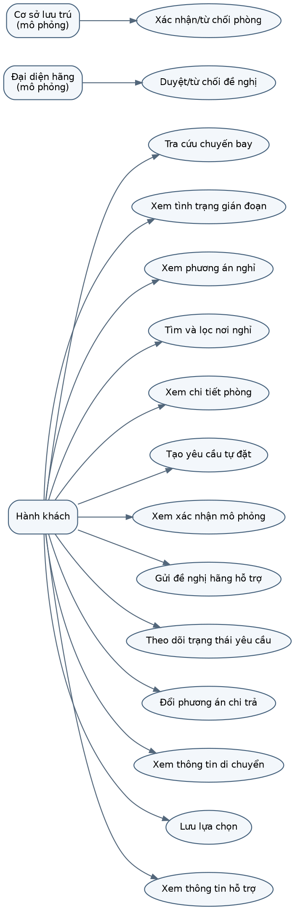

*Hình 4.1. Sơ đồ use case tổng quát*

*(Nguồn: Hồ sơ B04 của nhóm)*

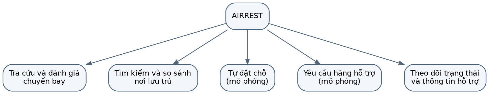

*Hình 4.2. Sơ đồ phân rã chức năng BFD*

*(Nguồn: Hồ sơ B04 của nhóm)*

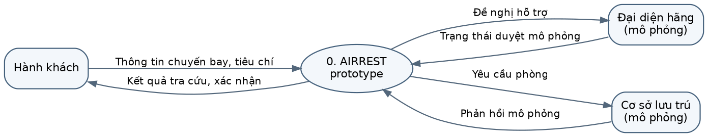

*Hình 4.3. DFD ngữ cảnh*

*(Nguồn: Hồ sơ B04 của nhóm)*

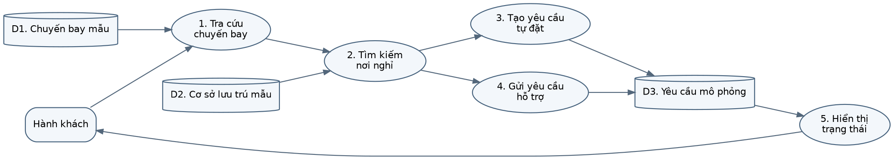

*Hình 4.4. DFD mức 0*

*(Nguồn: Hồ sơ B04 của nhóm)*

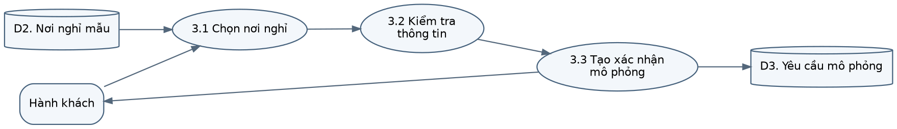

*Hình 4.5. DFD mức 1 - luồng tự đặt*

*(Nguồn: Hồ sơ B04 của nhóm)*

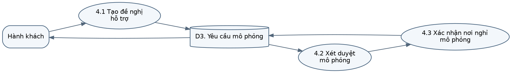

*Hình 4.6. DFD mức 1 - luồng hãng hỗ trợ*

*(Nguồn: Hồ sơ B04 của nhóm)*

### 4.3.1. Luồng theo vai trò và cấu trúc trang

Các sơ đồ chuyển yêu cầu thành luồng thao tác và cấu trúc trang. Luồng hành khách, đối tác khách sạn và quản trị hệ thống đã được phân định rõ rệt:
- **Hành khách vãng lai:** Không yêu cầu đăng nhập, thực hiện toàn bộ luồng tra cứu, đặt phòng và quản lý đơn qua định danh đơn hàng (Mã booking + Số điện thoại).
- **Hành khách có tài khoản:** Đăng nhập bằng Username, quản lý danh sách các đơn đã đặt qua nhiều lần sử dụng.
- **Nhân sự khách sạn:** Đăng nhập tài khoản được cấp, chỉ truy cập và thao tác trên dữ liệu thuộc quyền sở hữu của khách sạn mình (`hotelId` gắn trong JWT), thực hiện xác nhận/từ chối đơn, cập nhật số phòng, đóng/mở phòng bảo trì và điều phối xe.
- **Nhân sự quản trị hệ thống:** Đăng nhập tài khoản phân quyền theo vai trò (OPS, SUPPORT, FINANCE, SYSADMIN), thực hiện các tác vụ giám sát, điều phối, đối soát thanh toán và quản trị hạ tầng.

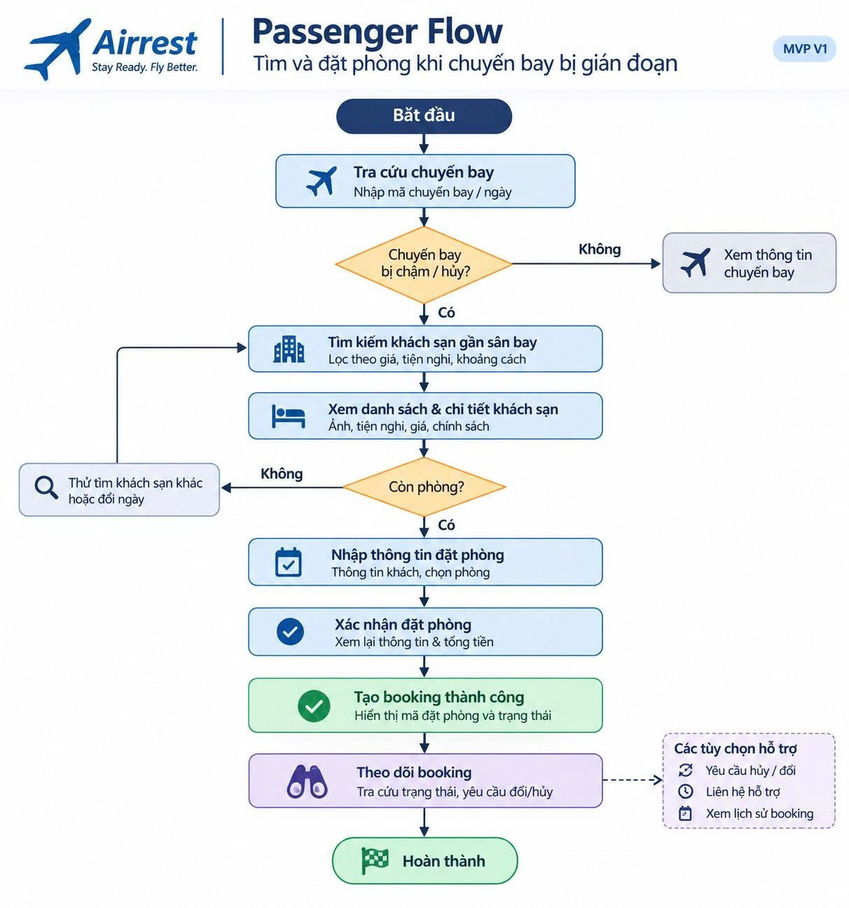

*Hình 4.7. Luồng nghiệp vụ hành khách của hệ thống AIRREST*

*(Nguồn: Nhóm tác giả xây dựng từ kết quả phân tích nghiệp vụ, tháng 11/2026)*

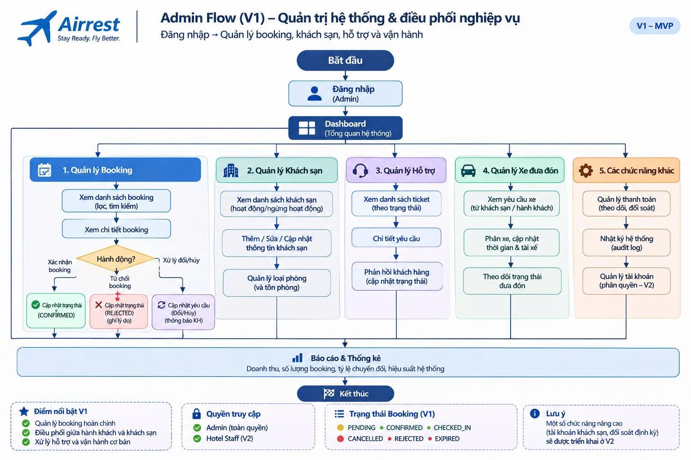

*Hình 4.8. Luồng quản trị và điều phối nghiệp vụ AIRREST*

*(Nguồn: Nhóm tác giả xây dựng từ kết quả phân tích nghiệp vụ, tháng 11/2026)*

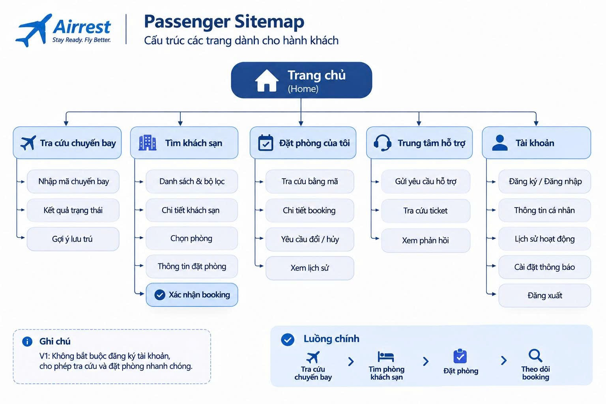

*Hình 4.9. Sơ đồ trang dành cho hành khách*

*(Nguồn: Nhóm tác giả xây dựng từ kết quả phân tích nghiệp vụ, tháng 11/2026)*

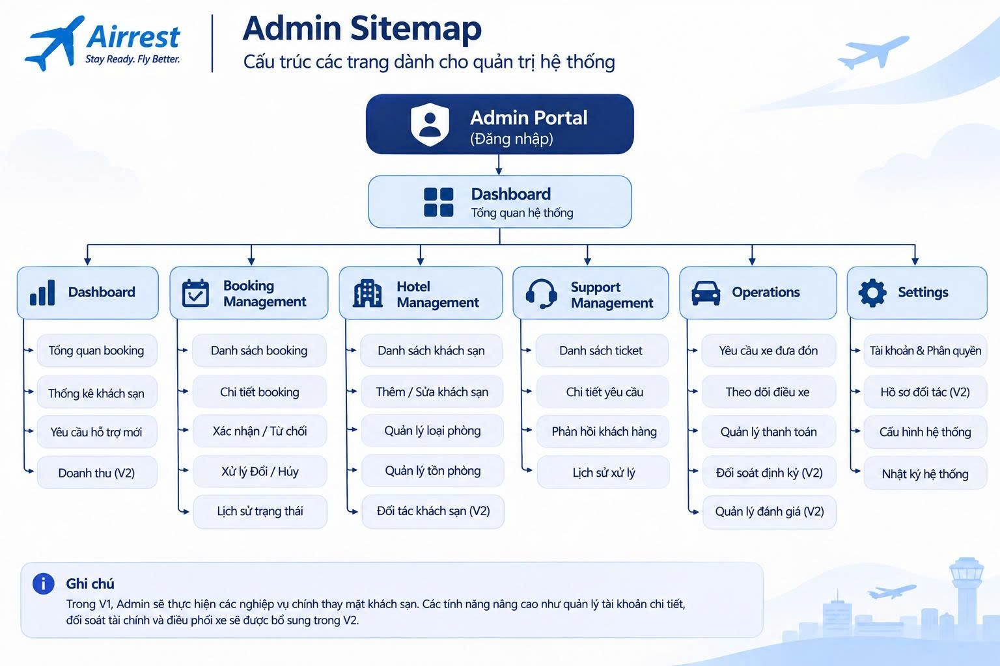

*Hình 4.10. Sơ đồ trang quản trị hệ thống*

*(Nguồn: Nhóm tác giả xây dựng từ kết quả phân tích nghiệp vụ, tháng 11/2026)*

Trong V1, hành khách có thể tra cứu và tạo booking mà không bắt buộc đăng ký. Quản trị viên thực hiện các nghiệp vụ chính thay cho tài khoản khách sạn. Các chức năng đối soát định kỳ, hồ sơ đối tác và quản lý đánh giá được đánh dấu cho V2, phù hợp với lộ trình ở Chương 5.

## 4.4. Danh mục 15 use case

Hệ thống kế thừa danh mục 15 ca sử dụng chuẩn mực, bao quát toàn bộ các tương tác giữa người dùng và hệ thống.

*Bảng 4.5. Danh mục use case của AIRREST*

| Mã | Tên Use Case | Tác nhân chính | Mục tiêu nghiệp vụ |
|---|---|---|---|
| **UC01** | Tra cứu và theo dõi chuyến bay | Hành khách, Nguồn dữ liệu chuyến bay | Nắm bắt trạng thái chuyến bay, giờ bay mới và thời gian gián đoạn |
| **UC02** | Xem quyền lợi bồi thường theo tình huống | Hành khách | Hiểu rõ quyền lợi ăn, ở, bồi thường theo quy định pháp lý |
| **UC03** | Nhận gợi ý phương án ở lại hoặc đi nghỉ | Hành khách | Ra quyết định rời sân bay hay ở lại dựa trên thời gian nghỉ thực tế |
| **UC04** | Tìm kiếm và lọc nơi nghỉ nhận khách | Hành khách | Tìm khách sạn còn phòng, gần sân bay và đáp ứng nhu cầu khẩn cấp |
| **UC05** | Xem chi tiết nơi nghỉ và loại phòng | Hành khách | Nắm rõ tiện ích, hình ảnh, đơn giá và chính sách nhận/trả phòng |
| **UC06** | Đặt phòng lưu trú khẩn cấp | Hành khách, Cơ sở lưu trú | Đặt phòng nhanh chóng không cần đăng ký tài khoản phức tạp |
| **UC07** | Nhắc giờ quay lại sân bay và xuất lịch | Hành khách | Bảo đảm có mặt tại sân bay đúng giờ khởi hành mới |
| **UC08** | Tra cứu tiện ích dịch vụ tại nhà ga | Hành khách | Tìm kiếm chỗ nghỉ tạm, dịch vụ ăn uống khi chọn ở lại sân bay |
| **UC09** | Quản lý và lưu trữ chứng từ lưu trú | Hành khách | Lưu mã booking, hóa đơn phục vụ yêu cầu hãng bồi hoàn sau này |
| **UC10** | Liên hệ và gửi ticket hỗ trợ | Hành khách, Nhân viên CSKH | Được giải đáp thắc mắc và hướng dẫn xử lý gián đoạn |
| **UC11** | Gửi đề nghị hỗ trợ lưu trú | Hành khách, Hãng hàng không | Đề xuất hãng hỗ trợ chi phí lưu trú theo quy định |
| **UC12** | Xem xét duyệt/từ chối hỗ trợ của hãng | Hãng hàng không, Quản trị viên | Phê duyệt hoặc từ chối hỗ trợ kèm lý do cụ thể |
| **UC13** | Cơ sở xác nhận hoặc từ chối tiếp nhận phòng | Cơ sở lưu trú | Quản lý năng lực đón tiếp, tránh tình trạng khách đến không có phòng |
| **UC14** | Chuyển đổi linh hoạt sang tự chi trả | Hành khách | Chủ động đặt phòng ngay khi hãng chậm trễ phản hồi hoặc từ chối |
| **UC15** | Cập nhật hệ thống khi lịch bay thay đổi | Nguồn chuyến bay, Quản trị viên | Tự động tính toán lại thời gian lưu trú và cảnh báo cho hành khách |

## 4.5. Tác nhân và đặc tả use case trọng tâm

Theo cách trình bày của một báo cáo hệ thống, danh mục use case được giữ gọn ở Bảng 4.5; chỉ bốn cụm use case quyết định trải nghiệm và trạng thái nghiệp vụ được đặc tả sâu. Các tác nhân ngoài hệ thống đều là mô phỏng trong V1.

AIRREST tuân thủ nguyên tắc tối thiểu hóa dữ liệu: luồng khách vãng lai chỉ thu thập thông tin liên hệ tối thiểu (họ tên, số điện thoại E.164) để phục vụ định danh đơn phòng và tài xế đón tiếp. Dữ liệu này được mã hóa cấp trường (AES-256-GCM) trước khi lưu trữ. Đăng ký tài khoản hành khách chỉ yêu cầu Username và Mật khẩu, không yêu cầu giấy tờ cá nhân hay thẻ tín dụng.

*Bảng 4.6. Tác nhân và vai trò trong hệ thống*

| Tác nhân | Phân loại | Vai trò và trách nhiệm trong hệ thống | Ca sử dụng liên quan |
|---|---|---|---|
| **Hành khách (Passenger)** | Tác nhân chính (Không bắt buộc đăng nhập / Có tài khoản) | Tra cứu thông tin, ra quyết định lưu trú, đặt phòng, thanh toán, gửi yêu cầu hỗ trợ và quản lý đơn đặt phòng. | UC01 → UC11, UC14 |
| **Nhân sự khách sạn (`hotel_owner`, Lễ tân)** | Tác nhân chính nội bộ (Bắt buộc đăng nhập xác thực JWT) | Tiếp nhận và duyệt đơn đặt phòng của khách sạn, chỉ định khách sạn thay thế, quản lý danh mục phòng và tồn kho, đón tiếp khách. | UC06, UC13 |
| **Quản trị viên hệ thống (OPS, SUPPORT, FINANCE, SYSADMIN)** | Tác nhân chính nội bộ (Bắt buộc đăng nhập xác thực JWT) | Quản trị đối tác khách sạn, hỗ trợ khách hàng, đối soát tài chính, cấu hình hệ thống, kiểm soát an toàn và truy vết thao tác. | Hỗ trợ UC10 → UC15 |
| **Hãng hàng không (Airlines)** | Tác nhân ngoài hệ thống (Mô phỏng trong phiên bản hiện tại) | Xem xét hồ sơ bồi thường, duyệt hoặc từ chối chi trả chi phí hỗ trợ lưu trú cho hành khách. | UC11, UC12 |
| **Nguồn dữ liệu chuyến bay** | Tác nhân ngoài hệ thống (Mô phỏng có seed trong CSDL) | Cung cấp thông tin lịch bay, giờ dự kiến cất cánh mới và các thông báo hủy chuyến. | UC01, UC15 |

*Bảng 4.7. Đặc tả các use case trọng tâm*

| Thuộc tính đặc tả | UC01: Tra cứu chuyến bay & Quét vé | UC06: Đặt phòng lưu trú khẩn cấp | UC13: Khách sạn duyệt/từ chối phòng | UC15: Cập nhật khi giờ bay thay đổi |
|---|---|---|---|---|
| **Tác nhân chính** | Hành khách hàng không | Hành khách, Cơ sở lưu trú | Nhân sự cơ sở lưu trú | Nguồn chuyến bay, Quản trị viên |
| **Tiền điều kiện** | Có kết nối mạng; có mã chuyến bay hoặc vé máy bay | Đã chọn khách sạn và loại phòng; phòng còn trống | Đơn đặt phòng ở trạng thái `AWAITING_APPROVAL` | Chuyến bay tồn tại trong hệ thống |
| **Kích hoạt (Trigger)** | Khách nhập mã bay hoặc quét mã BCBP | Khách bấm "Xác nhận đặt phòng" | Khách sạn mở danh sách đơn chờ duyệt | Quản trị viên cập nhật giờ bay mới hoặc có sự kiện radar |
| **Luồng sự kiện chính** | 1. Khách nhập mã (hoặc quét barcode qua camera). 2. Hệ thống gọi `GET /v1/flights/:code`. 3. Hiển thị thẻ trạng thái, giờ cũ/mới, quyền lợi pháp lý và khuyến nghị ở lại/đi nghỉ. | 1. Khách điền tên, SĐT, chọn phương thức thanh toán. 2. Hệ thống sinh Idempotency-Key, gọi `POST /v1/bookings`. 3. Backend chạy transaction, khóa hàng tồn phòng, tạo đơn `PENDING_PAYMENT` hoặc `AWAITING_APPROVAL`. 4. Trả về mã booking `AR-XXXXXXXX` và link thanh toán. | 1. Khách sạn xem thông tin đơn đặt phòng và giờ khách đến. 2. Chọn Xác nhận (`CONFIRMED`) hoặc Từ chối (`REJECTED`). 3. Nếu từ chối: nhập lý do bắt buộc và chọn tối đa 3 khách sạn thay thế. 4. Backend cập nhật `booking_decisions`, bắn Socket.IO thông báo cho khách. | 1. Nhận thông tin giờ cất cánh mới. 2. Ghi nhật ký vào bảng `flight_changes`. 3. Cập nhật bảng `flights`. 4. Kích hoạt tính toán lại khoảng thời gian lưu trú và gửi cảnh báo tới hành khách có liên quan. |
| **Ngoại lệ & Xử lý lỗi** | Không tìm thấy chuyến bay: báo lỗi 404 thân thiện, gợi ý khách tự chọn sân bay đến và giờ bay. | Hết phòng trong lúc đặt (Race Condition): transaction rollback, báo lỗi hết phòng và đề xuất phòng/khách sạn khác. | Quá hạn duyệt (`approvalExpireMin`): hệ thống tự động quét và chuyển trạng thái đơn sang `EXPIRED`. | Giờ bay mới bị đẩy sớm hơn: cảnh báo khẩn cấp hành khách trả phòng ngay lập tức. |
| **Hậu điều kiện** | Chuyến bay được lưu vào phiên để gợi ý khách sạn | Đơn được tạo trong CSDL; phòng được giữ chỗ an toàn | Trạng thái đơn được cập nhật; lý do từ chối được lưu vết | Lịch sử đổi giờ bay được lưu trữ phục vụ đối soát |
| **Truy vết** | FR-01, FR-02, FR-03, NFR-06 | FR-10, FR-11, FR-12, NFR-10 | FR-21, FR-22 | FR-03, FR-13, NFR-08 |

### 4.5.1. Mô hình dữ liệu logic và ràng buộc trạng thái

Mô hình dữ liệu logic của hệ thống AIRREST được hiện thực hóa trực tiếp trên cơ sở dữ liệu quan hệ **PostgreSQL 16+** thông qua 11 tập tin SQL migration có kiểm soát phiên bản, bao gồm 20 bảng quan hệ chặt chẽ. Hệ thống tuân thủ các chuẩn mực thiết kế cơ sở dữ liệu hiện đại:
- **Định danh duy nhất:** Mọi bảng đều sử dụng khóa chính dạng UUID ngẫu nhiên (`id uuid PRIMARY KEY DEFAULT gen_random_uuid()`) nhằm bảo đảm an toàn dữ liệu và chống dò quét ID tuần tự; đồng thời bổ sung cột số thứ tự tăng tự dần (`seq SERIAL UNIQUE`) để phục vụ kỹ thuật phân trang con trỏ (keyset/cursor pagination) hiệu năng cao.
- **Tiền tệ và thời gian:** Toàn bộ số tiền được lưu bằng kiểu số nguyên lớn `bigint` (đơn vị: Đồng Việt Nam - VND), loại bỏ triệt để sai số dấu phẩy động; toàn bộ mốc thời gian lưu bằng kiểu `timestamptz` (Timestamp with Time Zone), chuẩn hóa theo chuẩn ISO 8601 UTC.
- **Tính toán tồn phòng theo thời gian thực (Real-time Inventory):** Tồn phòng không lưu bằng một con số tĩnh dễ bị xung đột dữ liệu, mà được tính toán động dựa trên tổng số phòng của loại phòng trừ đi số lượng phòng đang được giữ chỗ trong các khoảng thời gian giao nhau (`room_reservations`) cộng với số phòng bị khóa bảo trì (`room_blocks`). Thuật toán quét đường (sweep-line algorithm) được áp dụng để xác định số lượng phòng đồng thời lớn nhất trong khoảng thời gian khách lưu trú.
- **Loại trừ Race Condition:** Khi tiếp nhận yêu cầu đặt phòng, backend khởi tạo một Database Transaction với mức độ cô lập nghiêm ngặt, thực hiện câu lệnh `SELECT ... FOR UPDATE` trên bản ghi loại phòng (`room_types`), kiểm tra khả năng đáp ứng rồi mới ghi nhận bản ghi giữ chỗ tạm thời (`room_reservations` trạng thái `HOLD` kèm hạn giờ `hold_expires_at`).
- **Cơ chế chống gửi trùng lặp (Idempotency):** Mọi thao tác ghi dữ liệu nhạy cảm (tạo booking, tạo yêu cầu đổi/hủy, gửi ticket hỗ trợ) đều bắt buộc phải có tiêu đề `Idempotency-Key`. Bảng `idempotency_keys` lưu vết cặp khóa kèm mã băm của nội dung request (`request_hash`), bảo đảm nếu client mạng chập chờn gửi lại cùng một request thì hệ thống trả về đúng kết quả cũ mà không tạo thêm bản ghi mới.

### 4.5.2. Mô hình dữ liệu mở rộng phục vụ vận hành

Với định hướng xây dựng một hệ thống website thay vì chỉ một luồng giao diện, mô hình dữ liệu được mở rộng từ các thực thể hành khách sang nhóm đối tác, điều phối, hỗ trợ và quản trị. 20 bảng cơ sở dữ liệu quan hệ được tổ chức thành 6 nhóm dữ liệu chính phục vụ vận hành:

*Bảng 4.8. Nhóm dữ liệu phục vụ hệ thống AIRREST*

| Nhóm dữ liệu | Tên bảng CSDL thực tế | Mục đích kỹ thuật và nghiệp vụ vận hành | Migration |
|---|---|---|---|
| **Cơ sở lưu trú & Phòng** | `hotels` | Lưu trữ hồ sơ đối tác khách sạn, tọa độ, địa chỉ, tiện ích, giờ nhận khách, album ảnh R2 | `001_init.sql`, `009_hotel_images.sql` |
| | `room_types` | Danh mục loại phòng (sức chứa, số giường, diện tích, đơn giá theo đêm `base_night_vnd`) | `001_init.sql`, `003_rooms.sql` |
| | `room_reservations` | Quản lý các khoảng thời gian giữ chỗ thực tế của từng đơn đặt phòng | `001_init.sql` |
| | `room_blocks` | Quản lý các khoảng thời gian khóa phòng/bảo trì do khách sạn thiết lập | `003_rooms.sql` |
| **Đặt phòng & Xử lý** | `bookings` | Quản lý vòng đời đơn đặt phòng, thông tin khách, tổng tiền, phương thức thanh toán | `001_init.sql`, `010_passenger_accounts.sql` |
| | `booking_decisions` | Lưu quyết định xác nhận hoặc từ chối của khách sạn, lý do từ chối và khách sạn thay thế | `004_booking_decisions.sql` |
| | `change_requests` | Quản lý yêu cầu đổi ngày lưu trú hoặc hủy phòng của hành khách kèm báo giá phạt/hoàn | `005_change_requests.sql` |
| **Thanh toán & Sổ cái** | `payments` | Giao dịch thanh toán cổng VNPay, mã giao dịch đối tác (`txn_ref`), trạng thái, số tiền | `001_init.sql`, `002_vnpay.sql` |
| | `refunds` | Quản lý các lệnh hoàn tiền qua cổng thanh toán VNPay | `001_init.sql`, `002_vnpay.sql` |
| | `ledger_entries` | Sổ cái kế toán chỉ thêm (Append-Only Ledger) phục vụ kiểm toán tài chính và đối soát | `001_init.sql` |
| **Hỗ trợ & Vận hành** | `support_tickets` | Quản lý các phiếu yêu cầu hỗ trợ khách hàng (mã `SP-XXXXXXXX`, trạng thái, mức ưu tiên) | `006_support.sql` |
| | `support_messages` | Luồng tin nhắn trao đổi hai chiều trong từng ticket hỗ trợ giữa khách và nhân viên | `006_support.sql` |
| | `shuttle_requests` | Quản lý yêu cầu xe đưa đón sân bay gắn liền với booking (giờ đón, điểm đón, cước phí) | `007_shuttle.sql` |
| **Chuyến bay & Lịch sử** | `flights` | Danh mục chuyến bay mô phỏng (số hiệu, chặng bay, giờ bay dự kiến, trạng thái trễ) | `008_flights.sql` |
| | `flight_changes` | Nhật ký lịch sử các lần thay đổi giờ bay hoặc hủy chuyến phục vụ đối soát pháp lý | `008_flights.sql` |
| **Xác thực & Quản trị** | `accounts` | Tài khoản người dùng (Nhân sự khách sạn, Lái xe, Quản trị viên, Hành khách) | `001_init.sql`, `010_passenger_accounts.sql` |
| | `roles` | Danh mục vai trò và tập hợp quyền hạn (4 vai trò hệ thống + vai trò tùy chỉnh) | `001_init.sql`, `011_custom_roles.sql` |
| | `system_configs` | Bảng tham số cấu hình hệ thống lưu trữ theo lịch sử phiên bản (`version`) | `001_init.sql` |
| | `audit_logs` | Nhật ký kiểm toán bất biến ghi vết mọi thao tác nhạy cảm của nhân sự | `001_init.sql` |
| | `idempotency_keys` | Quản lý khóa chống gửi trùng lặp các yêu cầu ghi dữ liệu nhạy cảm | `001_init.sql` |

## 4.6. Ma trận truy vết

Ma trận truy vết liên kết nguồn nhu cầu, yêu cầu FR/NFR, use case, thành phần mã nguồn và bằng chứng kiểm thử tự động. Quan hệ nhiều-nhiều được thể hiện rõ ràng: một phát hiện nhu cầu có thể sinh nhiều yêu cầu; một use case có thể đáp ứng nhiều yêu cầu; và một bộ kiểm thử kiểm chứng đồng thời cả tính đúng đắn chức năng lẫn các ràng buộc phi chức năng.

*Bảng 4.9. Trích ma trận truy vết yêu cầu*

| Nguồn nhu cầu | Yêu cầu FR/NFR | Use Case | Minh chứng thành phần mã nguồn | Minh chứng kiểm thử tự động |
|---|---|---|---|---|
| Hành khách cần biết giờ bay mới & quyền lợi | FR-01, FR-03, FR-04, NFR-06 | UC01, UC02, UC15 | `screens/user/Home.jsx`, `FlightStatusCard.jsx`, `GET /v1/flights/:code` | `flights.integration.test.ts` (11 tests) |
| Quét vé máy bay tự động không cần gõ tay | FR-02 | UC01 | `ScanTicket.jsx`, `apps/web/src/lib/bcbp.js` | `apps/web/src/lib/bcbp.test.js` (7 tests chuẩn IATA BCBP) |
| Tìm khách sạn khẩn cấp quanh 22 sân bay | FR-06, FR-07, FR-08, FR-10 | UC04, UC05 | `Home.jsx` (Stays), `GET /v1/airports`, `GET /v1/hotels` | `airports.test.ts`, `hotels.catalog.integration.test.ts`, `user.test.js` (4 tests) |
| Đặt phòng nhanh, không vượt tồn kho | FR-11, FR-12, FR-18, NFR-10 | UC06 | Modal đặt phòng tại `Home.jsx`, `POST /v1/bookings`, `sweepLine.ts` | `booking.integration.test.ts`, `rooms.integration.test.ts` |
| Khách sạn duyệt đơn, đề xuất phương án thay thế | FR-21, FR-22 | UC13 | `components/hotel/Bookings.jsx`, `POST /v1/hotel/bookings/:id/confirm|reject` | `booking-decisions.integration.test.ts`, `alternatives.integration.test.ts` |
| Tự động hủy phòng, đổi ngày kèm báo giá phạt | FR-15, FR-16 | UC14 | `BookingActions.jsx`, `/v1/change-requests/*`, `cancellation.ts` | `cancellation.unit.test.ts`, `changeRequests.integration.test.ts` |
| Đặt xe đưa đón sân bay liên kết booking | FR-17 | UC06 | `BookingActions.jsx`, `/v1/shuttle-requests/*`, `shuttle.ts` | `shuttle.unit.test.ts`, `shuttle.integration.test.ts` |
| Kênh gửi ticket hỗ trợ khách hàng | FR-16 | UC10 | `Support` trong `Pages.jsx`, `POST /v1/support`, `/v1/support/reply` | `support.integration.test.ts` (11 tests) |
| Trợ lý ảo tư vấn hỗ trợ chuyến bay và lưu trú | FR-20 | UC01, UC02, UC03 | `ChatBot.jsx`, `apps/web/src/screens/user/botEngine.js` | `apps/web/src/screens/user/botEngine.test.js` (11 tests kịch bản AI bot) |
| Đăng ký tài khoản khách không thu PII liên hệ | FR-19, NFR-05 | UC09 | `Account` trong `Pages.jsx`, `POST /v1/auth/passenger/*` | `passengers.integration.test.ts` (13 tests kiểm thử tài khoản BR-002) |
| Phân quyền chi tiết RBAC & Kiểm toán | FR-24, NFR-09 | Hỗ trợ UC10–15 | `screens/Admin.jsx`, `config/roles.ts`, `config/permissions.ts` | `adminRoles.integration.test.ts`, `foundations.integration.test.ts` |

## 4.7. Kết luận chương

Chương 4 đã thiết lập toàn diện khung phân tích yêu cầu nghiệp vụ và thiết kế kiến trúc hệ thống AIRREST. Điểm tiến bộ vượt bậc so với các đề xuất ban đầu là hệ thống không dừng lại ở mức mô hình khái niệm mà đã được cụ thể hóa thành 20 bảng cơ sở dữ liệu quan hệ PostgreSQL chuẩn hóa, 24 yêu cầu chức năng có khả năng truy nguyên trực tiếp tới các endpoint REST API, các component giao diện React và các bộ kiểm thử tích hợp tự động. Ranh giới giữa giao dịch thử nghiệm và giao dịch thật được phân định an toàn thông qua kiến trúc Dual-Mode tại các cổng thanh toán và dịch vụ ngoài, sẵn sàng đáp ứng yêu cầu chuyển đổi vận hành thực tế.

---

# CHƯƠNG 5 THIẾT KẾ, XÂY DỰNG VÀ KIỂM THỬ HỆ THỐNG WEBSITE AIRREST

## 5.1. Mục tiêu và phạm vi hiện thực

Mục tiêu trọng tâm của giai đoạn xây dựng hệ thống là chuyển hóa toàn bộ các đặc tả yêu cầu và mô hình thiết kế ở Chương 4 thành một sản phẩm phần mềm website hoạt động thực tế. Phiên bản hiện tại của AIRREST là một hệ thống monorepo hoàn chỉnh, bao gồm giao diện web ứng dụng đơn trang (SPA) đa cổng tương tác được xây dựng bằng React 18, Vite 6, Tailwind CSS v4, GSAP và kết nối trực tiếp với máy chủ dịch vụ Node.js 22, Express 5 và cơ sở dữ liệu quan hệ PostgreSQL.

*Bảng 5.1. Phạm vi kỹ thuật của prototype*

| Phân tầng kiến trúc | Thành phần hiện thực trong kho mã | Công nghệ & Phương thức xử lý | Đầu ra kỹ thuật |
|---|---|---|---|
| **Tầng Trình bày (Presentation Layer)** | `apps/web/src/screens/*`, `components/*`, `components/hotel/*`, `components/admin/*` | React 18.3.1, Tailwind CSS v4 (tiền tố `tw:`), GSAP, Lucide React, ZXing-WASM | Giao diện Single Page Application (SPA) responsive, 3 cổng tương tác độc lập |
| **Tầng Trạng thái giao diện (UI State Layer)** | `apps/web/src/state/store.jsx` | React Context API kết hợp `useReducer` quản lý trạng thái phiên, người dùng và điều hướng | Trạng thái ứng dụng nhất quán, token xác thực chỉ lưu trong bộ nhớ RAM an toàn |
| **Tầng Truy cập dữ liệu phía Client (Data Client Layer)** | `apps/web/src/data/*`, `packages/api-client`, `apps/web/src/lib/api.js` | Fetch API đóng gói qua SDK `@airrest/api-client`, tự động gắn `Idempotency-Key` | Gọi API RESTful `/v1/*` thật từ backend, tự động chuẩn hóa lỗi sang tiếng Việt |
| **Tầng Định tuyến & Kiểm soát API (API Layer)** | `backend/api/modules/*`, `backend/api/middleware/*` | Express 5.3.0, Zod schema validation, JWT auth, RBAC permissions, Rate limit, Helmet | Hệ thống REST API chuẩn hóa với hơn 40 endpoints, bảo vệ đa tầng |
| **Tầng Nghiệp vụ thuần (Domain Logic Layer)** | `packages/business-logic/src/*`, `backend/services/*` | TypeScript thuần túy: thuật toán sweep-line tính tồn phòng, công thức phạt hủy, định giá xe | Logic nghiệp vụ cốt lõi độc lập với framework, dễ dàng viết unit test |
| **Tầng Lưu trữ dữ liệu (Persistence Layer)** | `backend/database/*`, `backend/database/migrations/*.sql` | PostgreSQL 16+ (hỗ trợ Supabase Session Pooler), driver `pg` kết nối Pool | 20 bảng quan hệ, quản lý transaction với khóa hàng `SELECT ... FOR UPDATE` |
| **Tầng Thời gian thực (Realtime Layer)** | `backend/api/realtime/*`, `apps/web/src/screens/user/*` | Socket.IO 4.8.4, phân chia phòng theo vai trò (`admin`, `hotel:<id>`, `booking:<code>`) | Cập nhật tức thời trạng thái booking, cảnh báo đổi giờ bay và tin nhắn hỗ trợ |
| **Tầng Lưu trữ tệp đám mây (Cloud Storage Layer)** | `backend/lib/storage.ts` | AWS S3 Client SDK (`@aws-sdk/client-s3`), Cloudflare R2 | Cấp Presigned Upload URLs cho phép tải ảnh khách sạn trực tiếp lên bucket |
| **Tầng Đóng gói & Vận hành (DevOps Layer)** | `docker-compose.yml`, `render.yaml`, `backend/Dockerfile` | Docker đa tầng (Multi-stage build), Render Blueprint PaaS Infrastructure-as-Code | Môi trường phát triển và máy chủ triển khai tự động hóa hoàn toàn |

## 5.2. Hệ thống thiết kế và nguyên tắc giao diện

Hệ thống thiết kế (Design System) của AIRREST được xây dựng nhằm phục vụ đối tượng hành khách đang trong trạng thái căng thẳng do bị gián đoạn chuyến bay. Giao diện áp dụng bộ màu sắc nhận diện công nghệ cao: màu xanh thương hiệu chủ đạo `#062253` (Deep Navy) tạo cảm giác an tâm, tin cậy; màu xanh hành động `#1262E8` (Electric Blue) kích thích tương tác; màu xanh lá `#09875C` biểu thị trạng thái thành công, xác nhận; màu hổ phách `#F3A712` biểu thị cảnh báo chậm chuyến; và màu đỏ tươi `#D64545` biểu thị hủy chuyến hoặc báo lỗi. Bán kính bo góc thẻ dao động từ 12px đến 28px kết hợp hai cấp độ đổ bóng mềm mại mang lại cảm giác thân thiện, hiện đại.

*Bảng 5.2. Quy ước của hệ thống thiết kế*

| Quy ước thiết kế | Cách thức áp dụng trong mã nguồn | Mục tiêu trải nghiệm người dùng (UX) |
|---|---|---|
| **Phân cấp thị giác rõ rệt** | Sử dụng kết hợp nhãn kicker chữ in hoa, tiêu đề đậm, thẻ thông số lớn và ghi chú mờ | Giúp người dùng quét nhanh các thông tin quan trọng nhất trong vòng 3 giây |
| **Màu sắc trạng thái nhất quán** | Màu sắc phản ánh chính xác tình trạng: Xanh lá (Đúng giờ/Đã duyệt), Vàng (Chậm/Chờ duyệt), Đỏ (Hủy/Từ chối) | Loại bỏ sự mơ hồ, phân tách rạch ròi giữa hành động của người dùng và kết quả của hệ thống |
| **Cấu trúc thẻ lặp lại (Modular Cards)** | Thẻ trạng thái chuyến bay, thẻ khách sạn và thẻ loại phòng có bố cục cấu trúc nhất quán | Giảm tải nhận thức, giúp việc so sánh giữa các lựa chọn lưu trú trở nên trực quan |
| **Minh bạch nhãn dữ liệu** | Gắn nhãn mốc thời gian cập nhật "as of", nêu rõ chính sách nhận phòng đêm và điều kiện hủy | Tránh gây hiểu nhầm hoặc tạo ra kỳ vọng sai lệch cho hành khách |
| **Bố cục thích ứng (Responsive Grid)** | Hệ thống lưới tự động chuyển đổi từ 3 cột (Desktop) sang 2 cột (Tablet) và 1 cột (Mobile) | Bảo đảm toàn vẹn thứ tự ưu tiên nội dung và khả năng thao tác một tay trên điện thoại |
| **Vi tương tác mượt mà (Micro-interactions)** | Áp dụng GSAP cho các hiệu ứng trượt mở modal, chuyển tab, thông báo trạng thái | Mang lại cảm giác mượt mà, phản hồi tức thì với mọi cử chỉ chạm của người dùng |
| **Tôn trọng tùy chọn giảm chuyển động** | Tích hợp truy vấn media `prefers-reduced-motion` trong mã hiệu ứng GSAP | Bảo đảm khả năng tiếp cận cho người dùng nhạy cảm với chuyển động |

### 5.2.1. Quy trình thiết kế UI/UX

Quy trình thiết kế giao diện AIRREST trải qua 4 giai đoạn chặt chẽ:
1. **Nghiên cứu hành vi người dùng:** Phân tích ma trận tâm lý hành khách khi gặp sự cố tại sân bay (mệt mỏi, hoang mang, vội vã) để loại bỏ mọi rào cản không cần thiết.
2. **Xây dựng khung dây (Wireframing):** Thiết lập cấu trúc luồng thao tác tối giản: Trang chủ → Tra cứu chuyến bay → Chọn khách sạn → Đặt phòng 3 bước → Nhận mã xác nhận.
3. **Chuẩn hóa Design Tokens:** Khai báo bảng màu, độ dốc, khoảng cách và kiểu chữ thông qua cấu hình CSS tùy biến và Tailwind CSS v4.
4. **Hiện thực hóa thành mã nguồn:** Chuyển đổi thiết kế thành các component React tái sử dụng, tối ưu hóa kích thước bundle và kiểm thử giao diện trên nhiều thiết bị thực tế.

### 5.2.2. Wireframe và bố cục màn hình

Hệ thống bố cục được chia thành hai nhóm chính:
- **Khung giao diện người dùng cuối (`UserSite.jsx`):** Thiết kế dạng không gian phẳng rộng mở, sử dụng thanh điều hướng trên cùng cố định (Sticky Header), thanh tìm kiếm nổi bật và khu vực danh sách thẻ khách sạn rộng rãi. Trên thiết bị di động, thanh menu được chuyển thành ngăn kéo trượt (Mobile Drawer) dễ thao tác.
- **Khung giao diện cổng nhân sự (`Layout.jsx`):** Áp dụng mô hình thanh điều hướng bên (Sidebar Navigation) kết hợp thanh đường dẫn (Breadcrumb) và khu vực nội dung chính hiển thị các bảng dữ liệu quản trị, biểu đồ và form biểu mẫu phức tạp.

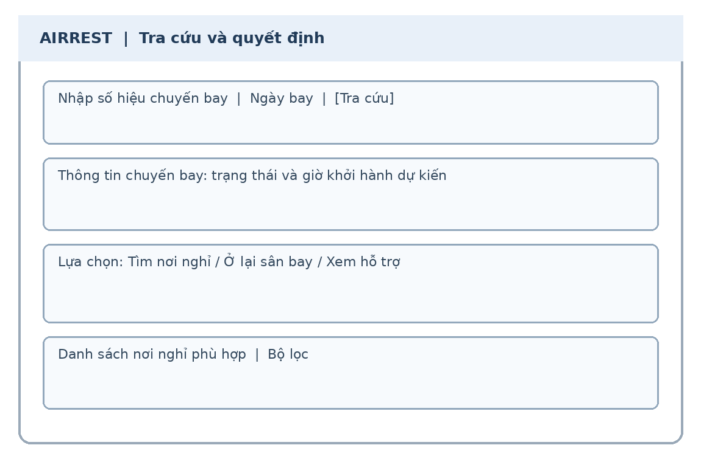

*Hình 5.1. Wireframe khái quát màn hình tra cứu và hỗ trợ quyết định (tái dựng)*

*(Nguồn: Nhóm tác giả xây dựng từ hồ sơ thiết kế, tháng 11/2026)*

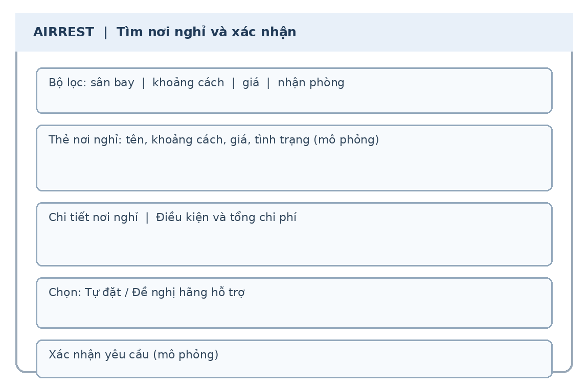

*Hình 5.2. Wireframe khái quát màn hình tìm nơi nghỉ và xác nhận (tái dựng)*

*(Nguồn: Nhóm tác giả xây dựng từ hồ sơ thiết kế, tháng 11/2026)*

### 5.2.3. Nguyên tắc thiết kế giao diện

Mọi thành phần giao diện của AIRREST đều tuân thủ 3 nguyên tắc bất biến:
1. **Ưu tiên thông tin khẩn cấp:** Luôn đặt trạng thái chuyến bay, số giờ trễ, khoảng cách tới sân bay và số phòng còn trống ở vị trí mắt dễ nhìn thấy nhất.
2. **Không áp đặt thao tác rườm rà:** Luồng đặt phòng cốt lõi không bắt buộc người dùng phải đăng ký tài khoản hay kích hoạt email phức tạp.
3. **Phòng ngừa lỗi người dùng:** Mọi thao tác hủy phòng, đổi ngày hay từ chối đơn đều có hộp thoại cảnh báo và yêu cầu xác nhận lần hai trước khi thực thi.

## 5.3. Công nghệ và công cụ sử dụng

Công nghệ của AIRREST được lựa chọn và chuẩn hóa theo tiêu chuẩn công nghiệp hiện đại, bao quát toàn diện cả ba tầng kiến trúc Frontend, Backend và Cơ sở dữ liệu:

*Bảng 5.3. Công nghệ và công cụ của AIRREST*

| Nhóm công nghệ | Tên công nghệ / Thư viện | Phiên bản | Vai trò trong hệ thống | Hiện trạng áp dụng |
|---|---|---|---|---|
| **Frontend Framework** | React | 18.3.1 | Xây dựng giao diện ứng dụng đơn trang (SPA) | Đang hoạt động (`apps/web`) |
| | React DOM | 18.3.1 | Kết nối React với Document Object Model trình duyệt | Đang hoạt động |
| **Công cụ Build** | Vite | 6.0.5 | Development server và đóng gói sản phẩm tĩnh | Đang hoạt động |
| **Styling & Icons** | Tailwind CSS | 4.3.5 | Utility-first CSS framework thế hệ mới | Đang hoạt động (tiền tố `tw:`) |
| | GSAP & @gsap/react | 3.15.1 / 2.1.2 | Xử lý hoạt họa, chuyển cảnh và vi tương tác | Đang hoạt động |
| | Lucide React | 0.468.0 | Hệ thống biểu tượng vector chuẩn hóa | Đang hoạt động |
| **Quét mã vạch vé máy bay** | ZXing-WASM | 3.1.6 | Giải mã mã vạch thẻ lên máy bay chuẩn IATA BCBP | Đang hoạt động (`ScanTicket.jsx`) |
| **Backend Runtime & API** | Node.js | ≥ 22.9 | Nền tảng thực thi JavaScript/TypeScript phía server | Đang hoạt động (`backend`) |
| | TypeScript | 7.0.2 | Ngôn ngữ kiểu tĩnh cho toàn bộ backend & packages | Đang hoạt động |
| | Express | 5.3.0 | Framework xây dựng REST API | Đang hoạt động |
| **Cơ sở dữ liệu** | PostgreSQL (Supabase) | 16+ | Hệ quản trị cơ sở dữ liệu quan hệ (20 bảng) | Đang hoạt động |
| | pg (node-postgres) | 8.23.1 | Kết nối cơ sở dữ liệu và quản lý connection pool | Đang hoạt động |
| **Kiểm tra dữ liệu** | Zod | 3.25.76 | Kiểm tra tính hợp lệ dữ liệu ở cả client và server | Đang hoạt động |
| **Bảo mật & Phân quyền** | jsonwebtoken | 9.0.3 | Quản lý token xác thực JWT (HS256) | Đang hoạt động |
| | Node.js scrypt | Chuẩn | Thuật toán băm mật khẩu bảo mật | Đang hoạt động |
| | Node.js AES-256-GCM | Chuẩn | Mã hóa cấp trường cho dữ liệu cá nhân nhạy cảm | Đang hoạt động (`lib/crypto.ts`) |
| | helmet & express-rate-limit | 8.3.0 / 8.7.4 | Bảo vệ tiêu đề HTTP và chống brute-force | Đang hoạt động |
| **Thời gian thực** | Socket.IO / Client | 4.8.4 | Truyền thông WebSocket hai chiều thời gian thực | Đang hoạt động |
| **Lưu trữ đám mây** | AWS S3 Client SDK | 3.1166.0 | Tích hợp Cloudflare R2 lưu trữ album ảnh | Đang hoạt động (`lib/storage.ts`) |
| **Thanh toán trực tuyến** | VNPay SDK | Tự phát triển | Tích hợp cổng thanh toán VNPay (Dual mode mock/live) | Đang hoạt động (`lib/vnpay.ts`) |
| **Kiểm thử tự động** | Vitest | 5.1.0 | Khung kiểm thử đơn vị và tích hợp | Đang hoạt động (31 test suites) |
| | Supertest | 7.3.2 | Kiểm thử tích hợp HTTP API | Đang hoạt động |
| | embedded-postgres | 18.6.0 | Kiểm thử cơ sở dữ liệu nhúng tự động | Đang hoạt động |
| **Tài liệu API** | OpenAPI 3.0 / Swagger UI | 5.0.1 | Tài liệu hóa tương tác API trực tiếp tại `/docs` | Đang hoạt động |
| **Đóng gói & Triển khai** | Docker & Compose | Chuẩn | Đóng gói container môi trường đa dịch vụ | Đang hoạt động |
| | Render Blueprint | YAML | Triển khai hạ tầng đám mây tự động | Đang hoạt động |

### 5.3.1. Frontend React và Vite

Mã nguồn frontend trong `apps/web` được xây dựng theo kiến trúc hiện đại, tách biệt hoàn toàn giữa giao diện người dùng và lớp dịch vụ. Thư viện Tailwind CSS phiên bản 4 được tích hợp trực tiếp qua `@tailwindcss/vite`, sử dụng tiền tố `tw:` để cách ly hoàn toàn kiểu dáng mới với các định dạng cũ. Các hiệu ứng chuyển cảnh của modal, thẻ thông tin và danh sách khách sạn được điều khiển bằng GSAP, bảo đảm tốc độ 60 khung hình/giây. 

Đặc biệt, tính năng quét mã thẻ lên máy bay được hiện thực bằng thư viện WebAssembly `zxing-wasm`, cho phép trình duyệt trực tiếp bóc tách dữ liệu từ luồng video camera mà không cần gửi hình ảnh lên máy chủ, tối ưu hóa băng thông và bảo vệ sự riêng tư của hành khách.

### 5.3.2. Dịch vụ mô phỏng và hợp đồng API

Frontend AIRREST kết nối trực tiếp với backend thông qua gói thư viện `@airrest/api-client` và module `apps/web/src/lib/api.js`. Địa chỉ máy chủ backend được cấu hình linh hoạt thông qua biến môi trường `VITE_API_BASE_URL`. Nếu biến môi trường bị thiếu, ứng dụng sẽ kích hoạt màn hình cảnh báo lỗi cấu hình fail-fast (`ConfigError.jsx`) ngay lập tức để ngăn chặn các lời gọi API sai lệch. 

Hợp đồng dữ liệu giữa máy khách và máy chủ được định nghĩa chặt chẽ bằng Zod schema tại `packages/validation`, bảo đảm tính tương thích kiểu dữ liệu hai chiều. Mọi phản hồi lỗi từ backend đều được ánh xạ qua lớp chuyển đổi ngôn ngữ tiếng Việt `describeApiError`, giúp người dùng nhận được các thông báo rõ ràng, dễ hiểu.

### 5.3.3. Bản đồ, thông báo và lịch

Hệ thống tích hợp các tiện ích tương tác phong phú hỗ trợ hành khách:
- **Định vị & Bản đồ lưu trú:** Thẻ khách sạn hiển thị trực quan khoảng cách địa lý (km) và thời gian di chuyển bằng taxi (phút) tới nhà ga sân bay thông qua dữ liệu tọa độ lưu trong `hotels.airports`.
- **Giải mã thẻ lên máy bay:** Module `lib/bcbp.js` phân tích chuỗi dữ liệu theo định dạng chuẩn IATA Resolution 792, trích xuất chính xác mã hãng hàng không (2 ký tự), số hiệu chuyến bay (tối đa 5 chữ số), và ngày bay định dạng Julian (3 chữ số) để tự động chuyển thành ngày dương lịch.
- **Xuất lịch cá nhân:** Module `lib/ics.js` tạo tệp lịch theo chuẩn RFC 5545 iCalendar (`.ics`), chứa thông tin đặt phòng, địa chỉ khách sạn và các mốc giờ cảnh báo ra sân bay để hành khách đồng bộ vào Google Calendar hoặc Apple Calendar.
- **Kênh thông báo thời gian thực:** Kết nối Socket.IO tự động lắng nghe các sự kiện đổi trạng thái booking và thông báo cho hành khách bằng hệ thống thông báo Toast nổi trên màn hình mà không cần tải lại trang.

## 5.4. Kiến trúc hệ thống

Hệ thống AIRREST được thiết kế theo mô hình **Kiến trúc phân tầng hướng dịch vụ (Layered Architecture)** kết hợp với cơ chế Monorepo, bảo đảm tính độc lập giữa các thành phần và khả năng mở rộng trong tương lai.

*Bảng 5.4. Các lớp kiến trúc AIRREST*

| Tầng kiến trúc | Thành phần thực thi | Trách nhiệm và vai trò | Công nghệ nền tảng |
|---|---|---|---|
| **Presentation (Trình bày)** | `apps/web/src/screens/*`, `components/*` | Hiển thị giao diện người dùng, tiếp nhận cử chỉ chạm/nhấp chuột, điều hướng màn hình | React 18, Tailwind v4, GSAP |
| **UI State (Trạng thái FE)** | `apps/web/src/state/store.jsx` | Quản lý trạng thái phiên, người dùng, giỏ hàng, thông báo toast | React Context API, useReducer |
| **API Client (Cầu nối FE-BE)** | `apps/web/src/data/*`, `packages/api-client` | Đóng gói HTTP requests, quản lý token bộ nhớ, sinh Idempotency-Key | Fetch API, TypeScript SDK |
| **API & Middleware (Cổng vào BE)** | `backend/api/modules/*`, `backend/api/middleware/*` | Định tuyến RESTful, xác thực JWT, phân quyền RBAC, kiểm tra schema Zod, rate limit | Express 5, Zod, Helmet |
| **Domain Services (Nghiệp vụ)** | `backend/services/*`, `packages/business-logic` | Thuật toán sweep-line tính tồn phòng, định giá xe, tính phí hủy/đổi, kiểm toán | TypeScript thuần |
| **Persistence (Dữ liệu bền vững)** | `backend/database/*`, 11 migration SQL | Quản lý kết nối PostgreSQL Pool, thực thi truy vấn an toàn, khóa hàng giao dịch | PostgreSQL, pg driver |
| **Realtime (Truyền thông tức thời)** | `backend/api/realtime/*` | Quản lý kết nối WebSocket, phát sự kiện theo phòng quyền hạn | Socket.IO 4 |
| **External Integration (Tích hợp ngoài)** | `backend/lib/vnpay.ts`, `lib/storage.ts` | Giao tiếp với cổng thanh toán VNPay và dịch vụ lưu trữ Cloudflare R2 | S3 SDK, HMAC-SHA512 |

### 5.4.1. Luồng xử lý một yêu cầu

Luồng xử lý một yêu cầu đặt phòng điển hình (`POST /v1/bookings`) minh chứng cho tính chặt chẽ của kiến trúc phân tầng:
1. **Khởi tạo tại Client:** Hành khách điền form đặt phòng. Trình duyệt gọi SDK `@airrest/api-client`, tự động sinh một mã định danh duy nhất `Idempotency-Key` (UUID v4) đính kèm vào HTTP Header.
2. **Tiếp nhận & Kiểm tra tại Middleware:** Request đi tới máy chủ Express 5. Middleware `rateLimit` kiểm tra tần suất gọi; middleware `idempotency` tra cứu bảng `idempotency_keys` xem request này đã được xử lý thành công trước đó chưa (nếu có, trả về ngay kết quả đã lưu trong đĩa); middleware `validate` dùng schema Zod đối soát tính hợp lệ của dữ liệu đầu vào.
3. **Thực thi nghiệp vụ trong Database Transaction:** Service `bookings.service.ts` mở một Transaction trong PostgreSQL:
   - Thực thi câu lệnh `SELECT ... FOR UPDATE` trên bảng `room_types` để khóa dòng loại phòng đang xét, loại trừ hiện tượng hai khách đặt cùng một lúc gây bán vượt tồn (race condition).
   - Gọi thuật toán `remainingRooms` trong `packages/business-logic` để tính toán số phòng trống đồng thời theo phương pháp sweep-line.
   - Nếu đủ phòng: Ghi bản ghi vào bảng `bookings` (trạng thái `PENDING_PAYMENT` hoặc `AWAITING_APPROVAL`); tạo bản ghi giữ chỗ tạm thời trong `room_reservations` với trạng thái `HOLD` kèm hạn giờ giữ chỗ (`holdExpiresAt`); ghi nhật ký kiểm toán vào bảng `audit_logs`.
   - Nếu khách chọn thanh toán VNPay: Module `lib/vnpay.ts` tạo URL thanh toán có chữ ký bảo mật HMAC-SHA512 trả về cho client.
4. **Phát sự kiện thời gian thực:** Socket.IO phát sự kiện `booking:created` vào phòng riêng của khách sạn tương ứng (`hotel:<hotelId>`) để chuông báo đơn mới reo ngay trên màn hình lễ tân khách sạn.
5. **Xác nhận thanh toán ngầm (Webhook IPN):** Khi khách thanh toán trên cổng VNPay, máy chủ VNPay gọi webhook ngầm tới `/v1/payments/vnpay/ipn`. Backend kiểm tra chữ ký bí mật, cập nhật đơn sang `AWAITING_APPROVAL` hoặc `CONFIRMED`, ghi nhận giao dịch vào sổ cái tài chính `ledger_entries` và bắn thông báo thành công tới trình duyệt khách qua WebSocket.

### 5.4.2. Mô hình triển khai

Hệ thống được đóng gói hoàn chỉnh bằng Docker và sẵn sàng triển khai trên nền tảng đám mây:
- **Môi trường phát triển nội bộ:** File `docker-compose.yml` định nghĩa 3 dịch vụ liên kết chặt chẽ: `api` (cổng 3000), `web` (cổng 5174), và `db` (PostgreSQL 16, cổng 5432). Lệnh `npm run dev:db` tự động khởi chạy cơ sở dữ liệu và nạp dữ liệu mẫu seed đầy đủ.
- **Môi trường sản xuất (Production Deployment):** File `render.yaml` cấu hình tự động hạ tầng trên Render PaaS, bao gồm:
  - Một dịch vụ `web-service` chạy Backend Node.js/Express kết nối cơ sở dữ liệu Supabase qua giao thức an toàn SSL.
  - Một dịch vụ `static-site` đóng gói bản build tĩnh của Frontend React/Vite.
  - Quản lý cấu hình tập trung theo triết lý Fail-Fast: module `backend/config/env.ts` sử dụng Zod schema để kiểm tra tính đầy đủ của toàn bộ biến môi trường (`JWT_SECRET`, `DATA_ENC_KEY`, `DATABASE_URL`, v.v.) ngay khi tiến trình khởi động; nếu thiếu bất kỳ biến nào, server sẽ dừng ngay lập tức và in lỗi rõ ràng thay vì chạy chập chờn.

## 5.5. Các phân hệ chức năng

*Bảng 5.5. Phạm vi chức năng theo phân hệ*

| Phân hệ chức năng | Chức năng chi tiết đã hiện thực | Mức độ hiện thực | Thành phần kỹ thuật chứng minh |
|---|---|---|---|
| **1. Cổng Hành khách** | Tra cứu chuyến bay, quét mã vé BCBP, xem quyền lợi pháp lý, lọc khách sạn 22 sân bay, đặt phòng 3 bước | Hoàn thành 100% | `screens/user/Home.jsx`, `Pages.jsx`, `ScanTicket.jsx`, `packages/api-client` |
| **2. Quản lý Đơn & Hủy/Đổi** | Tra cứu đơn bằng Mã + SĐT, báo giá phạt hủy tự động, đổi ngày lưu trú, đặt xe đưa đón, xuất lịch .ics | Hoàn thành 100% | `Track` trong `Pages.jsx`, `BookingActions.jsx`, `/v1/change-requests/*`, `/v1/shuttle-requests/*` |
| **3. Tài khoản Hành khách** | Đăng ký/đăng nhập bằng Username (không thu PII), đổi mật khẩu, xem lịch sử đơn đặt phòng phân trang | Hoàn thành 100% | `Account` trong `Pages.jsx`, `/v1/auth/passenger/*`, `010_passenger_accounts.sql` |
| **4. Trợ lý ảo AI** | Chatbot tư vấn kịch bản tự động, giải đáp chính sách đền bù và hướng dẫn xử lý gián đoạn | Hoàn thành 100% | `ChatBot.jsx`, `botEngine.js`, `botEngine.test.js` |
| **5. Cổng Khách sạn đối tác** | Bảng điều khiển Overview, duyệt/từ chối đơn kèm lý do & khách sạn thay thế, Check-in/Check-out, quản lý phòng | Hoàn thành 100% | `screens/Hotel.jsx`, `components/hotel/*`, `/v1/hotel/*` |
| **6. Quản lý Tồn kho & Khóa phòng** | Kiểm soát tồn phòng sweep-line theo ngày/giờ, thiết lập các khối khóa phòng bảo trì (`room_blocks`) | Hoàn thành 100% | `components/hotel/Inventory.jsx`, `/v1/hotel/room-blocks`, `sweepLine.ts` |
| **7. Quản lý Hồ sơ & Album ảnh R2** | Cập nhật thông tin khách sạn, tải ảnh trực tiếp lên Cloudflare R2 qua Presigned URL S3 API | Hoàn thành 100% | `components/hotel/Profile.jsx`, `/v1/hotel/media`, `009_hotel_images.sql` |
| **8. Cổng Quản trị hệ thống** | Dashboard số liệu GMV, duyệt/tạm ngưng khách sạn, cơ chế bốn mắt đổi tài khoản nhận tiền, quản lý chuyến bay | Hoàn thành 100% | `screens/Admin.jsx`, `components/admin/*`, `/v1/admin/*` |
| **9. Phân quyền RBAC & Kiểm toán** | 4 vai trò hệ thống (OPS, SUPPORT, FINANCE, SYSADMIN) + vai trò tùy chỉnh, 21 quyền hạn, Audit log bất biến | Hoàn thành 100% | `components/admin/Roles.jsx`, `Audit.jsx`, `config/permissions.ts`, `011_custom_roles.sql` |
| **10. Thanh toán & Sổ cái tài chính** | Cổng thanh toán VNPay (Dual mode mock/live), xử lý IPN webhook, hoàn tiền, sổ cái tài chính `ledger_entries` | Hoàn thành 100% | `components/admin/Payments.jsx`, `/v1/payments/*`, `lib/vnpay.ts` |

## 5.6. Trạng thái nghiệp vụ và dữ liệu

Trạng thái được xem là thành phần cốt lõi của hệ thống. Một yêu cầu không được hiển thị là “đã có phòng” chỉ vì hành khách đã gửi biểu mẫu. Luồng phân biệt rõ ràng: `PENDING_PAYMENT`, `AWAITING_APPROVAL`, `CONFIRMED`, `REJECTED`, `CANCELLED`, `COMPLETED`, `EXPIRED`. Mỗi lần chuyển trạng thái đều được thực hiện trong Database Transaction và ghi nhận thời điểm, tác nhân, lý do.

*Bảng 5.6. Quy tắc dữ liệu khi chuyển sang backend*

| Quy tắc dữ liệu | Yêu cầu kỹ thuật | Cách thức hiện thực hóa trong mã nguồn và CSDL |
|---|---|---|
| **Khóa chính & Định danh** | Khóa duy nhất, bảo mật, hỗ trợ phân trang hiệu năng cao | Khóa chính UUID v4 ngẫu nhiên kết hợp chỉ mục phân trang con trỏ `seq SERIAL UNIQUE`; ràng buộc `UNIQUE(code, flight_date)` chống trùng chuyến bay. |
| **Tính nguyên tử & Chống bán vượt tồn** | Cập nhật tồn phòng và đơn đặt nguyên tử (Atomic), loại trừ race condition | Giao dịch PostgreSQL với khóa dòng `SELECT ... FOR UPDATE` trên bảng `room_types`; kiểm tra tồn bằng thuật toán sweep-line trước khi ghi nhận giữ chỗ. |
| **Tính bất biến của dữ liệu tài chính** | Sổ cái tài chính chỉ thêm, không bao giờ sửa hoặc xóa dữ liệu cũ | Bảng `ledger_entries` và `audit_logs` chỉ chấp nhận thao tác `INSERT`, nghiêm cấm `UPDATE` và `DELETE`; mọi điều chỉnh tiền bạc đều ghi bản ghi bù trừ. |
| **Bảo vệ quyền riêng tư & Dữ liệu nhạy cảm** | Mã hóa dữ liệu định danh cá nhân (PII), kiểm soát quyền truy cập chặt chẽ | Mã hóa cấp trường AES-256-GCM các trường họ tên và số điện thoại qua `lib/crypto.ts`; log Pino tự động che dấu thông tin nhạy cảm; phân quyền RBAC theo `hotelId`. |
| **Chống gửi trùng lặp (Idempotency)** | Bảo đảm an toàn khi mạng chập chờn client gửi lại request nhiều lần | Bắt buộc tiêu đề `Idempotency-Key`; lưu vết mã băm request trong bảng `idempotency_keys` với thời gian hết hạn an toàn. |

## 5.7. Hiện thực luồng hành khách

Cổng hành khách cho phép duyệt nơi nghỉ mà không cần tài khoản. Khi cần tính thời gian nghỉ, nhắc giờ hoặc đặt phòng khẩn cấp, người dùng nhập số hiệu/ngày bay hoặc quét thẻ lên máy bay tự động.

### 5.7.1. Tìm, lọc và đặt nơi nghỉ

Hành khách tiếp cận danh sách khách sạn được phân bổ quanh 22 sân bay thương mại Việt Nam. Giao diện cung cấp các công cụ lọc mạnh mẽ theo khoảng cách (3km, 5km, 7km), xe đưa đón, tắm nước nóng, hủy miễn phí, lễ tân 24/24, thuê theo giờ và phòng gia đình. Khi hành khách bấm đặt phòng, modal 3 bước xuất hiện:
- Bước 1: Chọn ngày nhận và ngày trả phòng (tự động tính thời gian lưu trú tối ưu theo giờ bay mới), hiển thị số phòng còn lại thực tế.
- Bước 2: Nhập họ tên và số điện thoại (tự động chuẩn hóa theo định dạng quốc tế E.164).
- Bước 3: Lựa chọn hình thức thanh toán tại khách sạn (`AT_HOTEL`) hoặc thanh toán trực tuyến qua VNPay (`VNPAY`). Khi bấm xác nhận, hệ thống gửi request kèm `Idempotency-Key` tới máy chủ, thực hiện khóa tồn phòng và trả về mã booking `AR-XXXXXXXX` ngay lập tức.

### 5.7.2. Đề nghị hãng hỗ trợ

Quy trình hỗ trợ hành khách và quản trị đơn đặt phòng được khép kín giữa các bên:
- **Đề nghị hãng hỗ trợ & Duyệt đơn:** Luồng đề nghị hỗ trợ cho phép hành khách gửi thông tin gián đoạn để yêu cầu hỗ trợ. Phản hồi từ hãng hàng không hiện được thực hiện theo kịch bản hỗ trợ ra quyết định. Đối với cơ sở lưu trú, việc duyệt hoặc từ chối phòng là hoàn toàn có thật ở backend (`booking_decisions`) với thời hạn duyệt tự động (`approvalExpireMin`). Khi hết phòng, khách sạn có thể chỉ định tối đa 3 khách sạn thay thế lân cận (`alternatives`).
- **Hủy đặt phòng:** Hệ thống gọi API `/v1/change-requests/quote` để tính toán số tiền phạt và số tiền hoàn lại theo chính sách thời gian (áp dụng thuật toán trong `cancellation.ts`); hành khách xác nhận thì hệ thống tạo yêu cầu hủy phòng gửi tới khách sạn.
- **Đổi ngày lưu trú:** Hệ thống tính toán chênh lệch giá phòng mới, cho phép hành khách gửi yêu cầu đổi ngày.
- **Đặt xe đưa đón sân bay:** Hệ thống cung cấp bảng giá cố định theo cự ly sân bay, cho phép hành khách chọn chiều Đón hoặc Tiễn và ghi nhận yêu cầu vào bảng `shuttle_requests`.

### 5.7.3. Nhắc giờ quay lại sân bay

- Hệ thống tự động tính toán giờ rời nơi nghỉ an toàn dựa trên công thức: Giờ bay mới trừ thời gian làm thủ tục hàng không (90 phút) trừ thời gian di chuyển bằng taxi và 30 phút đệm an toàn.
- Hành khách có thể bấm nút "Xuất lịch cá nhân" để tải tệp `.ics` đồng bộ vào điện thoại.
- Trợ lý ảo Chatbot luôn thường trực ở góc màn hình, sẵn sàng giải đáp các thắc mắc về quyền lợi đền bù theo luật định hoặc hỗ trợ chỉ đường đến nhà ga.

## 5.8. Hiện thực phân hệ đối tác và quản trị

### 5.8.1. Cổng đối tác khách sạn

Cổng khách sạn được bảo vệ nghiêm ngặt bằng JWT; nhân sự đăng nhập chỉ xem và thao tác trên các bản ghi có `hotel_id` trùng khớp với tài khoản của mình:
- **Tab Đơn đặt phòng (`Bookings.jsx`):** Hiển thị danh sách đơn đến theo thời gian thực (nhờ Socket.IO). Khách sạn có thể bấm **Xác nhận (Confirm)** hoặc **Từ chối (Reject)**. Khi từ chối, khách sạn bắt buộc phải chọn lý do (Hết phòng, Giá sai, Đóng cửa bảo trì) và có thể chọn tối đa 3 khách sạn thay thế lân cận (`alternatives`) để hỗ trợ hành khách. Ngoài ra, tab còn hỗ trợ thao tác Check-in, Check-out và đánh dấu khách không đến (No-Show).
- **Tab Quản lý phòng (`Rooms.jsx` & `Inventory.jsx`):** Cho phép tạo mới và chỉnh sửa các loại phòng (`room_types`), thiết lập đơn giá theo đêm (`baseNightVnd`). Công cụ kiểm soát tồn phòng cho phép thiết lập các khối khóa phòng bảo trì (`room_blocks`) theo từng ngày hoặc khoảng thời gian bất kỳ.
- **Tab Hồ sơ & Album ảnh R2 (`Profile.jsx`):** Cập nhật địa chỉ, số điện thoại lễ tân, chính sách đón tiếp và tải ảnh chất lượng cao trực tiếp lên Cloudflare R2 thông qua URL ký trước (Presigned URL).
- **Tab Yêu cầu đổi/hủy & Xe đưa đón (`Changes.jsx` & `Shuttle.jsx`):** Phê duyệt các yêu cầu thay đổi lịch trình và phân bổ tài xế đón khách tại sân bay.

### 5.8.2. Cổng quản trị hệ thống

Cổng quản trị dành riêng cho đội ngũ vận hành trung tâm với 9 tab chức năng chuyên biệt:
- **Dashboard:** Thống kê tổng quan doanh thu toàn sàn (GMV), tổng số lượt đặt phòng, tỷ lệ hủy phòng và số lượng khách sạn đang hoạt động.
- **Khách sạn đối tác (`Hotels.jsx`):** Danh sách khách sạn toàn quốc, công cụ duyệt khách sạn mới tham gia sàn, tạm ngưng hợp tác, điều chỉnh tỷ lệ chiết khấu hoa hồng; đặc biệt tích hợp quy trình **kiểm soát bốn mắt (Four-Eyes Principle)**: khi khách sạn đề xuất thay đổi tài khoản ngân hàng nhận tiền, yêu cầu phải được một quản trị viên khác có quyền `admin:hotel:approve-sensitive` phê duyệt mới có hiệu lực.
- **Tài khoản nhân sự (`Accounts.jsx`):** Quản trị danh sách nhân viên nội bộ, phân quyền vai trò.
- **Vai trò & Quyền hạn (`Roles.jsx`):** Quản lý 4 vai trò hệ thống (`OPS`, `SUPPORT`, `FINANCE`, `SYSADMIN`) và khởi tạo các vai trò tùy chỉnh (`custom_roles`) với 21 quyền hạn chi tiết trong danh mục `PERM`.
- **Cấu hình hệ thống có phiên bản (`Configs.jsx`):** Cho phép chỉnh sửa các tham số nghiệp vụ toàn sàn (`refund`, `bookingHold`, `shuttlePricing`, `flightRules`) trực tiếp trên giao diện; mỗi lần sửa đổi đều sinh một phiên bản mới (`version`) và ghi vết tác nhân thay đổi.
- **Giám sát chuyến bay (`Flights.jsx`):** Theo dõi lịch trình bay, cho phép tiêm sự kiện thay đổi giờ bay (delay) hoặc hủy chuyến để kiểm thử phản ứng dây chuyền của hệ thống.
- **Thanh toán & Sổ cái (`Payments.jsx`):** Giám sát các giao dịch qua cổng VNPay, đối soát mã giao dịch ngân hàng, theo dõi lệnh hoàn tiền và kiểm tra tính toàn vẹn của sổ cái tài chính `ledger_entries`.
- **Hỗ trợ khách hàng (`Support.jsx`):** Điều phối và phân công nhân viên xử lý các ticket khiếu nại của hành khách trên toàn quốc.
- **Nhật ký kiểm toán (`Audit.jsx`):** Tra cứu dòng lịch sử kiểm toán bất biến (`audit_logs`), ghi nhận rõ địa chỉ IP, User-Agent, thời điểm, hành động và nội dung sai khác (Diff) của mọi thao tác quản trị.

## 5.9. Xác thực, phân quyền và bảo vệ dữ liệu

Hệ thống bảo mật của AIRREST được thiết kế theo tiêu chuẩn an ninh đa tầng chuyên sâu:
1. **Xác thực nhân sự:** Sử dụng mã thông báo JWT (JSON Web Token) ký bằng thuật toán HS256 với khóa bí mật `JWT_SECRET`. Mật khẩu được băm bằng thuật toán Scrypt với muối ngẫu nhiên (Salt). Token chỉ được lưu trữ trong bộ nhớ RAM của ứng dụng (`apps/web/src/lib/api.js`), tuyệt đối không lưu vào `localStorage` hay `sessionStorage` để triệt tiêu hoàn toàn nguy cơ bị đánh cắp qua tấn công XSS.
2. **Xác thực hành khách:** Tuân thủ triệt để nguyên tắc BR-002: Tài khoản hành khách (`PASSENGER`) đăng ký và đăng nhập chỉ bằng Tên đăng nhập (Username) và Mật khẩu, không yêu cầu cung cấp email hoặc số điện thoại làm định danh tài khoản. Đơn đặt phòng có thể gắn linh hoạt vào tài khoản hành khách hoặc thực hiện dưới dạng khách vãng lai.
3. **Phân quyền dựa trên quyền hạn (Permission-based RBAC):** Hệ thống không kiểm tra cứng theo tên vai trò mà kiểm tra theo danh mục 21 quyền hạn chi tiết (`PERM`). Mọi yêu cầu gọi tới API nội bộ đều được kiểm tra qua middleware `requirePermission`. Tài khoản khách sạn luôn bị khóa chặt trong phạm vi `hotelId` của mình qua middleware `hotelScope`.
4. **Mã hóa dữ liệu cá nhân nhạy cảm (PII Encryption):** Module `backend/lib/crypto.ts` sử dụng thuật toán mã hóa đối xứng AES-256-GCM với khóa bí mật `DATA_ENC_KEY` để mã hóa họ tên và số điện thoại hành khách trước khi ghi vào cơ sở dữ liệu. Khi truy vấn phục vụ hiển thị, dữ liệu mới được giải mã trong bộ nhớ.
5. **Bảo vệ mạng và chống lạm dụng:** Sử dụng thư viện `helmet` thiết lập các tiêu đề HTTP bảo mật cao (HSTS, CSP, X-Frame-Options); áp dụng `express-rate-limit` để giới hạn tần suất gọi API, ngăn chặn các cuộc tấn công dò quét mật khẩu (Brute-force) và từ chối dịch vụ (DoS).

## 5.10. Responsive và khả năng tiếp cận

Giao diện website AIRREST được tối ưu hóa toàn diện cho trải nghiệm trên thiết bị di động (Mobile-First):
- **Bố cục co giãn:** Hệ thống breakpoint linh hoạt của Tailwind CSS v4 bảo đảm các lưới thông tin tự động thu gọn về 1 cột trên màn hình điện thoại, các nút bấm có chiều cao tối thiểu 44px bảo đảm diện tích chạm ngón tay thoải mái.
- **Ngăn kéo điều hướng:** Trên màn hình nhỏ hơn 768px, thanh menu chuyển thành ngăn kéo trượt (Drawer) tiện lợi, có nút đóng rõ ràng và lớp nền mờ chặn tương tác nền.
- **Tiêu chuẩn tiếp cận (A11y):** Mã nguồn tuân thủ nghiêm ngặt các quy tắc ngữ nghĩa HTML5, cung cấp đầy đủ thuộc tính `aria-label`, `role="dialog"`, `aria-modal="true"`, các trường nhập liệu đều có nhãn `<label>` tường minh, và toàn bộ hình ảnh đều có thuộc tính `alt` mô tả nội dung.

## 5.11. Chiến lược kiểm thử

Chiến lược kiểm thử của AIRREST được triển khai theo mô hình kim tự tháp kiểm thử tự động với công cụ chính là **Vitest 5.1.0** kết hợp **Supertest 7.3.2** và **embedded-postgres 18.6.0**:

*Bảng 5.7. Bằng chứng hiện có và khoảng trống kiểm thử*

| Nhóm kiểm thử & Đóng gói | Căn cứ mã nguồn & Kịch bản kiểm thử | Công cụ thực thi | Kết quả thực nghiệm trong kho mã |
|---|---|---|---|
| **Kiểm tra kiểu tĩnh (Typecheck)** | Toàn bộ mã nguồn TypeScript của backend và packages | TypeScript Compiler (`tsc --noEmit`) | **100% PASS (0 errors)**; bảo đảm cấu trúc kiểu dữ liệu toàn diện và tính tương thích giữa các packages. |
| **Kiểm thử đơn vị Frontend (FE Unit)** | 3 test suites: view model dữ liệu khách sạn (`apps/web/src/data/user.test.js`), giải mã vé máy bay chuẩn IATA (`apps/web/src/lib/bcbp.test.js`), kịch bản AI Chatbot (`apps/web/src/screens/user/botEngine.test.js`) | Vitest | **100% PASS (22 tests)** thực thi thành công trong 145ms. |
| **Kiểm thử đơn vị Backend (BE Unit)** | Thuật toán tính phí phạt hủy phòng (`cancellation.unit.test.ts`), thuật toán định giá xe đưa đón (`shuttle.unit.test.ts`), thuật toán sweep-line tính tồn phòng (`unit.test.ts`) | Vitest | **100% PASS (33 tests)** thực thi độc lập cực nhanh dưới 15ms. |
| **Kiểm thử HTTP Middleware** | Kiểm thử xác thực JWT, xử lý mã hóa crypto AES-256-GCM, băm mật khẩu Scrypt, xử lý lỗi Zod, kiểm tra storage Cloudflare R2, danh mục sân bay (`http.test.ts`, `storage.test.ts`, `airports.test.ts`) | Vitest + Supertest | **100% PASS (40 tests)**; bảo đảm tính toàn vẹn của lớp phòng thủ ngoài cùng của API. |
| **Kiểm thử tích hợp CSDL (DB Integration Tests)** | 18 test files: `booking`, `booking-decisions`, `booking-expiry`, `alternatives`, `changeRequests`, `rooms`, `room-blocks`, `shuttle`, `support`, `flights`, `adminRoles`, `dashboard`, `passengers`, `payments` | Vitest + Embedded-Postgres 18.6 | **100% PASS (166 test cases)** chạy trong 24.54s; bao quát toàn bộ các luồng giao dịch, khóa hàng `SELECT ... FOR UPDATE`, sweep-line, và 11 migration SQL. |
| **Kiểm thử luồng tích hợp E2E (End-to-End)** | Luồng đặt phòng hoàn chỉnh từ tra cứu → chọn phòng → giữ chỗ → thanh toán VNPay → duyệt đơn (`e2e.booking-flow.integration.test.ts`) | Vitest + Supertest | **100% PASS (1 test suite)**; kiểm chứng tính trơn tru của chuỗi nghiệp vụ xuyên suốt các phân hệ. |
| **Đóng gói sản phẩm tĩnh (Web Build)** | Toàn bộ ứng dụng giao diện React 18, Tailwind CSS v4, GSAP, WebAssembly ZXing | Vite 6 (`npm run build:web`) | **100% SUCCESS trong 2.15s**: `dist/index.html` (1.64 kB), WASM reader (946.86 kB), CSS (94.05 kB), JS (486.14 kB). |
| **Tổng kết số liệu kiểm thử** | Toàn bộ 31 test suites (28 backend + 3 frontend web) | `npm run test:db -w @airrest/backend`, `npx vitest run apps/web` | **Tổng cộng 262 test cases (100% PASS, 0 failed, 0 skipped)** khi chạy đầy đủ chu trình kiểm thử tự động. |

## 5.12. Giới hạn của bản hiện thực

Dù đã đạt được bước tiến lớn khi hoàn thiện toàn bộ kiến trúc fullstack và kết nối API thật, hệ thống AIRREST vẫn có những giới hạn thực tế cần được nhìn nhận thẳng thắn:
1. **Dữ liệu chuyến bay:** Hiện tại dữ liệu chuyến bay vẫn là dữ liệu mẫu (seed) và kịch bản can thiệp mô phỏng; hệ thống chưa có kết nối API thời gian thực với các nhà cung cấp dữ liệu radar hàng không thương mại (FlightRadar24/FlightAware) do rào cản chi phí bản quyền B2B.
2. **Cổng thanh toán VNPay:** Thanh toán trực tuyến đang vận hành ở chế độ thử nghiệm (`VNPAY_MODE=mock` hoặc sandbox), chưa phát sinh dòng tiền thực tế qua tài khoản ngân hàng doanh nghiệp.
3. **Phản hồi của hãng hàng không:** Quy trình hãng hàng không phê duyệt voucher hỗ trợ lưu trú vẫn là kịch bản mô phỏng hỗ trợ quyết định; chưa có cổng API kết nối trực tiếp vào hệ thống quản trị hành khách (PSS) của các hãng bay nội địa.
4. **Kiểm thử tự động giao diện (UI E2E):** Giao diện frontend hiện mới được kiểm chứng thông qua bộ ảnh chụp thủ công đa thiết bị trong `reports/ui_implementation/` và các bài kiểm tra logic component; hệ thống chưa thiết lập kịch bản tự động hóa trình duyệt hoàn chỉnh (Playwright/Cypress).

## 5.13. Lộ trình hoàn thiện hệ thống

Để đưa AIRREST từ môi trường nghiên cứu tốt nghiệp sang giai đoạn thương mại hóa thực tế, lộ trình hoàn thiện tiếp theo được xác định theo 5 giai đoạn:
1. **Giai đoạn 1 - Tự động hóa kiểm thử giao diện & Tối ưu hiệu năng:** Bổ sung bộ kịch bản kiểm thử E2E giao diện bằng Playwright; chạy kiểm toán hiệu năng Lighthouse và tối ưu chỉ số Web Vitals trên mạng 3G/4G; thực hiện kiểm toán khả năng tiếp cận WCAG 2.2 với người dùng khiếm thị sử dụng Screen Reader.
2. **Giai đoạn 2 - Kết nối nguồn dữ liệu chuyến bay thương mại:** Ký kết thỏa thuận thử nghiệm dữ liệu với Cục Hàng không hoặc tích hợp API đối tác dữ liệu chuyến bay (AviationStack/OAG) để tự động cập nhật lịch bay thực tế tại các sân bay Việt Nam.
3. **Giai đoạn 3 - Thương mại hóa cổng thanh toán & Đối soát:** Ký kết hợp đồng đơn vị chấp nhận thanh toán (Merchant) với VNPay; chuyển cấu hình sang `VNPAY_MODE=live`; hoàn thiện quy trình đối soát tự động hàng ngày giữa sổ cái `ledger_entries` và bảng sao kê ngân hàng.
4. **Giai đoạn 4 - Thử nghiệm thực địa (Pilot Run) tại Nội Bài:** Triển khai thử nghiệm thực tế với 10 cơ sở lưu trú đối tác tại khu vực Sóc Sơn quanh sân bay Nội Bài (HAN); đo lường tỷ lệ chuyển đổi và thời gian hành khách tiếp cận phòng nghỉ sau sự cố.
5. **Giai đoạn 5 - Phát triển ứng dụng di động bản địa (Native Mobile App):** Khởi động dự án `apps/mobile` sử dụng React Native hoặc Flutter, tận dụng lại toàn bộ các thư viện dùng chung trong `packages/*` và hệ thống REST API hiện có.
