# Phân tích hệ thống AIRREST — công nghệ, sơ đồ hoạt động, kiến trúc, sơ đồ lớp và thiết kế dữ liệu

> Tài liệu phân tích mã nguồn `Airrest_website` theo khung của một đồ án tốt nghiệp: Chương I (cơ sở lý thuyết và công cụ) và Chương II các mục 2.5–2.8 (sơ đồ hoạt động, kiến trúc, sơ đồ lớp, thiết kế dữ liệu).
>
> - **Ngày lập:** 05/11/2026.
> - **Nguồn:** mã nguồn trong thư mục này (`package.json`, `src/**`), tài liệu `docs/MVP.md`, `docs/srs/**`, `reports/ui_implementation/IMPLEMENTATION_REPORT.md`.
> - **Nguyên tắc:** chỉ mô tả những gì **đang có trong mã**; riêng Chương I có thêm các công nghệ, công cụ **dự kiến** cho backend (Node.js, MongoDB, Socket, Postman, Docker Desktop), luôn gắn nhãn "dự kiến". Airrest hiện là **prototype frontend**, mọi dữ liệu là **mô phỏng** và chỉ nằm trong bộ nhớ trang. Phần nào ngoài MVP hoặc chưa được Product Owner (PO) duyệt đều được ghi rõ.
> - **Sơ đồ:** vẽ bằng Mermaid, xem được trên GitHub, GitLab, VS Code (tiện ích Markdown Preview Mermaid) hoặc dán vào <https://mermaid.live> để xuất ảnh PNG/SVG.

## Mục lục

- [Tổng quan đề tài](#tổng-quan-đề-tài)
- [CHƯƠNG I: CƠ SỞ LÝ THUYẾT VÀ CÔNG CỤ SỬ DỤNG](#chương-i-cơ-sở-lý-thuyết-và-công-cụ-sử-dụng)
  - [Bảng tổng hợp công nghệ và công cụ](#chương-i-cơ-sở-lý-thuyết-và-công-cụ-sử-dụng)
  - [1.1. Kiến thức cơ bản](#11-kiến-thức-cơ-bản)
  - [1.2. Tổng quan về Client-Server và vị trí của AIRREST](#12-tổng-quan-về-client-server-và-vị-trí-của-airrest)
  - [1.3. Tổng quan về Node.js](#13-tổng-quan-về-nodejs)
  - [1.4. Tổng quan về ReactJS](#14-tổng-quan-về-reactjs)
  - [1.5. Tổng quan về Vite](#15-tổng-quan-về-vite)
  - [1.6. Tổng quan về RESTful API và lớp dịch vụ mô phỏng](#16-tổng-quan-về-restful-api-và-lớp-dịch-vụ-mô-phỏng)
  - [1.7. Tổng quan về Socket (WebSocket, Socket.IO)](#17-tổng-quan-về-socket-websocket-socketio)
  - [1.8. Tổng quan về MongoDB](#18-tổng-quan-về-mongodb)
  - [1.9. Tổng quan về OpenStreetMap và Leaflet](#19-tổng-quan-về-openstreetmap-và-leaflet)
  - [1.10. Các chuẩn và API trình duyệt khác](#110-các-chuẩn-và-api-trình-duyệt-khác)
  - [1.11. Công cụ sử dụng](#111-công-cụ-sử-dụng)
- [CHƯƠNG II: PHÂN TÍCH VÀ THIẾT KẾ HỆ THỐNG (2.5–2.8)](#chương-ii-phân-tích-và-thiết-kế-hệ-thống-2528)
  - [2.5. Sơ đồ hoạt động](#25-sơ-đồ-hoạt-động)
  - [2.6. Kiến trúc hệ thống](#26-kiến-trúc-hệ-thống)
  - [2.7. Sơ đồ lớp](#27-sơ-đồ-lớp)
  - [2.8. Thiết kế dữ liệu](#28-thiết-kế-dữ-liệu)
- [Phụ lục: giới hạn của tài liệu](#phụ-lục-giới-hạn-của-tài-liệu)

---

## Tổng quan đề tài

**AIRREST** là website hỗ trợ hành khách tìm nơi nghỉ khi chuyến bay nội địa bị chậm hoặc huỷ, tập trung quanh hai sân bay **Nội Bài (HAN)** và **Tân Sơn Nhất (SGN)**.

| Nhóm người dùng | Mô tả | Thuộc MVP? |
|---|---|---|
| **Người dùng cuối (hành khách)** | Tra cứu chuyến bay, xem quyền lợi tham khảo, nhận gợi ý ở lại hay đi nghỉ, tìm và đặt nơi nghỉ mô phỏng, nhắc giờ quay lại sân bay, gửi đề nghị hãng hỗ trợ. Không cần tài khoản. | Có |
| **Người dùng cuối có tài khoản** | Đăng ký/đăng nhập mô phỏng bằng tên gọi và mật khẩu; tên gọi tự điền khi đặt chỗ. | **Không** (MB-16 đã loại; quyết định D-30 chờ PO) |
| **Khách sạn**: chủ/quản lý, nhân viên, lái xe | Quản lý hồ sơ cơ sở, loại phòng, giá, tồn phòng, xử lý đặt phòng, đón khách. | **Không** (gói SRS mở rộng `hotel-admin`, Proposed) |
| **Nhân sự Airrest**: quản trị, vận hành, hỗ trợ, tài chính, kiểm toán | Duyệt đối tác, quản lý tài khoản và quyền, cấu hình, giám sát, ca hỗ trợ, nhật ký, báo cáo. | **Không** (Proposed) |
| **Tác nhân mô phỏng**: hãng hàng không, nguồn dữ liệu chuyến bay, cơ sở lưu trú | Phản hồi được sinh theo kịch bản chọn trước, không kết nối hệ thống thật. | Có (dạng mô phỏng) |

---

## CHƯƠNG I: CƠ SỞ LÝ THUYẾT VÀ CÔNG CỤ SỬ DỤNG

Bảng dưới tổng hợp công nghệ và công cụ của đề tài. Cột **Trạng thái** phân biệt phần **đang dùng trong mã** của prototype với phần **dự kiến** cho giai đoạn xây dựng backend (chưa có mã, chưa có tệp cấu hình trong thư mục này).

| Nhóm | Công nghệ / công cụ | Vai trò trong AIRREST | Trạng thái |
|---|---|---|---|
| Frontend | **ReactJS 18** | Xây dựng giao diện theo component | Đang dùng |
| Frontend | **Vite 6** | Chạy môi trường phát triển, đóng gói | Đang dùng |
| Frontend | HTML5, CSS3, JavaScript (JSX) | Cấu trúc, định dạng, logic giao diện | Đang dùng |
| Bản đồ | **OpenStreetMap** + Leaflet 1.9.4 | Bản đồ nơi nghỉ quanh sân bay | Đang dùng (ngoài MVP) |
| Backend | **Node.js** (+ Express) | Máy chủ API REST, xác thực, phân quyền | Node.js đang dùng cho công cụ build; backend **dự kiến** |
| Cơ sở dữ liệu | **MongoDB** | Lưu chuyến bay, cơ sở, đặt chỗ, tài khoản, nhật ký | **Dự kiến** |
| Thời gian thực | **Socket** (WebSocket / Socket.IO) | Đẩy cập nhật đặt phòng, đón khách, đổi giờ bay | **Dự kiến** |
| Công cụ | **Visual Studio Code** | Soạn thảo mã | Đang dùng |
| Công cụ | **Postman** | Kiểm thử API | **Dự kiến** (dùng khi có API thật) |
| Công cụ | **Docker Desktop** (giao diện GUI) | Chạy MongoDB và máy chủ Node.js trong container | **Dự kiến** |
| Công cụ | Git, Render, Figma Make, Chrome headless + playwright-core, Mermaid | Quản lý mã, triển khai, dựng prototype, kiểm thử, vẽ sơ đồ | Đang dùng |

### 1.1. Kiến thức cơ bản

<p align="center">  <br><em>Hình 1.1: Bộ ba nền tảng web HTML5, CSS3 và JavaScript</em></p>

**a. HTML5.** Ngôn ngữ đánh dấu siêu văn bản dùng để dựng cấu trúc trang web, do W3C/WHATWG duy trì. Trong Airrest, `index.html` chỉ chứa khung tối thiểu: thẻ `<div id="root">` để React gắn giao diện vào, các thẻ `meta` mô tả trang (tiêu đề, mô tả, màu chủ đề) và các thẻ **Open Graph** (`og:title`, `og:image`…) để khi chia sẻ liên kết trên mạng xã hội có ảnh xem trước. Giao diện dùng các thẻ có ngữ nghĩa (`header`, `main`, `section`, `form`, `fieldset`, `dl`, `ol`) và thuộc tính trợ năng (`aria-*`, `role`) để hỗ trợ trình đọc màn hình.

**b. CSS3.** Ngôn ngữ định dạng giao diện. Airrest dùng **CSS thuần** trong một tệp `src/styles.css` (khoảng 600 dòng), không dùng Tailwind hay thư viện giao diện:
- **Biến CSS (design token)** khai báo ở `:root`: màu chủ đạo xanh `#0066B3`, nền `#F5F7FA`, chữ `#0F172A`, màu trạng thái (thành công, cảnh báo, lỗi), bo góc, đổ bóng.
- **Bố cục:** CSS Grid và Flexbox.
- **Responsive** bằng `@media` ở các mốc 720/768/1024/1360 px: dưới 1024 px menu thành ngăn kéo, trên 1360 px trang danh sách nơi nghỉ có ba cột (danh sách, chi tiết, bản đồ).
- **Giảm chuyển động** với `prefers-reduced-motion` cho người dùng nhạy cảm với hiệu ứng.
- Font hệ thống (ưu tiên Inter, Be Vietnam Pro nếu máy có sẵn), **không tải font từ bên ngoài** để tránh lời gọi mạng ra ngoài (IFR-001).

**c. JavaScript (ES2020+) và JSX.** JavaScript là ngôn ngữ lập trình chạy trên trình duyệt. Airrest viết bằng **JavaScript thuần** (không dùng TypeScript) với cú pháp **JSX** của React, cho phép viết giao diện dạng thẻ ngay trong mã. Mã dùng các tính năng hiện đại: module ES (`import`/`export`), hàm mũi tên, `async`/`await`, toán tử `?.` và `??`, phân rã đối tượng.

**d. Node.js và npm.** Node.js là môi trường chạy JavaScript ngoài trình duyệt; npm là trình quản lý gói đi kèm. Hiện Airrest dùng Node.js 22 để chạy công cụ phát triển và đóng gói; Node.js cũng là nền tảng backend dự kiến (xem mục 1.3).

### 1.2. Tổng quan về Client-Server và vị trí của AIRREST

Mô hình **Client-Server** chia hệ thống thành **Client** (giao diện, tương tác người dùng), **Server** (xử lý nghiệp vụ, quản lý dữ liệu) và **Database** (lưu trữ), giao tiếp theo cơ chế **yêu cầu – phản hồi** (request – response) qua HTTP.

Airrest hiện là **ứng dụng một trang (SPA) chạy hoàn toàn ở client**. Vai trò của "server" được **mô phỏng ngay trong trình duyệt** bởi lớp dịch vụ `src/mock/service.js` và các kho dữ liệu trong bộ nhớ. Lớp này được viết theo kiểu bất đồng bộ (`async`, có độ trễ 350 ms và công tắc giả lập lỗi) để giao diện xử lý đúng các trạng thái *đang tải*, *lỗi* và *thử lại* như khi gọi máy chủ thật. Khi có backend Node.js, chỉ cần thay lớp này bằng lời gọi HTTP mà không phải sửa giao diện.

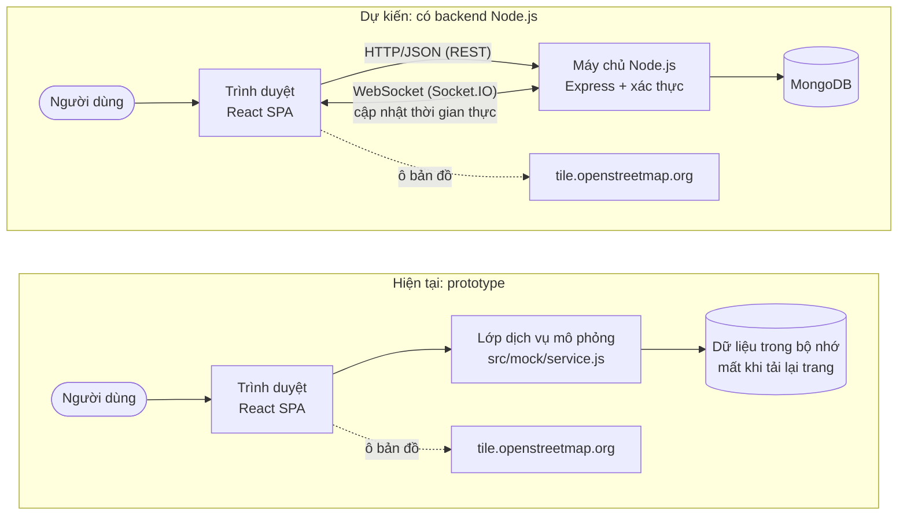

| Thành phần | Hiện tại trong Airrest | Ghi chú |
|---|---|---|
| Client | React 18 SPA, chạy trong trình duyệt | Có |
| Server | **Mô phỏng** bằng `src/mock/service.js`, `src/mock/partner.js`, `src/mock/users.js` | Không có máy chủ thật. Dự kiến: Node.js (mục 1.3) |
| Database | **Không có**; dữ liệu là mảng/đối tượng JavaScript trong bộ nhớ | Mất khi tải lại trang (quyết định D-18 phương án A). Dự kiến: MongoDB (mục 1.8) |
| Kênh thời gian thực | **Không có**; cập nhật giữa các vai trò chỉ trong cùng một tab | Dự kiến: Socket.IO (mục 1.7) |
| Dịch vụ ngoài | Chỉ ô bản đồ OpenStreetMap | Lệch AC-063 "không gọi hệ thống ngoài", đang chờ PO |

### 1.3. Tổng quan về Node.js

<p align="center"> <br><em>Hình 1.2: Node.js và framework Express</em></p>

Node.js là **môi trường chạy JavaScript phía máy chủ**, xây dựng trên engine V8 của Google Chrome, ra mắt năm 2009. Node.js xử lý theo mô hình **hướng sự kiện, I/O không chặn** (event loop): một tiến trình có thể phục vụ nhiều kết nối đồng thời mà không cần tạo luồng cho mỗi yêu cầu, rất hợp với ứng dụng nhiều thao tác đọc/ghi và kết nối thời gian thực. Đi kèm Node.js là **npm**, kho thư viện mã nguồn mở lớn nhất cho JavaScript.

Lợi ích khi chọn Node.js cho Airrest:
- **Một ngôn ngữ cho cả frontend và backend** (JavaScript), dùng chung được hàm kiểm tra hợp lệ và quy tắc nghiệp vụ đang có trong `src/lib/` (tính giờ nghỉ, luật "đang nhận khách", ma trận quyền).
- Hệ sinh thái sẵn có: **Express** (định tuyến API REST), **Mongoose** (làm việc với MongoDB), **Socket.IO** (thời gian thực), **bcrypt** (băm mật khẩu), **jsonwebtoken** (phiên đăng nhập).
- Lớp dịch vụ mô phỏng `src/mock/service.js` đã viết theo kiểu `async`, nên có thể thay bằng lời gọi HTTP tới Node.js mà không sửa giao diện.

**Trạng thái trong Airrest:**
- **Đang dùng:** Node.js 22 (khai báo trong `.mise.toml`) để chạy Vite, cài thư viện và build.
- **Dự kiến:** máy chủ API Node.js. Chưa có mã backend trong thư mục này. Hướng tổ chức đề xuất theo kiểu phân tầng `routes → controllers → services → models`, mỗi nhóm điểm cuối tương ứng một nhóm hàm mô phỏng hiện có (bảng ở mục 1.6).

### 1.4. Tổng quan về ReactJS

<p align="center"><br><em>Hình 1.3: Thư viện ReactJS</em></p>

**React** là thư viện JavaScript mã nguồn mở của Meta để xây dựng giao diện theo **component**: mỗi phần giao diện là một hàm nhận dữ liệu đầu vào (props) và trả về JSX. Khi dữ liệu (state) thay đổi, React tự vẽ lại phần giao diện liên quan.

Airrest dùng **React 18.3.1** và **React DOM 18.3.1**. Các cơ chế React được dùng:

| Cơ chế | Dùng ở đâu | Mục đích |
|---|---|---|
| `useReducer` + `Context` | `src/state/store.jsx` | Trạng thái toàn ứng dụng của người dùng cuối (màn hình hiện tại, chuyến bay, nơi nghỉ đang chọn, đặt chỗ, yêu cầu hỗ trợ, phiên đăng nhập…). Mọi thay đổi đi qua các "hành động" (`dispatch({ type: ... })`). |
| `useSyncExternalStore` | `src/mock/partner.js` (`usePartner`) | Kho dữ liệu đối tác nằm ngoài React (hồ sơ, phòng, giá, đặt phòng, tài khoản, nhật ký); khi kho đổi, các màn hình đăng ký theo dõi tự cập nhật. |
| `useState`, `useEffect`, `useMemo`, `useCallback` | Các màn hình trong `src/screens/` | Trạng thái cục bộ của biểu mẫu, gọi dịch vụ mô phỏng khi mở màn hình, tính danh sách đã lọc. |
| Định tuyến bằng hash | `store.jsx` | Đồng bộ màn hình với `window.location.hash` (`#/stays`, `#/home`, `#/login`…) để nút Quay lại của trình duyệt hoạt động, không cần thư viện định tuyến. |

### 1.5. Tổng quan về Vite

<p align="center"><br><em>Hình 1.4: Công cụ phát triển và đóng gói Vite</em></p>

**Vite** là công cụ phát triển và đóng gói frontend:
- **Chế độ phát triển** (`npm run dev`): máy chủ phát triển nạp module ES trực tiếp, cập nhật nóng (HMR) khi sửa mã.
- **Đóng gói** (`npm run build`): dùng Rollup để gộp và nén mã vào thư mục `dist/`.
- **Xem bản đóng gói** (`vite preview`): phục vụ thư mục `dist/` để kiểm tra trước khi triển khai.

Airrest dùng **Vite 6** (bản cài thực tế 6.4.4). Tệp `vite.config.js` chỉ khai báo `preview.allowedHosts` để chế độ preview chấp nhận tên miền `airrest-website.onrender.com` khi triển khai trên Render. Kết quả build gần nhất: JS khoảng 416 kB (gzip 118 kB), CSS khoảng 40 kB, phần bản đồ được tách thành gói riêng và chỉ tải khi cần.

### 1.6. Tổng quan về RESTful API và lớp dịch vụ mô phỏng

**REST** là kiểu kiến trúc thiết kế API quản lý **tài nguyên** qua HTTP: `GET` đọc, `POST` tạo, `PUT`/`PATCH` sửa, `DELETE` xoá (CRUD). Máy chủ trả mã trạng thái như `200 OK`, `201 Created`, `400 Bad Request`, `401 Unauthorized`, `403 Forbidden`, `404 Not Found`.

Airrest **chưa có API thật**. Tài liệu thiết kế (SRS, báo cáo) mô tả các điểm cuối REST; mã hiện thực chúng bằng **hàm JavaScript bất đồng bộ** có cùng ý nghĩa. Bảng dưới là ánh xạ để khi làm backend có thể giữ nguyên hợp đồng dữ liệu:

| Điểm cuối REST dự kiến | Hàm mô phỏng trong mã | Tệp | Mã lỗi mô phỏng |
|---|---|---|---|
| `GET /flights/{code}?date=` | `lookupFlight({ code, dateIso })` | `mock/service.js` | `notfound` (≈404), `service` (≈503) |
| `POST /flights/manual` | `buildManualFlight({ airport, newTime, schedTime, unknownTime })` | `mock/service.js` | `service` |
| `GET /flights/{code}/refresh` | `refreshFlight(flight, now)` | `mock/service.js` | `service` |
| `GET /properties?airport=&at=` | `searchProperties({ airport, now })` | `mock/service.js` | `service` |
| `GET /properties/{id}` | `getProperty(id, now)` | `mock/service.js` | — |
| `GET /properties/alternatives` | `alternatives({ airport, now, excludeIds, limit })` | `mock/service.js` | — |
| `POST /bookings` | `createBooking({ propertyId, name, method, now })` | `mock/service.js` | `closed` (≈409), `roomGone` (≈409), `service` |
| `POST /support-requests` | `createRequest({ code, flight, now })` | `lib/request.js` | — |
| `GET /support-requests/{code}` | `deriveRequest(req, flight, now)` | `lib/request.js` | — |
| `GET /rules` | Đọc cấu hình `RIGHTS` | `config/rights.js` | — |
| `POST /auth/login`, `POST /auth/register` | `startSession`, `loginUser`, `registerUser` | `mock/partner.js`, `mock/users.js` | Sai mật khẩu, tài khoản khoá |
| `PATCH /bookings/{code}/status` | `setBookingStatus(code, status, reason, by, now)` | `mock/partner.js` | `401`/`403` qua `guard` |
| `POST /pickups`, `PATCH /pickups/{id}` | `requestPickup`, `setPickupStatus` | `mock/partner.js` | — |

Hàm kiểm quyền `authorize` trong `lib/rbac.js` trả về mã giống HTTP: **401** khi chưa đăng nhập, **403** khi vai trò không có quyền hoặc truy cập dữ liệu của khách sạn khác, **200** khi hợp lệ.

### 1.7. Tổng quan về Socket (WebSocket, Socket.IO)

<p align="center"><br><em>Hình 1.5: Thư viện thời gian thực Socket.IO</em></p>

**WebSocket** là giao thức (RFC 6455) mở một **kết nối hai chiều, giữ lâu** giữa trình duyệt và máy chủ. Khác với HTTP thông thường (client hỏi, server trả lời rồi đóng), qua WebSocket máy chủ có thể **chủ động đẩy dữ liệu** xuống client ngay khi có sự kiện. **Socket.IO** là thư viện phổ biến trên Node.js bọc WebSocket, bổ sung tự kết nối lại, phòng (room) theo nhóm người nhận, và cơ chế dự phòng khi mạng chặn WebSocket.

Trong Airrest, nhiều thông tin cần **cập nhật tức thời giữa các vai trò**:

| Sự kiện | Ai phát | Ai cần nhận ngay | Hiện tại trong prototype |
|---|---|---|---|
| Có đặt chỗ mới | Người dùng cuối | Khách sạn (tab Đặt phòng) | Chỉ thấy trong cùng tab trình duyệt |
| Khách sạn xác nhận/từ chối đặt phòng | Khách sạn | Người dùng cuối | Như trên |
| Lái xe cập nhật trạng thái đón | Lái xe | Người dùng cuối | Như trên |
| Giờ bay thay đổi | Nguồn dữ liệu chuyến bay | Người dùng cuối (banner, tính lại giờ rời) | Mô phỏng bằng "Công cụ mô phỏng" |
| Hãng/cơ sở phản hồi đề nghị hỗ trợ | Hãng, cơ sở | Người dùng cuối | Suy ra từ giờ mô phỏng |
| Phiên bị thu hồi | Quản trị | Người bị khoá (đăng xuất ngay) | Như trên |

**Trạng thái trong Airrest:** **dự kiến**, chưa có mã. Prototype hiện dùng cơ chế "phát sự kiện" nội bộ (`emit()` trong `src/mock/partner.js` + `useSyncExternalStore`) để các màn hình tự cập nhật, nhưng chỉ trong **một tab**. Đây chính là giới hạn ghi ở OQ-42/D-29. Socket.IO sẽ thay `emit()` bằng sự kiện gửi qua máy chủ tới mọi thiết bị, ví dụ phòng `property:<mã cơ sở>` cho khách sạn và `booking:<mã đặt chỗ>` cho người dùng cuối.

### 1.8. Tổng quan về MongoDB

<p align="center"><br><em>Hình 1.6: Hệ quản trị cơ sở dữ liệu MongoDB</em></p>

**MongoDB** là hệ quản trị cơ sở dữ liệu **NoSQL hướng tài liệu** (document database). Dữ liệu lưu thành các **tài liệu** dạng JSON (BSON) nằm trong các **collection**, không bắt buộc lược đồ cố định như bảng SQL. Một tài liệu có thể chứa mảng và đối tượng lồng nhau; truy vấn, đánh chỉ mục (index) và tổng hợp (aggregation) được thực hiện trực tiếp trên các trường này.

Lý do phù hợp với Airrest:
- Dữ liệu mô phỏng hiện có **đã ở dạng tài liệu JSON**: đặt phòng chứa mảng `history`, hồ sơ đối tác chứa `history`, ca hỗ trợ chứa `notes`. Chúng chuyển gần như nguyên dạng sang collection.
- Cấu trúc còn thay đổi theo quyết định của PO (D-25…D-30). Lược đồ linh hoạt giúp thêm trường mà không phải chạy migration.
- Thư viện **Mongoose** cho Node.js cho phép khai báo schema, kiểm tra hợp lệ và quan hệ tham chiếu giữa các collection.

Ánh xạ dự kiến từ các "bảng" ở mục 2.8 sang collection MongoDB:

| Collection dự kiến | Lấy từ bảng (mục 2.8.2) | Ghi chú |
|---|---|---|
| `flights` | 2.1 FLIGHT | Khoá duy nhất `{ code, dayOffset }` |
| `properties` | 2.2 PROPERTY + 2.11 PARTNER_PROFILE + 2.15 POLICY | Gộp hồ sơ và điều kiện lưu trú vào cùng tài liệu |
| `roomTypes`, `rates` | 2.12, 2.13 | Hoặc nhúng vào `properties` |
| `inventory` | 2.14 | Một tài liệu cho mỗi (cơ sở, loại phòng, ngày) |
| `bookings` | 2.4 + 2.5 (nhúng `history`) | Chỉ mục theo `propertyId`, `status` |
| `supportRequests` | 2.6 | Lưu thêm `status` thật thay vì suy ra |
| `users`, `accounts`, `sessions` | 2.8, 2.9, 2.10 | Mật khẩu phải băm (bcrypt), không lưu thô |
| `pickups`, `cases`, `incidents`, `qualityIssues` | 2.16–2.18 | |
| `flags`, `configChanges`, `catalogs` | 2.19, 2.20 | |
| `auditLogs` | 2.21 | Chỉ ghi thêm, không sửa/xoá |

**Trạng thái trong Airrest:** **dự kiến**, chưa có cơ sở dữ liệu. Lưu ý: lưu dữ liệu lâu dài đi ngược quyết định D-18 phương án A (chỉ lưu trong phiên) và đụng quy tắc riêng tư BR-002, NFR-005. Trước khi dùng MongoDB cho dữ liệu thật cần PO chọn phương án C của D-29/D-30 và rà soát Luật 91/2025/QH15 về bảo vệ dữ liệu cá nhân.

### 1.9. Tổng quan về OpenStreetMap và Leaflet

<p align="center"> <br><em>Hình 1.7: Bản đồ mở OpenStreetMap và thư viện Leaflet</em></p>

**OpenStreetMap (OSM)** là dự án bản đồ thế giới **mở và miễn phí**, do cộng đồng đóng góp, khởi đầu năm 2004, cấp phép dữ liệu theo ODbL. OSM cung cấp dữ liệu đường, địa điểm và dịch vụ **ô bản đồ** (tile): bản đồ được cắt thành các ảnh vuông 256×256 px theo mức thu phóng `z` và toạ độ ô `x`, `y`. Chính sách sử dụng ô của OSM yêu cầu **ghi công** ("© OpenStreetMap contributors") và lưu lượng thấp; ứng dụng lớn nên tự dựng máy chủ ô hoặc dùng nhà cung cấp riêng.

**Leaflet** là thư viện JavaScript mã nguồn mở, nhẹ (khoảng 40 kB), dùng để hiển thị bản đồ tương tác từ các ô đó: thu phóng, kéo, đặt ghim, popup.

Airrest dùng **Leaflet 1.9.4** trong `src/components/StaysMap.jsx`:
- Ô bản đồ tải từ `https://tile.openstreetmap.org/{z}/{x}/{y}.png`, có ghi công "© OpenStreetMap contributors".
- Tâm bản đồ là **toạ độ thật** của hai sân bay. Vị trí từng nơi nghỉ là **toạ độ tổng hợp** (đặt cách sân bay đúng số km mô phỏng theo một góc cố định), có ghi chú "minh họa (mô phỏng), không phải địa chỉ thật".
- Ghim (`divIcon`) hiển thị giá; bấm ghim thì đồng bộ với danh sách và panel chi tiết.
- Không dùng định vị người dùng, không chỉ đường.

Lưu ý: bản đồ là **mở rộng ngoài MVP** (MB-15 "bản đồ" đã loại) và là lời gọi mạng ra ngoài duy nhất của trang.

### 1.10. Các chuẩn và API trình duyệt khác

| Chuẩn/thư viện | Dùng để | Tệp |
|---|---|---|
| **lucide-react 0.468** | Bộ biểu tượng dạng SVG | Toàn bộ giao diện |
| **iCalendar (RFC 5545)** | Tạo tệp `.ics` để người dùng thêm lịch nhắc "rời nơi nghỉ" vào ứng dụng lịch | `lib/ics.js` |
| **Notification API** | Thông báo trình duyệt khi đến giờ rời nơi nghỉ (chỉ khi trang còn mở) | `screens/Reminder.jsx` |
| **Blob + URL.createObjectURL** | Xuất tệp CSV báo cáo, tải tệp `.ics` | `mock/partner.js`, `lib/ics.js` |
| **History API (hash)** | Điều hướng giữa các màn hình | `state/store.jsx` |
| **Intl.NumberFormat** | Định dạng tiền Việt Nam | `lib/time.js` (`money`) |

### 1.11. Công cụ sử dụng

| Công cụ | Vai trò | Trạng thái |
|---|---|---|
| **Visual Studio Code** | Trình soạn thảo mã | Đang dùng |
| **Postman** | Kiểm thử API REST | Dự kiến |
| **Docker Desktop** | Chạy MongoDB và máy chủ Node.js trong container | Dự kiến |
| **Node.js 22 + npm** | Chạy Vite, cài thư viện (`npm install`), build (`npm run build`) | Đang dùng |
| **Git** | Quản lý phiên bản mã nguồn | Đang dùng |
| **Figma Make** | Dựng bản prototype ban đầu (thư mục `.figma/`, tệp `.mise.toml` do Figma Make sinh) | Đang dùng |
| **Render** | Triển khai bản demo tại `airrest-website.onrender.com` | Đang dùng |
| **Google Chrome headless + playwright-core** | Kiểm thử tự động trên trình duyệt thật (kịch bản nằm ngoài kho mã) | Đang dùng |
| **Mermaid** | Vẽ các sơ đồ trong tài liệu này | Đang dùng |
| **Python 3** | Các script thu thập, làm sạch, thống kê dữ liệu nghiên cứu trong `BTHQUAN/` | Đang dùng |

<p align="center"><br><em>Hình 1.8: Công cụ soạn thảo mã Visual Studio Code</em></p>

**a. Visual Studio Code (VS Code).** Trình soạn thảo mã miễn phí của Microsoft, chạy trên Windows, macOS, Linux. Hỗ trợ tô màu cú pháp, gợi ý mã (IntelliSense) cho JavaScript/JSX, gỡ lỗi, terminal tích hợp, quản lý Git, và kho tiện ích mở rộng. Với Airrest, các tiện ích hữu ích gồm ESLint, Prettier, Markdown Preview Mermaid (xem sơ đồ trong tài liệu này) và MongoDB for VS Code (khi có cơ sở dữ liệu).

<p align="center"><br><em>Hình 1.9: Công cụ kiểm thử API Postman</em></p>

**b. Postman.** Công cụ gửi và kiểm thử yêu cầu HTTP: tạo yêu cầu `GET`/`POST`/`PATCH`/`DELETE`, gắn header và thân JSON, xem mã trạng thái và dữ liệu trả về, gom yêu cầu thành **collection**, dùng **biến môi trường** (địa chỉ máy chủ, token) và viết kiểm tra tự động. Khi có backend Node.js, mỗi dòng của bảng ánh xạ ở mục 1.6 sẽ thành một yêu cầu trong collection Postman để kiểm thử API trước khi nối vào giao diện, gồm cả các trường hợp lỗi `401`, `403`, `404`, `409`. Hiện Airrest chưa có API HTTP nên chưa dùng Postman.

<p align="center"><br><em>Hình 1.10: Docker Desktop</em></p>

**c. Docker Desktop (giao diện GUI).** Docker đóng gói ứng dụng và thư viện đi kèm vào **container** để chạy giống nhau trên mọi máy. **Docker Desktop** là ứng dụng có giao diện đồ hoạ để tải image, chạy/dừng container, xem log, quản lý volume (dữ liệu lưu bền) mà không phải gõ lệnh. Dự kiến dùng cho Airrest:
- Chạy **MongoDB** bằng image chính thức `mongo`, dữ liệu lưu trong volume.
- Chạy **máy chủ Node.js** trong container riêng.
- Gom hai dịch vụ bằng `docker compose` để cả nhóm khởi động môi trường bằng một lệnh.

Hiện thư mục chưa có `Dockerfile` hay `docker-compose.yml`. Bản demo frontend triển khai trên Render không cần Docker.

**d. Các công cụ khác.**

| Hình | Công cụ | Dùng trong AIRREST |
|---|---|---|
|   | **Hình 1.11:** Node.js và npm | Chạy Vite, cài thư viện, build |
|  | **Hình 1.12:** Git | Quản lý phiên bản mã nguồn |
|  | **Hình 1.13:** Figma Make | Dựng prototype giao diện ban đầu |
|  | **Hình 1.14:** Render | Triển khai bản demo trực tuyến |
|   | **Hình 1.15:** Google Chrome headless và Playwright | Kiểm thử tự động trên trình duyệt thật |
|  | **Hình 1.16:** Mermaid | Vẽ sơ đồ hoạt động, kiến trúc, lớp, dữ liệu trong tài liệu này |
|  | **Hình 1.17:** Python 3 | Script thu thập, làm sạch, thống kê dữ liệu nghiên cứu (`BTHQUAN/`) |

Nguồn logo (cả Chương I): bộ biểu tượng mã nguồn mở [Devicon](https://devicon.dev) (MIT) và [Simple Icons](https://simpleicons.org) (CC0, logo Render, Mermaid, OpenStreetMap, Leaflet); các logo là nhãn hiệu của chủ sở hữu tương ứng, chỉ dùng để minh hoạ.

---

## CHƯƠNG II: PHÂN TÍCH VÀ THIẾT KẾ HỆ THỐNG (2.5–2.8)

### 2.5. Sơ đồ hoạt động

Các sơ đồ dưới đây vẽ theo đúng luồng xử lý trong mã. Ký hiệu: hình chữ nhật là hoạt động, hình thoi là điều kiện, hình tròn là bắt đầu/kết thúc.

#### 2.5.1. Sơ đồ hoạt động tổng quát của người dùng cuối

Trang đầu là danh sách nơi nghỉ ở **chế độ duyệt**: chưa cần nhập chuyến bay vẫn xem được nơi nghỉ và chi tiết, tính theo giờ mô phỏng mặc định 23:08. Muốn đặt chỗ, tính giờ nghỉ, nhắc giờ hoặc xin hãng hỗ trợ thì phải nhập chuyến bay.

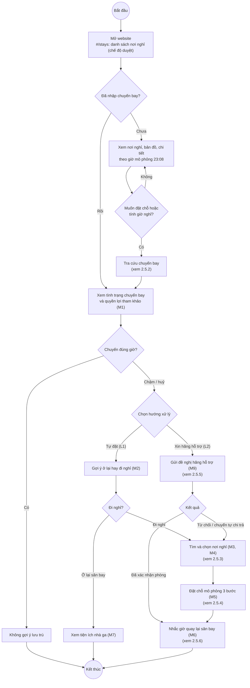

#### 2.5.2. Sơ đồ hoạt động tra cứu chuyến bay (M0)

Hai cách nhập: theo **số hiệu** (có kiểm tra định dạng và ngày) hoặc **nhập thủ công** khi không có số hiệu.

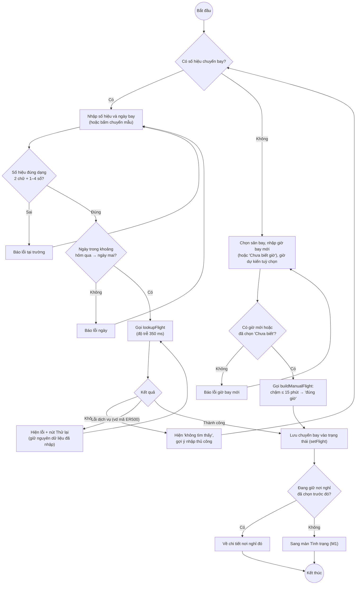

#### 2.5.3. Sơ đồ hoạt động tìm và chọn nơi nghỉ (M3, M4)

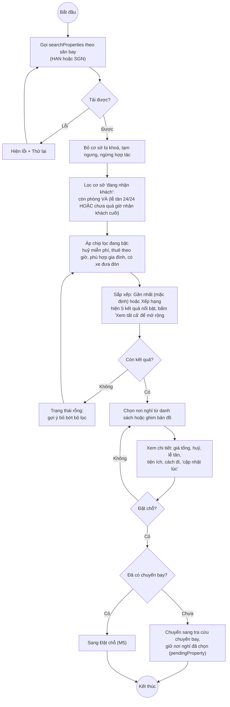

#### 2.5.4. Sơ đồ hoạt động đặt chỗ mô phỏng (M5)

Đặt chỗ **không cần tài khoản**, tối đa 3 bước, **không thu số điện thoại hay email** (BR-002), có ít nhất 2 cách trả mô phỏng.

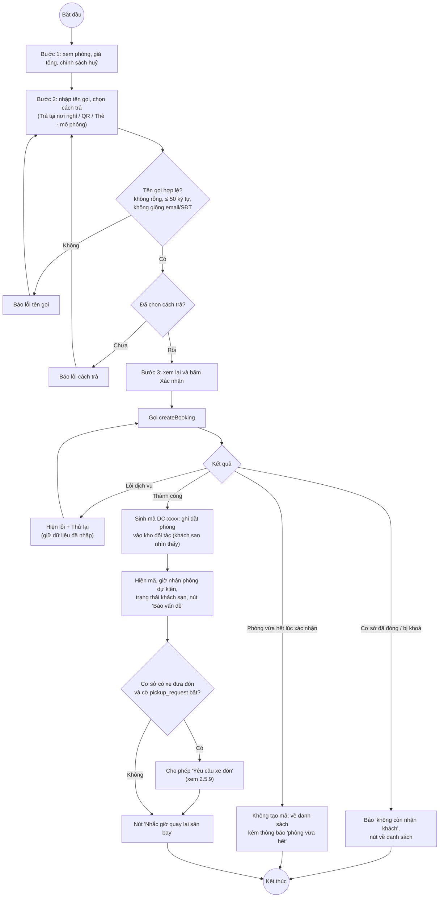

#### 2.5.5. Sơ đồ hoạt động đề nghị hãng hỗ trợ (luồng L2, M9)

Trạng thái của đề nghị **không được lưu** mà được **suy ra** từ giờ mô phỏng và kịch bản gán sẵn cho từng chuyến bay (`approve`, `reject`, `hotelfull`, `noreply`). Mặc định hãng phản hồi sau 8 phút, cơ sở phản hồi sau 8 phút tiếp theo, hạn chờ là 15 phút (tham số mô phỏng).

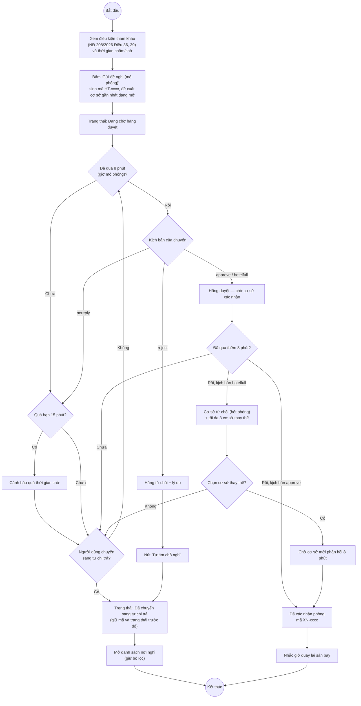

Sơ đồ trạng thái tương ứng (`lib/request.js`, hàm `deriveRequest`):

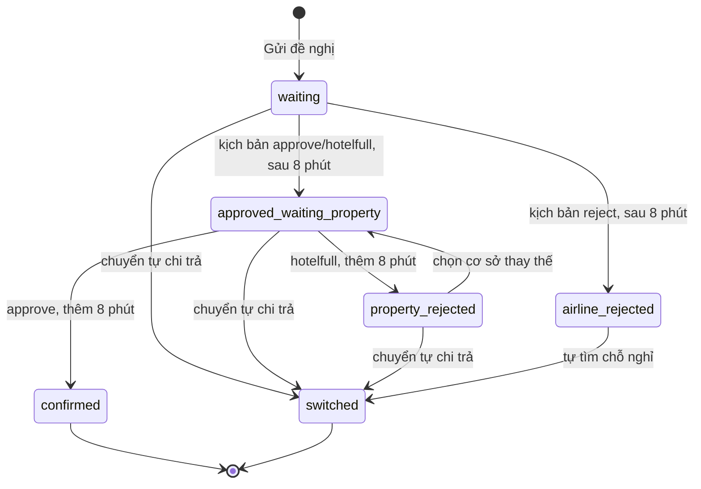

Ghi chú: SRS đề xuất 8 trạng thái; mã hiện có 6 trạng thái, chưa có bước bổ sung minh chứng, hết hạn (chỉ có cờ cảnh báo `expired`) và huỷ yêu cầu (OQ-08 chờ PO).

#### 2.5.6. Sơ đồ hoạt động nhắc giờ quay lại sân bay (M6)

Công thức (tham số ở `config/simulation.js`, chờ PO chốt — OQ-04):
- Giờ có mặt tại sân bay = giờ bay mới − **120 phút** (không được ít hơn 40 phút, mốc đóng quầy nội địa).
- Giờ rời nơi nghỉ = giờ có mặt − thời gian đi xe − **15 phút** dự phòng.

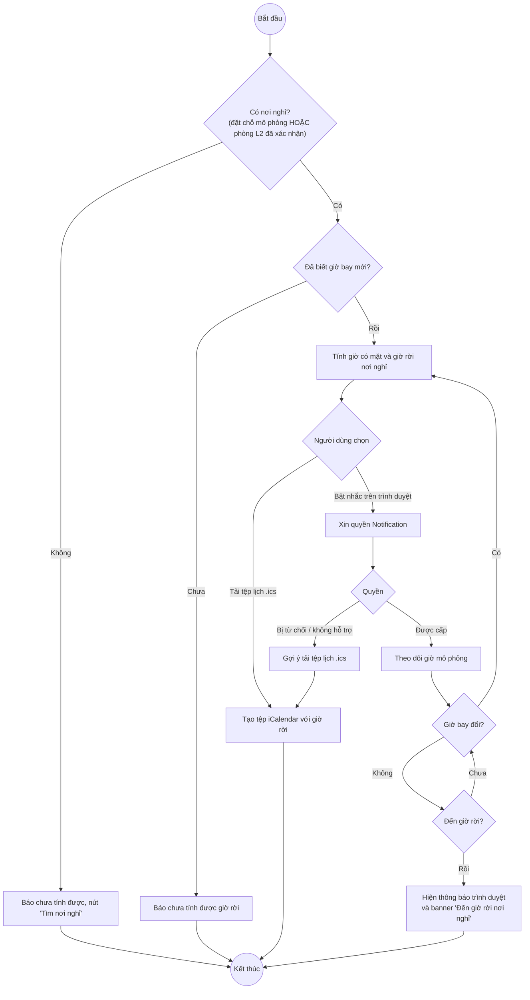

#### 2.5.7. Sơ đồ hoạt động đăng nhập và đăng ký (M12)

Một trang chung cho cả người dùng cuối và đối tác. Mọi tài khoản mẫu dùng mật khẩu demo `Demo@2026`. Dữ liệu chỉ trong bộ nhớ trang. Phần đăng ký người dùng **ngoài MVP**, chờ PO (D-30).

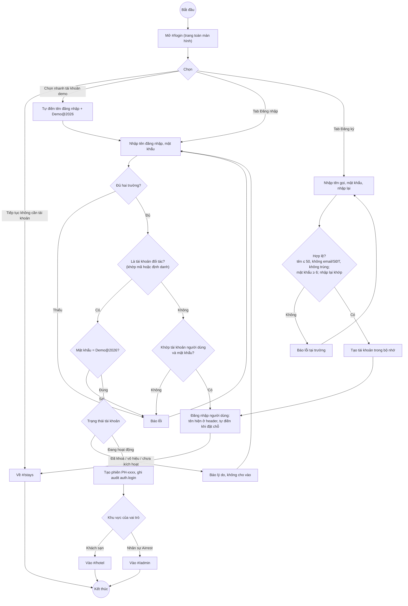

#### 2.5.8. Sơ đồ hoạt động khách sạn xử lý đặt phòng (ngoài MVP)

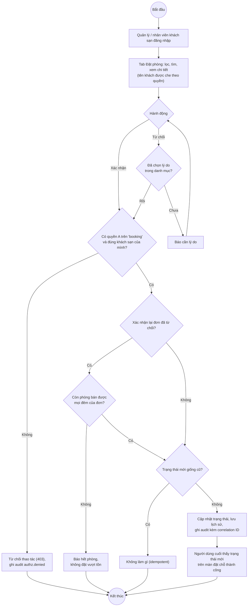

#### 2.5.9. Sơ đồ hoạt động đón khách tại sân bay (ngoài MVP)

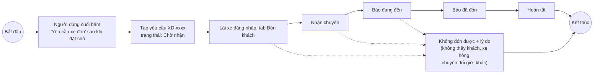

Mỗi bước cập nhật trạng thái được người dùng cuối nhìn thấy ngay (cùng phiên trình duyệt). Lái xe **không** có số điện thoại của khách (BR-002); chức năng này còn chờ quyết định D-26.

#### 2.5.10. Sơ đồ hoạt động duyệt hồ sơ đối tác (ngoài MVP)

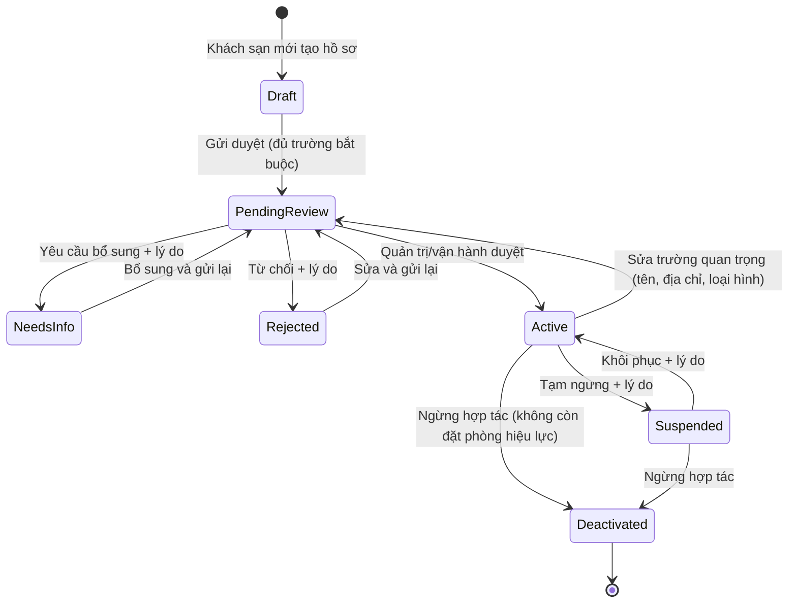

Hồ sơ **Active** mới hiện với người dùng cuối; **Suspended/Deactivated** bị ẩn, đặt phòng đã xác nhận được giữ nguyên. Hai người duyệt cùng lúc thì người sau nhận thông báo xung đột.

#### 2.5.11. Sơ đồ hoạt động thay đổi cấu hình có phê duyệt (ngoài MVP)

Áp dụng cho cờ tính năng `pickup_request` (nút yêu cầu xe đón) và `guest_case` (nút báo vấn đề).

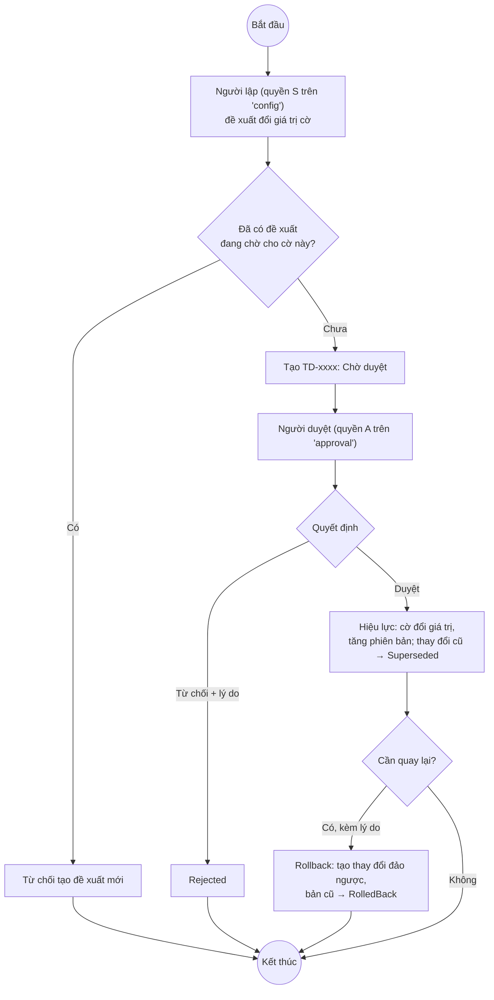

#### 2.5.12. Sơ đồ hoạt động xử lý ca hỗ trợ (ngoài MVP)

Ca được tạo khi người dùng cuối bấm "Báo vấn đề về đặt phòng này" (khi cờ `guest_case` bật).

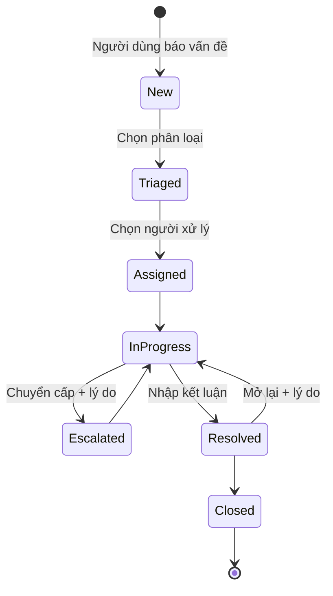

#### 2.5.13. Sơ đồ hoạt động kiểm tra quyền (dùng chung cho mọi thao tác đối tác)

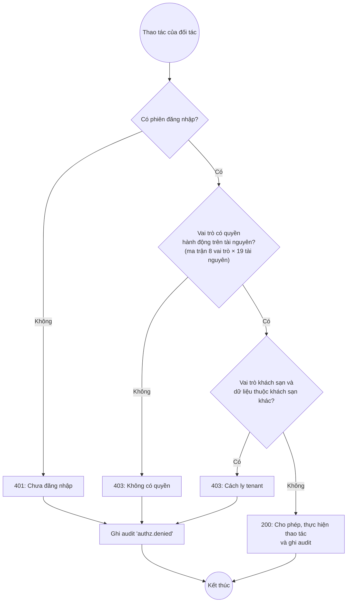

Ngoài ra, khi quản trị khoá, vô hiệu hoá hoặc đổi vai trò một tài khoản, mọi phiên của tài khoản đó bị thu hồi và người đang dùng bị đăng xuất ngay.

### 2.6. Kiến trúc hệ thống

#### 2.6.1. Kiến trúc phân lớp của ứng dụng

Airrest là SPA chạy trong trình duyệt, tổ chức thành các lớp. Lớp trên chỉ gọi lớp dưới; giao diện không đọc trực tiếp dữ liệu thô mà đi qua lớp dịch vụ.

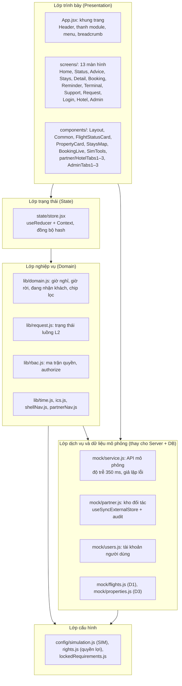

| Lớp | Thư mục | Trách nhiệm |
|---|---|---|
| Trình bày | `App.jsx`, `screens/`, `components/`, `styles.css` | Hiển thị, nhận thao tác, kiểm tra hợp lệ biểu mẫu, hiển thị trạng thái đang tải/lỗi/rỗng |
| Trạng thái | `state/store.jsx` | Lưu trạng thái phiên của người dùng cuối, chuyển màn hình, đồng bộ địa chỉ trang |
| Nghiệp vụ | `lib/` | Công thức thời gian, luật "đang nhận khách", trạng thái yêu cầu hỗ trợ, phân quyền |
| Dịch vụ, dữ liệu | `mock/` | Đóng vai máy chủ và cơ sở dữ liệu: tra cứu, đặt chỗ, ghi đặt phòng, kiểm quyền "phía máy chủ", nhật ký |
| Cấu hình | `config/` | Tham số mô phỏng (sửa được lúc chạy bởi quản trị), nội dung quyền lợi có nguồn |

#### 2.6.2. Luồng một yêu cầu điển hình (đặt chỗ)

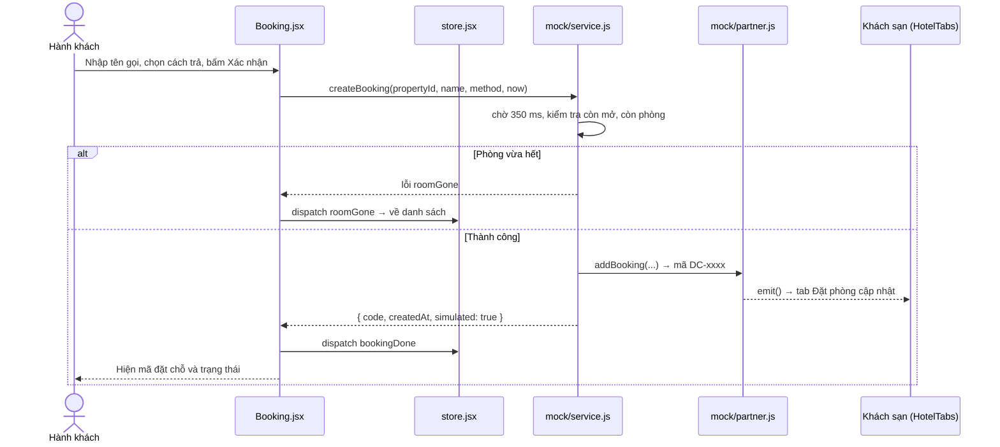

#### 2.6.3. Mô hình triển khai

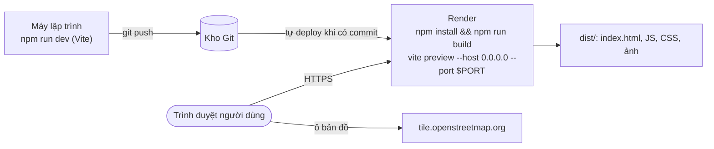

Vì ứng dụng chỉ là tệp tĩnh và định tuyến bằng hash, có thể triển khai dạng **Static Site** (thư mục xuất bản `dist`) mà không cần tiến trình chạy thường trực.

### 2.7. Sơ đồ lớp

JavaScript trong Airrest không khai báo `class`; dữ liệu là đối tượng thuần và nghiệp vụ là hàm. Sơ đồ dưới **mô hình hoá các đối tượng dữ liệu như lớp**: thuộc tính lấy đúng tên trường trong mã, phương thức là các hàm thao tác trên đối tượng đó (tên hàm thật trong mã).

#### 2.7.1. Phần người dùng cuối (MVP)

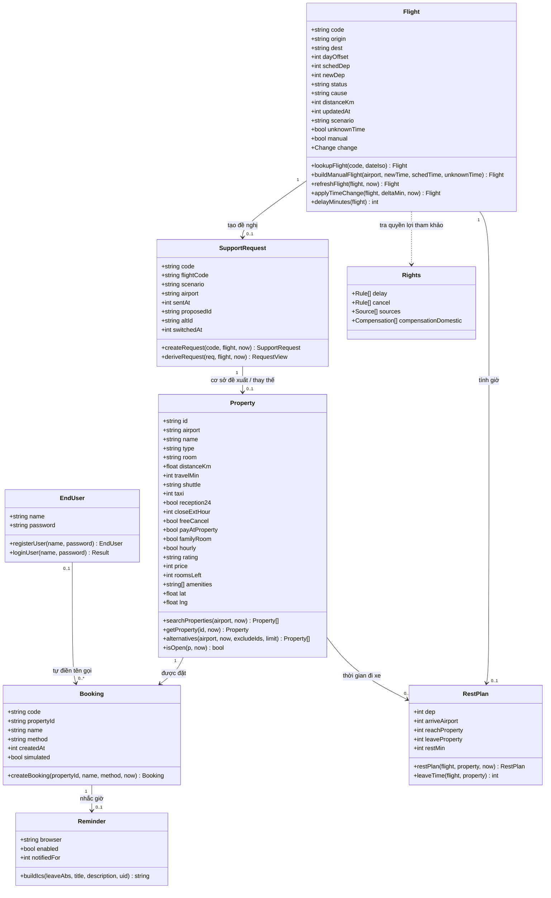

#### 2.7.2. Phần đối tác và quản trị (ngoài MVP)

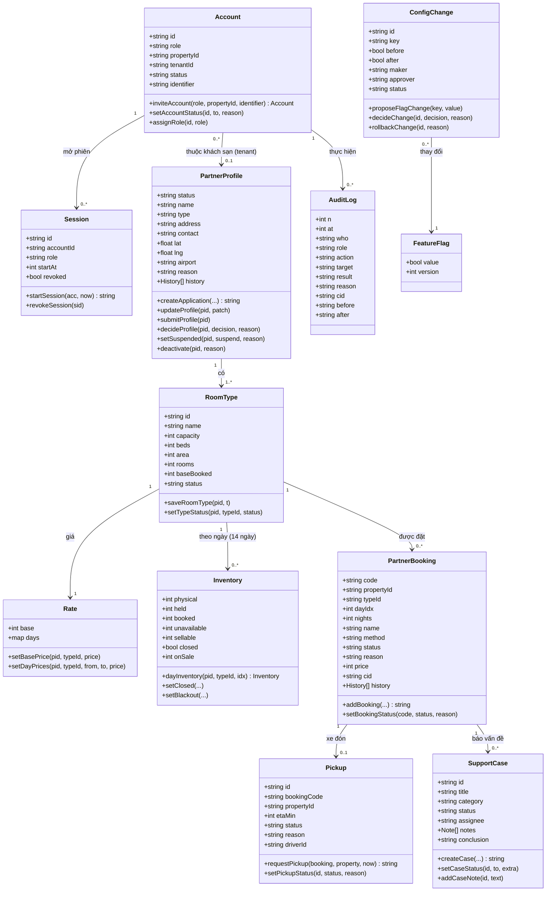

### 2.8. Thiết kế dữ liệu

#### 2.8.1. Mô hình dữ liệu

Airrest **không có cơ sở dữ liệu**. Dữ liệu là các **tập (collection) trong bộ nhớ trình duyệt**, chia thành 5 nhóm kho. Phần dưới gọi mỗi tập là một "bảng" để dễ đối chiếu khi chuyển sang CSDL thật.

| Kho | Tệp | Nội dung | Tính chất |
|---|---|---|---|
| **D1 — Chuyến bay** | `mock/flights.js` | 20 chuyến mô phỏng (HAN, SGN) với kịch bản chậm/huỷ/đúng giờ; mã `ER500` cố ý gây lỗi | Chỉ đọc |
| **D2 — Quyền lợi tham khảo** | `config/rights.js` | Mốc chậm/huỷ, quyền lợi, điều khoản trích NĐ 208/2026 và TT 48/2026, mức bồi thường theo cự ly | Chỉ đọc, chờ PO duyệt |
| **D3 — Cơ sở lưu trú** | `mock/properties.js` | 34 cơ sở **tổng hợp** (HAN 20, SGN 14), không dùng bản ghi thật A08 (D-23 phương án B) | Chỉ đọc, bị ghi đè bởi kho đối tác |
| **Trạng thái phiên** | `state/store.jsx` | Chuyến bay đang theo dõi, đặt chỗ, yêu cầu hỗ trợ, nhắc giờ, phiên đăng nhập | Đọc/ghi, mất khi tải lại |
| **Kho đối tác** | `mock/partner.js` | Tài khoản, phiên, hồ sơ, loại phòng, giá, tồn, đặt phòng, đón khách, ca hỗ trợ, sự cố, cờ tính năng, danh mục, nhật ký | Đọc/ghi, mất khi tải lại |
| **Tài khoản người dùng** | `mock/users.js` | Tên gọi + mật khẩu demo | Đọc/ghi, mất khi tải lại |
| **Tham số mô phỏng (SIM)** | `config/simulation.js` | Giờ có mặt, dự phòng, hạn chờ, độ trễ… | Quản trị sửa được lúc chạy |

**Quy ước chung:**
- **Thời gian** lưu bằng **số phút tuyệt đối tính từ 00:00 hôm nay** (ví dụ 23:08 = 1388; 06:00 hôm sau = 1800), không dùng kiểu `Date`. Hàm `fmtTime`, `fmtDateTime` trong `lib/time.js` đổi ra giờ hiển thị.
- **Tiền** là số nguyên VNĐ, định dạng bằng `money()`.
- **Mã định danh** là chuỗi có tiền tố: `DC-` đặt chỗ, `HT-` yêu cầu hỗ trợ, `XN-` xác nhận phòng, `XD-` đón khách, `PH-` phiên, `CA-` ca hỗ trợ, `SI-` sự cố hệ thống, `CL-` sự cố chất lượng, `TD-` thay đổi cấu hình, `HS-` hồ sơ đăng ký, `cid-` correlation ID.
- **Không thu** họ tên thật, số điện thoại, email người dùng cuối, giấy tờ, thẻ thanh toán, vị trí chính xác (BR-002, NFR-005).

Sơ đồ quan hệ dữ liệu:

```mermaid
erDiagram
  FLIGHT ||--o| SUPPORT_REQUEST : "tạo"
  PROPERTY ||--o{ SUPPORT_REQUEST : "được đề xuất"
  PROPERTY ||--|| PARTNER_PROFILE : "có hồ sơ"
  PROPERTY ||--|{ ROOM_TYPE : "có"
  ROOM_TYPE ||--|| RATE : "có giá"
  ROOM_TYPE ||--o{ BLACKOUT : "không khả dụng theo ngày"
  ROOM_TYPE ||--o{ CLOSED_DAY : "đóng bán theo ngày"
  PROPERTY ||--o| POLICY : "điều kiện lưu trú"
  PROPERTY ||--o{ BOOKING : "nhận"
  ROOM_TYPE ||--o{ BOOKING : "loại phòng"
  BOOKING ||--o{ BOOKING_HISTORY : "lịch sử trạng thái"
  BOOKING ||--o| PICKUP : "xe đón"
  BOOKING ||--o{ SUPPORT_CASE : "báo vấn đề"
  PROPERTY ||--o{ ACCOUNT : "tenant của"
  ACCOUNT ||--o{ SESSION : "mở"
  ACCOUNT ||--o{ AUDIT_LOG : "thực hiện"
  ACCOUNT ||--o{ PICKUP : "lái xe nhận"
  PROPERTY ||--o{ QUALITY_ISSUE : "bị ghi nhận"
  FEATURE_FLAG ||--o{ CONFIG_CHANGE : "được thay đổi qua"
  RATE ||--o{ RATE_LOG : "lịch sử giá"
  END_USER ||--o{ BOOKING : "tự điền tên gọi"

  FLIGHT {
    string code PK
    int dayOffset PK
    string origin
    string status
    int schedDep
    int newDep
    string scenario
  }
  PROPERTY {
    string id PK
    string airport
    string name
    int travelMin
    int price
    int roomsLeft
  }
  BOOKING {
    string code PK
    string propertyId FK
    string typeId FK
    string name
    string method
    string status
  }
  SUPPORT_REQUEST {
    string code PK
    string flightCode FK
    string proposedId FK
    string altId FK
    int sentAt
  }
  ACCOUNT {
    string id PK
    string role
    string tenantId FK
    string status
    string identifier UK
  }
  ROOM_TYPE {
    string propertyId PK
    string id PK
    int rooms
    string status
  }
  PICKUP {
    string id PK
    string bookingCode FK
    string driverId FK
    string status
  }
  AUDIT_LOG {
    int n PK
    string who FK
    string action
    string cid
  }
```

#### 2.8.2. Chi tiết các bảng dữ liệu

Cột **Kiểu** dùng kiểu JavaScript: `string`, `int`, `float`, `bool`, `array`, `object`. Cột **Ràng buộc / giá trị** ghi miền giá trị hoặc quy tắc kiểm tra có trong mã.

##### Bảng 2.1. FLIGHT — chuyến bay (D1, `mock/flights.js`)

| Tên trường | Kiểu | Ràng buộc / giá trị | Giải thích |
|---|---|---|---|
| `code` | string | PK (cùng `dayOffset`); mẫu `^[A-Z]{2}\d{1,4}$`; nhập thủ công = `"Nhập thủ công"` | Số hiệu chuyến bay |
| `dayOffset` | int | -1, 0, 1 | Ngày bay so với hôm nay |
| `origin` | string | `HAN` \| `SGN` | Sân bay đi, dùng để tìm nơi nghỉ |
| `dest` | string | `HAN` \| `SGN` \| rỗng | Sân bay đến |
| `airline` | string | mặc định `"Hãng mô phỏng"` | Tên hãng |
| `schedDep` | int | phút tuyệt đối; có thể `null` khi nhập thủ công | Giờ khởi hành theo lịch |
| `newDep` | int | phút tuyệt đối; `null` nếu huỷ hoặc chưa biết | Giờ khởi hành mới |
| `status` | string | `delayed` \| `ontime` \| `cancelled` | Trạng thái chuyến |
| `cause` | string | `airline` (lỗi hãng) \| `force` (ngoài kiểm soát) \| `unknown` | Nguyên nhân, quyết định cách hiển thị quyền lợi |
| `distanceKm` | int | ví dụ 450, 1160; `null` khi nhập thủ công | Cự ly, dùng cho mức bồi thường tham khảo |
| `now` | int | phút tuyệt đối | Giờ mô phỏng khi mở kịch bản |
| `updatedAt` | int | phút tuyệt đối | "Cập nhật lúc" (minh bạch độ mới dữ liệu) |
| `cancelledAt` | int | chỉ khi huỷ | Thời điểm huỷ, tính thời gian chờ |
| `scenario` | string | `approve` \| `reject` \| `hotelfull` \| `noreply` | Kịch bản phản hồi của luồng L2 |
| `unknownTime` | bool | | Chưa biết giờ bay mới |
| `manual` | bool | | Chuyến nhập thủ công |
| `change` | object | `{ from, to, at }` | Lần đổi giờ gần nhất (để hiện banner, tính lại giờ rời) |

##### Bảng 2.2. PROPERTY — cơ sở lưu trú (D3, `mock/properties.js`)

| Tên trường | Kiểu | Ràng buộc / giá trị | Giải thích |
|---|---|---|---|
| `id` | string | PK; `HAN-01…HAN-20`, `SGN-01…SGN-14`; cơ sở thêm mới `HAN-N01…` | Mã cơ sở |
| `airport` | string | `HAN` \| `SGN` | Sân bay lân cận |
| `name` | string | | Tên (tổng hợp) |
| `type` | string | Khách sạn \| Nhà nghỉ \| Căn hộ \| Hộp ngủ \| Phòng theo giờ | Loại hình |
| `room` | string | | Loại phòng hiển thị cho người dùng cuối |
| `area` | string | luôn ghi "(mô phỏng)" | Khu vực, thay cho địa chỉ |
| `distanceKm` | float | | Khoảng cách tới sân bay |
| `travelMin` | int | 6–29 | Thời gian đi xe, dùng để sắp xếp và tính giờ |
| `shuttle` | string | `free` \| `paid` \| `none` | Xe đưa đón |
| `taxi` | int | VNĐ | Giá taxi ước tính |
| `reception24` | bool | | Lễ tân 24/24 |
| `closeExtHour` | int | 22–26 (24 = 00:00, 26 = 02:00 hôm sau) | Giờ nhận khách cuối |
| `freeCancel` | bool | | Huỷ miễn phí |
| `payAtProperty` | bool | | Trả tại nơi nghỉ |
| `familyRoom` | bool | | Phù hợp gia đình |
| `hourly` | bool | | Thuê theo giờ |
| `rating` | string | "7.0"–"9.4" | Điểm đánh giá |
| `price` | int | VNĐ; bị ghi đè bởi giá của khách sạn | Giá tổng 1 phòng, 1 đêm, 2 người lớn |
| `roomsLeft` | int | ≥ 0; bị ghi đè bởi tồn phòng | Số phòng còn bán |
| `amenities` | array | chuỗi | Tiện ích |
| `lat`, `lng` | float | toạ độ **tổng hợp** | Vị trí ghim trên bản đồ |
| `soldOutOnConfirm` | bool | 1 cơ sở mỗi sân bay = `true` | Kịch bản "phòng vừa hết khi xác nhận" |
| `updatedAtOffsetMin` | int | ≤ 0 | Độ lệch "cập nhật lúc" so với giờ mô phỏng |
| `locked` | bool | tính khi đọc | Quản trị tạm khoá (ẩn khỏi người dùng cuối) |

Luật "đang nhận khách" (`isOpen`): `roomsLeft > 0` **và** (`reception24` **hoặc** giờ hiện tại ≤ giờ nhận khách cuối).

##### Bảng 2.3. RIGHTS — quyền lợi tham khảo (D2, `config/rights.js`)

| Tên trường | Kiểu | Ràng buộc / giá trị | Giải thích |
|---|---|---|---|
| `effectiveFrom`, `accessed` | string | "01/7/2026", "26/10/2026" | Ngày hiệu lực văn bản, ngày truy cập nguồn |
| `sources[]` | array | `{ id, label, url }` | NĐ 208/2026/NĐ-CP, TT 48/2026/TT-BXD |
| `delay[]` | array | `{ hours: 2\|3\|4\|6, title, cite, needsFault, cond }` | Quyền lợi theo số giờ chậm (Điều 36) |
| `cancel[]` | array | `{ hours: 0\|2\|3\|6, title, cite, needsFault, cond }` | Quyền lợi khi huỷ theo thời gian chờ (Điều 39) |
| `passengerConditions[]` | array | chuỗi | Điều kiện chung với hành khách |
| `compensationDomestic[]` | array | `{ label, amount }`: 220.000đ / 330.000đ / 440.000đ | Bồi thường ứng trước theo cự ly (TT 48 Điều 5.1) |
| `exemptionNote` | string | | Ghi chú về miễn trừ (Điều 40) |

`needsFault = true` nghĩa là quyền lợi chỉ áp dụng khi lỗi do hãng; khi nguyên nhân `unknown` hoặc `force`, giao diện **không kết luận** quyền lợi.

##### Bảng 2.4. BOOKING — đặt chỗ / đặt phòng (`mock/partner.js`, tập `bookings`)

| Tên trường | Kiểu | Ràng buộc / giá trị | Giải thích |
|---|---|---|---|
| `code` | string | PK; `DC-0001…`; mẫu `DC-S001…S003` | Mã đặt chỗ |
| `propertyId` | string | FK → PROPERTY | Cơ sở |
| `typeId` | string | FK → ROOM_TYPE; mặc định `STD` | Loại phòng |
| `dayIdx` | int | 0–13 | Ngày nhận phòng (0 = hôm nay) |
| `nights` | int | mặc định 1 | Số đêm |
| `name` | string | 1–50 ký tự, không giống email/SĐT | Tên gọi nhận phòng |
| `method` | string | `at-property` \| `qr` \| `card` (mô phỏng) | Cách trả |
| `price` | int | VNĐ | Giá tại thời điểm đặt |
| `createdAt` | int | phút tuyệt đối | Thời điểm đặt |
| `status` | string | `pending` \| `confirmed` \| `rejected` (tồn phòng còn tính `checked_in`) | Trạng thái; đặt từ người dùng cuối là `confirmed` ngay |
| `reason` | string | bắt buộc khi `rejected`, lấy từ danh mục lý do | Lý do từ chối |
| `decidedAt` | int | | Thời điểm khách sạn xử lý |
| `cid` | string | `cid-xxxx` | Correlation ID để tra cứu nhật ký |
| `history[]` | array | xem Bảng 2.5 | Lịch sử trạng thái |
| `seed` | bool | | Bản ghi mẫu |

##### Bảng 2.5. BOOKING_HISTORY — lịch sử trạng thái đặt phòng (mảng `history` trong BOOKING)

| Tên trường | Kiểu | Giải thích |
|---|---|---|
| `at` | int | Thời điểm đổi |
| `from`, `to` | string | Trạng thái trước và sau |
| `who` | string | FK → ACCOUNT, người thao tác |
| `reason` | string | Lý do (nếu có) |

##### Bảng 2.6. SUPPORT_REQUEST — đề nghị hãng hỗ trợ (`state.request`, `lib/request.js`)

| Tên trường | Kiểu | Ràng buộc / giá trị | Giải thích |
|---|---|---|---|
| `code` | string | PK; `HT-0001…` | Mã yêu cầu |
| `flightCode` | string | FK → FLIGHT | Chuyến bay |
| `scenario` | string | sao chép từ FLIGHT | Kịch bản phản hồi |
| `airport` | string | `HAN` \| `SGN` | Sân bay để tìm cơ sở |
| `sentAt` | int | phút tuyệt đối | Thời điểm gửi |
| `proposedId` | string | FK → PROPERTY | Cơ sở gần nhất đang mở được đề xuất |
| `altId`, `altAt` | string, int | FK → PROPERTY | Cơ sở thay thế người dùng chọn và thời điểm chọn |
| `switchedAt` | int | | Thời điểm chuyển sang tự chi trả |
| `changeSeen` | int | | Lần đổi giờ bay đã thấy |

Trường **suy ra** (không lưu, tính bởi `deriveRequest`): `status` (6 giá trị ở mục 2.5.5), `waited`, `expired`, `property`, `alts` (≤ 3), `reason`, `confirmCode` (`XN-xxxx`).

##### Bảng 2.7. APP_STATE — trạng thái phiên người dùng cuối (`state/store.jsx`)

| Tên trường | Kiểu | Giá trị mặc định | Giải thích |
|---|---|---|---|
| `screen` | string | `stays` | Màn hình hiện tại (đồng bộ hash) |
| `flight` | object | `null` | Chuyến bay đang theo dõi (FLIGHT) |
| `browseAirport` | string | `HAN` | Sân bay khi chưa có chuyến bay |
| `lookupPrefill` | string | `''` | Số hiệu gõ ở ô tìm kiếm trên header |
| `pendingProperty` | bool | `false` | Đang đi nhập chuyến bay để đặt nơi nghỉ đã chọn |
| `simNow` | int | 1388 (23:08) | Giờ mô phỏng hiện tại |
| `chips` | array | `[]` | Bộ lọc nhanh đang bật |
| `showAll` | bool | `false` | Hiện tất cả kết quả |
| `propertyId` | string | `null` | Cơ sở đang xem/đặt |
| `booking` | object | `{ name, method, result }` | Đặt chỗ đang làm và kết quả |
| `request` | object | `null` | Đề nghị hỗ trợ (SUPPORT_REQUEST) |
| `reminder` | object | `{ browser: 'idle', enabled: false, notifiedFor: null }` | Trạng thái nhắc giờ |
| `bannerClosedAt` | int | `null` | Đã đóng banner đổi giờ |
| `partnerTab` | string | `null` | Tab đang chọn ở khu vực đối tác |
| `session` | object | `null` | Phiên đối tác `{ id, role, propertyId, tenantId, sid }` |
| `user` | object | `null` | Người dùng cuối đã đăng nhập `{ name }` |

##### Bảng 2.8. END_USER — tài khoản người dùng cuối (`mock/users.js`, ngoài MVP)

| Tên trường | Kiểu | Ràng buộc / giá trị | Giải thích |
|---|---|---|---|
| `name` | string | PK (không phân biệt hoa thường); 1–50 ký tự; không chứa `@` hoặc dãy ≥ 6 chữ số; không trùng mã/định danh đối tác | Tên gọi, dùng làm tên đăng nhập |
| `password` | string | ≥ 6 ký tự; mẫu `nguoidung` dùng `Demo@2026` | Mật khẩu **mô phỏng**, lưu dạng thô trong bộ nhớ, không phải xác thực thật |
| `seed` | bool | | Tài khoản mẫu |

##### Bảng 2.9. ACCOUNT — tài khoản đối tác và nhân sự (`accounts`)

| Tên trường | Kiểu | Ràng buộc / giá trị | Giải thích |
|---|---|---|---|
| `id` | string | PK; tiền tố theo vai trò `qt`, `vh`, `ht`, `tc`, `kt`, `ks`, `nv`, `lx` | Mã tài khoản, dùng làm tên đăng nhập |
| `role` | string | `admin` \| `ops` \| `support` \| `finance` \| `auditor` \| `manager` \| `staff` \| `driver` \| `none` | Vai trò |
| `propertyId` | string | FK → PROPERTY; bắt buộc với vai trò khách sạn | Cơ sở được gán |
| `tenantId` | string | bằng `propertyId` với vai trò khách sạn; `null` với nhân sự Airrest | Khoá cách ly dữ liệu |
| `status` | string | `active` \| `invited` \| `locked` \| `disabled` | Chỉ `active` mới đăng nhập được |
| `identifier` | string | UK; dạng địa chỉ thư (vd `ql.han01@khachsan.mo`) | Định danh, cũng dùng để đăng nhập |
| `inviteExpiresAt` | int | lời mời hết hạn sau 3 ngày | Hạn chấp nhận lời mời |

Quy tắc: không cấp vai trò vượt quyền người cấp; không vô hiệu hoá quản trị viên cuối cùng; không tự khoá hoặc tự đổi vai trò của mình; khoá/đổi vai trò thì thu hồi mọi phiên.

##### Bảng 2.10. SESSION — phiên đăng nhập (`sessions`)

| Tên trường | Kiểu | Giải thích |
|---|---|---|
| `id` | string | PK; `PH-0001…` |
| `accountId` | string | FK → ACCOUNT |
| `role` | string | Vai trò tại thời điểm đăng nhập |
| `startAt` | int | Thời điểm bắt đầu |
| `revoked` | bool | Đã bị thu hồi (người dùng bị đăng xuất ngay) |

##### Bảng 2.11. PARTNER_PROFILE — hồ sơ đối tác (`profiles`, khoá theo mã cơ sở hoặc `HS-xxxx`)

| Tên trường | Kiểu | Ràng buộc / giá trị | Giải thích |
|---|---|---|---|
| `status` | string | `Draft` \| `PendingReview` \| `NeedsInfo` \| `Active` \| `Rejected` \| `Suspended` \| `Deactivated` | Trạng thái (mục 2.5.10) |
| `name`, `type`, `address`, `contact` | string | bắt buộc khi gửi duyệt | Thông tin cơ sở |
| `lat`, `lng` | float | bắt buộc khi gửi duyệt | Toạ độ |
| `airport` | string | `HAN` \| `SGN` | Sân bay |
| `amenities` | string | | Tiện ích |
| `reason` | string | bắt buộc khi từ chối, yêu cầu bổ sung, tạm ngưng | Lý do gần nhất |
| `history[]` | array | `{ at, who, field, before, after }` | Lịch sử thay đổi từng trường |
| `isApplication`, `tenantId`, `ownerId`, `propertyId` | | | Hồ sơ đăng ký mới và cơ sở được tạo sau khi duyệt |

##### Bảng 2.12. ROOM_TYPE — loại phòng (`roomTypes[propertyId]`)

| Tên trường | Kiểu | Ràng buộc / giá trị | Giải thích |
|---|---|---|---|
| `id` | string | PK trong khách sạn; `^[A-Z0-9]{2,8}$`; mặc định `STD` | Mã loại phòng |
| `name` | string | bắt buộc | Tên loại phòng |
| `capacity` | int | ≥ 1 | Số khách tối đa |
| `beds` | int | ≥ 1 | Số giường |
| `area` | int | m² | Diện tích |
| `amenities` | array | | Tiện ích |
| `rooms` | int | 1–500; không giảm dưới số phòng đã cam kết | Số phòng vật lý |
| `baseBooked` | int | | Số phòng đã bán qua kênh khác (giả định) |
| `status` | string | `selling` \| khác (ngừng bán) \| `retired` | Trạng thái bán |

##### Bảng 2.13. RATE và RATE_LOG — giá (`rates[propertyId][typeId]`, `rateLog`)

| Tên trường | Kiểu | Ràng buộc / giá trị | Giải thích |
|---|---|---|---|
| `base` | int | 100.000–20.000.000 VNĐ | Giá cơ sở |
| `days` | object | `{ dayIdx: giá }`, ghi đè cần xác nhận | Giá riêng theo ngày |
| `rateLog[]` | array | `{ at, who, pid, typeId, scope, before, after }` | Lịch sử đổi giá |

##### Bảng 2.14. INVENTORY — tồn phòng theo ngày (tính bởi `dayInventory`, dữ liệu gốc ở `blackouts`, `closedDays`)

| Tên trường | Kiểu | Cách tính / nguồn | Giải thích |
|---|---|---|---|
| `physical` | int | `ROOM_TYPE.rooms` | Số phòng vật lý |
| `booked` | int | `baseBooked` + đặt phòng `confirmed`/`checked_in` qua Airrest | Đã bán |
| `held` | int | đặt phòng `pending` | Đang giữ chờ khách sạn |
| `unavailable` | int | `blackouts[pid][typeId][ngày].n` (kèm `reason`) | Không khả dụng (bảo trì…) |
| `sellable` | int | `physical − held − booked − unavailable` | Có thể bán |
| `closed` | bool | `closedDays[pid][typeId][ngày]` | Đóng bán ngày đó |
| `onSale` | int | 0 nếu đóng hoặc ngừng bán, ngược lại `max(sellable, 0)` | Hiển thị cho người dùng cuối |

Không cho đặt vượt tồn: số phòng không khả dụng cộng đã bán và đang giữ không được vượt số phòng vật lý.

##### Bảng 2.15. POLICY — điều kiện lưu trú (`policies[propertyId]`)

| Tên trường | Kiểu | Ràng buộc / giá trị | Giải thích |
|---|---|---|---|
| `checkin`, `checkout` | string | `HH:MM`; mặc định 14:00 và 12:00 | Giờ nhận/trả phòng |
| `maxGuests` | int | ≥ 1, ≤ sức chứa loại phòng lớn nhất | Số khách tối đa |
| `childPolicy` | string | | Chính sách trẻ em |
| `extraBed` | bool | | Có giường phụ |

##### Bảng 2.16. PICKUP — yêu cầu xe đón (`pickups`)

| Tên trường | Kiểu | Ràng buộc / giá trị | Giải thích |
|---|---|---|---|
| `id` | string | PK; `XD-0001…` | Mã yêu cầu |
| `bookingCode` | string | FK → BOOKING | Đặt chỗ liên quan |
| `propertyId` | string | FK → PROPERTY | Cơ sở |
| `airport` | string | | Sân bay đón |
| `name` | string | | Tên gọi khách (không có SĐT) |
| `etaMin` | int | giờ đặt + thời gian đi xe | Giờ đến dự kiến |
| `status` | string | `waiting` → `accepted` → `enroute` → `picked` → `done`; hoặc `failed` | Trạng thái |
| `reason` | string | bắt buộc khi `failed` | Lý do không đón được |
| `driverId` | string | FK → ACCOUNT (lái xe) | Lái xe nhận chuyến |
| `updatedAt` | int | | Lần cập nhật cuối |

##### Bảng 2.17. SUPPORT_CASE — ca hỗ trợ (`cases`)

| Tên trường | Kiểu | Ràng buộc / giá trị | Giải thích |
|---|---|---|---|
| `id` | string | PK; `CA-0001…` | Mã ca |
| `title`, `desc` | string | | Tiêu đề, mô tả |
| `category` | string | bắt buộc trước khi `Triaged`; từ danh mục | Phân loại |
| `status` | string | `New`, `Triaged`, `Assigned`, `InProgress`, `Escalated`, `Resolved`, `Closed` | Trạng thái (mục 2.5.12) |
| `assignee` | string | bắt buộc trước khi `Assigned` | Người xử lý |
| `link` | object | `{ type: 'booking', code, propertyId }` | Đặt phòng liên quan |
| `notes[]` | array | `{ at, who, text }` | Ghi chú nội bộ |
| `history[]` | array | `{ at, from, to, who, reason }` | Lịch sử trạng thái |
| `createdBy`, `createdRole`, `createdAt` | | `người dùng cuối`/`enduser` khi khách tạo | Người tạo |
| `conclusion` | string | bắt buộc trước khi `Resolved` | Kết luận |

##### Bảng 2.18. INCIDENT và QUALITY_ISSUE — sự cố hệ thống và sự cố chất lượng

| Bảng | Trường | Giải thích |
|---|---|---|
| `incidents` | `id` (`SI-xxxx`), `title`, `severity`, `cid`, `status` (`New` → `InProgress` → `Resolved` → `Closed`; `Resolved` có thể mở lại), `assignee`, `conclusion` (bắt buộc trước khi `Resolved`/`Closed`), `history[]` | Sự cố hệ thống do vận hành ghi nhận |
| `quality` | `id` (`CL-xxxx`), `propertyId`, `category` (từ danh mục loại sự cố), `desc` (bắt buộc), `bookingCode`, `status` (`open`), `createdBy`, `at` | Sự cố chất lượng của đối tác (hết phòng dù đã xác nhận, sai giá…) |

##### Bảng 2.19. FEATURE_FLAG và CONFIG_CHANGE — cờ tính năng và thay đổi có phê duyệt

| Bảng | Trường | Giải thích |
|---|---|---|
| `flags` | khoá `pickup_request`, `guest_case`; giá trị `{ value: bool, version: int }` | Bật/tắt nút yêu cầu xe đón và nút báo vấn đề cho người dùng cuối |
| `changes` | `id` (`TD-xxxx`), `kind` (`flag`), `key`, `before`, `after`, `maker`, `approver`, `status` (`PendingApproval` \| `Effective` \| `Rejected` \| `Superseded` \| `RolledBack`), `reason`, `at`, `decidedAt` | Đề xuất thay đổi và kết quả duyệt (mục 2.5.11) |

##### Bảng 2.20. CATALOG — danh mục dùng chung (`catalogs`)

| Danh mục | Giá trị mẫu | Dùng ở |
|---|---|---|
| `reject_reasons` | Hết phòng; Cơ sở tạm đóng cửa; Thông tin đặt chỗ không hợp lệ; Lý do khác | Khách sạn từ chối đặt phòng |
| `case_categories` | Đặt phòng; Thanh toán; Thông tin cơ sở; Đón khách; Khác | Phân loại ca hỗ trợ |
| `incident_types` | Hết phòng dù đã xác nhận; Từ chối nhận khách; Sai giá; Sai thông tin | Sự cố chất lượng |
| `amenities` | Wifi; Điều hòa; Tắm nước nóng; Gửi hành lý; Bếp nhỏ | Hồ sơ cơ sở |

Mỗi mục có `{ id, label, active }`. Mục đang được tham chiếu chỉ được **ngừng dùng**, không được xoá.

##### Bảng 2.21. AUDIT_LOG — nhật ký (`log`)

| Tên trường | Kiểu | Giải thích |
|---|---|---|
| `n` | int | PK, số thứ tự |
| `at` | int | Thời điểm (giờ mô phỏng) |
| `who`, `role` | string | Người thực hiện và vai trò (`hệ thống` nếu tự động) |
| `action` | string | Ví dụ `auth.login`, `authz.denied`, `partner.approved`, `rate.changed`, `inventory.closed`, `config.approved`, `data.exported`, `sensitive.revealed` |
| `target` | string | Đối tượng tác động |
| `detail` | string | Chi tiết |
| `result` | string | `ok` \| `denied` |
| `reason` | string | Lý do (khi bắt buộc) |
| `cid` | string | Correlation ID |
| `before`, `after` | string | Giá trị trước và sau |

##### Bảng 2.22. SIM — tham số mô phỏng (`config/simulation.js`)

| Tham số | Mặc định | Quản trị sửa được (khoảng) | Giải thích |
|---|---|---|---|
| `arrivalLeadMin` | 120 phút | 40–360 | Giờ có mặt trước giờ bay (không dưới mốc đóng quầy 40 phút) |
| `counterCloseMin` | 40 phút | không | Đóng quầy nội địa (TT 48/2026 Điều 8.1b) |
| `leaveBufferMin` | 15 phút | không | Dự phòng khi tính giờ rời |
| `requestExpiryMin` | 15 phút | 1–120 | Hạn chờ phản hồi đề nghị hỗ trợ |
| `staleAfterMin` | 30 phút | 5–240 | Ngưỡng coi dữ liệu là cũ |
| `airlineReplyMin`, `propertyReplyMin` | 8 phút | không | Thời gian phản hồi mô phỏng |
| `topResults` | 5 | 1–20 | Số kết quả nổi bật |
| `restWarnMin` | 60 phút | 0–240 | Ngưỡng cảnh báo nghỉ quá ngắn |
| `latencyMs` | 350 ms | không | Độ trễ của dịch vụ mô phỏng |
| `assumptions` | `{ rooms: 1, nights: 1, adults: 2 }` | không | Giả định khi tính giá tổng |

##### Bảng 2.23. Ma trận quyền (`lib/rbac.js`)

Ký hiệu hành động: **C** tạo, **R** đọc, **U** sửa, **S** gửi duyệt, **A** duyệt/từ chối, **X** huỷ/vô hiệu, **E** xuất, **M** quản lý người dùng/quyền, **V** xem trường nhạy cảm. Ô trống là **không có quyền** (deny by default). Ma trận là **đề xuất**, chưa được PO/Security duyệt (OQ-55).

| Tài nguyên | admin | ops | support | finance | auditor | manager | staff | driver |
|---|---|---|---|---|---|---|---|---|
| Hồ sơ đối tác | RUAX | RAX | R | R | R | CRUS | RU | |
| Tài liệu xác minh | RA | RA | | | R | CR | | |
| Loại phòng | R | R | R | R | R | CRUX | R | |
| Giá và chính sách | RU | R | R | R | R | CRU | R | |
| Tồn phòng | R | RU | R | | R | RU | RU | |
| Đặt phòng | R | R | R | R | R | RA | RA | R |
| Nhận/trả phòng | | R | | | R | RU | RU | |
| Đối soát, thanh toán | R | | | RUEV | R | R | | |
| Chất lượng, sự cố | R | CRU | CR | | R | RC | | |
| Tài khoản | CRUXM | R | R | | R | CRUXM | | |
| Vai trò và quyền | RUM | | | | R | | | |
| Cấu hình, danh mục | RUS | RUS | R | | R | | | |
| Phê duyệt thay đổi | A | A | | | R | | | |
| Audit log | R | R | | | R | R | | |
| Ca hỗ trợ | R | RU | CRU | | R | CR | | |
| Báo cáo | RE | RE | R | RE | R | RE | | |
| Cấu hình tích hợp | RUM | R | | | R | | | |
| Đón khách | R | R | R | | R | R | | RU |
| Trường nhạy cảm | V | V | V | V | | V | | |

---

## Phụ lục: giới hạn của tài liệu

- Tài liệu mô tả **mã nguồn tại ngày 05/11/2026**. Mã thay đổi thì cần cập nhật lại các bảng và sơ đồ.
- Sơ đồ hoạt động được vẽ **từ mã**, không phải từ sơ đồ trong báo cáo khóa luận; nếu báo cáo có sơ đồ khác thì cần đối chiếu.
- Không có cơ sở dữ liệu thật. Các "bảng" ở mục 2.8 là cấu trúc đối tượng trong bộ nhớ; khi làm backend cần bổ sung kiểu dữ liệu CSDL, độ dài, chỉ mục, khoá ngoại thật, và thay mật khẩu thô bằng mã hoá (hash).
- Chưa đọc chi tiết từng tab giao diện khách sạn/quản trị (`components/partner/*`), `config/lockedRequirements.js` (33 yêu cầu đang Blocked/Deferred, hiện dạng thẻ "chờ quyết định"), các màn Status, Terminal, Support ngoài phần đầu tệp.
- Các tính năng ngoài MVP (đăng nhập/đăng ký người dùng, khách sạn, lái xe, quản trị, bản đồ) **chưa được PO duyệt**; xem `docs/srs/PRODUCT_DECISION_REGISTER.md` (D-25…D-30).
