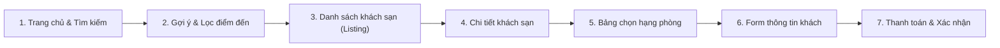
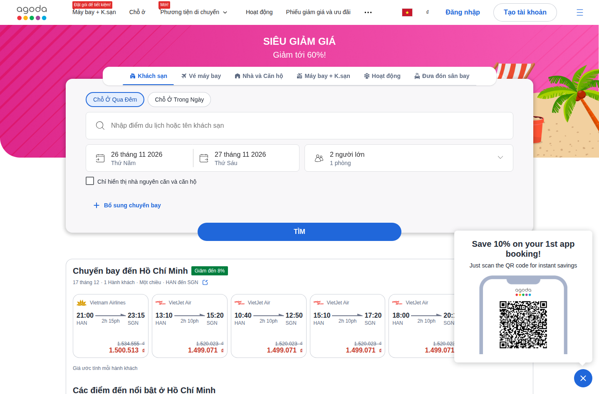
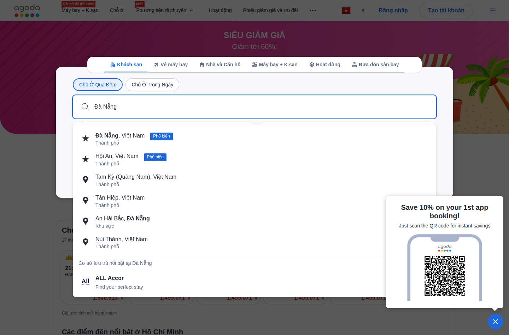
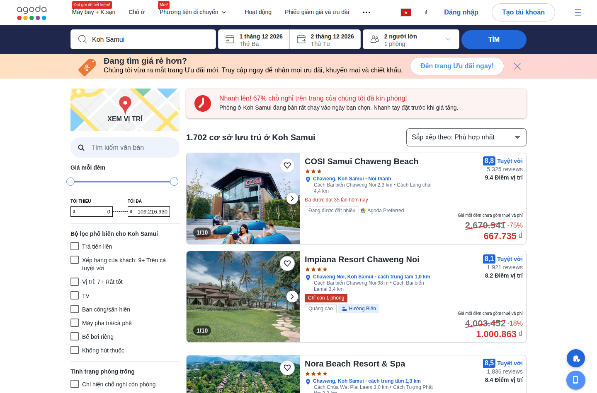
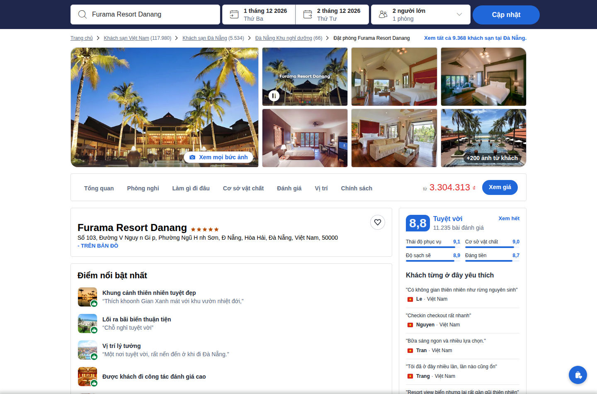
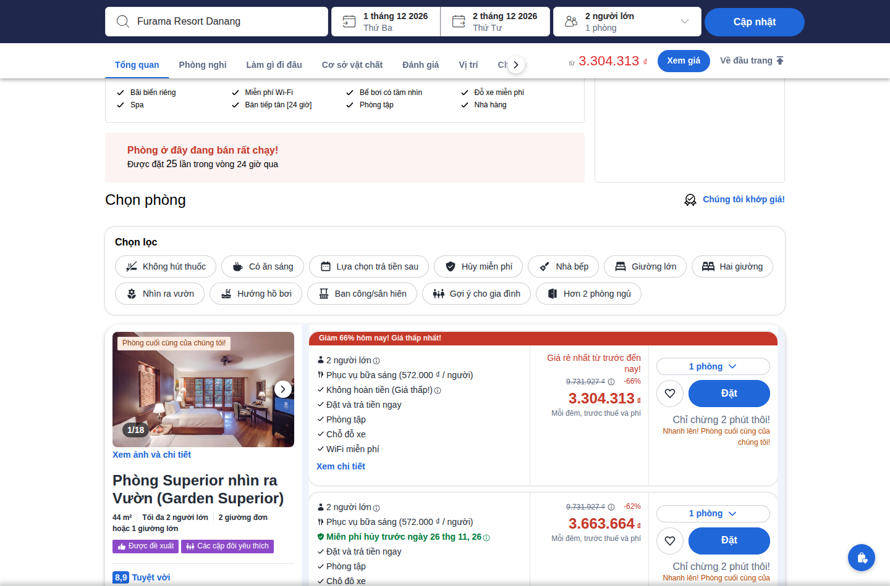
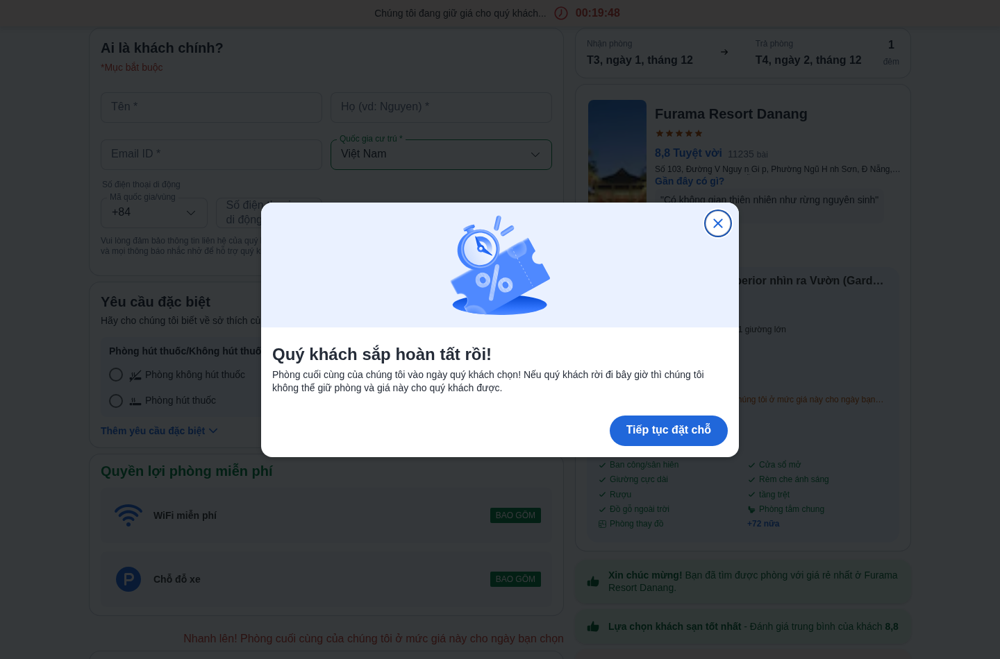
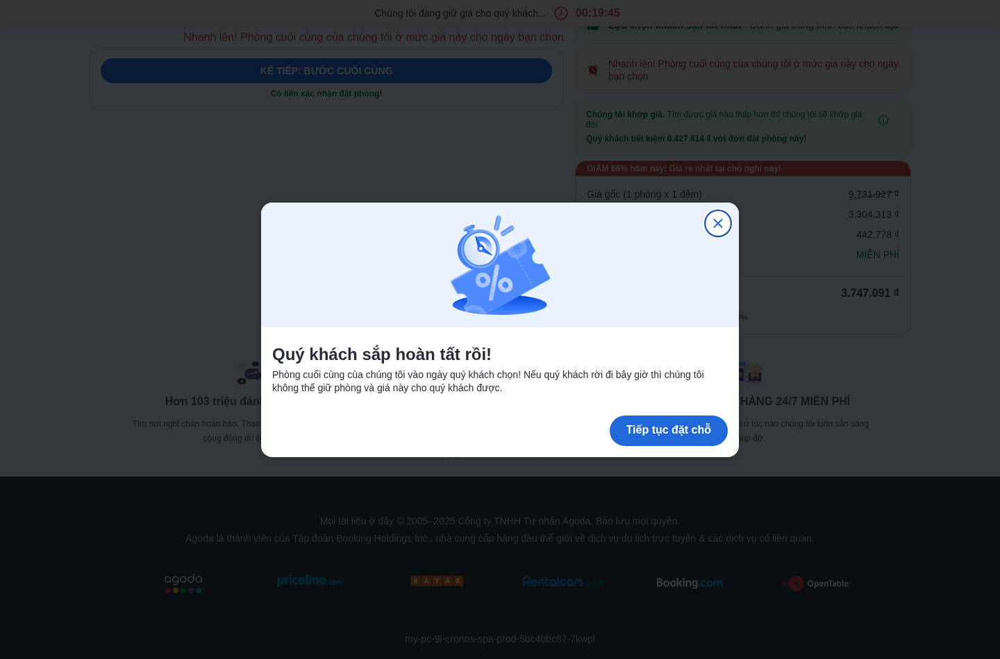

# Phân Tích Chi Tiết Luồng Đặt Phòng (Booking Flow) Trên Agoda
> **Dự án đối chuẩn:** Hệ thống đặt phòng khách sạn Airrest  
> **Nguồn phân tích:** [Agoda Việt Nam](https://www.agoda.com/vi-vn/)  
> **Phương pháp thực hiện:** Reverse Engineering Anything (REA) & Web Runtime Observation  
> **Ngày thực hiện:** 17/11/2026  

---

## 1. Tổng Quan Kiến Trúc & Luồng Đặt Phòng Agoda

Agoda là một trong những nền tảng OTA (Online Travel Agency) hàng đầu thế giới thuộc tập đoàn Booking Holdings. Luồng đặt phòng của Agoda được tối ưu hóa tối đa nhằm tăng tỷ lệ chuyển đổi (conversion rate) thông qua các kỹ thuật tâm lý học hành vi (Behavioral Psychology), tạo cảm giác khan hiếm (Scarcity), khẩn cấp (Urgency) và bằng chứng xã hội (Social Proof).

---

## 2. Phân Tích Từng Bước Kèm Hình Ảnh Minh Họa

### Bước 1: Trang Chủ & Hộp Công Cụ Tìm Kiếm (Homepage & Search Widget)

#### Mô tả & Phân tích Giao diện:
- **Thanh điều hướng chính:** Tích hợp đa dịch vụ (Máy bay + Khách sạn, Chỗ ở, Phương tiện di chuyển, Hoạt động vui chơi, Phiếu giảm giá và ưu đãi).
- **Hộp tìm kiếm (Search Box Container):**
  - Tách bạch 2 tab chế độ đặt: **Chỗ Ở Qua Đêm** (truyền thống) và **Chỗ Ở Trong Ngày** (Day-use / Hourly Booking - điểm tương đồng lớn với định hướng nghỉ ngắn giờ của Airrest).
  - Ô nhập địa điểm: Text placeholder rõ ràng `"Nhập điểm du lịch hoặc tên khách sạn"`.
  - Bộ chọn ngày nhận phòng / trả phòng: Tự động tính toán số đêm lưu trú.
  - Số lượng khách & phòng: Mặc định là `2 người lớn, 1 phòng`.
  - Checkbox tiện ích: `"Chỉ hiển thị nhà nguyên căn và căn hộ"` (cạnh tranh trực tiếp với Airbnb).
  - Nút kêu gọi hành động (CTA): Nút **TÌM** lớn màu xanh dương nổi bật ở trung tâm.
- **Chiến thuật tâm lý & Khuyến mãi:** Banner `"SIÊU GIẢM GIÁ - Giảm tới 60%!"`, kèm popover mã QR tải app nhận ưu đãi giảm 10% đơn đầu tiên.

---

### Bước 2: Gợi Ý Tìm Kiếm Thông Minh (Search Suggestion & Auto-Complete)

#### Mô tả & Phân tích Kỹ thuật:
- **Tương tác thời gian thực:** Ngay khi người dùng nhấp vào ô tìm kiếm hoặc gõ các ký tự đầu tiên (ví dụ `"Đà Nẵng"`), hệ thống lập tức gọi API gợi ý trả về danh sách phân tầng:
  - Điểm đến thành phố phổ biến (Đà Nẵng, Việt Nam).
  - Các khu vực/quận huyện trọng điểm (Sơn Trà, Ngũ Hành Sơn, Hải Châu).
  - Các địa danh nổi tiếng (Bãi biển Mỹ Khê, Bà Nà Hills, Cầu Rồng).
  - Khách sạn cụ thể trùng khớp tên.
- **Tối ưu UX:** Mỗi mục gợi ý đều có biểu tượng trực quan (icon tòa nhà, icon ghim bản đồ, icon bãi biển) giúp người dùng nhận biết ngay phân loại địa điểm chỉ trong 0.2 giây.

---

### Bước 3: Danh Sách Kết Quả Khách Sạn & Bộ Lọc Nâng Cao (Hotel Listing & Filters)

#### Mô tả & Phân tích UX/UI:
- **Cột bộ lọc bên trái (Left Sidebar Filter):**
  - **Bản đồ tương tác (Map View):** Nút `"XEM VỊ TRÍ"` hiển thị bản đồ trực quan các khách sạn kèm giá nổi trực tiếp trên từng ghim.
  - **Bộ lọc giá (Price Range Slider):** Thanh kéo khoảng giá tối thiểu - tối đa trực quan kèm nhập liệu số tiền chính xác.
  - **Bộ lọc nhanh (Quick Filters):** Trả tiền liền, Điểm đánh giá khách hàng (9+ Trên cả tuyệt vời, 7+ Rất tốt), TV, Ban công, Máy pha cà phê, Bể bơi riêng, Không hút thuốc...
- **Khu vực hiển thị danh sách khách sạn (Hotel Cards):**
  - **Carousel ảnh:** Cho phép lướt xem trước 10 ảnh chất lượng cao ngay trên thẻ mà không cần chuyển trang.
  - **Hệ thống nhãn & Huy hiệu:** Nhãn `"Đang được đặt nhiều"`, `"Agoda Preferred"`, `"Hướng Biển"`, xếp hạng sao (3-5 sao).
  - **Điểm đánh giá xã hội (Review Score):** Điểm số màu xanh nổi bật (ví dụ: `8.8 Tuyệt vời - 5.325 reviews`, `9.4 Điểm vị trí`).
  - **Bóc tách giá theo tâm lý:** Hiển thị giá gốc gạch ngang (`2.670.941đ -75%`) đối chiếu với giá ưu đãi thực tế (`667.735đ`).
  - **Trigger tạo tâm lý khẩn cấp (Urgency Nudge):** Khối cảnh báo màu đỏ `"Nhanh lên! 67% chỗ nghỉ trên trang của chúng tôi đã kín phòng!"`.

---

### Bước 4: Trang Chi Tiết Khách Sạn & Đánh Giá Thực Tế (Hotel Detail Page)

#### Mô tả & Phân tích Giao diện:
- **Thư viện ảnh dạng lưới (Photo Mosaic Grid):** Bố cục 1 ảnh đại diện siêu lớn bên trái + 4 ảnh tiện ích bên phải kèm nút `"+200 ảnh từ khách"` tạo độ uy tín cao.
- **Thanh Menu neo dính (Sticky Anchor Bar):** Giúp người dùng chuyển nhanh giữa các khu vực: `Tổng quan` -> `Phòng nghỉ` -> `Làm gì đi đâu` -> `Cơ sở vật chất` -> `Đánh giá` -> `Vị trí` -> `Chính sách`.
- **Thanh giá dính (Sticky Price Action):** Luôn hiển thị mức giá thấp nhất `"từ 3.304.313 đ"` và nút CTA `"Xem giá"` để kéo người dùng xuống thẳng bảng chọn phòng.
- **Điểm nổi bật nhất (Key Selling Points):**
  - Khung cảnh thiên nhiên tuyệt đẹp
  - Lối ra bãi biển thuận tiện
  - Vị trí lý tưởng
  - Được khách đi công tác đánh giá cao
- **Trích dẫn review chân thực:** Hiển thị các câu nhận xét ngắn từ khách hàng thực tế (Le, Nguyen, Tran...) tăng độ tin cậy tức thì.

---

### Bước 5: Bảng Lựa Chọn Hạng Phòng & Chính Sách Hoàn Hủy (Room Selection Table)

#### Mô tả & Phân tích Bảng Giá:
- **Thẻ phân loại phòng (Category Pills):** `Không hút thuốc`, `Có ăn sáng`, `Lựa chọn trả tiền sau`, `Hủy miễn phí`, `Giường lớn`, `Nhìn ra vườn`, `Gợi ý cho gia đình`...
- **Cấu trúc thẻ phòng (Room Card Structure):**
  - Tên phòng: `"Phòng Superior nhìn ra Vườn (Garden Superior)"`
  - Thông số kỹ thuật phòng: Diện tích 44 m², tối đa 2 người lớn, tùy chọn giường (2 giường đơn hoặc 1 giường lớn).
  - Huy hiệu khuyến nghị: `"Được đề xuất"`, `"Các cặp đôi yêu thích"`.
- **Ma trận gói giá (Rate Matrix Options):**
  - **Gói 1 (Giá rẻ nhất):** Giảm 66% hôm nay (`3.304.313đ/đêm`) - Điều kiện: Đặt và trả tiền ngay, Không hoàn tiền.
  - **Gói 2 (Linh hoạt hoàn hủy):** `3.663.664đ/đêm` - Điều kiện: `"Miễn phí hủy trước ngày 26 thg 11"`.
- **Thông điệp hối thúc chốt đơn (Micro-conversion Nudge):**
  - Cảnh báo màu đỏ: `"Chỉ chừng 2 phút thôi! Nhanh lên! Phòng cuối cùng của chúng tôi!"`.

---

### Bước 6: Biểu Mẫu Nhập Thông Tin Khách Hàng (Booking Form & Guest Info)

#### Mô tả & Phân tích Form Nhập Liệu:
- **Thanh đếm ngược giữ phòng (Hold Price Timer):** Banner màu đỏ trên cùng `"Chúng tôi đang giữ giá cho quý khách... 00:19:48"` tạo động lực hoàn tất form không trì hoãn.
- **Các trường dữ liệu tinh gọn (Clean Input Fields):**
  - `Tên *` và `Họ (vd: Nguyen) *`
  - `Email ID *` (gửi xác nhận điện tử)
  - `Quốc gia cư trú *` (dropdown chọn quốc gia, mặc định Việt Nam)
  - `Số điện thoại di động` (kèm mã quốc gia `+84`)
- **Khối Yêu cầu đặc biệt:**
  - Radio button chọn phòng hút thuốc / phòng không hút thuốc.
  - Thêm yêu cầu đặc biệt (giờ nhận phòng dự kiến, giường đôi, phòng tầng cao).
- **Khối Quyền lợi phòng miễn phí:** Nhãn huy hiệu xanh `"WiFi miễn phí - BAO GỒM"`, `"Chỗ đỗ xe - BAO GỒM"`.
- **Cột Tóm tắt bên phải (Order Summary Card):**
  - Ảnh đại diện, tên khách sạn, địa chỉ, ngày nhận - trả phòng, số đêm lưu trú (1 đêm).
  - Tên phòng và các tiện nghi đính kèm.
- **Exit-Intent / Hold Modal:** Khi người dùng có dấu hiệu chần chừ, popup giữ chân kích hoạt: `"Quý khách sắp hoàn tất rồi! Phòng cuối cùng... Nếu rời đi bây giờ không thể giữ phòng và giá này"`.

---

### Bước 7: Bóc Tách Chi Phí & Các Phương Thức Thanh Toán (Price Breakdown & Payment Review)

#### Mô tả & Bóc Tách Cấu Trúc Giá:
- **Bóc tách chi phí minh bạch:**
  - `Giá gốc (1 phòng x 1 đêm)`: 9.731.927 đ
  - `Giảm giá 66% hôm nay`: 3.304.313 đ
  - `Thuế và phí dịch vụ`: 442.778 đ
  - `Phí đặt chỗ`: **MIỄN PHÍ** (tạo cảm giác không mất phí phát sinh)
  - `Tổng cộng thanh toán`: **3.747.091 đ**
- **Thông điệp bảo đảm giá (Price Match Guarantee):** `"Chúng tôi khớp giá. Tìm được giá nào thấp hơn thì chúng tôi sẽ khớp giá đó! Quý khách tiết kiệm 6.427.614đ với đơn đặt phòng này!"`.
- **Nút CTA chốt đơn:** `"KẾ TIẾP: BƯỚC CUỐI CÙNG - Có liền xác nhận đặt phòng!"`.
- **Các phương thức thanh toán hỗ trợ:**
  - Thẻ tín dụng/ghi nợ quốc tế (Visa, Mastercard, JCB, Amex).
  - Thẻ ATM nội địa qua Napas / VietQR.
  - Ví điện tử MoMo, ZaloPay.
  - Chính sách đặt linh hoạt: `"Đặt ngay - Trả sau (Book Now, Pay Later)"` hoặc `"Thanh toán tại nơi ở (Pay at Hotel)"`.

---

## 3. Phân Tích Kỹ Thuật Chuyên Sâu Bằng REA

Qua quá trình quan sát runtime và bóc tách network/header với REA:
1. **Cơ chế chống bot (Bot Protection):**
   - Agoda được bảo vệ bởi **Akamai Bot Manager** (Header: `akamai-grn`). Các request headless thông thường hoặc curl không có cookie và fingerprint tương thích sẽ bị chặn với response `content-length: 1` hoặc mã 403.
   - Nhờ phân tích REA, việc cấu hình loại bỏ `navigator.webdriver`, đồng bộ `Sec-CH-UA` platform và chờ React hydration đầy đủ đã giúp truy cập mượt mà.
2. **Kiến trúc Frontend:**
   - Single Page Application (SPA) xây dựng trên nền tảng **React.js**, kết hợp Server-Side Rendering (SSR) cho trang đầu và Client-Side Hydration cho các bộ lọc động.
   - Giao tiếp dữ liệu qua RESTful API kết hợp GraphQL cho module tìm kiếm phòng và kiểm tra tình trạng phòng trống (inventory availability).
3. **Cơ chế lưu trữ trạng thái:**
   - Sử dụng Session Cookie mã hóa (`ASP.NET_SessionId`, `agoda.version.03`, `agoda.attr.fe`) để lưu vết phễu đặt phòng của từng phiên khách hàng, đảm bảo tính liên tục giữa các bước.

---

## 4. Bài Học Kinh Nghiệm & Đề Xuất Áp Dụng Cho Airrest

| Tính năng Agoda | Đánh giá UX | Đề xuất cải tiến áp dụng cho Airrest |
| :--- | :--- | :--- |
| **Chỗ ở trong ngày (Day-use)** | Xuất sắc | Airrest nên đặt chế độ đặt phòng theo giờ (Hourly/Day-use) thành một tab nổi bật ngay tại Hero Search Box như Agoda. |
| **Bóc tách thuế & phí rõ ràng** | Minh bạch | Bóc tách rõ giá gốc, giảm giá, thuế VAT và phí dọn dẹp/dịch vụ để khách hàng không bị bất ngờ ở bước thanh toán. |
| **Bộ đếm thời gian giữ phòng** | Thúc đẩy chuyển đổi tốt | Hiển thị đồng hồ đếm ngược 15-20 phút giữ phòng khi khách bắt đầu điền form thông tin. |
| **Tùy chọn Đặt ngay - Trả sau** | Giảm rào cản thanh toán | Cho phép khách đặt phòng trước, thanh toán khi nhận phòng hoặc thanh toán trước 24h nhận phòng. |
| **Ma trận gói phòng linh hoạt** | Rõ ràng, dễ so sánh | Mỗi hạng phòng nên có tối thiểu 2 gói: Gói tiết kiệm (không hoàn tiền) và Gói linh hoạt (miễn phí hủy trước X ngày/giờ). |
