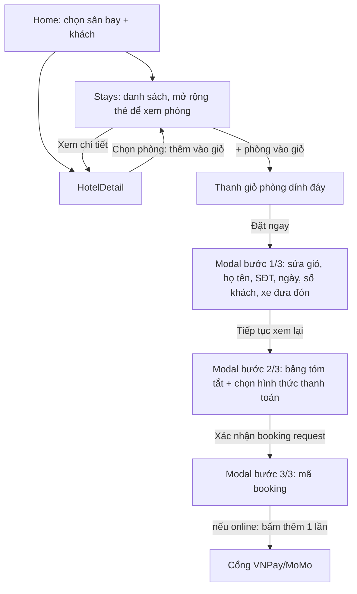
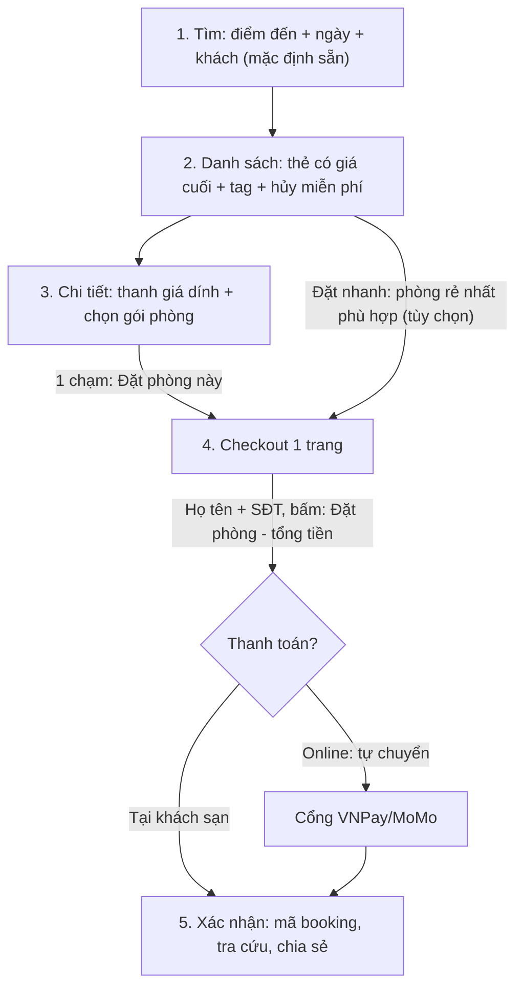

# Phân tích & thiết kế lại luồng đặt phòng Airrest (v2)

> Phạm vi: luồng đặt phòng phía khách hàng (mobile-first), từ tìm kiếm đến xác nhận.
> Nguồn: `docs/agoda/booking_flow.md`, `docs/traveloka/booking_flow.md`, code hiện tại ở `apps/web/src/screens/user/` (Home, Stays, HotelDetail, BookingModal, cart.js) và `backend/services/bookings/`.
> Ràng buộc đã chốt: **không bắt đăng nhập**; mục tiêu là **khách thao tác ít nhất có thể**.
> Trạng thái: tài liệu thiết kế, chưa sửa code.

---

## 1. Phần A — Phân tích Agoda & Traveloka (chỉ rút ra điều liên quan đến số bước và thao tác)

### 1.1 Số bước và điểm giảm ma sát

| Chặng | Agoda | Traveloka | Điều học được |
|---|---|---|---|
| Tìm kiếm | 1 hộp: điểm đến, ngày, 2 người lớn/1 phòng mặc định, tab "Trong ngày" | 1 hộp 3 ô; gợi ý theo vùng/quận có ảnh | Mọi thứ có **mặc định hợp lý**, khách chỉ cần nhập điểm đến rồi bấm Tìm |
| Danh sách | Thẻ có giá gạch/giá thật, điểm đánh giá, nhãn khan hiếm | Thẻ có ribbon giảm giá | Giá cuối cùng thấy ngay trên thẻ, không phải mở ra mới biết |
| Chi tiết | **Thanh giá dính** "từ X đ" + nút *Xem giá* luôn trên màn hình | Nút *Chọn phòng* ngay trên từng gói | Khách luôn có **một nút hành động** trong tầm tay, không phải cuộn tìm |
| Chọn phòng | Ma trận gói giá (rẻ không hoàn / linh hoạt hoàn hủy), chọn **1 chạm** sang form | Gói cơ bản / kèm sáng / hoàn hủy, `Chọn phòng` → form | Chính sách hủy nằm **ngay cạnh giá**, chọn xong vào thẳng form |
| Form | Tên, Họ, Email, Quốc gia, SĐT; yêu cầu đặc biệt (tùy chọn); **đếm ngược giữ giá 20 phút**; thẻ tóm tắt đơn bên cạnh | Họ tên, SĐT, Email; công tắc *Tôi đặt cho người khác* | Chỉ trường tối thiểu bắt buộc; còn lại **tùy chọn, ẩn sau công tắc** |
| Thanh toán | Tách giá minh bạch (gốc, giảm, thuế, phí 0đ); thẻ, Napas/VietQR, MoMo, ZaloPay, **Đặt ngay trả sau / trả tại KS** | VietQR 24/7, thẻ, ví, PayLater; ô mã giảm giá; add-on (bảo hiểm, đưa đón) | Có sẵn lựa chọn **không phải trả trước**; mã giảm giá gấp lại, không chiếm chỗ |
| Chốt đơn | 1 nút "Bước cuối cùng" | 1 nút thanh toán | **Không có màn "xem lại" riêng**: tóm tắt luôn hiện cạnh form |

### 1.2 Cả hai đều dồn về cùng một cấu trúc

`Tìm kiếm → Danh sách → Chi tiết (chọn gói phòng) → 1 trang Form + Thanh toán + Tóm tắt → Xác nhận`

Tức là **4 màn**, và trang cuối là **một trang duy nhất** chứa thông tin khách, thanh toán và tóm tắt giá. Họ không có bước "xem lại rồi mới xác nhận".

### 1.3 Điểm không nên bê nguyên

- Cảnh báo khan hiếm giả ("67% đã kín phòng", "phòng cuối cùng") — chỉ hiện khi dữ liệu tồn phòng thật (`availableRooms`).
- Chống bot nhiều lớp (Akamai, DataDome...) và Rate Key mật mã của Traveloka: quá nặng cho giai đoạn này. Backend Airrest đã có `quote` và `idempotency`; chỉ cần đảm bảo **server tự tính lại giá**, không tin giá từ client.
- Quốc gia cư trú, bảo hiểm, PayLater: ngoài phạm vi khách mobile trong nước.

---

## 2. Phần B — Luồng hiện tại của Airrest (đo từ code)



### 2.1 Số thao tác cho khách đặt 1 phòng, thanh toán tại khách sạn (trường hợp đơn giản nhất)

| # | Việc khách phải làm | Loại |
|---|---|---|
| 1 | Chọn sân bay/khách ở Home, bấm tìm | Bắt buộc |
| 2 | Chọn khách sạn, mở rộng thẻ (hoặc vào Chi tiết) | Bắt buộc |
| 3 | Bấm `+` thêm phòng vào giỏ (nếu đi từ Chi tiết: bấm Chọn phòng, **bị đưa ngược về Stays**) | Thừa một lượt khi đi từ Chi tiết |
| 4 | Bấm `Đặt ngay` trên thanh giỏ | Thừa (giỏ cho 1 phòng) |
| 5 | Modal 1: nhập họ tên, SĐT; **kiểm tra lại ngày** và số khách | Họ tên, SĐT là cần; phần còn lại lặp lại điều đã chọn |
| 6 | Bấm `Tiếp tục xem lại` | **Thừa** |
| 7 | Modal 2: đọc bảng tóm tắt, chọn thanh toán, bấm `Xác nhận` | Bước xem lại thừa, chọn thanh toán là cần |
| 8 | Modal 3: nếu online, bấm thêm `Thanh toán qua ...` | **Thừa** |

Kết quả: khoảng **7 thao tác bấm + 2 trường nhập** (SĐT, họ tên), cùng 3 màn trong modal. Với khách quay lại (đã được nhớ họ tên/SĐT), vẫn còn khoảng 6 lần bấm.

### 2.2 Vấn đề cụ thể (gắn với code)

| # | Vấn đề | Vị trí | Hệ quả |
|---|---|---|---|
| V1 | `pick()` ở Chi tiết thêm vào giỏ rồi `go stays` | `HotelDetail.jsx:166-172` | Khách bị đẩy ngược ra danh sách, mất ngữ cảnh, phải tìm thanh giỏ |
| V2 | Mô hình giỏ nhiều dòng áp dụng cho cả đơn 1 phòng | `cart.js`, `Stays.jsx:195-205` | Thêm một bước "mở giỏ" không cần thiết |
| V3 | Modal bước 1 vừa là giỏ, vừa nhập khách, vừa chọn lại ngày | `BookingModal.jsx:180-226` | Khách phải kiểm tra lại ngày/khách đã chọn từ trước |
| V4 | Bước 2 chỉ để xem lại | `BookingModal.jsx:227-247` | 1 lần bấm không thêm giá trị |
| V5 | Hình thức thanh toán chỉ xuất hiện ở bước 2, sau khi đã điền hết | `BookingModal.jsx:239` | Khách không biết sớm có trả sau được hay không |
| V6 | Tạo đơn xong mới hiện nút sang cổng thanh toán | `BookingModal.jsx:262-264` | Thêm 1 lần bấm; khách dễ bỏ giữa chừng khi đơn đã giữ chỗ |
| V7 | Giá chi tiết (`priceQuote`) chỉ có từ bước 2 | `BookingModal.jsx:94-100` | Ở bước nhập thông tin khách chỉ thấy "tạm tính" |
| V8 | Giữ phòng 20 phút có ở backend (`HOLD_MS`) nhưng **không hiện đếm ngược** | `bookings.service.ts:16` | Khách không biết thời hạn, mất tác dụng thúc chuyển đổi |
| V9 | Modal, trên mobile là bottom-sheet cao 96dvh, cuộn dài | `BookingModal.jsx:178` | Khó thao tác, mất nút Back của trình duyệt, khó chia sẻ/khôi phục |

---

## 3. Phần C — Luồng đề xuất

### 3.1 Nguyên tắc

1. **Mỗi dữ liệu chỉ hỏi một lần.** Ngày, khách, số phòng lấy từ ô tìm kiếm, ở trang đặt chỉ hiển thị dạng chip có thể bấm để sửa.
2. **Chỉ 2 trường bắt buộc: Họ tên và SĐT** (đã nhớ trên máy thì điền sẵn). Email, yêu cầu đặc biệt, đặt hộ người khác: tùy chọn, gấp lại.
3. **Một trang checkout duy nhất**, thay modal 3 bước: thông tin khách + thanh toán + tóm tắt giá + nút chốt. Không có bước "xem lại".
4. **Một nút hành động luôn thấy**: thanh dính đáy màn hình, ghi rõ tổng tiền.
5. **Tiền và chính sách hủy hiện trước khi nhập thông tin**, không sau.
6. **Chốt xong là đi thẳng**: online thì tự chuyển sang cổng; tại KS thì ra màn xác nhận có mã.
7. **Không bắt đăng nhập.** Tra cứu bằng mã + SĐT như hiện tại.

### 3.2 Luồng mới



Cấu trúc 4 màn, khớp với cả Agoda lẫn Traveloka, nhưng bỏ hẳn modal và bước xem lại.

### 3.3 Bố cục trang Checkout (mobile)

```
┌──────────────────────────────┐
│ ← Đặt phòng       ⏱ 19:42    │  đếm ngược chỉ hiện khi đơn có HOLD
├──────────────────────────────┤
│ [ảnh] Khách sạn A             │
│ Deluxe · 1 phòng              │
│ [20/11 → 21/11 · 1 đêm] [2 khách] ← chip, bấm để sửa tại chỗ
│ ✓ Hủy miễn phí trước 19/11 14:00   │
├──────────────────────────────┤
│ Họ và tên   [____________]    │  điền sẵn từ lần trước
│ Số điện thoại [__________]    │
│ ▸ Đặt hộ người khác / Yêu cầu đặc biệt / Email   ← gấp lại
│ ▸ Xe đưa đón sân bay (+giá)   ← gấp lại, chỉ hiện nếu KS có xe
├──────────────────────────────┤
│ Thanh toán                    │
│ (•) Tại khách sạn — không trả trước │  mặc định = lựa chọn lần trước
│ ( ) VNPay   ( ) MoMo          │
│ ▸ Mã giảm giá                 │  gấp lại
├──────────────────────────────┤
│ Tiền phòng           450.000đ │
│ Phí dịch vụ                0đ │
│ Tổng                 450.000đ │
├──────────────────────────────┤
│ [ Đặt phòng · 450.000đ ]      │  dính đáy, an toàn với safe-area
└──────────────────────────────┘
```

### 3.4 Đếm lại thao tác (đặt 1 phòng, thanh toán tại khách sạn)

| | Hiện tại | Đề xuất |
|---|---|---|
| Khách mới | ~7 lần bấm + 2 trường | **3 lần bấm** (Chọn gói, Đặt phòng, (xem mã)) + 2 trường |
| Khách quay lại (đã nhớ tên/SĐT) | ~6 lần bấm | **2 lần bấm**, 0 trường nhập |
| Thanh toán online | +1 lần bấm trên modal 3 | **0 lần bấm thêm** (tự chuyển cổng) |
| Số màn / modal | 3 bước modal + giỏ | **1 trang** |

### 3.5 Quyết định thiết kế chính và lý do

| Quyết định | Lý do | Ảnh hưởng tới code hiện có |
|---|---|---|
| Bỏ bước "xem lại", gộp vào 1 trang checkout | Agoda/Traveloka đều không có; V4 | Bỏ `step===2`, đưa phần tóm tắt + chọn thanh toán lên cùng trang |
| `Chọn phòng` ở Chi tiết đi **thẳng** tới checkout, không qua Stays | V1 | Đổi `pick()`; vẫn tái dùng `cart.js` bên trong cho 1 dòng |
| Giữ giỏ nhiều dòng **chỉ cho đặt nhiều phòng/loại phòng**, không bắt đi qua giỏ với đơn 1 phòng | V2 | Giữ `cart.js` và thanh giỏ ở Stays; thêm lối rẽ thẳng |
| Checkout là **trang có đường dẫn riêng** thay modal (ví dụ `/dat-phong`) | V9: có nút Back, tải lại không mất, tương thích Safari | Thêm một mục vào `routes.js`; cần test routes |
| Chọn thanh toán trước khi bấm chốt, mặc định = lần trước | V5; Agoda/Traveloka đều để thanh toán trong cùng trang | Dùng lại `listPaymentMethods`; thêm lưu "phương thức lần trước" cạnh `saveGuest` |
| Online: tạo đơn xong **tự `location.assign(payUrl)`** | V6 | Đổi `bookingResult` xử lý; giữ nút thủ công làm dự phòng nếu `payUrl` lỗi |
| Hiện đếm ngược từ `holdExpiresAt` | V8; Agoda | Cần backend trả `holdExpiresAt` ở quote/booking (xem 4.2) |
| Giá chi tiết ngay khi mở checkout | V7 | Gọi `quoteBooking` khi mở trang, không chờ bước 2 |

---

## 4. Phần D — Các phần còn thiếu, xếp ưu tiên

### 4.1 Giao diện (hầu hết không cần backend mới)

| Ưu tiên | Hạng mục | Học từ | Ghi chú |
|---|---|---|---|
| **P0** | Trang Checkout 1 trang, thay modal 3 bước | Cả hai | Giá trị lớn nhất, xem 3.3 |
| **P0** | Thanh giá dính trên Chi tiết + nút `Đặt phòng` luôn hiện | Agoda | Hiện chỉ có "từ X/đêm" trên thanh tiêu đề (`HotelDetail.jsx:189`, ẩn ở mobile do `tw:hidden … tw:sm:flex`) |
| ~~P0~~ | ~~Chính sách hủy nằm cạnh giá của từng gói~~ | Agoda, Traveloka | **Đã có** ở `RoomCard` (`HotelDetail.jsx`: `cancellationPolicy` + mức Không hoàn hủy), nhận định ban đầu sai |
| **P0** | Chip ngày/khách/phòng sửa tại chỗ trong checkout | Agoda | Bỏ trường ngày lặp lại ở bước 1 |
| **P0** | Tự chuyển sang cổng thanh toán | Traveloka | Bỏ 1 lần bấm |
| **P1** | Đếm ngược giữ phòng | Agoda | Dùng `HOLD_MS = 20 phút` đã có |
| **P1** | Màn xác nhận đầy đủ: mã, nút *Lưu ảnh*, *Chia sẻ*, *Thêm vào lịch*, *Chỉ đường*, giờ nhận phòng | Cả hai | Hiện màn 3 chỉ có mã + tóm tắt + nút tra cứu |
| **P1** | Gấp lại: *Đặt hộ người khác* và *Yêu cầu đặc biệt* (giờ đến sớm, giường, tầng cao) | Traveloka | Có thể ghi vào ghi chú; cần xác nhận trường trong schema (4.2) |
| **P1** | Mã giảm giá (ô gấp lại) | Traveloka | Hiện **chưa có** trong web/backend (chỉ có trong `lib/money.ts` liên quan giá, không có khái niệm voucher) |
| **P1** | Tab *Theo giờ* nổi bật ở hộp tìm kiếm | Agoda "Trong ngày" | Hiện chọn giờ nằm ở bước đặt phòng (`HourlyPicker`) |
| **P2** | Gợi ý điểm đến phân tầng kèm ảnh/số chỗ (sân bay, bệnh viện...) | Traveloka | Làm sau, ngoài trọng tâm giảm thao tác đặt |
| **P2** | Thẻ danh sách: giá cuối, nhãn "Hủy miễn phí", điểm đánh giá | Agoda | `hotel_reviews` đã có |
| **P2** | Email tùy chọn để nhận xác nhận | Cả hai | Xem 4.2 |
| **P2** | VietQR động, tự khớp lệnh | Traveloka | Cần tích hợp thanh toán mới, tách thành hạng mục riêng |

### 4.2 Việc cần xem backend / dữ liệu (cần bạn đồng ý trước khi làm, theo CLAUDE.md)

| Hạng mục | Câu hỏi cần chốt |
|---|---|
| Trả `holdExpiresAt` cho FE | Đơn **tự duyệt** có giữ chỗ không, hay chỉ đơn **chờ khách sạn duyệt** mới có đếm ngược? (code: `holdExpiresAt` có khi chờ duyệt hoặc thanh toán online) |
| Email / yêu cầu đặc biệt / đặt hộ | Có thêm cột trong collection booking không, hay gộp vào một trường ghi chú? Đụng schema nên cần xác nhận riêng |
| Mã giảm giá | Có nằm trong phạm vi MVP không? Cần bảng voucher, quy tắc áp dụng |
| Quote có "chữ ký" | `quoteBooking` đã có; cần đảm bảo `createBooking` tính lại giá phía server (không tin giá FE). Em chưa kiểm tra chi tiết |

### 4.3 Đo hiệu quả (cách biết "tối ưu" thật)

- Số lần chạm từ Chi tiết đến có mã booking: mục tiêu ≤ 3 với khách mới, ≤ 2 với khách quay lại.
- Tỷ lệ bỏ giữa chừng tại checkout; thời gian từ vào checkout đến có mã.
- Tỷ lệ đơn online có hoàn tất thanh toán (trước/sau khi tự chuyển cổng).

---

## 5. Gợi ý thứ tự triển khai (chờ bạn duyệt)

1. **Đợt 1 (chỉ FE, không động schema):** trang checkout 1 trang, bỏ bước xem lại, `pick()` đi thẳng, chip sửa ngày/khách, thanh dính, tự chuyển cổng thanh toán, hiện chính sách hủy cạnh giá.
2. **Đợt 2 (FE + trả thêm field):** đếm ngược giữ phòng, màn xác nhận đầy đủ, tab *Theo giờ* ở tìm kiếm.
3. **Đợt 3 (cần quyết định backend):** email, yêu cầu đặc biệt, đặt hộ, mã giảm giá, VietQR.

## 5b. Tiến độ triển khai (cập nhật 2026-11-17)

**Đã làm (chỉ giao diện, không đổi schema/API):**
- Bỏ bước xem lại: thanh toán + báo giá + chốt đơn gộp vào 1 form; nút "Đặt phòng · tổng tiền".
- Online tự chuyển sang cổng thanh toán; `Chọn phòng` ở trang chi tiết mở thẳng form; chống bấm đúp.
- Thanh giá dính ở mobile (trang chi tiết).
- Nhớ hình thức thanh toán lần trước.
- Email xác nhận (tùy chọn): backend `guest.email` đã hỗ trợ sẵn.
- Đếm ngược hạn giữ phòng ở màn kết quả: backend (`backend/services/bookings`) đã trả `expiresAt` cho đơn chờ duyệt và đơn online.
- Màn xác nhận: sao chép mã, chia sẻ, chỉ đường.
- Nút "Thuê theo giờ" ở hero trang chủ (mở Stays với bộ lọc giờ); nhãn "Hủy miễn phí"/"Theo giờ" trên thẻ khách sạn.

**Hiệu chỉnh nhận định ban đầu:** backend thật là `backend/api` + `backend/services` (Postgres); `backend/src` là bản Mongo cũ, không dùng. Chính sách hủy cạnh giá và điểm đánh giá trên thẻ đã có từ trước.

**Quyết định BA: hoãn có chủ đích**
| Hạng mục | Lý do hoãn |
|---|---|
| Yêu cầu đặc biệt, đặt hộ người khác | Booking chưa có trường ghi chú/người ở; cần thêm cột + migration + hiển thị cho khách sạn. Làm cùng một đợt backend riêng |
| Mã giảm giá | Cần quy tắc nghiệp vụ (điều kiện, hạn, ngân sách) và bảng voucher; chưa có yêu cầu từ chủ sản phẩm |
| VietQR động | Cần tài khoản ngân hàng + webhook đối soát; phụ thuộc đối tác |
| Checkout thành trang riêng | Modal đã còn 1 bước; đổi sang route đụng nhiều test, lợi ích thấp |
| Thêm vào lịch, gợi ý điểm đến có ảnh | Ưu tiên thấp |

## 6. Chưa kiểm tra / giả định

- Chưa chạy thử luồng trên trình duyệt; số thao tác ở 2.1 và 3.4 là suy ra từ đọc code, chưa đo bằng thao tác thật.
- Chưa đọc chi tiết `HourlyPicker`, `ShuttleOptions`, trang `Stays` danh sách; đề xuất giữ nguyên các phần này, chỉ đổi cách chúng nằm trong checkout.
- Chưa xác minh chính sách hủy hiện được dữ liệu từ backend theo từng gói hay chỉ có cờ `NR` (không hoàn hủy).
