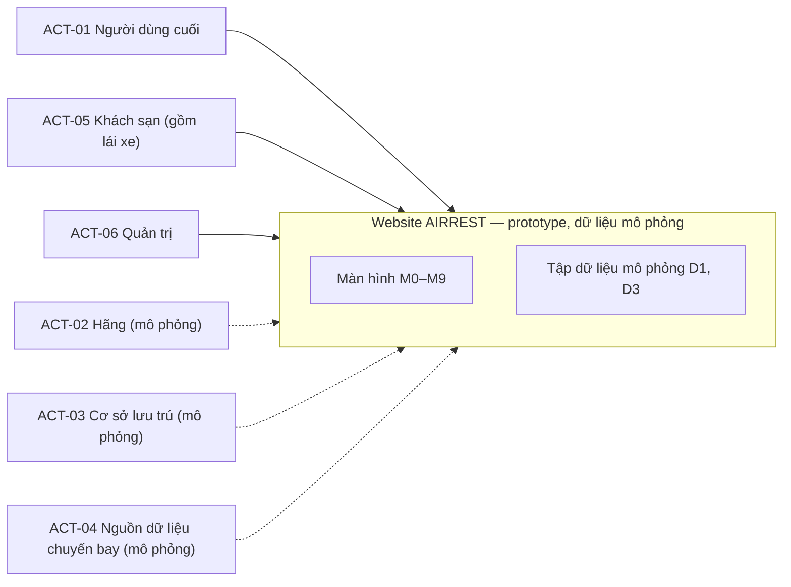
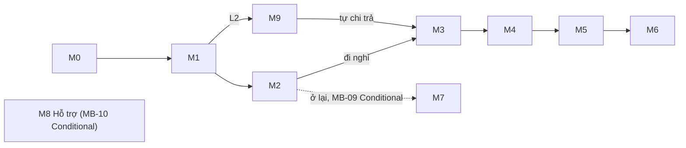
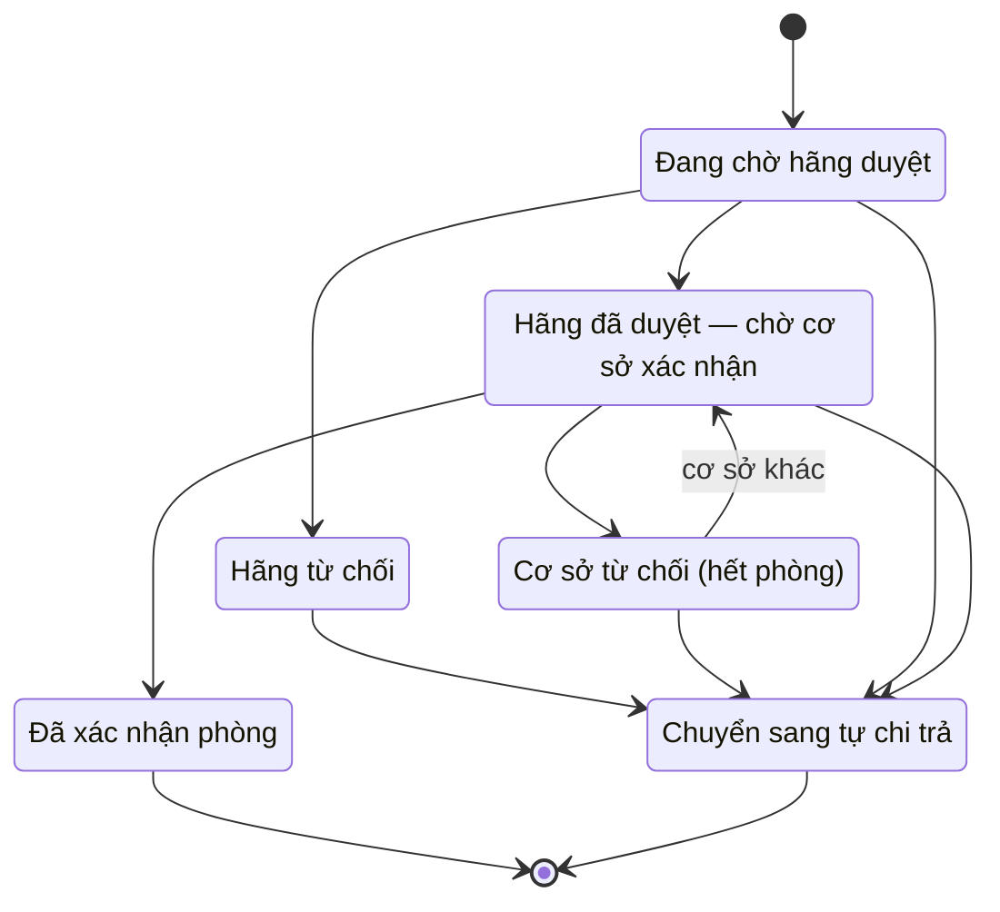

# Software Requirements Specification — Airrest website

| Mục | Nội dung |
|---|---|
| Sản phẩm | AIRREST — website hỗ trợ lưu trú khẩn cấp khi chuyến bay chậm hoặc huỷ (prototype) |
| Phiên bản / trạng thái | v0.6 — **Draft**, baseline đề xuất; chưa được phê duyệt và **Not Ready** (xem READINESS_AUDIT.md, OQ-20, mục 8.5). Mâu thuẫn xử lý theo MVP; đã audit v0.4 và sửa lỗi cụ thể (v0.5) |
| Ngày soạn | 2026-10-26 |
| Người soạn | Claude (Claude Code) theo yêu cầu của phuongdd |
| Người rà soát / phê duyệt | Chưa có |
| Nguồn phạm vi chính | `docs/MVP.md` (20 tính năng MB-01…MB-20) |
| Tài liệu đi kèm | `RTM.md`, `OPEN_QUESTIONS.md`, `SRS_REVIEW.md`, `RESEARCH_AND_GAP_ANALYSIS.md`, `PRODUCT_DECISION_REGISTER.md`, `READINESS_AUDIT.md` (cùng thư mục) |

> Tài liệu viết theo hướng ISO/IEC/IEEE 29148 nhưng ưu tiên nhất quán với MVP. Chỉ nội dung gắn nhãn **[MVP]** (CONFIRMED) là đã xác nhận; nội dung **[B03]/[B04]** (INFERRED) là chi tiết bổ sung từ tài liệu trong `BTHQUAN/` và ở mức **Proposed**; nội dung từ nghiên cứu bên ngoài (EXTERNALLY_RESEARCHED) chỉ là tham khảo, nằm ở mục 3.4 và `RESEARCH_AND_GAP_ANALYSIS.md`, không tạo AC mới; **TBD** là chưa đủ căn cứ.

## Mục lục

- 1. Giới thiệu
- 2. Bối cảnh hệ thống
- 3. Yêu cầu chức năng
- 4. Quy trình nghiệp vụ và use case
- 5. Yêu cầu dữ liệu
- 6. Yêu cầu giao diện và tương tác
- 7. Yêu cầu phi chức năng
- 8. Ràng buộc, giả định, phụ thuộc, rủi ro
- 9. Phạm vi ngoài MVP
- 10. Tiêu chí nghiệm thu và tham chiếu kiểm thử
- Phụ lục A. Kiểm kê tài liệu nguồn
- Phụ lục B. Đối chiếu MVP → yêu cầu

## 1. Giới thiệu

### 1.1 Mục đích

Tài liệu chuyển 20 tính năng trong `docs/MVP.md` thành yêu cầu phần mềm có mã định danh, kiểm thử được và truy vết được, làm cơ sở cho thiết kế UI/UX, phát triển và kiểm thử. Tài liệu không thêm tính năng, tích hợp hay công nghệ mà MVP không quy định.

### 1.2 Phạm vi sản phẩm

- Website responsive, mobile-first cho hành khách bị ảnh hưởng bởi chuyến bay chậm/huỷ **[MVP: MB-17; B03 mục 1]**.
- Hai luồng nghiệp vụ: **L1** — tự tìm và tự chi trả; **L2** — đề nghị hãng hỗ trợ **[MVP cột “Luồng/Màn hình”; định nghĩa L1/L2: B03 mục 1, B00]**.
- Toàn bộ dữ liệu chuyến bay, tồn phòng, giá, thanh toán và phản hồi hãng/cơ sở là **mô phỏng** và phải có nhãn **[MVP: MB-07, MB-11, MB-19]**.
- Phạm vi nghiên cứu: chỉ thư mục `go/apps/manufacture/test/Airrest_website`; không có hệ thống bên ngoài.

### 1.3 Mục tiêu nghiệp vụ

Rút từ cột “Giá trị người dùng” của MVP **[MVP]**: biết giờ bay và bối cảnh; không bỏ lỡ thay đổi; hiểu quyền lợi và điều kiện; ra quyết định nhanh; tìm chỗ phù hợp đang hoạt động; hiểu giá và điều kiện; hoàn tất nhanh; không lỡ chuyến; có phương án khi không đi khách sạn; biết nơi liên hệ; yêu cầu hỗ trợ rõ ràng; biết kết quả và lý do; biết đã có phòng hay chưa; không bị mắc kẹt trong luồng.

### 1.4 Định nghĩa, thuật ngữ, từ viết tắt

| Thuật ngữ | Nghĩa | Nguồn |
|---|---|---|
| MVP / MB-xx | Tính năng trong `docs/MVP.md` | MVP |
| L1 / L2 | Luồng 1 tự tìm và tự chi trả (M0→M1→M2→M3→M4→M5→M6); luồng 2 đề nghị hãng hỗ trợ (M0→M1→M9…) | B03 mục 1, 6.2 |
| M0…M9 | Mã màn hình MVP (tên màn hình ở mục 6) | MVP; tên: B03 mục 6.2 |
| D1, D3 | Kho dữ liệu mô phỏng: D1 chuyến bay; D3 cơ sở lưu trú và tồn phòng | MVP (“Mock D1/D3”); định nghĩa: B04 mục 5.2 |
| N01…N13 | Mã nhu cầu người dùng (ví dụ N01 Biết giờ bay mới) | MVP cột Nguồn; B03 mục 5, B04 mục 7 |
| FR-01, NFR-01… (2 chữ số) | Mã yêu cầu **gốc** của B03, được MVP tham chiếu ở cột FR/NFR | MVP, B03 |
| FR-001, NFR-001… (3 chữ số) | Mã yêu cầu **của SRS này**; luôn kèm mã gốc ở trường “Mã gốc” | SRS |
| MoSCoW | Must / Should / Could / Won’t | MVP cột MoSCoW |
| S1…S4 | Nhãn Sprint của MVP; định nghĩa chưa tìm thấy (OQ-28) | MVP |
| Blocked | Trạng thái duyệt: bị chặn chờ kiểm chứng | MVP |
| GVHD | Giảng viên hướng dẫn | B00, MVP dòng 2 |
| A08 | Bộ dữ liệu 70 cơ sở lưu trú HAN/SGN (tham chiếu, chưa xác nhận làm mock) | B04 mục 5.2 |
| ACT-05 | Khách sạn (gồm lái xe) | Tác nhân người thật trong hệ thống: quản lý khách sạn và lái xe của cơ sở lưu trú; ngoài MVP | Chỉ đạo PO 26/10/2026 |
| ACT-06 | Quản trị | Tác nhân người thật quản lý cơ sở, tài khoản, nội dung và tham số, giám sát; ngoài MVP | Chỉ đạo PO 26/10/2026 |
| Ba tác nhân hệ thống | ACT-01 người dùng cuối, ACT-05 khách sạn (gồm lái xe), ACT-06 quản trị | Chỉ đạo PO 26/10/2026 |

### 1.5 Đối tượng đọc

Chủ sản phẩm/BA, nhóm UI/UX, nhóm phát triển, nhóm kiểm thử, GVHD.

### 1.6 Tài liệu tham chiếu (trong repository)

Danh mục đầy đủ và mức tin cậy: Phụ lục A. Nguồn chính: `docs/MVP.md`. Nguồn bổ sung: `BTHQUAN/` (B00, B03, B04, 00_DOC_TRUOC; B01/B02 đọc có chọn lọc). Bằng chứng tham khảo prototype: `src/main.jsx`. Nghiên cứu bên ngoài: `RESEARCH_AND_GAP_ANALYSIS.md`.

### 1.7 Quy ước

| Loại | Quy ước |
|---|---|
| Mã định danh | `FR-xxx` chức năng; `BR-xxx` quy tắc nghiệp vụ; `NFR-xxx` phi chức năng; `DR-xxx` dữ liệu; `UIR-xxx` giao diện; `IFR-xxx` giao diện hệ thống/dữ liệu; `UC-xxx` use case; `AC-xxx` tiêu chí nghiệm thu; `TC-xxx` tham chiếu test dự kiến; `OQ-xx` câu hỏi mở; `OOS-xx` ngoài phạm vi; `ACT-xx` tác nhân. Mã MVP `MB-xx` được giữ nguyên. |
| Mức căn cứ | **CONFIRMED** = **[MVP]** xác nhận trong `docs/MVP.md`; **INFERRED** = **[B03]/[B04]** chi tiết từ tài liệu nội bộ, Proposed; **EXTERNALLY_RESEARCHED** = tham khảo nguồn ngoài (xem `RESEARCH_AND_GAP_ANALYSIS.md`), chưa được Airrest chấp thuận; **TBD** chưa đủ căn cứ |
| Trạng thái SRS | **In Scope**, **Conditional**, **Out of Scope**, **TBD**, **Proposed** |
| Từ điển trạng thái | Yêu cầu: In Scope/Conditional/Out of Scope/TBD/Proposed. Ứng viên CR (mục 3.5): Proposed, Deferred, Blocked. Sổ quyết định: Pending PO (chờ PO), Simulation Parameter (tham số mô phỏng, PO vẫn cần xác nhận), Deferred (hoãn được), Blocked (thiếu căn cứ hoặc dữ liệu). “(Blocked)” sau trạng thái của một yêu cầu nghĩa là MVP đang đặt MB-03/MB-20 ở Blocked |
| Ưu tiên | Giữ nguyên MoSCoW và Sprint của MVP (không tự thay đổi) |
| Ngôn ngữ | Tiếng Việt; “Hệ thống phải…” cho yêu cầu đã xác nhận |
| TC | Chỉ là mã tham chiếu dự kiến, một TC cho mỗi AC đủ thông tin; chưa viết test case chi tiết. AC chưa đủ thông tin (TBD) không có TC |
| Yêu cầu ngoài MVP | Yêu cầu có nguồn là chỉ đạo của chủ sản phẩm (26/10/2026), không có hạng mục MB tương ứng: trạng thái **Proposed (ngoài MVP)**, không có AC cho đến khi PO duyệt; không sửa `docs/MVP.md` |

## 2. Bối cảnh hệ thống

### 2.1 Bối cảnh vận hành

Hành khách (không đăng nhập) dùng website trên di động khi chuyến bay chậm hoặc huỷ: tra cứu chuyến bay, xem quyền lợi, quyết định ở lại hay đi nghỉ, tìm và đặt nơi nghỉ (L1) hoặc đề nghị hãng hỗ trợ chỗ nghỉ (L2), rồi nhận nhắc giờ quay lại sân bay. Mọi dữ liệu và giao dịch là mô phỏng. **[MVP; B03 mục 1]**

Luồng L2 là cơ chế mô phỏng của Airrest. Nghĩa vụ ăn, nghỉ, hoàn vé và bồi thường thuộc hãng hàng không theo văn bản pháp luật và không phụ thuộc việc hành khách dùng Airrest hay gửi đề nghị trên Airrest (xem G-19 trong `RESEARCH_AND_GAP_ANALYSIS.md`).

Theo chỉ đạo của chủ sản phẩm (26/10/2026), hệ thống có ba tác nhân người thật: **người dùng cuối** (hành khách, không đăng nhập), **khách sạn** (gồm lái xe) và **quản trị**. MVP hiện chỉ mô tả người dùng cuối; hai tác nhân còn lại và các chức năng của họ (mục 3.6) là yêu cầu ngoài MVP ở mức Proposed, chờ PO duyệt (D-25 đến D-29). Hãng hàng không, cơ sở lưu trú (phản hồi tự động) và nguồn dữ liệu chuyến bay vẫn là tác nhân mô phỏng.

### 2.2 Tác nhân

| ID | Tác nhân | Mô tả | Nguồn |
|---|---|---|---|
| ACT-01 | Người dùng cuối (hành khách) | Tác nhân chính (người dùng cuối). Dùng website trên di động, không cần tài khoản. | MVP (cột “Giá trị người dùng”, luồng L1/L2); mô tả chi tiết: B03 mục 1, B04 mục 1 |
| ACT-02 | Hãng hàng không (mô phỏng) | Tác nhân phụ do hệ thống mô phỏng; duyệt hoặc từ chối đề nghị hỗ trợ. | MVP MB-12 (“Phản hồi mô phỏng”); B04 mục 1 |
| ACT-03 | Cơ sở lưu trú (mô phỏng) | Tác nhân phụ do hệ thống mô phỏng; xác nhận hoặc từ chối phòng. | MVP MB-13 (“Phản hồi mô phỏng”); B04 mục 1 |
| ACT-04 | Nguồn dữ liệu chuyến bay (mô phỏng) | Tác nhân phụ do hệ thống mô phỏng; cung cấp trạng thái và giờ bay mới (kho D1). | MVP MB-01 (“Mock D1”); B04 mục 1 |
| ACT-05 | Khách sạn (gồm lái xe) | Tác nhân người thật (ngoài MVP, Proposed). Quản lý khách sạn cập nhật hồ sơ, phòng, giá và xử lý đặt chỗ; lái xe nhận và cập nhật chuyến đón khách. Khi D-27 chọn dùng khách sạn thật, hành động của ACT-05 thay phản hồi mô phỏng của ACT-03. | Chỉ đạo PO 26/10/2026; D-26, D-27 |
| ACT-06 | Quản trị | Tác nhân người thật (ngoài MVP, Proposed). Quản lý cơ sở và tài khoản, nội dung và tham số cấu hình, giám sát yêu cầu hỗ trợ và đặt chỗ, xem nhật ký. | Chỉ đạo PO 26/10/2026; D-25, D-28 |

Ba tác nhân người thật là ACT-01, ACT-05 và ACT-06; ACT-02, ACT-03 và ACT-04 là tác nhân mô phỏng. ACT-05 và ACT-06 không có trong MVP và được thêm theo chỉ đạo của chủ sản phẩm (26/10/2026); phạm vi và cơ chế chi tiết còn mở (OQ-38 đến OQ-42, OQ-21).

### 2.3 Ranh giới hệ thống

Ngoài ranh giới: mọi hệ thống thật (hãng, sân bay, OTA, thanh toán, SMS/email) — xem mục 9. ACT-05 và ACT-06 là người dùng của chính website (ngoài MVP, Proposed), không phải hệ thống ngoài.

### 2.4 Chức năng thuộc phạm vi MVP

| MVP ID | Hạng mục | MoSCoW | MVP | Sprint | Trạng thái duyệt | Phân loại SRS |
|---|---|---|---|---|---|---|
| MB-01 | Tra cứu/nhập chuyến bay | Must | Có | S1 | Chờ duyệt | In Scope |
| MB-02 | Thẻ trạng thái và đổi giờ | Must | Có | S1/S2 | Chờ duyệt | In Scope |
| MB-03 | Quyền lợi hành khách | Must | Có điều kiện | S1 | Blocked | Conditional |
| MB-04 | Gợi ý ở lại hay đi nghỉ | Should | Có | S1 | Chờ duyệt | In Scope |
| MB-05 | Tìm/lọc nơi nghỉ nhận khách ngay | Must | Có | S1 | Chờ duyệt | In Scope |
| MB-06 | Chi tiết nơi nghỉ | Must | Có | S1 | Chờ duyệt | In Scope |
| MB-07 | Đặt chỗ mô phỏng không tài khoản | Must | Có | S1 | Chờ duyệt | In Scope |
| MB-08 | Nhắc giờ quay lại | Should | Có | S2 | Chờ duyệt | In Scope |
| MB-09 | Tiện ích tại nhà ga | Should | Có điều kiện | S3 | Chờ duyệt | Conditional |
| MB-10 | Hỗ trợ 24/7 | Could | Không/giản lược | S3 | Chờ duyệt | Conditional |
| MB-11 | Gửi đề nghị hãng hỗ trợ | Must | Có | S2 | Chờ duyệt | In Scope |
| MB-12 | Hãng duyệt/từ chối | Must | Có | S2 | Chờ duyệt | In Scope |
| MB-13 | Cơ sở xác nhận/từ chối | Must | Có | S2 | Chờ duyệt | In Scope |
| MB-14 | Chuyển tự chi trả/đổi giờ | Must | Có | S2 | Chờ duyệt | In Scope |
| MB-15 | Bản đồ, gọi xe, lưu chứng từ | Could | Không | Sau MVP | Đã loại | Out of Scope |
| MB-16 | Tài khoản/điểm/voucher B2B | Won't | Không | Không làm | Đã loại | Out of Scope |
| MB-17 | Responsive và khả dụng | Must | Có | S1–S3 | Chờ duyệt | In Scope |
| MB-18 | Hiệu năng prototype | Must | Có | S1–S3 | Chờ duyệt | In Scope |
| MB-19 | Riêng tư và mô phỏng | Must | Có | S1–S4 | Chờ duyệt | In Scope |
| MB-20 | Minh bạch nguồn và cấu hình | Must | Có | S1–S4 | Blocked | In Scope |

### 2.5 Chức năng ngoài phạm vi MVP

Xem mục 9.

### 2.6 Giả định, ràng buộc, phụ thuộc

Xem mục 8.

## 3. Yêu cầu chức năng

Mỗi yêu cầu giữ ưu tiên (MoSCoW · Sprint) của dòng MVP nguồn. Chữ “Mã gốc” là mã FR/NFR của B03 mà MVP tham chiếu.

### 3.1 Tổng hợp

| ID | Tên | MVP | Mã gốc | Ưu tiên | Trạng thái | Căn cứ |
|---|---|---|---|---|---|---|
| FR-001 | Tra cứu chuyến bay theo số hiệu và ngày bay | MB-01 | FR-01 | Must · S1 | In Scope | MVP + B03/B04 |
| FR-002 | Nhập thủ công thông tin chuyến bay | MB-01 | FR-02 | Must · S1 | In Scope | MVP + B03/B04 |
| FR-003 | Thẻ trạng thái chuyến bay | MB-02 | FR-03 | Must · S1/S2 | In Scope | MVP + B03 |
| FR-004 | Banner đổi giờ bay và cập nhật thời gian liên quan | MB-02 | FR-03 | Must · S1/S2 | In Scope | MVP + B03 |
| FR-005 | Khối “Quyền lợi của bạn” | MB-03 | FR-04 | Must · S1 | Conditional (Blocked) | MVP + B03/B04 (Blocked) |
| FR-006 | Tính và giải thích thời gian nghỉ thực tế | MB-04 | FR-05 | Should · S1 | In Scope | MVP + B03/B04 |
| FR-007 | Gợi ý hai nhánh: ở lại hoặc đi nghỉ | MB-04 | FR-05 | Should · S1 | In Scope | MVP + B03/B04 |
| FR-008 | Danh sách nơi nghỉ nhận khách ngay | MB-05 | FR-06 | Must · S1 | In Scope | MVP + B03/B04 |
| FR-009 | Thời gian di chuyển và sắp xếp theo phút đi | MB-05 | FR-07 | Must · S1 | In Scope | MVP + B03 |
| FR-010 | Chip lọc nhanh | MB-05 | FR-08 | Must · S1 | In Scope | MVP + B03 |
| FR-011 | Chi tiết nơi nghỉ minh bạch | MB-06 | FR-10 | Must · S1 | In Scope | MVP + B03/B04 |
| FR-012 | Đặt chỗ mô phỏng không cần tài khoản | MB-07 | FR-11; FR-18 | Must · S1 | In Scope | MVP + B03/B04 |
| FR-013 | Lựa chọn phương thức trả mô phỏng | MB-07 | FR-12 | Must · S1 | In Scope | MVP + B03/B04 |
| FR-014 | Tính giờ rời nơi nghỉ và nhắc giờ quay lại | MB-08 | FR-13 | Should · S2 | In Scope | MVP + B03/B04 |
| FR-015 | Phương án thay thế bằng lịch khi không nhắc được | MB-08 | FR-13 | Should · S2 | In Scope | MVP + B04 |
| FR-016 | Tính lại giờ rời khi giờ bay đổi | MB-08 | FR-13 | Should · S2 | In Scope | MVP + B04 |
| FR-017 | Tiện ích tại nhà ga | MB-09 | FR-15 | Should · S3 | Conditional | MVP + B03/B04 |
| FR-018 | Hỗ trợ giản lược: FAQ và liên hệ có nguồn | MB-10 | FR-16 | Could · S3 | Conditional | MVP |
| FR-019 | Gửi đề nghị hãng hỗ trợ chỗ nghỉ | MB-11 | FR-21 | Must · S2 | In Scope | MVP + B03/B04 |
| FR-020 | Hãng duyệt hoặc từ chối (mô phỏng) | MB-12 | FR-22 | Must · S2 | In Scope | MVP + B03/B04 |
| FR-021 | Cơ sở xác nhận hoặc từ chối phòng (mô phỏng) | MB-13 | FR-23 | Must · S2 | In Scope | MVP + B03/B04 |
| FR-022 | Chuyển sang tự chi trả | MB-14 | FR-24 | Must · S2 | In Scope | MVP + B03/B04 |
| FR-023 | Xử lý giờ bay mới trong luồng hỗ trợ | MB-14 | FR-24 | Must · S2 | In Scope | MVP (mơ hồ) + B03/B04 |
| FR-024 | Đăng nhập và phân quyền theo tác nhân | — (ngoài MVP) | — | Chưa xếp (D-28) | Proposed (ngoài MVP) | Chỉ đạo PO 26/10/2026 |
| FR-025 | Khách sạn quản lý hồ sơ cơ sở và tình trạng nhận khách | — (ngoài MVP) | — | Chưa xếp (D-28) | Proposed (ngoài MVP) | Chỉ đạo PO 26/10/2026 |
| FR-026 | Khách sạn quản lý phòng, tồn phòng và giá | — (ngoài MVP) | — | Chưa xếp (D-28) | Proposed (ngoài MVP) | Chỉ đạo PO 26/10/2026 |
| FR-027 | Khách sạn xử lý đặt chỗ | — (ngoài MVP) | — | Chưa xếp (D-28) | Proposed (ngoài MVP) | Chỉ đạo PO 26/10/2026 |
| FR-028 | Lái xe thực hiện đón khách tại sân bay | — (ngoài MVP) | — | Chưa xếp (D-28) | Proposed (ngoài MVP) | Chỉ đạo PO 26/10/2026 |
| FR-029 | Người dùng cuối yêu cầu và theo dõi xe đón | — (ngoài MVP) | — | Chưa xếp (D-28) | Proposed (ngoài MVP) | Chỉ đạo PO 26/10/2026 |
| FR-030 | Quản trị quản lý cơ sở lưu trú | — (ngoài MVP) | — | Chưa xếp (D-28) | Proposed (ngoài MVP) | Chỉ đạo PO 26/10/2026 |
| FR-031 | Quản trị quản lý tài khoản khách sạn và lái xe | — (ngoài MVP) | — | Chưa xếp (D-28) | Proposed (ngoài MVP) | Chỉ đạo PO 26/10/2026 |
| FR-032 | Quản trị quản lý nội dung và tham số cấu hình | — (ngoài MVP) | — | Chưa xếp (D-28) | Proposed (ngoài MVP) | Chỉ đạo PO 26/10/2026 |
| FR-033 | Quản trị giám sát và xử lý yêu cầu hỗ trợ và đặt chỗ | — (ngoài MVP) | — | Chưa xếp (D-28) | Proposed (ngoài MVP) | Chỉ đạo PO 26/10/2026 |
| FR-034 | Quản trị xem nhật ký thao tác và thống kê tổng hợp | — (ngoài MVP) | — | Chưa xếp (D-28) | Proposed (ngoài MVP) | Chỉ đạo PO 26/10/2026 |

### 3.2 Đặc tả từng yêu cầu chức năng

#### FR-001 — Tra cứu chuyến bay theo số hiệu và ngày bay

| Trường | Nội dung |
|---|---|
| ID | FR-001 |
| Source | MB-01 — Tra cứu/nhập chuyến bay |
| Mã gốc | FR-01 |
| Name | Tra cứu chuyến bay theo số hiệu và ngày bay |
| Mức căn cứ / trạng thái | MVP + B03/B04 / In Scope |
| Actor | ACT-01; ACT-04 |
| Preconditions | • Người dùng ở M0. • Tập dữ liệu mô phỏng D1 có bản ghi cho số hiệu và ngày được nhập (nếu không, xem luồng thay thế). |
| Trigger | Người dùng nhập số hiệu chuyến bay và ngày bay rồi chọn Tra cứu. |
| Main flow | 1. Người dùng nhập số hiệu và ngày bay tại M0. 2. Hệ thống tra bản ghi tương ứng trong D1 (mô phỏng). 3. Hệ thống hiển thị giờ dự kiến cũ, giờ dự kiến mới và trạng thái chuyến bay trong ≤3 giây. 4. Hệ thống chuyển sang M1 và hiển thị thẻ trạng thái (FR-003). |
| Alternative flows | • Không tìm thấy số hiệu/ngày hoặc đầu vào sai: hiển thị lỗi nêu cách sửa và gợi ý nhập thủ công (FR-002) [B04 UC01 E1; Proposed]. • Chuyến đúng giờ: hiển thị trạng thái, không gợi ý lưu trú [B04 UC01 A2; Proposed]. |
| Input | • so_hieu, ngay (DR-001) |
| Output | • Giờ dự kiến cũ, giờ dự kiến mới, trạng thái (DR-001) |
| Business rules | BR-001, BR-012 |
| Postconditions | • Chuyến bay đang theo dõi được xác định; thẻ trạng thái sẵn sàng hiển thị. |
| Priority | Must · S1 (theo MVP) |
| Acceptance criteria | AC-001 [MVP] Với số hiệu và ngày có trong D1, hệ thống hiển thị giờ dự kiến cũ, giờ dự kiến mới và trạng thái trong ≤3 giây (đo với mock data trong môi trường test). AC-002 [B04] Với số hiệu/ngày không có trong D1 hoặc sai định dạng, hệ thống hiển thị thông báo lỗi nêu cách sửa và gợi ý nhập thủ công; màn hình vẫn thao tác được. |
| Test reference | TC-001, TC-002 |
| Open questions | OQ-15, OQ-23 |
| Gap / nghiên cứu | G-01 (EXTERNALLY_RESEARCHED; R-19, R-02); G-15 (INFERRED; không có nguồn ngoài) |

#### FR-002 — Nhập thủ công thông tin chuyến bay

| Trường | Nội dung |
|---|---|
| ID | FR-002 |
| Source | MB-01 — Tra cứu/nhập chuyến bay |
| Mã gốc | FR-02 |
| Name | Nhập thủ công thông tin chuyến bay |
| Mức căn cứ / trạng thái | MVP + B03/B04 / In Scope |
| Actor | ACT-01 |
| Preconditions | • Người dùng ở M0 và không có (hoặc không dùng) số hiệu chuyến bay. |
| Trigger | Người dùng chọn nhập thủ công thay vì tra cứu theo số hiệu. |
| Main flow | 1. Người dùng chọn nhập thủ công tại M0. 2. Người dùng chọn sân bay và nhập giờ khởi hành mới hoặc “chưa biết” [B03 FR-02]. 3. Hệ thống hiển thị giờ/trạng thái theo dữ liệu đã nhập trong ≤3 giây và tiếp tục luồng như FR-001. |
| Alternative flows | • Giờ mới là “chưa biết”: hiển thị trạng thái “chưa biết giờ” [B04 KT-12; Proposed]. • Giờ cũ không có khi nhập thủ công: chưa xác định cách hiển thị (OQ-23). |
| Input | • san_bay_di, gio_moi (DR-001) |
| Output | • Thẻ trạng thái theo dữ liệu nhập (DR-001) |
| Business rules | BR-001 |
| Postconditions | • Chuyến bay theo dõi được tạo từ dữ liệu nhập. |
| Priority | Must · S1 (theo MVP) |
| Acceptance criteria | AC-003 [MVP] Người dùng có thể nhập thủ công và hệ thống hiển thị giờ/trạng thái theo dữ liệu đã nhập trong ≤3 giây (đo với mock data). AC-004 [B03/B04] Khi giờ mới là “chưa biết”, hệ thống hiển thị trạng thái “chưa biết giờ” và cho phép tiếp tục luồng. |
| Test reference | TC-003, TC-004 |
| Open questions | OQ-23 |
| Gap / nghiên cứu | G-01 (EXTERNALLY_RESEARCHED; R-19, R-02) |

#### FR-003 — Thẻ trạng thái chuyến bay

| Trường | Nội dung |
|---|---|
| ID | FR-003 |
| Source | MB-02 — Thẻ trạng thái và đổi giờ |
| Mã gốc | FR-03 |
| Name | Thẻ trạng thái chuyến bay |
| Mức căn cứ / trạng thái | MVP + B03 / In Scope |
| Actor | ACT-01 |
| Preconditions | • Đã xác định chuyến bay đang theo dõi (FR-001 hoặc FR-002). |
| Trigger | Người dùng mở bất kỳ màn hình nào trong luồng sau khi đã có chuyến bay. |
| Main flow | 1. Hệ thống hiển thị thẻ trạng thái chuyến bay. 2. Thẻ hiển thị giờ, trạng thái và thời điểm cập nhật. |
| Alternative flows | • Mất mạng: hiển thị dữ liệu đã tải kèm nhãn “có thể đã cũ” [B04 UC01 E2; Proposed]. |
| Input | • Chuyến bay đang theo dõi (DR-001) |
| Output | • Thẻ trạng thái + “cập nhật lúc” |
| Business rules | BR-012 |
| Postconditions | • Thẻ trạng thái hiển thị. |
| Priority | Must · S1/S2 (theo MVP) |
| Acceptance criteria | AC-005 [MVP + B03] Thẻ trạng thái luôn hiển thị trong luồng (đặt ở đầu mọi màn hình theo B03) và có thời điểm cập nhật. |
| Test reference | TC-005 |
| Open questions | OQ-22 |
| Gap / nghiên cứu | G-01 (EXTERNALLY_RESEARCHED; R-19, R-02); G-11 (EXTERNALLY_RESEARCHED; R-19, R-01); G-15 (INFERRED; không có nguồn ngoài) |

#### FR-004 — Banner đổi giờ bay và cập nhật thời gian liên quan

| Trường | Nội dung |
|---|---|
| ID | FR-004 |
| Source | MB-02 — Thẻ trạng thái và đổi giờ |
| Mã gốc | FR-03 |
| Name | Banner đổi giờ bay và cập nhật thời gian liên quan |
| Mức căn cứ / trạng thái | MVP + B03 / In Scope |
| Actor | ACT-01; ACT-04 |
| Preconditions | • Có chuyến bay đang theo dõi. |
| Trigger | Giờ bay mới trong D1 khác giờ đang hiển thị. |
| Main flow | 1. Hệ thống phát hiện giờ bay mới khác giờ đang hiển thị. 2. Hệ thống hiển thị banner đổi giờ nêu giờ cũ và giờ mới. 3. Hệ thống cập nhật các thời gian liên quan (thời gian nghỉ thực tế, giờ rời nơi nghỉ — FR-006, FR-016). |
| Alternative flows | • Chuyến bị huỷ hoặc giờ bay dời sớm hơn: xử lý theo B04 UC15 A1/A2 (Proposed, chưa đủ căn cứ để đặc tả). |
| Input | • gio_moi, cap_nhat_luc (DR-001) |
| Output | • Banner đổi giờ; các thời gian được tính lại |
| Business rules | BR-012, BR-011 |
| Postconditions | • Mọi thời gian liên quan phản ánh giờ bay mới. |
| Priority | Must · S1/S2 (theo MVP) |
| Acceptance criteria | AC-006 [MVP + B03] Khi giờ bay mới thay đổi, hệ thống hiển thị banner nêu giờ cũ và giờ mới. AC-007 [B03] Sau khi giờ bay đổi, các thời gian liên quan đang hiển thị được cập nhật theo giờ mới. |
| Test reference | TC-006, TC-007 |
| Open questions | OQ-22, OQ-04 |
| Gap / nghiên cứu | G-11 (EXTERNALLY_RESEARCHED; R-19, R-01) |

#### FR-005 — Khối “Quyền lợi của bạn”

| Trường | Nội dung |
|---|---|
| ID | FR-005 |
| Source | MB-03 — Quyền lợi hành khách |
| Mã gốc | FR-04 |
| Name | Khối “Quyền lợi của bạn” |
| Mức căn cứ / trạng thái | MVP + B03/B04 (Blocked) / Conditional (Blocked) |
| Actor | ACT-01 |
| Preconditions | • Có chuyến bay đang theo dõi với số giờ chậm/khung giờ/nguyên nhân (nếu có). • Nội dung quyền lợi đã được chủ sản phẩm duyệt (MVP: hiện Blocked; đã có đối chiếu văn bản chính thức ở RESEARCH_AND_GAP_ANALYSIS.md, chờ phê duyệt). |
| Trigger | Người dùng mở khối quyền lợi tại M1. |
| Main flow | 1. Hệ thống xác định mốc chậm và khung giờ. 2. Hệ thống hiển thị quyền lợi tương ứng kèm mốc, nguồn và điều kiện áp dụng. 3. Hệ thống không kết luận quyền lợi nếu nguyên nhân chưa rõ. |
| Alternative flows | • Thiếu nguyên nhân: hiển thị cả hai kịch bản (lỗi hãng / bất khả kháng) và yêu cầu người dùng xác nhận [B04 UC02 E1; Proposed]. • Nguyên nhân bất khả kháng: ghi rõ phần không áp dụng [B04 UC02 A1; Proposed]. |
| Input | • Số giờ chậm, khung giờ, nguyên_nhân (DR-001); quy định (DR-002) |
| Output | • Danh sách quyền lợi + mốc + nguồn + điều kiện |
| Business rules | BR-006, BR-007 |
| Postconditions | • Người dùng thấy quyền lợi hoặc lý do chưa kết luận. |
| Priority | Must · S1 (theo MVP) |
| Acceptance criteria | AC-008 [MVP] Mỗi quyền lợi hiển thị kèm mốc, nguồn và điều kiện áp dụng. AC-009 [MVP] Khi nguyên nhân chậm/huỷ chưa rõ, hệ thống không đưa ra kết luận về quyền lợi. AC-010 [TBD] Các mốc giờ, khung giờ, mức bồi thường và điều khoản cụ thể được hiển thị đúng văn bản gốc. |
| Test reference | TC-008, TC-009 |
| Open questions | OQ-06, OQ-19 |
| Gap / nghiên cứu | G-02 (EXTERNALLY_RESEARCHED; R-19, R-20, R-08, R-09); G-17 (EXTERNALLY_RESEARCHED; R-01, R-19, R-02, R-03, R-04); G-19 (INFERRED; R-19, R-20, R-21); G-21 (EXTERNALLY_RESEARCHED; R-19, R-21) |

#### FR-006 — Tính và giải thích thời gian nghỉ thực tế

| Trường | Nội dung |
|---|---|
| ID | FR-006 |
| Source | MB-04 — Gợi ý ở lại hay đi nghỉ |
| Mã gốc | FR-05 |
| Name | Tính và giải thích thời gian nghỉ thực tế |
| Mức căn cứ / trạng thái | MVP + B03/B04 / In Scope |
| Actor | ACT-01 |
| Preconditions | • Có giờ bay mới (hoặc “chưa biết”), giờ hiện tại và sân bay. |
| Trigger | Người dùng chuyển sang M2 (gợi ý ở lại / đi nghỉ). |
| Main flow | 1. Hệ thống tính thời gian nghỉ thực tế từ giờ bay, giờ hiện tại, thời gian di chuyển và giờ có mặt tại sân bay. 2. Hệ thống hiển thị kết quả kèm giải thích các thành phần tính (giờ đến nơi nghỉ, giờ phải rời, giờ có mặt). |
| Alternative flows | • Giờ bay “chưa biết”: gợi ý nơi huỷ miễn phí/thuê theo giờ và nhắc kiểm tra lại [B04 UC03 A1; Proposed]. • Giờ bay mới sớm hơn 3 giờ so với hiện tại: cảnh báo không nên rời sân bay [B04 UC03 E1; Proposed]. |
| Input | • gio_moi, giờ hiện tại, phut_di_chuyen (DR-001, DR-003) |
| Output | • Thời gian nghỉ thực tế và các mốc giải thích |
| Business rules | BR-011 |
| Postconditions | • Người dùng thấy thời gian nghỉ thực tế. |
| Priority | Should · S1 (theo MVP) |
| Acceptance criteria | AC-011 [MVP] Hệ thống hiển thị thời gian nghỉ thực tế kèm giải thích từng thành phần (giờ đến nơi nghỉ, giờ phải rời, giờ có mặt tại sân bay). AC-012 [TBD] Giá trị thời gian nghỉ thực tế khớp công thức đã được chủ sản phẩm chốt. |
| Test reference | TC-011 |
| Open questions | OQ-04 |
| Gap / nghiên cứu | G-10 (EXTERNALLY_RESEARCHED; R-01, R-07) |

#### FR-007 — Gợi ý hai nhánh: ở lại hoặc đi nghỉ

| Trường | Nội dung |
|---|---|
| ID | FR-007 |
| Source | MB-04 — Gợi ý ở lại hay đi nghỉ |
| Mã gốc | FR-05 |
| Name | Gợi ý hai nhánh: ở lại hoặc đi nghỉ |
| Mức căn cứ / trạng thái | MVP + B03/B04 / In Scope |
| Actor | ACT-01 |
| Preconditions | • FR-006 đã tính được thời gian nghỉ thực tế. |
| Trigger | Hệ thống hiển thị M2. |
| Main flow | 1. Hệ thống hiển thị hai nhánh lựa chọn (ở lại / đi nghỉ). 2. Người dùng chọn một nhánh; nhánh đi nghỉ chuyển đến M3, nhánh ở lại chuyển đến M7 nếu MB-09 được giữ (B03 mục 6.2). |
| Alternative flows | • B03/B04 mô tả ba phương án (ở lại sân bay / nghỉ trong nhà ga / đi khách sạn) và ngưỡng 3–6 giờ — khác MVP “hai nhánh” (OQ-05). |
| Input | • Thời gian nghỉ thực tế (FR-006) |
| Output | • Hai nhánh lựa chọn kèm lý do gợi ý |
| Business rules | — |
| Postconditions | • Người dùng đi tiếp theo nhánh đã chọn. |
| Priority | Should · S1 (theo MVP) |
| Acceptance criteria | AC-013 [MVP] Hệ thống hiển thị hai nhánh lựa chọn (ở lại / đi nghỉ) cho người dùng chọn. |
| Test reference | TC-013 |
| Open questions | OQ-05, OQ-13 |
| Gap / nghiên cứu | — |

#### FR-008 — Danh sách nơi nghỉ nhận khách ngay

| Trường | Nội dung |
|---|---|
| ID | FR-008 |
| Source | MB-05 — Tìm/lọc nơi nghỉ nhận khách ngay |
| Mã gốc | FR-06 |
| Name | Danh sách nơi nghỉ nhận khách ngay |
| Mức căn cứ / trạng thái | MVP + B03/B04 / In Scope |
| Actor | ACT-01 |
| Preconditions | • Biết sân bay và giờ hiện tại. • D3 (mô phỏng) có ≥30 cơ sở. |
| Trigger | Người dùng chọn nhánh đi nghỉ tại M2 hoặc chuyển từ L2 sang tự chi trả (FR-022). |
| Main flow | 1. Hệ thống lọc các cơ sở còn phòng và trong giờ lễ tân/nhận khách. 2. Hệ thống hiển thị danh sách tại M3 (FR-009 quy định thứ tự). |
| Alternative flows | • Không còn nơi nào nhận khách: hiển thị trạng thái không có kết quả; B04 gợi ý tiện ích nhà ga (nếu MB-09 được giữ) và nút hỗ trợ (nếu MB-10 được giữ) [B04 UC04 A1; Proposed]. • Dữ liệu tồn phòng quá cũ (>30 phút): gắn nhãn “cần xác nhận lại” [B04 UC04 E1; Proposed]. |
| Input | • Sân bay, giờ hiện tại; DR-003, DR-004 |
| Output | • Danh sách cơ sở còn nhận khách |
| Business rules | BR-003, BR-001 |
| Postconditions | • Người dùng thấy danh sách nơi nghỉ còn nhận khách. |
| Priority | Must · S1 (theo MVP) |
| Acceptance criteria | AC-014 [MVP] Danh sách chỉ hiển thị cơ sở còn phòng và đang trong giờ lễ tân/nhận khách tại thời điểm xem. AC-015 [B03/B04] Mỗi thẻ có nhãn giờ nhận khách; màn hình đầu hiển thị tối đa 5 kết quả nổi bật. AC-016 [B04] Khi không có kết quả, hệ thống hiển thị trạng thái không có kết quả thay vì danh sách rỗng không giải thích. |
| Test reference | TC-014, TC-015, TC-016 |
| Open questions | OQ-15, OQ-24, OQ-25 |
| Gap / nghiên cứu | G-04 (EXTERNALLY_RESEARCHED; R-08, R-09, R-11); G-05 (TBD; R-18); G-15 (INFERRED; không có nguồn ngoài) |

#### FR-009 — Thời gian di chuyển và sắp xếp theo phút đi

| Trường | Nội dung |
|---|---|
| ID | FR-009 |
| Source | MB-05 — Tìm/lọc nơi nghỉ nhận khách ngay |
| Mã gốc | FR-07 |
| Name | Thời gian di chuyển và sắp xếp theo phút đi |
| Mức căn cứ / trạng thái | MVP + B03 / In Scope |
| Actor | ACT-01 |
| Preconditions | • FR-008 đã tạo danh sách. |
| Trigger | Hệ thống hiển thị danh sách tại M3. |
| Main flow | 1. Hệ thống sắp xếp danh sách theo số phút di chuyển tăng dần. 2. Mỗi thẻ hiển thị số phút di chuyển. |
| Alternative flows | — |
| Input | • phut_di_chuyen (DR-003) |
| Output | • Danh sách đã sắp xếp |
| Business rules | BR-004 |
| Postconditions | • Danh sách theo thứ tự phút đi. |
| Priority | Must · S1 (theo MVP) |
| Acceptance criteria | AC-017 [MVP] Danh sách được sắp xếp theo số phút di chuyển tăng dần. AC-018 [B03] Mỗi thẻ hiển thị phương tiện, chi phí taxi ước tính và nhãn xe đưa đón. |
| Test reference | TC-017, TC-018 |
| Open questions | OQ-24 |
| Gap / nghiên cứu | — |

#### FR-010 — Chip lọc nhanh

| Trường | Nội dung |
|---|---|
| ID | FR-010 |
| Source | MB-05 — Tìm/lọc nơi nghỉ nhận khách ngay |
| Mã gốc | FR-08 |
| Name | Chip lọc nhanh |
| Mức căn cứ / trạng thái | MVP + B03 / In Scope |
| Actor | ACT-01 |
| Preconditions | • Danh sách M3 đang hiển thị. |
| Trigger | Người dùng bật một chip lọc. |
| Main flow | 1. Người dùng bật chip lọc. 2. Hệ thống chỉ giữ các kết quả thoả điều kiện của chip. 3. Chip hiển thị trạng thái đang bật. |
| Alternative flows | • Danh sách chip B03: Huỷ miễn phí, Thuê theo giờ, Dưới [x]đ, Phù hợp gia đình, Trong nhà ga, Có xe đưa đón — chưa xác nhận là tập chip của MVP (OQ-24). |
| Input | • Chip được chọn |
| Output | • Danh sách đã lọc |
| Business rules | — |
| Postconditions | • Danh sách phản ánh chip đang bật. |
| Priority | Must · S1 (theo MVP) |
| Acceptance criteria | AC-019 [MVP] Khi bật một chip lọc, danh sách chỉ còn các kết quả thoả điều kiện chip và chip hiển thị trạng thái đang bật. |
| Test reference | TC-019 |
| Open questions | OQ-24, OQ-02 |
| Gap / nghiên cứu | — |

#### FR-011 — Chi tiết nơi nghỉ minh bạch

| Trường | Nội dung |
|---|---|
| ID | FR-011 |
| Source | MB-06 — Chi tiết nơi nghỉ |
| Mã gốc | FR-10 |
| Name | Chi tiết nơi nghỉ minh bạch |
| Mức căn cứ / trạng thái | MVP + B03/B04 / In Scope |
| Actor | ACT-01 |
| Preconditions | • Người dùng chọn một cơ sở ở M3. |
| Trigger | Người dùng mở chi tiết cơ sở (M4). |
| Main flow | 1. Hệ thống hiển thị giá tổng, chính sách huỷ, giờ lễ tân, tiện ích và cách đi. 2. Hệ thống hiển thị nhãn mô phỏng. 3. Người dùng chọn đặt chỗ (FR-012). |
| Alternative flows | • Cơ sở vừa đóng nhận khách: ẩn nút đặt chỗ và gợi ý quay lại M3 [B04 UC05 E1; Proposed]. |
| Input | • DR-003, DR-004 |
| Output | • Trang chi tiết |
| Business rules | BR-005, BR-001 |
| Postconditions | • Người dùng có thể đặt chỗ hoặc quay lại danh sách. |
| Priority | Must · S1 (theo MVP) |
| Acceptance criteria | AC-020 [MVP] Giá tổng ở chi tiết trùng với giá ở danh sách và ở bước đặt chỗ. AC-021 [MVP] Chi tiết hiển thị chính sách huỷ, giờ lễ tân, tiện ích, cách đi và nhãn mô phỏng. AC-022 [B04] Khi cơ sở đã đóng nhận khách, nút đặt chỗ không hiển thị. |
| Test reference | TC-020, TC-021, TC-022 |
| Open questions | OQ-25 |
| Gap / nghiên cứu | G-05 (TBD; R-18); G-07 (INFERRED; không có nguồn ngoài) |

#### FR-012 — Đặt chỗ mô phỏng không cần tài khoản

| Trường | Nội dung |
|---|---|
| ID | FR-012 |
| Source | MB-07 — Đặt chỗ mô phỏng không tài khoản |
| Mã gốc | FR-11; FR-18 |
| Name | Đặt chỗ mô phỏng không cần tài khoản |
| Mức căn cứ / trạng thái | MVP + B03/B04 / In Scope |
| Actor | ACT-01; ACT-03 |
| Preconditions | • Người dùng đã chọn cơ sở/phòng tại M4. |
| Trigger | Người dùng chọn Đặt chỗ. |
| Main flow | 1. Người dùng chọn phòng. 2. Người dùng nhập tên gọi để nhận phòng (không nhập số điện thoại/email). 3. Người dùng xác nhận (số bước ≤3; cách đếm bước xem OQ-10). 4. Hệ thống sinh mã đặt chỗ mô phỏng và hiển thị xác nhận gắn nhãn mô phỏng. |
| Alternative flows | • Phòng vừa hết khi xác nhận: thông báo lỗi, không tạo mã, quay về M3 với đề xuất khác [B04 UC06 E1; Proposed]. |
| Input | • ten_goi, phòng đã chọn (DR-005) |
| Output | • ma_dat_cho, địa chỉ, giờ nhận phòng (DR-005) |
| Business rules | BR-001, BR-002 |
| Postconditions | • Bản ghi đặt chỗ mô phỏng được tạo. |
| Priority | Must · S1 (theo MVP) |
| Acceptance criteria | AC-023 [MVP] Người dùng hoàn tất đặt chỗ trong ≤3 bước. AC-024 [MVP] Luồng đặt chỗ không yêu cầu đăng nhập/tài khoản và không có trường số điện thoại hay email. AC-025 [MVP] Sau xác nhận, hệ thống sinh mã đặt chỗ mô phỏng; kết quả gắn nhãn mô phỏng và không có giao dịch thật. AC-026 [B04] Khi phòng vừa hết lúc xác nhận, hệ thống không tạo mã và hiển thị thông báo rõ ràng kèm đề xuất khác. |
| Test reference | TC-023, TC-024, TC-025, TC-026 |
| Open questions | OQ-10, OQ-26 |
| Gap / nghiên cứu | G-04 (EXTERNALLY_RESEARCHED; R-08, R-09, R-11); G-05 (TBD; R-18); G-07 (INFERRED; không có nguồn ngoài); G-14 (EXTERNALLY_RESEARCHED; R-23, R-24); G-15 (INFERRED; không có nguồn ngoài) |

#### FR-013 — Lựa chọn phương thức trả mô phỏng

| Trường | Nội dung |
|---|---|
| ID | FR-013 |
| Source | MB-07 — Đặt chỗ mô phỏng không tài khoản |
| Mã gốc | FR-12 |
| Name | Lựa chọn phương thức trả mô phỏng |
| Mức căn cứ / trạng thái | MVP + B03/B04 / In Scope |
| Actor | ACT-01 |
| Preconditions | • Người dùng đang ở bước đặt chỗ. |
| Trigger | Người dùng chọn phương thức trả. |
| Main flow | 1. Hệ thống hiển thị ít nhất hai cách trả mô phỏng. 2. Người dùng chọn một cách; hệ thống ghi nhận lựa chọn mô phỏng. |
| Alternative flows | • B03/B04: phương thức gồm trả tại nơi nghỉ / QR / thẻ; “Trả tại nơi nghỉ” chỉ khi cơ sở hỗ trợ; hiển thị khi nào bị trừ tiền (Proposed). |
| Input | • phuong_thuc_tt (DR-005) |
| Output | • Phương thức đã chọn |
| Business rules | BR-001 |
| Postconditions | • Phương thức trả mô phỏng gắn với đặt chỗ. |
| Priority | Must · S1 (theo MVP) |
| Acceptance criteria | AC-027 [MVP] Hệ thống cung cấp ít nhất hai cách trả mô phỏng để người dùng chọn. AC-028 [B03/B04] Khi cơ sở hỗ trợ trả tại nơi nghỉ, tuỳ chọn này hiển thị và nêu rõ thời điểm bị trừ tiền. |
| Test reference | TC-027, TC-028 |
| Open questions | OQ-11, OQ-02 |
| Gap / nghiên cứu | G-04 (EXTERNALLY_RESEARCHED; R-08, R-09, R-11) |

#### FR-014 — Tính giờ rời nơi nghỉ và nhắc giờ quay lại

| Trường | Nội dung |
|---|---|
| ID | FR-014 |
| Source | MB-08 — Nhắc giờ quay lại |
| Mã gốc | FR-13 |
| Name | Tính giờ rời nơi nghỉ và nhắc giờ quay lại |
| Mức căn cứ / trạng thái | MVP + B03/B04 / In Scope |
| Actor | ACT-01 |
| Preconditions | • Có giờ bay, thời gian di chuyển của nơi nghỉ và giờ có mặt yêu cầu. |
| Trigger | Sau đặt chỗ thành công hoặc người dùng bật nhắc giờ tại M6. |
| Main flow | 1. Hệ thống tính giờ phải rời nơi nghỉ. 2. Hệ thống hiển thị giờ rời và đặt nhắc. 3. Đến giờ, hệ thống hiển thị nhắc (kênh xem FR-015, OQ-09). |
| Alternative flows | — |
| Input | • gio_bay_moi, gio_co_mat, phut_di_chuyen (DR-006) |
| Output | • gio_roi, nhắc giờ (DR-006) |
| Business rules | BR-011 |
| Postconditions | • Lịch nhắc được lưu. |
| Priority | Should · S2 (theo MVP) |
| Acceptance criteria | AC-029 [MVP] Hệ thống hiển thị giờ phải rời nơi nghỉ và cho phép bật nhắc giờ. AC-030 [TBD] Giờ rời được tính đúng theo công thức đã được chủ sản phẩm chốt. |
| Test reference | TC-029 |
| Open questions | OQ-04, OQ-09 |
| Gap / nghiên cứu | G-10 (EXTERNALLY_RESEARCHED; R-01, R-07); G-12 (EXTERNALLY_RESEARCHED; R-13, R-14, R-25, R-26, R-27) |

#### FR-015 — Phương án thay thế bằng lịch khi không nhắc được

| Trường | Nội dung |
|---|---|
| ID | FR-015 |
| Source | MB-08 — Nhắc giờ quay lại |
| Mã gốc | FR-13 |
| Name | Phương án thay thế bằng lịch khi không nhắc được |
| Mức căn cứ / trạng thái | MVP + B04 / In Scope |
| Actor | ACT-01 |
| Preconditions | • Người dùng bật nhắc giờ (FR-014). |
| Trigger | Kênh nhắc chính không dùng được (ví dụ trình duyệt chặn thông báo). |
| Main flow | 1. Hệ thống cung cấp phương án thêm vào lịch. 2. Hệ thống hướng dẫn bật thông báo hoặc dùng lịch [B04 UC07 E1]. |
| Alternative flows | — |
| Input | • kenh (DR-006) |
| Output | • Phương án lịch |
| Business rules | — |
| Postconditions | • Người dùng có phương án nhắc thay thế. |
| Priority | Should · S2 (theo MVP) |
| Acceptance criteria | AC-031 [MVP] Khi kênh nhắc chính không khả dụng, hệ thống cung cấp phương án thêm vào lịch. |
| Test reference | TC-031 |
| Open questions | OQ-09 |
| Gap / nghiên cứu | G-12 (EXTERNALLY_RESEARCHED; R-13, R-14, R-25, R-26, R-27) |

#### FR-016 — Tính lại giờ rời khi giờ bay đổi

| Trường | Nội dung |
|---|---|
| ID | FR-016 |
| Source | MB-08 — Nhắc giờ quay lại |
| Mã gốc | FR-13 |
| Name | Tính lại giờ rời khi giờ bay đổi |
| Mức căn cứ / trạng thái | MVP + B04 / In Scope |
| Actor | ACT-01; ACT-04 |
| Preconditions | • Đã có giờ rời/nhắc giờ. |
| Trigger | Giờ bay đổi (FR-004). |
| Main flow | 1. Hệ thống tính lại giờ rời. 2. Hệ thống thông báo cho người dùng giờ rời mới. |
| Alternative flows | • Giờ bay dời sớm hơn: cảnh báo, gợi ý huỷ phòng nếu còn hạn huỷ miễn phí [B04 UC15 A2; Proposed, liên quan OQ-29]. |
| Input | • gio_bay_moi (DR-001, DR-006) |
| Output | • gio_roi mới (DR-006) |
| Business rules | BR-011 |
| Postconditions | • Giờ rời phản ánh giờ bay mới. |
| Priority | Should · S2 (theo MVP) |
| Acceptance criteria | AC-032 [MVP] Khi giờ bay đổi, giờ rời nơi nghỉ được tính lại và người dùng thấy giá trị mới. |
| Test reference | TC-032 |
| Open questions | OQ-04, OQ-29 |
| Gap / nghiên cứu | G-09 (TBD; R-01); G-10 (EXTERNALLY_RESEARCHED; R-01, R-07) |

#### FR-017 — Tiện ích tại nhà ga

| Trường | Nội dung |
|---|---|
| ID | FR-017 |
| Source | MB-09 — Tiện ích tại nhà ga |
| Mã gốc | FR-15 |
| Name | Tiện ích tại nhà ga |
| Mức căn cứ / trạng thái | MVP + B03/B04 / Conditional |
| Actor | ACT-01 |
| Preconditions | • MB-09 được giữ trong MVP (điều kiện: còn capacity). • Người dùng chọn nhánh ở lại. |
| Trigger | Người dùng chọn nhánh ở lại tại M2. |
| Main flow | 1. Hệ thống hiển thị danh sách tiện ích tại nhà ga. 2. Mỗi tiện ích hiển thị vị trí, giờ mở, giá và ngày cập nhật. |
| Alternative flows | • Chưa có dữ liệu cho nhà ga: hiển thị thông tin chung và nút hỗ trợ nếu MB-10 được giữ [B04 UC08 E1; Proposed]. |
| Input | • DR-008 |
| Output | • Danh sách tiện ích |
| Business rules | BR-001 |
| Postconditions | • Người dùng biết phương án khi không đi khách sạn. |
| Priority | Should · S3 (theo MVP) |
| Acceptance criteria | AC-033 [MVP] Mỗi tiện ích hiển thị vị trí, giờ mở, giá và ngày cập nhật của dữ liệu. |
| Test reference | TC-033 |
| Open questions | OQ-13 |
| Gap / nghiên cứu | G-18 (TBD; R-16, R-28) |

#### FR-018 — Hỗ trợ giản lược: FAQ và liên hệ có nguồn

| Trường | Nội dung |
|---|---|
| ID | FR-018 |
| Source | MB-10 — Hỗ trợ 24/7 |
| Mã gốc | FR-16 |
| Name | Hỗ trợ giản lược: FAQ và liên hệ có nguồn |
| Mức căn cứ / trạng thái | MVP / Conditional |
| Actor | ACT-01 |
| Preconditions | • MB-10 được giữ trong MVP (MVP ghi “Không/giản lược”, “Có thể loại khỏi MVP”). |
| Trigger | Người dùng mở M8. |
| Main flow | 1. Hệ thống hiển thị FAQ và/hoặc thông tin liên hệ. 2. Mỗi nội dung hiển thị kèm nguồn. |
| Alternative flows | • Không có nguồn xác minh: không hiển thị thông tin liên hệ. |
| Input | • DR-009 |
| Output | • FAQ/liên hệ có nguồn |
| Business rules | BR-013 |
| Postconditions | • Người dùng biết nơi liên hệ. |
| Priority | Could · S3 (theo MVP) |
| Acceptance criteria | AC-034 [MVP] Mọi FAQ và thông tin liên hệ hiển thị đều kèm nguồn. AC-035 [MVP] Không có số hotline hoặc kênh liên hệ nào được hiển thị mà không có nguồn xác minh. |
| Test reference | TC-034, TC-035 |
| Open questions | OQ-12, OQ-02 |
| Gap / nghiên cứu | G-20 (EXTERNALLY_RESEARCHED; R-21, R-22) |

#### FR-019 — Gửi đề nghị hãng hỗ trợ chỗ nghỉ

| Trường | Nội dung |
|---|---|
| ID | FR-019 |
| Source | MB-11 — Gửi đề nghị hãng hỗ trợ |
| Mã gốc | FR-21 |
| Name | Gửi đề nghị hãng hỗ trợ chỗ nghỉ |
| Mức căn cứ / trạng thái | MVP + B03/B04 / In Scope |
| Actor | ACT-01; ACT-02 |
| Preconditions | • Người dùng ở M1/M9 trong luồng L2. • Điều kiện gửi đề nghị: chủ sản phẩm chưa quyết định (D-01, OQ-07). Văn bản pháp lý đã được xác minh nhưng nghĩa vụ thuộc hãng; luồng L2 là cơ chế mô phỏng (G-19). |
| Trigger | Người dùng chọn gửi đề nghị hỗ trợ. |
| Main flow | 1. Người dùng chọn gửi đề nghị hãng hỗ trợ. 2. Hệ thống tạo yêu cầu có mã và trạng thái chờ. 3. Hệ thống hiển thị M9 với mã, trạng thái chờ, nhãn mô phỏng và lựa chọn tự chi trả. |
| Alternative flows | • Hãng không phản hồi quá thời gian chờ (15 phút mô phỏng): gợi ý chuyển sang tự chi trả [B04 UC11 E1; Proposed]. |
| Input | • so_hieu, moc_cham, khung_gio (DR-007) |
| Output | • ma_yeu_cau, trang_thai chờ (DR-007) |
| Business rules | BR-001, BR-010 |
| Postconditions | • Yêu cầu ở trạng thái chờ hãng duyệt. |
| Priority | Must · S2 (theo MVP) |
| Acceptance criteria | AC-036 [MVP] Sau khi gửi, hệ thống hiển thị mã yêu cầu và trạng thái chờ, gắn nhãn mô phỏng. AC-037 [MVP] Tại trạng thái chờ, người dùng có lựa chọn chuyển sang tự chi trả. |
| Test reference | TC-036, TC-037 |
| Open questions | OQ-07, OQ-08, OQ-21 |
| Gap / nghiên cứu | G-02 (EXTERNALLY_RESEARCHED; R-19, R-20, R-08, R-09); G-03 (EXTERNALLY_RESEARCHED; R-19); G-06 (INFERRED; R-01, R-19, R-08); G-13 (TBD; không có nguồn ngoài); G-19 (INFERRED; R-19, R-20, R-21) |

#### FR-020 — Hãng duyệt hoặc từ chối (mô phỏng)

| Trường | Nội dung |
|---|---|
| ID | FR-020 |
| Source | MB-12 — Hãng duyệt/từ chối |
| Mã gốc | FR-22 |
| Name | Hãng duyệt hoặc từ chối (mô phỏng) |
| Mức căn cứ / trạng thái | MVP + B03/B04 / In Scope |
| Actor | ACT-02; ACT-01 |
| Preconditions | • Có yêu cầu ở trạng thái chờ hãng duyệt. |
| Trigger | Hãng (mô phỏng) phản hồi. |
| Main flow | 1. Hãng (mô phỏng) duyệt hoặc từ chối. 2. Nếu duyệt: yêu cầu chuyển sang bước chờ cơ sở xác nhận (FR-021). 3. Nếu từ chối: hệ thống hiển thị lý do từ chối. 4. Người dùng được chuyển sang tự chi trả (FR-022). |
| Alternative flows | • B03: lý do gồm bất khả kháng, chưa đủ mốc giờ, không đúng điều kiện; kèm điều khoản viện dẫn (Proposed, phụ thuộc OQ-06). |
| Input | • Phản hồi mô phỏng của hãng |
| Output | • trang_thai, ly_do_tu_choi (DR-007) |
| Business rules | BR-008, BR-010, BR-001 |
| Postconditions | • Yêu cầu ở trạng thái đã duyệt hoặc từ chối. |
| Priority | Must · S2 (theo MVP) |
| Acceptance criteria | AC-038 [MVP] Hệ thống xử lý đúng hai nhánh: duyệt chuyển yêu cầu sang chờ cơ sở xác nhận; từ chối hiển thị kết quả từ chối. AC-039 [MVP] Khi từ chối, hệ thống hiển thị lý do từ chối. AC-040 [MVP] Sau khi từ chối, người dùng có lựa chọn chuyển sang tự chi trả. |
| Test reference | TC-038, TC-039, TC-040 |
| Open questions | OQ-08, OQ-21 |
| Gap / nghiên cứu | G-06 (INFERRED; R-01, R-19, R-08); G-13 (TBD; không có nguồn ngoài); G-19 (INFERRED; R-19, R-20, R-21) |

#### FR-021 — Cơ sở xác nhận hoặc từ chối phòng (mô phỏng)

| Trường | Nội dung |
|---|---|
| ID | FR-021 |
| Source | MB-13 — Cơ sở xác nhận/từ chối |
| Mã gốc | FR-23 |
| Name | Cơ sở xác nhận hoặc từ chối phòng (mô phỏng) |
| Mức căn cứ / trạng thái | MVP + B03/B04 / In Scope |
| Actor | ACT-03; ACT-01 |
| Preconditions | • Hãng đã duyệt đề nghị (FR-020). |
| Trigger | Cơ sở (mô phỏng) phản hồi. |
| Main flow | 1. Hệ thống gửi đề nghị phòng tới cơ sở (mô phỏng). 2. Nếu xác nhận: hệ thống hiển thị mã xác nhận. 3. Nếu từ chối: hệ thống hiển thị tối đa 3 đề xuất thay thế. |
| Alternative flows | • B03: 3 cơ sở thay thế còn nhận khách, sắp theo thời gian di chuyển, kèm tuỳ chọn tự chi trả (Proposed). • Không còn cơ sở nào nhận khách: B04 UC13 E1 gợi ý tiện ích nhà ga (Proposed). |
| Input | • Phản hồi mô phỏng của cơ sở |
| Output | • Mã xác nhận hoặc ≤3 đề xuất (DR-007) |
| Business rules | BR-009, BR-001 |
| Postconditions | • Yêu cầu ở trạng thái đã xác nhận phòng hoặc cơ sở từ chối. |
| Priority | Must · S2 (theo MVP) |
| Acceptance criteria | AC-041 [MVP] Khi cơ sở xác nhận, hệ thống hiển thị mã xác nhận. AC-042 [MVP] Khi cơ sở từ chối, hệ thống hiển thị tối đa 3 đề xuất thay thế. AC-043 [B03/B04] Các đề xuất thay thế là cơ sở còn nhận khách, sắp theo phút đi, kèm tuỳ chọn tự chi trả. |
| Test reference | TC-041, TC-042, TC-043 |
| Open questions | OQ-08, OQ-21 |
| Gap / nghiên cứu | G-06 (INFERRED; R-01, R-19, R-08); G-08 (EXTERNALLY_RESEARCHED; R-08, R-09, R-11); G-13 (TBD; không có nguồn ngoài); G-19 (INFERRED; R-19, R-20, R-21) |

#### FR-022 — Chuyển sang tự chi trả

| Trường | Nội dung |
|---|---|
| ID | FR-022 |
| Source | MB-14 — Chuyển tự chi trả/đổi giờ |
| Mã gốc | FR-24 |
| Name | Chuyển sang tự chi trả |
| Mức căn cứ / trạng thái | MVP + B03/B04 / In Scope |
| Actor | ACT-01 |
| Preconditions | • Có yêu cầu hỗ trợ trong L2. |
| Trigger | Người dùng chọn chuyển sang tự chi trả. |
| Main flow | 1. Người dùng chọn chuyển sang tự chi trả. 2. Hệ thống giữ mã yêu cầu và trạng thái. 3. Hệ thống chuyển người dùng sang M3. |
| Alternative flows | • B04: giữ bộ lọc hiện tại khi mở M3 (Proposed). • B04 UC14 A1: hãng phản hồi sau khi đã chuyển → huỷ đặt chỗ mô phỏng — hủy đặt chỗ không có trong MVP (OQ-29). |
| Input | • ma_yeu_cau (DR-007) |
| Output | • Yêu cầu được đánh dấu đã chuyển; M3 hiển thị |
| Business rules | BR-010, BR-014 |
| Postconditions | • Người dùng ở luồng L1 (M3) và mã/trạng thái yêu cầu được giữ. |
| Priority | Must · S2 (theo MVP) |
| Acceptance criteria | AC-044 [MVP] Sau khi chuyển, mã và trạng thái của yêu cầu được giữ lại. AC-045 [MVP] Sau khi chuyển, hệ thống mở đúng M3. AC-046 [B04] M3 mở với bộ lọc hiện tại. |
| Test reference | TC-044, TC-045, TC-046 |
| Open questions | OQ-08, OQ-03, OQ-29 |
| Gap / nghiên cứu | G-04 (EXTERNALLY_RESEARCHED; R-08, R-09, R-11); G-08 (EXTERNALLY_RESEARCHED; R-08, R-09, R-11); G-09 (TBD; R-01) |

#### FR-023 — Xử lý giờ bay mới trong luồng hỗ trợ

| Trường | Nội dung |
|---|---|
| ID | FR-023 |
| Source | MB-14 — Chuyển tự chi trả/đổi giờ |
| Mã gốc | FR-24 |
| Name | Xử lý giờ bay mới trong luồng hỗ trợ |
| Mức căn cứ / trạng thái | MVP (mơ hồ) + B03/B04 / In Scope |
| Actor | ACT-01; ACT-04 |
| Preconditions | • Có yêu cầu hỗ trợ còn hiệu lực trong L2. |
| Trigger | Giờ bay mới được cập nhật (FR-004). |
| Main flow | 1. Hệ thống gắn nhãn “Giờ bay đã đổi” cho yêu cầu. 2. Hệ thống tính lại giờ rời nơi nghỉ. 3. Hệ thống gợi ý giữ/huỷ/đổi đề nghị [B03 FR-24]. |
| Alternative flows | • MVP chỉ ghi “xử lý giờ bay mới”, chưa nêu hành vi cụ thể (OQ-08). |
| Input | • gio_bay_moi (DR-001, DR-007) |
| Output | • Nhãn đổi giờ, giờ rời mới, gợi ý |
| Business rules | BR-011, BR-014 |
| Postconditions | • Yêu cầu phản ánh giờ bay mới. |
| Priority | Must · S2 (theo MVP) |
| Acceptance criteria | AC-047 [B03] Khi giờ bay đổi trong lúc yêu cầu còn hiệu lực, yêu cầu gắn nhãn “Giờ bay đã đổi” và giờ rời được tính lại. |
| Test reference | TC-047 |
| Open questions | OQ-08, OQ-04 |
| Gap / nghiên cứu | G-09 (TBD; R-01); G-10 (EXTERNALLY_RESEARCHED; R-01, R-07) |

#### FR-024 — Đăng nhập và phân quyền theo tác nhân

| Trường | Nội dung |
|---|---|
| ID | FR-024 |
| Source | Chỉ đạo của chủ sản phẩm 26/10/2026 — ngoài MVP (không có MB tương ứng) |
| Mã gốc | — |
| Name | Đăng nhập và phân quyền theo tác nhân |
| Mức căn cứ / trạng thái | Chỉ đạo PO / Proposed (ngoài MVP) |
| Actor | ACT-05; ACT-06 |
| Preconditions | • Người dùng cuối không cần tài khoản (BR-002). • Tài khoản khách sạn, lái xe hoặc quản trị đã được quản trị tạo (FR-031). |
| Trigger | Khách sạn, lái xe hoặc quản trị mở khu vực làm việc của mình và đăng nhập. |
| Main flow | 1. Tác nhân mở màn hình đăng nhập (M12). 2. Tác nhân nhập thông tin đăng nhập theo cơ chế được chọn tại D-25 (chưa chốt). 3. Hệ thống xác định vai trò (quản lý khách sạn, lái xe, quản trị) và cơ sở được gán. 4. Hệ thống chỉ mở các chức năng và dữ liệu thuộc vai trò đó (BR-015). |
| Alternative flows | • Thông tin sai hoặc tài khoản bị khóa: hiển thị lỗi nêu cách khắc phục. • Truy cập chức năng ngoài quyền: từ chối và nêu rõ lý do. |
| Input | • Thông tin đăng nhập (DR-010) |
| Output | • Phiên làm việc theo vai trò |
| Business rules | BR-015, BR-016, BR-017 |
| Postconditions | • Tác nhân vào đúng khu vực của vai trò. |
| Priority | Chưa xếp (MoSCoW/Sprint do PO quyết định — D-28) |
| Acceptance criteria | TBD — chưa có AC (không tạo AC mới khi chưa được PO duyệt) |
| Test reference | — |
| Open questions | OQ-38 |
| Decision | D-25, D-28 |

#### FR-025 — Khách sạn quản lý hồ sơ cơ sở và tình trạng nhận khách

| Trường | Nội dung |
|---|---|
| ID | FR-025 |
| Source | Chỉ đạo của chủ sản phẩm 26/10/2026 — ngoài MVP (không có MB tương ứng) |
| Mã gốc | — |
| Name | Khách sạn quản lý hồ sơ cơ sở và tình trạng nhận khách |
| Mức căn cứ / trạng thái | Chỉ đạo PO / Proposed (ngoài MVP) |
| Actor | ACT-05 |
| Preconditions | • Đã đăng nhập với vai trò quản lý khách sạn (FR-024). |
| Trigger | Quản lý khách sạn mở hồ sơ cơ sở ở M10. |
| Main flow | 1. Hệ thống hiển thị hồ sơ cơ sở của khách sạn (DR-003). 2. Quản lý sửa tên, loại hình, khu vực, giờ lễ tân, giờ nhận khách cuối, lễ tân 24/24, chính sách hủy và thanh toán, tiện ích, thông tin xe đưa đón. 3. Hệ thống lưu thay đổi, ghi “cập nhật lúc” và ghi nhật ký (FR-034). 4. Danh sách nơi nghỉ (FR-008) dùng dữ liệu đã cập nhật. |
| Alternative flows | • Dữ liệu không hợp lệ: báo lỗi từng trường và giữ dữ liệu đã nhập. • Cơ sở bị quản trị tạm khóa: không hiển thị cho người dùng cuối (FR-030). |
| Input | • Hồ sơ cơ sở (DR-003) |
| Output | • Hồ sơ đã cập nhật có thời điểm cập nhật |
| Business rules | BR-003, BR-012, BR-015, BR-016, BR-017 |
| Postconditions | • Người dùng cuối thấy thông tin mới ở M3, M4. |
| Priority | Chưa xếp (MoSCoW/Sprint do PO quyết định — D-28) |
| Acceptance criteria | TBD — chưa có AC (không tạo AC mới khi chưa được PO duyệt) |
| Test reference | — |
| Open questions | OQ-38, OQ-41 |
| Decision | D-28, D-29 |

#### FR-026 — Khách sạn quản lý phòng, tồn phòng và giá

| Trường | Nội dung |
|---|---|
| ID | FR-026 |
| Source | Chỉ đạo của chủ sản phẩm 26/10/2026 — ngoài MVP (không có MB tương ứng) |
| Mã gốc | — |
| Name | Khách sạn quản lý phòng, tồn phòng và giá |
| Mức căn cứ / trạng thái | Chỉ đạo PO / Proposed (ngoài MVP) |
| Actor | ACT-05 |
| Preconditions | • Đã đăng nhập với vai trò quản lý khách sạn (FR-024). |
| Trigger | Quản lý khách sạn mở danh sách phòng ở M10. |
| Main flow | 1. Hệ thống hiển thị loại phòng, số phòng còn và giá tổng theo giả định (DR-004). 2. Quản lý cập nhật số phòng còn và giá. 3. Hệ thống ghi “cập nhật lúc” và nhật ký. 4. Khi số phòng còn bằng 0, cơ sở không còn trong danh sách nhận khách ngay (BR-003). |
| Alternative flows | • Giá hoặc số phòng không hợp lệ: báo lỗi. • Phòng hết đúng lúc người dùng cuối đang đặt: người dùng nhận thông báo theo AC-026 (FR-012). |
| Input | • Loại phòng, số phòng còn, giá (DR-004) |
| Output | • Tồn phòng và giá mới |
| Business rules | BR-003, BR-005, BR-012, BR-015, BR-016, BR-017 |
| Postconditions | • Giá tổng nhất quán ở danh sách, chi tiết và đặt chỗ (BR-005). |
| Priority | Chưa xếp (MoSCoW/Sprint do PO quyết định — D-28) |
| Acceptance criteria | TBD — chưa có AC (không tạo AC mới khi chưa được PO duyệt) |
| Test reference | — |
| Open questions | OQ-41 |
| Decision | D-28, D-29 |

#### FR-027 — Khách sạn xử lý đặt chỗ

| Trường | Nội dung |
|---|---|
| ID | FR-027 |
| Source | Chỉ đạo của chủ sản phẩm 26/10/2026 — ngoài MVP (không có MB tương ứng) |
| Mã gốc | — |
| Name | Khách sạn xử lý đặt chỗ |
| Mức căn cứ / trạng thái | Chỉ đạo PO / Proposed (ngoài MVP) |
| Actor | ACT-05; ACT-01 |
| Preconditions | • Đã đăng nhập với vai trò quản lý khách sạn (FR-024). • Có đặt chỗ mô phỏng mới gửi tới cơ sở (FR-012). |
| Trigger | Có đặt chỗ mới hoặc quản lý mở danh sách đặt chỗ ở M10. |
| Main flow | 1. Hệ thống hiển thị đặt chỗ mới của cơ sở: mã đặt chỗ, tên gọi, phòng, giờ nhận (DR-005), nhãn mô phỏng. 2. Quản lý xác nhận hoặc từ chối đặt chỗ; khi từ chối phải nêu lý do. 3. Khi từ chối, hệ thống đưa tối đa 3 đề xuất thay thế cho người dùng cuối (BR-009). 4. Người dùng cuối thấy kết quả và lý do (FR-021). |
| Alternative flows | • Không phản hồi trong thời hạn (tham số mô phỏng): trạng thái quá hạn theo D-04. • Đặt chỗ thuộc cơ sở khác: không hiển thị (BR-015). |
| Input | • Quyết định xác nhận hoặc từ chối, lý do |
| Output | • Trạng thái đặt chỗ (DR-005), thông báo cho người dùng cuối |
| Business rules | BR-001, BR-009, BR-015, BR-016, BR-017 |
| Postconditions | • Khi D-27 chọn phương án dùng khách sạn thật, phản hồi mô phỏng của ACT-03 được thay bằng hành động của ACT-05. |
| Priority | Chưa xếp (MoSCoW/Sprint do PO quyết định — D-28) |
| Acceptance criteria | TBD — chưa có AC (không tạo AC mới khi chưa được PO duyệt) |
| Test reference | — |
| Open questions | OQ-40 |
| Decision | D-27, D-28 |

#### FR-028 — Lái xe thực hiện đón khách tại sân bay

| Trường | Nội dung |
|---|---|
| ID | FR-028 |
| Source | Chỉ đạo của chủ sản phẩm 26/10/2026 — ngoài MVP (không có MB tương ứng) |
| Mã gốc | — |
| Name | Lái xe thực hiện đón khách tại sân bay |
| Mức căn cứ / trạng thái | Chỉ đạo PO / Proposed (ngoài MVP) |
| Actor | ACT-05 |
| Preconditions | • Đã đăng nhập với vai trò lái xe (FR-024). • Cơ sở có xe đưa đón và có yêu cầu đón của người dùng cuối (FR-029). |
| Trigger | Lái xe mở danh sách yêu cầu đón ở M10. |
| Main flow | 1. Hệ thống hiển thị yêu cầu đón của cơ sở: mã đặt chỗ, sân bay, giờ dự kiến, tên gọi (DR-011). 2. Lái xe nhận chuyến. 3. Lái xe cập nhật trạng thái: đang đến, đã đón, hoàn tất, không đón được (kèm lý do). 4. Hệ thống ghi nhật ký và thông báo trạng thái cho người dùng cuối. |
| Alternative flows | • Không đón được: nêu lý do và gợi ý người dùng cuối dùng cách đi khác (taxi, tự đi). • Chuyến bay đổi giờ: hệ thống cập nhật giờ dự kiến đón (theo FR-016, nếu D-26 chọn). |
| Input | • Trạng thái đón, lý do (DR-011) |
| Output | • Trạng thái đón hiển thị cho người dùng cuối |
| Business rules | BR-001, BR-002, BR-015, BR-016, BR-017 |
| Postconditions | • Chức năng này đi ngược MB-15 (“gọi xe” đã loại) và chỉ mở rộng nếu PO chọn D-26; không có bản đồ, định vị hay thanh toán xe. Cách liên lạc giữa lái xe và người dùng cuối khi BR-002 cấm thu số điện thoại chưa xác định (OQ-39). |
| Priority | Chưa xếp (MoSCoW/Sprint do PO quyết định — D-28) |
| Acceptance criteria | TBD — chưa có AC (không tạo AC mới khi chưa được PO duyệt) |
| Test reference | — |
| Open questions | OQ-39 |
| Decision | D-26, D-28 |

#### FR-029 — Người dùng cuối yêu cầu và theo dõi xe đón

| Trường | Nội dung |
|---|---|
| ID | FR-029 |
| Source | Chỉ đạo của chủ sản phẩm 26/10/2026 — ngoài MVP (không có MB tương ứng) |
| Mã gốc | — |
| Name | Người dùng cuối yêu cầu và theo dõi xe đón |
| Mức căn cứ / trạng thái | Chỉ đạo PO / Proposed (ngoài MVP) |
| Actor | ACT-01; ACT-05 |
| Preconditions | • Người dùng cuối đã có đặt chỗ xác nhận ở cơ sở có xe đưa đón (FR-012). |
| Trigger | Người dùng cuối chọn “yêu cầu xe đón” sau khi đặt chỗ. |
| Main flow | 1. Hệ thống hiển thị thông tin xe đưa đón của cơ sở (miễn phí hay có phí). 2. Người dùng cuối gửi yêu cầu đón với giờ dự kiến. 3. Hệ thống tạo yêu cầu đón (DR-011) và hiển thị trạng thái do lái xe cập nhật (FR-028). |
| Alternative flows | • Cơ sở không có xe đưa đón: không hiển thị lựa chọn. • Không đón được: hiển thị lý do và cách đi khác. |
| Input | • Giờ đón dự kiến |
| Output | • Yêu cầu đón và trạng thái |
| Business rules | BR-001, BR-002, BR-016 |
| Postconditions | • Người dùng cuối biết xe có đến hay không. |
| Priority | Chưa xếp (MoSCoW/Sprint do PO quyết định — D-28) |
| Acceptance criteria | TBD — chưa có AC (không tạo AC mới khi chưa được PO duyệt) |
| Test reference | — |
| Open questions | OQ-39 |
| Decision | D-26 |

#### FR-030 — Quản trị quản lý cơ sở lưu trú

| Trường | Nội dung |
|---|---|
| ID | FR-030 |
| Source | Chỉ đạo của chủ sản phẩm 26/10/2026 — ngoài MVP (không có MB tương ứng) |
| Mã gốc | — |
| Name | Quản trị quản lý cơ sở lưu trú |
| Mức căn cứ / trạng thái | Chỉ đạo PO / Proposed (ngoài MVP) |
| Actor | ACT-06 |
| Preconditions | • Đã đăng nhập với vai trò quản trị (FR-024). |
| Trigger | Quản trị mở danh sách cơ sở ở M11. |
| Main flow | 1. Hệ thống hiển thị danh sách cơ sở (D3, tối thiểu 30 cơ sở theo MB-05). 2. Quản trị thêm, sửa, tạm khóa hoặc kích hoạt cơ sở. 3. Cơ sở bị khóa không xuất hiện trong danh sách của người dùng cuối. 4. Hệ thống ghi nhật ký. |
| Alternative flows | • Cơ sở đang có đặt chỗ chưa hoàn tất bị khóa: cảnh báo trước khi khóa. |
| Input | • Hồ sơ cơ sở (DR-003) |
| Output | • Danh sách cơ sở đã cập nhật |
| Business rules | BR-015, BR-016, BR-017 |
| Postconditions | • Danh sách nơi nghỉ phản ánh trạng thái kích hoạt. |
| Priority | Chưa xếp (MoSCoW/Sprint do PO quyết định — D-28) |
| Acceptance criteria | TBD — chưa có AC (không tạo AC mới khi chưa được PO duyệt) |
| Test reference | — |
| Open questions | OQ-41 |
| Decision | D-28 |

#### FR-031 — Quản trị quản lý tài khoản khách sạn và lái xe

| Trường | Nội dung |
|---|---|
| ID | FR-031 |
| Source | Chỉ đạo của chủ sản phẩm 26/10/2026 — ngoài MVP (không có MB tương ứng) |
| Mã gốc | — |
| Name | Quản trị quản lý tài khoản khách sạn và lái xe |
| Mức căn cứ / trạng thái | Chỉ đạo PO / Proposed (ngoài MVP) |
| Actor | ACT-06 |
| Preconditions | • Đã đăng nhập với vai trò quản trị (FR-024). |
| Trigger | Quản trị mở danh sách tài khoản ở M11. |
| Main flow | 1. Hệ thống hiển thị tài khoản và vai trò (DR-010). 2. Quản trị tạo, khóa hoặc mở khóa tài khoản và gán tài khoản với một cơ sở. 3. Hệ thống ghi nhật ký. |
| Alternative flows | • Khóa tài khoản đang đăng nhập: phiên kết thúc ở thao tác tiếp theo. |
| Input | • Tài khoản, vai trò, cơ sở được gán (DR-010) |
| Output | • Tài khoản đã cập nhật |
| Business rules | BR-015, BR-017 |
| Postconditions | • Khách sạn và lái xe chỉ vào được khi có tài khoản hoạt động. |
| Priority | Chưa xếp (MoSCoW/Sprint do PO quyết định — D-28) |
| Acceptance criteria | TBD — chưa có AC (không tạo AC mới khi chưa được PO duyệt) |
| Test reference | — |
| Open questions | OQ-38 |
| Decision | D-25, D-28 |

#### FR-032 — Quản trị quản lý nội dung và tham số cấu hình

| Trường | Nội dung |
|---|---|
| ID | FR-032 |
| Source | Chỉ đạo của chủ sản phẩm 26/10/2026 — ngoài MVP (không có MB tương ứng) |
| Mã gốc | — |
| Name | Quản trị quản lý nội dung và tham số cấu hình |
| Mức căn cứ / trạng thái | Chỉ đạo PO / Proposed (ngoài MVP) |
| Actor | ACT-06 |
| Preconditions | • Đã đăng nhập với vai trò quản trị (FR-024). |
| Trigger | Quản trị mở màn hình nội dung và tham số ở M11. |
| Main flow | 1. Hệ thống hiển thị các tham số mô phỏng (giờ có mặt, hạn yêu cầu, ngưỡng dữ liệu cũ…) và nội dung (quyền lợi, FAQ, tiện ích nhà ga) kèm nguồn và ngày hiệu lực. 2. Quản trị sửa giá trị; thay đổi có hiệu lực mà không sửa mã (NFR-009). 3. Hệ thống ghi lịch sử thay đổi (nội dung cũ, mới, người sửa, thời điểm). |
| Alternative flows | • Nội dung quyền lợi chưa được PO duyệt: không được đặt ở trạng thái hiển thị (MB-03 Blocked, D-13). • Giá trị vượt ràng buộc cứng (giờ có mặt muộn hơn mốc đóng quầy 40 phút): từ chối. |
| Input | • Tham số và nội dung |
| Output | • Cấu hình đã cập nhật có ngày hiệu lực |
| Business rules | BR-007, BR-015, BR-017 |
| Postconditions | • Người dùng cuối thấy nội dung mới cùng nguồn và ngày hiệu lực. |
| Priority | Chưa xếp (MoSCoW/Sprint do PO quyết định — D-28) |
| Acceptance criteria | TBD — chưa có AC (không tạo AC mới khi chưa được PO duyệt) |
| Test reference | — |
| Open questions | OQ-41 |
| Decision | D-13, D-28 |

#### FR-033 — Quản trị giám sát và xử lý yêu cầu hỗ trợ và đặt chỗ

| Trường | Nội dung |
|---|---|
| ID | FR-033 |
| Source | Chỉ đạo của chủ sản phẩm 26/10/2026 — ngoài MVP (không có MB tương ứng) |
| Mã gốc | — |
| Name | Quản trị giám sát và xử lý yêu cầu hỗ trợ và đặt chỗ |
| Mức căn cứ / trạng thái | Chỉ đạo PO / Proposed (ngoài MVP) |
| Actor | ACT-06; ACT-02 |
| Preconditions | • Đã đăng nhập với vai trò quản trị (FR-024). |
| Trigger | Quản trị mở màn hình giám sát ở M11. |
| Main flow | 1. Hệ thống hiển thị yêu cầu hỗ trợ (DR-007) và đặt chỗ (DR-005) theo trạng thái, có bộ lọc. 2. Quản trị xem chi tiết và lịch sử trạng thái. 3. Nếu D-27 chọn quản trị thay hãng mô phỏng: quản trị duyệt hoặc từ chối yêu cầu hỗ trợ kèm lý do (BR-008). 4. Hệ thống ghi nhật ký mọi thay đổi trạng thái. |
| Alternative flows | • Thay đổi trạng thái không hợp lệ theo bảng chuyển trạng thái (SRS 4.3): từ chối thao tác. |
| Input | • Bộ lọc, quyết định xử lý |
| Output | • Trạng thái yêu cầu và đặt chỗ đã cập nhật |
| Business rules | BR-001, BR-008, BR-010, BR-014, BR-015, BR-016, BR-017 |
| Postconditions | • Phụ thuộc state machine của L2 (OQ-08). |
| Priority | Chưa xếp (MoSCoW/Sprint do PO quyết định — D-28) |
| Acceptance criteria | TBD — chưa có AC (không tạo AC mới khi chưa được PO duyệt) |
| Test reference | — |
| Open questions | OQ-40 |
| Decision | D-27, D-28 |

#### FR-034 — Quản trị xem nhật ký thao tác và thống kê tổng hợp

| Trường | Nội dung |
|---|---|
| ID | FR-034 |
| Source | Chỉ đạo của chủ sản phẩm 26/10/2026 — ngoài MVP (không có MB tương ứng) |
| Mã gốc | — |
| Name | Quản trị xem nhật ký thao tác và thống kê tổng hợp |
| Mức căn cứ / trạng thái | Chỉ đạo PO / Proposed (ngoài MVP) |
| Actor | ACT-06 |
| Preconditions | • Đã đăng nhập với vai trò quản trị (FR-024). |
| Trigger | Quản trị mở màn hình nhật ký ở M11. |
| Main flow | 1. Hệ thống hiển thị nhật ký thao tác của khách sạn, lái xe và quản trị (DR-012), có bộ lọc theo thời gian, vai trò, đối tượng. 2. Hệ thống hiển thị thống kê tổng hợp: số yêu cầu hỗ trợ và đặt chỗ theo trạng thái. |
| Alternative flows | • Không có dữ liệu: hiển thị trạng thái rỗng. |
| Input | • Bộ lọc |
| Output | • Nhật ký và thống kê không chứa dữ liệu cá nhân ngoài phạm vi (NFR-005) |
| Business rules | BR-017 |
| Postconditions | • Thời gian lưu nhật ký chưa xác định (OQ-42). |
| Priority | Chưa xếp (MoSCoW/Sprint do PO quyết định — D-28) |
| Acceptance criteria | TBD — chưa có AC (không tạo AC mới khi chưa được PO duyệt) |
| Test reference | — |
| Open questions | OQ-41, OQ-42 |
| Decision | D-28, D-29 |

### 3.3 Quy tắc nghiệp vụ

| ID | Tên | Quy tắc | MVP | Căn cứ | Kiểm chứng bằng | OQ |
|---|---|---|---|---|---|---|
| BR-001 | Dữ liệu và giao dịch là mô phỏng, có nhãn | Mọi dữ liệu chuyến bay, tồn phòng, giá, đặt chỗ, thanh toán và phản hồi của hãng/cơ sở là mô phỏng; không có giao dịch thật; phần tử mô phỏng phải có nhãn hiển thị. | MB-07, MB-11, MB-12, MB-13, MB-19 | MVP | AC-025, AC-036, AC-058 | OQ-26 |
| BR-002 | Không yêu cầu tài khoản, số điện thoại, email khi đặt chỗ | Luồng đặt chỗ không được yêu cầu đăng nhập/tài khoản và không được thu số điện thoại hay email. | MB-07 | MVP | AC-024 | — |
| BR-003 | Chỉ liệt kê nơi nghỉ còn phòng và đang nhận khách | Danh sách nơi nghỉ chỉ gồm cơ sở còn phòng và đang trong giờ lễ tân/nhận khách. Quy tắc tính “đang nhận khách” (giờ nhận phòng cuối, lễ tân 24/24, độ cũ dữ liệu) là chi tiết bổ sung chờ xác nhận. | MB-05 | MVP | AC-014 | OQ-25 |
| BR-004 | Sắp xếp theo thời gian di chuyển | Danh sách nơi nghỉ được sắp xếp theo số phút di chuyển tăng dần. | MB-05 | MVP | AC-017 | — |
| BR-005 | Giá tổng nhất quán | Giá tổng của một lựa chọn phải giống nhau ở danh sách, chi tiết và bước đặt chỗ. | MB-06 | MVP | AC-020 | — |
| BR-006 | Không kết luận quyền lợi khi nguyên nhân chưa rõ | Khi nguyên nhân chậm/huỷ chưa rõ, hệ thống không được đưa ra kết luận về quyền lợi của hành khách. Lưu ý nghiên cứu: văn bản pháp luật chỉ gắn điều kiện lỗi với hoàn vé và bồi thường ứng trước, không với ăn/nghỉ (OQ-36, CR-11); SRS giữ quy tắc theo MVP. | MB-03 | MVP | AC-009 | OQ-06, OQ-36 |
| BR-007 | Nội dung quyền lợi/pháp lý có mốc, nguồn, điều kiện và ngày hiệu lực | Mỗi nội dung quyền lợi hoặc pháp lý hiển thị phải kèm mốc, nguồn, điều kiện áp dụng và ngày hiệu lực của văn bản. Nội dung cụ thể phụ thuộc kết quả kiểm chứng văn bản gốc (Blocked). | MB-03, MB-20 | MVP | AC-008, AC-061 | OQ-06, OQ-19 |
| BR-008 | Từ chối của hãng phải có lý do | Khi hãng (mô phỏng) từ chối, hệ thống phải hiển thị lý do từ chối. | MB-12 | MVP | AC-039 | OQ-08 |
| BR-009 | Cơ sở từ chối: tối đa 3 đề xuất thay thế | Khi cơ sở từ chối, hệ thống đưa ra tối đa 3 đề xuất thay thế. | MB-13 | MVP | AC-042 | — |
| BR-010 | Luôn có lối chuyển sang tự chi trả | Người dùng phải có lựa chọn chuyển sang tự chi trả tại trạng thái chờ hãng duyệt (MB-11) và sau khi hãng từ chối (MB-12); việc chuyển giữ mã và trạng thái (MB-14). Việc cho phép chuyển ở mọi trạng thái khác của L2 là bổ sung từ B03 mục 6.4, chờ xác nhận. | MB-11, MB-12, MB-14 | MVP | AC-037, AC-040, AC-044 | OQ-08 |
| BR-011 | Tính lại giờ rời nơi nghỉ khi giờ bay đổi | Khi giờ bay đổi, giờ phải rời nơi nghỉ được tính lại. | MB-08 | MVP | AC-032 | OQ-04 |
| BR-012 | Hiển thị thời điểm cập nhật | Thông tin trạng thái chuyến bay và dữ liệu có độ mới (tồn phòng) phải hiển thị thời điểm cập nhật (“cập nhật lúc”). | MB-02, MB-20 | MVP | AC-005, AC-059 | OQ-22 |
| BR-013 | Hỗ trợ chỉ hiển thị thông tin có nguồn, không giả hotline | Mục hỗ trợ chỉ hiển thị FAQ/liên hệ có nguồn; không được hiển thị hotline giả như thể là thật. | MB-10 | MVP | AC-034, AC-035 | OQ-12 |
| BR-014 | Chuyển trạng thái yêu cầu hỗ trợ theo state machine (chưa xác định) | MVP ghi “Cần state machine” cho MB-14 nhưng không định nghĩa trạng thái và quy tắc chuyển. SRS chỉ ghi nhận nhu cầu; bảng trạng thái tại SRS mục 4.3 là đề xuất từ B03, chưa phải yêu cầu. | MB-14 | TBD | — | OQ-08 |
| BR-015 | Phân quyền theo tác nhân | Người dùng cuối không đăng nhập. Khách sạn chỉ xem và sửa dữ liệu của cơ sở được gán; lái xe chỉ thấy yêu cầu đón của cơ sở đó; quản trị xem toàn bộ cấu hình, cơ sở và tài khoản nhưng không xem dữ liệu cá nhân ngoài phạm vi NFR-005. | — (ngoài MVP) | Chỉ đạo PO 26/10/2026; Proposed (ngoài MVP) | — | D-25 |
| BR-016 | Ba tác nhân thao tác trên dữ liệu mô phỏng có nhãn | Khách sạn, lái xe và quản trị làm việc trên dữ liệu mô phỏng; không có giao dịch thật; BR-001 áp dụng cho cả ba tác nhân. | — (ngoài MVP) | Chỉ đạo PO 26/10/2026; Proposed (ngoài MVP) | — | D-29 |
| BR-017 | Mọi thay đổi của khách sạn và quản trị được ghi nhật ký | Mọi thay đổi dữ liệu do khách sạn, lái xe hoặc quản trị thực hiện phải ghi người thực hiện, thời điểm, đối tượng và hiển thị “cập nhật lúc” (BR-012) cho dữ liệu có độ mới. | — (ngoài MVP) | Chỉ đạo PO 26/10/2026; Proposed (ngoài MVP) | — | OQ-42 |

### 3.4 Ghi chú nghiên cứu khoảng trống (không phải yêu cầu)

Kết quả nghiên cứu nội bộ và bên ngoài cho các khoảng trống của MVP. Không có mục nào ở đây là yêu cầu hay AC; chúng là căn cứ và đề xuất, cần chủ sản phẩm phê duyệt. Chi tiết, nguồn và URL: `RESEARCH_AND_GAP_ANALYSIS.md`.

| Gap | Chủ đề | Yêu cầu liên quan | Loại thông tin | Mức xác minh | Đề xuất tóm tắt |
|---|---|---|---|---|---|
| G-01 | Điều kiện xác định chuyến bay chậm hoặc hủy | FR-001, FR-002, FR-003 | EXTERNALLY_RESEARCHED | Đã xác minh bản chính thức (R-19) | SRS đặc tả hệ thống nhận trạng thái chuyến bay từ D1 (mô phỏng), không tự suy ngưỡng 15 phút. “Giờ dự kiến ban đầu” trong thẻ trạng thái nên được hiểu là giờ theo lịch bay căn cứ. Cần chủ sản phẩm duyệt cách gọi tên trường (CR-12). |
| G-02 | Điều kiện hành khách đủ điều kiện được hỗ trợ lưu trú | FR-005, FR-019 | EXTERNALLY_RESEARCHED | Đã xác minh bản chính thức (R-19); Luật 130 chỉ thứ cấp (R-20) | Điều kiện hưởng nơi nghỉ theo các điều đã đọc: (1) chậm ≥6 giờ (Điều 36 k7) hoặc hủy chuyến và chờ ≥6 giờ tại cảng (Điều 39 k3c); (2) có vé, đã xác nhận chỗ, có mặt tại cảng (Điều 36 k8); (3) không áp dụng nếu hành khách chấp nhận hoàn vé (Điều 36 k7c; Điều 39 k3c nêu “đã yêu cầu hoàn vé”). Điều kiện “không do lỗi hành khách” chỉ thấy rõ ở Điều 39 k3c (hủy chuyến, bản chính thức) và Luật 130 Điều 53 k2d (thứ cấp, chưa xác minh). Khung 22h–7h đổi loại nơi nghỉ. Điều 36 k7 không ghi điều kiện “lỗi hãng” (k6d chỉ nêu cho k6 b, c); tuy nhiên k7a dẫn “thực hiện theo khoản 6” nên cách hiểu này là diễn giải của người soạn, cần pháp chế xác nhận. B03 FR-21 (≥6 giờ hoặc 22h–7h, và lỗi hãng) chưa khớp văn bản đã đọc. Airrest không phải bên thực hiện nghĩa vụ; đề xuất chỉ hiển thị điều kiện, không chặn việc gửi đề nghị (D-01, CR-01). Chờ phê duyệt của chủ sản phẩm. |
| G-03 | Xác minh thông tin chuyến bay và hành khách | FR-019, NFR-005 | EXTERNALLY_RESEARCHED | Đã xác minh bản chính thức (R-19 Điều 36 k8) | Vì Airrest không thu mã đặt chỗ và không tích hợp hãng, không thể xác minh thật; đề xuất hiển thị 3 điều kiện kèm xác nhận tự khai (mô phỏng) trước khi gửi đề nghị. Cần chủ sản phẩm duyệt. |
| G-04 | Quy trình tìm kiếm, lựa chọn nơi lưu trú và ai trả tiền | FR-008, FR-012, FR-013, FR-022 | EXTERNALLY_RESEARCHED | Quy định nước ngoài (regulator) và báo chí; không có quy định Việt Nam về cách sắp xếp lưu trú | Mô hình L1 (tự lo) và L2 (hãng sắp xếp) của MVP khớp thông lệ; giữ nguyên. Việc đòi lại chi phí cần hóa đơn nên liên quan MB-15 (chứng từ) — xem D-07. |
| G-05 | Khả năng còn phòng và thời hạn giữ phòng | FR-008, FR-011, FR-012 | TBD | Không có nguồn | Không đặc tả “thời hạn giữ phòng”. Giữ quy tắc B04 về “nhận khách ngay” ở mức Proposed và yêu cầu hiển thị thời điểm cập nhật dữ liệu. Chủ sản phẩm quyết định có cần khái niệm giữ phòng trong mô phỏng không. |
| G-06 | Xác nhận, từ chối hoặc hết hạn yêu cầu hỗ trợ | FR-019, FR-020, FR-021 | INFERRED | Đã đọc Điều 36–40 NĐ 208 và Điều 3–8 TT 48: không có thời hạn phản hồi cho đề nghị lưu trú (chưa đọc toàn bộ văn bản) | Giữ các trạng thái của B03 như đề xuất; “hết hạn sau 15 phút” là tham số mô phỏng của B04, không phải quy định. Không dùng thời hạn bồi thường để suy ra thời hạn lưu trú. |
| G-07 | Phân bổ phòng, số khách và thời gian lưu trú | FR-011, FR-012, DR-004 | INFERRED | Không có nguồn ngoài | Không thêm trường nhập số khách/phòng/đêm vào MVP. Ghi rõ giả định của dữ liệu mô phỏng (1 phòng, 1 đêm, 2 người lớn theo A08) trên giao diện để “giá tổng” không gây hiểu nhầm. Cần chủ sản phẩm duyệt. |
| G-08 | Xử lý khi không còn chỗ hoặc nhà cung cấp từ chối | FR-021, FR-022 | EXTERNALLY_RESEARCHED | Quy định nước ngoài (regulator) | MVP đã có lối thoát (3 đề xuất, tự chi trả). Đề xuất bổ sung khi hết phòng hoàn toàn: gợi ý nhà ga (nếu MB-09 giữ) — chỉ là Proposed. |
| G-09 | Thay đổi, hủy hoặc hết hiệu lực yêu cầu/đặt chỗ | FR-016, FR-022, FR-023, DR-005 | TBD | Đã xác minh một phần (R-01, R-19) | Không đặc tả hủy đặt chỗ vì MVP không quy định. Giờ bay đổi chỉ tính lại giờ rời và gắn nhãn (theo MVP). |
| G-10 | Công thức thời gian nghỉ và giờ có mặt tại sân bay | FR-006, FR-014, FR-016, FR-023 | EXTERNALLY_RESEARCHED | Đã xác minh bản chính thức (R-01 Điều 8.1) | Mốc pháp lý tối thiểu là 40 phút (đóng quầy), nên cả 90 và 120 phút đều hợp lệ. Đề xuất coi “giờ có mặt trước giờ bay” và “dự phòng” là tham số cấu hình, không hard-code; giá trị mặc định do chủ sản phẩm chọn (đề xuất 120 phút vì dư xa mốc 40 phút). |
| G-11 | Thông báo trạng thái và cập nhật giờ bay cho người dùng | FR-003, FR-004, NFR-007 | EXTERNALLY_RESEARCHED | Đã xác minh bản chính thức (R-19 Điều 36 k3b) | Dùng 30 phút làm tham số mặc định tham khảo cho tần suất làm mới dữ liệu mô phỏng và ngưỡng “dữ liệu cũ”; luôn hiển thị “cập nhật lúc”. Cần chủ sản phẩm duyệt. |
| G-12 | Kênh nhắc giờ và phương án thay thế | FR-014, FR-015 | EXTERNALLY_RESEARCHED | Tài liệu chuẩn kỹ thuật (MDN, WebKit); chưa thử nghiệm | Nhắc nền khi đóng trang bắt buộc phải có máy chủ gửi push (hạ tầng ngoài phạm vi MVP hiện tại) nên bị chặn. Trong MVP: nhắc khi trang còn mở (thông báo trình duyệt khi người dùng cấp quyền, kèm nhắc trong trang) và tệp lịch iCalendar để người dùng tự đặt nhắc trong ứng dụng lịch của họ (cần thử nghiệm khi triển khai). Loại SMS. Chủ sản phẩm cần chấp nhận giới hạn này (D-03). |
| G-13 | Quyền hạn từng actor và trạng thái xử lý nghiệp vụ | FR-019, FR-020, FR-021, IFR-002 | TBD | Không có nguồn ngoài | Giữ nguyên: một actor người dùng thật (hành khách); ba actor mô phỏng. Cơ chế kích hoạt phản hồi mô phỏng cần chủ sản phẩm quyết định. |
| G-14 | Xử lý dữ liệu cá nhân | NFR-005, FR-012 | EXTERNALLY_RESEARCHED | Luật 91/2025 đã xác minh (R-23); NĐ 356 xác minh một phần (R-24) | Giữ nguyên nguyên tắc “không thu dữ liệu cá nhân”. “Tên gọi” chưa chắc là dữ liệu cá nhân (phụ thuộc có xác định được một người hay không) nên chưa kết luận; giữ lưu trữ chỉ trong phiên. Nếu sau này thu SĐT, tên thật hoặc mã đặt chỗ thì cần đồng ý theo Điều 9 và rà soát pháp lý. Chưa tạo yêu cầu pháp lý nào trong SRS. |
| G-15 | Lỗi hệ thống và các trường hợp bất thường | FR-001, FR-003, FR-008, FR-012, UIR-011 | INFERRED | Không có nguồn ngoài | Giữ các ngoại lệ B04 như AC mức Proposed (đã có trong SRS). Không đặt yêu cầu giám sát/ghi log khi MVP chưa nêu. |
| G-16 | Khả năng tiếp cận và vùng chạm | NFR-003 | EXTERNALLY_RESEARCHED | Kết quả tìm kiếm (W3C không mở được) | Giữ AC B03 ở mức Proposed; vùng chạm 24 px khớp tiêu chuẩn W3C. Chủ sản phẩm quyết định có chọn WCAG 2.2 AA làm mục tiêu không. |
| G-17 | Nội dung quyền lợi (kiểm chứng B03 FR-04) và Blocked của MB-03/MB-20 | FR-005, DR-002, NFR-008, NFR-009 | EXTERNALLY_RESEARCHED | Đã xác minh bản chính thức (R-01, R-19) | Giá trị pháp lý đã xác minh được ghi nhận làm tham khảo ở DR-002. Trạng thái Blocked của MB-03/MB-20 do MVP đặt nên chỉ chủ sản phẩm gỡ; SRS không tự gỡ. |
| G-18 | Dữ liệu tiện ích nhà ga (MB-09) | FR-017, DR-008 | TBD | Trang chính thức của cảng (R-28): vị trí đã xác minh, giá/giờ chưa | Chỉ ghi vị trí đã xác minh (T1 tầng 3, T2 tầng 2); giá, giờ mở, đơn vị vận hành chờ nguồn hiện hành. Mỗi bản ghi tiện ích phải có “ngày cập nhật” như MVP đã yêu cầu (D-09). |
| G-19 | Phân biệt nghĩa vụ pháp lý của hãng với chính sách vận hành của Airrest | FR-005, FR-019, FR-020, FR-021 | INFERRED | Đã xác minh bản chính thức (R-19) và trang hãng (R-21, R-22) | Luồng L2 là cơ chế mô phỏng của Airrest, không phải thủ tục pháp lý; SRS không được phát biểu rằng người dùng “phải gửi đề nghị” để được hưởng quyền. Các điều kiện pháp lý chỉ được hiển thị như thông tin. Trạng thái “hãng từ chối” là tình huống mô phỏng, không đại diện quyết định pháp lý của hãng. |
| G-20 | Độ tin cậy của chính sách công bố của từng hãng | FR-018, BR-013 | EXTERNALLY_RESEARCHED | Trang chính thức của hãng (R-21, R-22) | Nội dung FAQ/liên hệ phải trích văn bản pháp luật hoặc trang chính thức kèm ngày truy cập/cập nhật; không sao chép chính sách hãng khi chưa đối chiếu văn bản hiện hành (D-12, CR-08). |
| G-21 | Điều kiện miễn trừ bồi thường ứng trước ảnh hưởng nội dung hiển thị | FR-005, DR-002 | EXTERNALLY_RESEARCHED | Đã xác minh bản chính thức (R-19 Điều 40) | Quy tắc “nguyên nhân chưa rõ thì không kết luận” của MVP chỉ hợp lý cho hoàn vé và bồi thường; áp dụng cho ăn/nghỉ sẽ che mất quyền có thật (D-10, OQ-36). Việc hiển thị danh mục miễn trừ nên hoãn đến khi nội dung quyền lợi được duyệt (D-11). |

### 3.5 Ứng viên yêu cầu (Proposed — không phải yêu cầu đã duyệt)

Các mục dưới đây là ứng viên rút ra từ nghiên cứu. Chúng chưa được chủ sản phẩm phê duyệt, chưa có tiêu chí nghiệm thu và không tạo yêu cầu pháp lý bắt buộc. Mỗi mục có nguồn, trạng thái và liên kết truy vết (RTM mục 6).

| ID | Nội dung | Nguồn | Trạng thái | Yêu cầu liên quan | Quyết định | Gap | MVP |
|---|---|---|---|---|---|---|---|
| CR-01 | Khối quyền lợi hiển thị điều kiện áp dụng nghĩa vụ ăn/nghỉ (có vé, đã xác nhận chỗ, có mặt tại cảng; không áp dụng nếu nhận hoàn vé) như thông tin; không chặn việc gửi đề nghị. | R-19 Điều 36 k7–k8; B03 FR-21 | Proposed (chờ gỡ Blocked MB-03) | FR-005, FR-019 | D-01 | G-02, G-19 | MB-03, MB-11 |
| CR-02 | Cho phép hành khách tự xác nhận (mô phỏng) các điều kiện trước khi gửi đề nghị; không thu dữ liệu. | R-19 Điều 36 k8; MVP MB-19 | Proposed | FR-019, NFR-005 | D-05 | G-03 | MB-11, MB-19 |
| CR-03 | Giờ có mặt, dự phòng, hệ số di chuyển là tham số cấu hình; ràng buộc: giờ có mặt không muộn hơn mốc đóng quầy 40 phút. | R-01 Điều 8.1b; B03, B04 | Proposed (tham số mô phỏng) | FR-006, FR-014, FR-016, NFR-009 | D-02 | G-10 | MB-04, MB-08 |
| CR-04 | Tần suất làm mới dữ liệu chuyến bay mô phỏng và ngưỡng “dữ liệu cũ” là tham số, mặc định tham khảo 30 phút. | R-19 Điều 36 k3b; B03 FR-03 | Proposed (tham số mô phỏng) | FR-003, FR-004, NFR-007 | D-08 | G-11 | MB-02, MB-20 |
| CR-05 | Nhắc giờ: thông báo trình duyệt khi trang còn mở (sau khi người dùng cấp quyền) và tệp lịch iCalendar; hiển thị rõ giới hạn không nhắc khi đóng trang; không dùng SMS. | R-13, R-14, R-25, R-26, R-27 | Proposed | FR-014, FR-015 | D-03 | G-12 | MB-08 |
| CR-06 | Hiển thị giả định của “giá tổng” (1 phòng, 1 đêm, 2 người lớn) cạnh giá. | B02 (A08); MVP MB-06 | Proposed (tham số mô phỏng) | FR-011, DR-004 | D-06 | G-07 | MB-06 |
| CR-07 | Thời hạn hết hiệu lực của yêu cầu L2 là tham số mô phỏng; khi quá hạn gợi ý chuyển sang tự chi trả. | B04 UC11 E1; R-01 (không có thời hạn pháp lý) | Proposed (tham số mô phỏng) | FR-019, FR-020, FR-021 | D-04 | G-06 | MB-11, MB-12, MB-13 |
| CR-08 | Nội dung FAQ/liên hệ trích văn bản pháp luật hoặc trang chính thức kèm ngày truy cập; không sao chép chính sách hãng khi chưa đối chiếu văn bản hiện hành. | R-21, R-22; MVP MB-10 | Proposed (Conditional theo MB-10) | FR-018, BR-013 | D-12 | G-20 | MB-10 |
| CR-09 | Hiển thị danh mục miễn trừ bồi thường ứng trước (Điều 40) và lưu ý đăng ký thông tin liên lạc. | R-19 Điều 40 | Deferred (chờ gỡ Blocked MB-03) | FR-005, DR-002 | D-11 | G-21 | MB-03 |
| CR-10 | Dữ liệu tiện ích nhà ga chỉ ghi vị trí đã xác minh; giá và giờ mở chờ nguồn hiện hành. | R-28 | Blocked (thiếu dữ liệu) | FR-017, DR-008 | D-09 | G-18 | MB-09 |
| CR-11 | Quy tắc “nguyên nhân chưa rõ thì không kết luận” chỉ áp dụng cho hoàn vé và bồi thường, không áp dụng cho ăn/nghỉ. | R-19 Điều 36 k6d, k7; MVP MB-03 | Proposed (khác chữ MVP, cần phê duyệt) | FR-005, BR-006 | D-10 | G-21, G-02 | MB-03 |
| CR-12 | “Giờ dự kiến ban đầu” trong thẻ trạng thái là giờ theo lịch bay căn cứ; trạng thái chậm/hủy do dữ liệu mô phỏng cung cấp. | R-19 Điều 36 k1–k2; Điều 39 k1 | Proposed | FR-001, FR-002, FR-003 | — | G-01 | MB-01, MB-02 |

### 3.6 Yêu cầu theo tác nhân bổ sung (ngoài MVP — chỉ đạo của chủ sản phẩm)

Ngày 26/10/2026 chủ sản phẩm chỉ đạo: hệ thống phải có ba tác nhân — **người dùng cuối, khách sạn (đã bao gồm lái xe) và quản trị** — dù MVP chưa có hai tác nhân sau. Các yêu cầu dưới đây được thêm theo chỉ đạo đó. Chúng **không** có hạng mục MB, **không** có AC và ở trạng thái **Proposed (ngoài MVP)** cho đến khi PO duyệt phạm vi (D-25 đến D-29). `docs/MVP.md` không bị sửa.

| Tác nhân | Yêu cầu | Use case | Dữ liệu | Màn hình | Quyết định |
|---|---|---|---|---|---|
| ACT-01 Người dùng cuối | FR-029 (theo dõi xe đón); các FR-001 đến FR-023 của MVP | UC-016 | DR-011 | M5, M6 và M10 (xem trạng thái) | D-26 |
| ACT-05 Khách sạn (gồm lái xe) | FR-024, FR-025, FR-026, FR-027, FR-028 | UC-014, UC-015, UC-016 | DR-003, DR-004, DR-005, DR-010, DR-011 | M10, M12 | D-25, D-26, D-27, D-28 |
| ACT-06 Quản trị | FR-024, FR-030, FR-031, FR-032, FR-033, FR-034 | UC-017, UC-018, UC-019 | DR-003, DR-007, DR-010, DR-012 | M11, M12 | D-25, D-27, D-28, D-29 |

Quy tắc chung: BR-015 (phân quyền), BR-016 (dữ liệu mô phỏng có nhãn), BR-017 (nhật ký thao tác); phi chức năng: NFR-010.

**Xung đột và điểm cần PO quyết định:**

- **MB-15 “gọi xe” đã loại** nhưng chỉ đạo yêu cầu khách sạn bao gồm lái xe: FR-028 và FR-029 giới hạn ở cập nhật trạng thái đón, không bản đồ, định vị hay thanh toán xe; PO quyết định ở D-26.
- **MB-07 “không tài khoản”** áp dụng cho người dùng cuối; khách sạn và quản trị cần đăng nhập (D-25). Không có backend nên cơ chế và nơi lưu dữ liệu chưa xác định (D-25, D-29, OQ-42).
- **MB-12, MB-13 phản hồi mô phỏng**: khi khách sạn và quản trị là tác nhân thật, ai duyệt đề nghị hỗ trợ cần được quyết định (D-27, OQ-40).
- **MB-19 “không thu dữ liệu ngoài phạm vi”** và **BR-002**: tài khoản và liên lạc giữa lái xe và người dùng cuối không được thu số điện thoại hay email nếu PO không cho phép.
- Không có tiêu chí nghiệm thu hay TC cho FR-024 đến FR-034, UC-014 đến UC-019, UIR-012 đến UIR-014.

## 4. Quy trình nghiệp vụ và use case

Chỉ các use case có căn cứ từ MVP; B04 UC09 (Lưu chứng từ) không được đưa vào vì MB-15 đã loại. Mã `UC-xxx` của SRS có ánh xạ tới mã B04 (`UC0x`).

### 4.1 Luồng màn hình

Nguồn: B03 mục 6.2 (bổ sung); mã M0–M9 và “L2→L1 · M9→M3” khớp MVP.

### 4.2 Use case

#### UC-001 — Tra cứu chuyến bay và theo dõi thẻ trạng thái

| Mục | Nội dung |
|---|---|
| Mã B04 / MVP | UC01 / MB-01, MB-02 |
| Căn cứ / trạng thái | MVP + B04 / In Scope |
| Mục tiêu | Biết giờ bay và bối cảnh (giá trị người dùng MB-01). |
| Actor | ACT-01; ACT-04 |
| Tiền điều kiện | Có kết nối mạng; D1 có bản ghi (hoặc nhập thủ công). |
| Sự kiện kích hoạt | Người dùng mở M0 và tra cứu hoặc nhập thủ công. |
| Luồng chính | 1. Nhập số hiệu + ngày (hoặc nhập thủ công). 2. Hệ thống tra D1. 3. Hiển thị giờ cũ/mới/trạng thái ≤3 giây. 4. Hiển thị thẻ trạng thái ở M1. |
| Luồng thay thế / ngoại lệ | A1: Nhập thủ công (FR-002). E1: không tìm thấy → lỗi nêu cách sửa. E2: mất mạng → dữ liệu cũ kèm nhãn (B04, Proposed). |
| Hậu điều kiện | Thẻ trạng thái hiển thị; chuyến bay được theo dõi. |
| Yêu cầu liên quan | FR-001, FR-002, FR-003, UIR-001, UIR-002 |
| Tiêu chí nghiệm thu | AC-001, AC-002, AC-003, AC-005 |

#### UC-002 — Xem quyền lợi của hành khách

| Mục | Nội dung |
|---|---|
| Mã B04 / MVP | UC02 / MB-03 |
| Căn cứ / trạng thái | MVP + B04 (Blocked) / Conditional |
| Mục tiêu | Hiểu quyền lợi và điều kiện. |
| Actor | ACT-01 |
| Tiền điều kiện | Đã có thẻ trạng thái; nội dung quyền lợi đã kiểm chứng. |
| Sự kiện kích hoạt | Người dùng mở khối quyền lợi ở M1. |
| Luồng chính | 1. Xác định mốc chậm/khung giờ. 2. Hiển thị quyền lợi kèm mốc, nguồn, điều kiện. 3. Nếu nguyên nhân chưa rõ, không kết luận. |
| Luồng thay thế / ngoại lệ | E1: thiếu nguyên nhân → không kết luận (MVP); hiển thị hai kịch bản (B04, Proposed). |
| Hậu điều kiện | Người dùng thấy quyền lợi hoặc lý do chưa kết luận. |
| Yêu cầu liên quan | FR-005, BR-006, BR-007, DR-002 |
| Tiêu chí nghiệm thu | AC-008, AC-009 |

#### UC-003 — Nhận gợi ý ở lại hay đi nghỉ

| Mục | Nội dung |
|---|---|
| Mã B04 / MVP | UC03 / MB-04 |
| Căn cứ / trạng thái | MVP + B04 / In Scope |
| Mục tiêu | Ra quyết định nhanh. |
| Actor | ACT-01 |
| Tiền điều kiện | Có giờ bay mới (hoặc “chưa biết”), giờ hiện tại. |
| Sự kiện kích hoạt | Người dùng chuyển sang M2. |
| Luồng chính | 1. Tính thời gian nghỉ thực tế. 2. Hiển thị giải thích. 3. Hiển thị hai nhánh. 4. Người dùng chọn nhánh. |
| Luồng thay thế / ngoại lệ | A1: giờ bay “chưa biết” (B04, Proposed). E1: bay sớm hơn 3 giờ so với hiện tại (B04, Proposed). Số nhánh/ngưỡng: OQ-05. |
| Hậu điều kiện | Người dùng đi tiếp M3 hoặc M7. |
| Yêu cầu liên quan | FR-006, FR-007, UIR-003 |
| Tiêu chí nghiệm thu | AC-011, AC-013 |

#### UC-004 — Tìm và xem nơi nghỉ nhận khách ngay

| Mục | Nội dung |
|---|---|
| Mã B04 / MVP | UC04, UC05 / MB-05, MB-06 |
| Căn cứ / trạng thái | MVP + B04 / In Scope |
| Mục tiêu | Tìm chỗ phù hợp đang hoạt động; hiểu giá và điều kiện. |
| Actor | ACT-01 |
| Tiền điều kiện | D3 có ≥30 cơ sở; biết giờ hiện tại và sân bay. |
| Sự kiện kích hoạt | Người dùng chọn nhánh đi nghỉ hoặc chuyển từ L2. |
| Luồng chính | 1. Lọc cơ sở còn phòng/trong giờ lễ tân. 2. Sắp xếp theo phút đi. 3. Áp chip lọc. 4. Mở chi tiết (M4). 5. Chọn đặt chỗ. |
| Luồng thay thế / ngoại lệ | A1: không còn kết quả (B04, Proposed). E1: dữ liệu quá cũ (B04, Proposed). E2: cơ sở vừa đóng (B04, Proposed). |
| Hậu điều kiện | Người dùng chọn được cơ sở để đặt. |
| Yêu cầu liên quan | FR-008, FR-009, FR-010, FR-011, UIR-004, UIR-005 |
| Tiêu chí nghiệm thu | AC-014, AC-017, AC-019, AC-020, AC-021 |

#### UC-005 — Đặt chỗ mô phỏng

| Mục | Nội dung |
|---|---|
| Mã B04 / MVP | UC06 / MB-07 |
| Căn cứ / trạng thái | MVP + B04 / In Scope |
| Mục tiêu | Hoàn tất nhanh. |
| Actor | ACT-01; ACT-03 |
| Tiền điều kiện | Đã chọn phòng; không cần đăng nhập. |
| Sự kiện kích hoạt | Người dùng chọn Đặt chỗ ở M4. |
| Luồng chính | 1. Chọn phòng. 2. Nhập tên gọi. 3. Chọn phương thức trả mô phỏng. 4. Xác nhận. 5. Hệ thống sinh mã mô phỏng. |
| Luồng thay thế / ngoại lệ | E1: phòng vừa hết (B04, Proposed). Cách đếm “≤3 bước”: OQ-10. |
| Hậu điều kiện | Bản ghi đặt chỗ mô phỏng được tạo. |
| Yêu cầu liên quan | FR-012, FR-013, BR-001, BR-002, DR-005, UIR-006 |
| Tiêu chí nghiệm thu | AC-023, AC-024, AC-025, AC-027 |

#### UC-006 — Nhắc giờ quay lại sân bay

| Mục | Nội dung |
|---|---|
| Mã B04 / MVP | UC07 / MB-08 |
| Căn cứ / trạng thái | MVP + B04 / In Scope |
| Mục tiêu | Không lỡ chuyến. |
| Actor | ACT-01 |
| Tiền điều kiện | Có giờ bay, thời gian di chuyển, giờ có mặt. |
| Sự kiện kích hoạt | Sau đặt chỗ hoặc bật nhắc ở M6. |
| Luồng chính | 1. Tính giờ rời. 2. Hiển thị và đặt nhắc. 3. Đến giờ, hiển thị nhắc. |
| Luồng thay thế / ngoại lệ | E1: trình duyệt chặn thông báo → phương án lịch (FR-015). A1: giờ bay đổi → UC-013. |
| Hậu điều kiện | Lịch nhắc được lưu. |
| Yêu cầu liên quan | FR-014, FR-015, DR-006, UIR-007 |
| Tiêu chí nghiệm thu | AC-029, AC-031 |

#### UC-007 — Xem tiện ích tại nhà ga

| Mục | Nội dung |
|---|---|
| Mã B04 / MVP | UC08 / MB-09 |
| Căn cứ / trạng thái | MVP + B04 / Conditional |
| Mục tiêu | Có phương án khi không đi khách sạn. |
| Actor | ACT-01 |
| Tiền điều kiện | MB-09 được giữ trong MVP. |
| Sự kiện kích hoạt | Người dùng chọn nhánh ở lại. |
| Luồng chính | 1. Hiển thị danh sách tiện ích. 2. Mỗi tiện ích có vị trí, giờ mở, giá, ngày cập nhật. |
| Luồng thay thế / ngoại lệ | E1: chưa có dữ liệu nhà ga (B04, Proposed). |
| Hậu điều kiện | Người dùng biết phương án ở lại. |
| Yêu cầu liên quan | FR-017, DR-008, UIR-008 |
| Tiêu chí nghiệm thu | AC-033 |

#### UC-008 — Xem hỗ trợ (FAQ/liên hệ có nguồn)

| Mục | Nội dung |
|---|---|
| Mã B04 / MVP | UC10 / MB-10 |
| Căn cứ / trạng thái | MVP / Conditional |
| Mục tiêu | Biết nơi liên hệ. |
| Actor | ACT-01 |
| Tiền điều kiện | MB-10 được giữ trong MVP. |
| Sự kiện kích hoạt | Người dùng mở M8. |
| Luồng chính | 1. Hiển thị FAQ/liên hệ. 2. Mỗi mục có nguồn. |
| Luồng thay thế / ngoại lệ | Không có nguồn → không hiển thị. |
| Hậu điều kiện | Người dùng biết nơi liên hệ. |
| Yêu cầu liên quan | FR-018, BR-013, DR-009, UIR-009 |
| Tiêu chí nghiệm thu | AC-034, AC-035 |

#### UC-009 — Gửi đề nghị hãng hỗ trợ chỗ nghỉ

| Mục | Nội dung |
|---|---|
| Mã B04 / MVP | UC11 / MB-11 |
| Căn cứ / trạng thái | MVP + B04 / In Scope |
| Mục tiêu | Yêu cầu hỗ trợ rõ ràng. |
| Actor | ACT-01; ACT-02 |
| Tiền điều kiện | Đủ điều kiện gửi (chưa xác định, OQ-07). |
| Sự kiện kích hoạt | Người dùng chọn gửi đề nghị ở M1/M9. |
| Luồng chính | 1. Tạo yêu cầu có mã. 2. Trạng thái chờ hãng duyệt. 3. Hiển thị M9 với nhãn mô phỏng và lựa chọn tự chi trả. |
| Luồng thay thế / ngoại lệ | E1: hãng không phản hồi quá 15 phút mô phỏng (B04, Proposed). |
| Hậu điều kiện | Yêu cầu ở trạng thái chờ. |
| Yêu cầu liên quan | FR-019, DR-007, UIR-010 |
| Tiêu chí nghiệm thu | AC-036, AC-037 |

#### UC-010 — Hãng duyệt hoặc từ chối

| Mục | Nội dung |
|---|---|
| Mã B04 / MVP | UC12 / MB-12 |
| Căn cứ / trạng thái | MVP + B04 / In Scope |
| Mục tiêu | Biết kết quả và lý do. |
| Actor | ACT-02; ACT-01 |
| Tiền điều kiện | Yêu cầu ở trạng thái chờ. |
| Sự kiện kích hoạt | Hãng (mô phỏng) phản hồi. |
| Luồng chính | 1. Hãng duyệt → chờ cơ sở xác nhận. 2. Hãng từ chối → hiển thị lý do. 3. Người dùng có thể chuyển tự chi trả. |
| Luồng thay thế / ngoại lệ | Cơ chế kích hoạt phản hồi: OQ-21. |
| Hậu điều kiện | Yêu cầu đã duyệt hoặc từ chối. |
| Yêu cầu liên quan | FR-020, BR-008, IFR-002 |
| Tiêu chí nghiệm thu | AC-038, AC-039, AC-040 |

#### UC-011 — Cơ sở xác nhận hoặc từ chối phòng

| Mục | Nội dung |
|---|---|
| Mã B04 / MVP | UC13 / MB-13 |
| Căn cứ / trạng thái | MVP + B04 / In Scope |
| Mục tiêu | Biết đã có phòng hay chưa. |
| Actor | ACT-03; ACT-01 |
| Tiền điều kiện | Hãng đã duyệt. |
| Sự kiện kích hoạt | Cơ sở (mô phỏng) phản hồi. |
| Luồng chính | 1. Cơ sở xác nhận → hiển thị mã xác nhận. 2. Cơ sở từ chối → hiển thị tối đa 3 đề xuất thay thế. |
| Luồng thay thế / ngoại lệ | E1: không còn cơ sở nhận khách (B04, Proposed). |
| Hậu điều kiện | Yêu cầu đã xác nhận phòng hoặc cơ sở từ chối. |
| Yêu cầu liên quan | FR-021, BR-009, IFR-002 |
| Tiêu chí nghiệm thu | AC-041, AC-042 |

#### UC-012 — Chuyển sang tự chi trả

| Mục | Nội dung |
|---|---|
| Mã B04 / MVP | UC14 / MB-14 |
| Căn cứ / trạng thái | MVP + B04 / In Scope |
| Mục tiêu | Không bị mắc kẹt trong luồng. |
| Actor | ACT-01 |
| Tiền điều kiện | Có yêu cầu trong L2. |
| Sự kiện kích hoạt | Người dùng chọn chuyển sang tự chi trả. |
| Luồng chính | 1. Xác nhận chuyển. 2. Giữ mã và trạng thái. 3. Mở M3. |
| Luồng thay thế / ngoại lệ | A1: hãng phản hồi sau khi đã chuyển (B04) — OQ-29. |
| Hậu điều kiện | Người dùng ở L1 (M3). |
| Yêu cầu liên quan | FR-022, BR-010, BR-014 |
| Tiêu chí nghiệm thu | AC-044, AC-045 |

#### UC-013 — Cập nhật khi giờ bay đổi

| Mục | Nội dung |
|---|---|
| Mã B04 / MVP | UC15 / MB-02, MB-08, MB-14 |
| Căn cứ / trạng thái | MVP + B04 / In Scope |
| Mục tiêu | Không bỏ lỡ thay đổi. |
| Actor | ACT-04; ACT-01 |
| Tiền điều kiện | Có chuyến bay đang theo dõi. |
| Sự kiện kích hoạt | Giờ bay mới trong D1. |
| Luồng chính | 1. Phát hiện thay đổi. 2. Hiển thị banner đổi giờ. 3. Tính lại giờ rời. 4. Gắn nhãn yêu cầu hỗ trợ (nếu có). |
| Luồng thay thế / ngoại lệ | Chuyến bị huỷ / bay sớm hơn: B04 UC15 A1/A2 (Proposed). “Tự động hoá hoàn thiện S2”: OQ-22. |
| Hậu điều kiện | Mọi thời gian liên quan được cập nhật. |
| Yêu cầu liên quan | FR-004, FR-016, FR-023 |
| Tiêu chí nghiệm thu | AC-006, AC-032, AC-047 |

#### Use case của khách sạn, lái xe và quản trị (ngoài MVP, Proposed)

Các use case sau theo chỉ đạo của chủ sản phẩm (26/10/2026), không có mã B04 và chưa có AC.

#### UC-014 — Khách sạn cập nhật tình trạng nhận khách, phòng và giá

| Mục | Nội dung |
|---|---|
| Mã B04 / MVP | — / không có MB (chỉ đạo PO, ngoài MVP) |
| Căn cứ / trạng thái | Chỉ đạo PO / Proposed (ngoài MVP) |
| Mục tiêu | Giữ dữ liệu cơ sở đúng để người dùng cuối thấy đúng nơi còn nhận khách. |
| Actor | ACT-05 |
| Tiền điều kiện | Đã đăng nhập (FR-024). |
| Sự kiện kích hoạt | Quản lý mở M10. |
| Luồng chính | 1. Mở hồ sơ và danh sách phòng. 2. Sửa giờ nhận khách, tồn phòng, giá. 3. Hệ thống lưu, ghi “cập nhật lúc” và nhật ký. |
| Luồng thay thế / ngoại lệ | E1: dữ liệu không hợp lệ → báo lỗi từng trường. |
| Hậu điều kiện | Danh sách M3, M4 phản ánh dữ liệu mới. |
| Yêu cầu liên quan | FR-024, FR-025, FR-026, UIR-012, UIR-014 |
| Tiêu chí nghiệm thu | TBD — chưa có AC |

#### UC-015 — Khách sạn xử lý đặt chỗ

| Mục | Nội dung |
|---|---|
| Mã B04 / MVP | — / không có MB (chỉ đạo PO, ngoài MVP) |
| Căn cứ / trạng thái | Chỉ đạo PO / Proposed (ngoài MVP) |
| Mục tiêu | Xác nhận hoặc từ chối đặt chỗ kịp thời. |
| Actor | ACT-05; ACT-01 |
| Tiền điều kiện | Có đặt chỗ mới của cơ sở. |
| Sự kiện kích hoạt | Có đặt chỗ mới. |
| Luồng chính | 1. Xem đặt chỗ mới. 2. Xác nhận hoặc từ chối kèm lý do. 3. Nếu từ chối, hệ thống đưa tối đa 3 đề xuất thay thế cho người dùng cuối. |
| Luồng thay thế / ngoại lệ | E1: quá hạn phản hồi (D-04). |
| Hậu điều kiện | Người dùng cuối thấy kết quả và lý do. |
| Yêu cầu liên quan | FR-021, FR-027, BR-009, UIR-012 |
| Tiêu chí nghiệm thu | TBD — chưa có AC |

#### UC-016 — Lái xe thực hiện đón khách

| Mục | Nội dung |
|---|---|
| Mã B04 / MVP | — / không có MB (chỉ đạo PO, ngoài MVP) |
| Căn cứ / trạng thái | Chỉ đạo PO / Proposed (ngoài MVP) |
| Mục tiêu | Đón người dùng cuối từ sân bay về cơ sở. |
| Actor | ACT-05; ACT-01 |
| Tiền điều kiện | Có yêu cầu đón (cần D-26). |
| Sự kiện kích hoạt | Người dùng cuối gửi yêu cầu đón. |
| Luồng chính | 1. Lái xe nhận chuyến. 2. Cập nhật đang đến, đã đón, hoàn tất. 3. Người dùng cuối thấy trạng thái. |
| Luồng thay thế / ngoại lệ | E1: không đón được → nêu lý do và cách đi khác. A1: chuyến bay đổi giờ → cập nhật giờ đón. |
| Hậu điều kiện | Trạng thái đón được ghi nhận. |
| Yêu cầu liên quan | FR-028, FR-029, DR-011, UIR-012 |
| Tiêu chí nghiệm thu | TBD — chưa có AC |

#### UC-017 — Quản trị quản lý cơ sở và tài khoản

| Mục | Nội dung |
|---|---|
| Mã B04 / MVP | — / không có MB (chỉ đạo PO, ngoài MVP) |
| Căn cứ / trạng thái | Chỉ đạo PO / Proposed (ngoài MVP) |
| Mục tiêu | Kiểm soát cơ sở và tài khoản tham gia hệ thống. |
| Actor | ACT-06 |
| Tiền điều kiện | Đã đăng nhập với vai trò quản trị. |
| Sự kiện kích hoạt | Quản trị mở M11. |
| Luồng chính | 1. Thêm, sửa, khóa cơ sở. 2. Tạo, khóa tài khoản và gán cơ sở. 3. Hệ thống ghi nhật ký. |
| Luồng thay thế / ngoại lệ | E1: khóa cơ sở đang có đặt chỗ chưa hoàn tất → cảnh báo. |
| Hậu điều kiện | Cơ sở và tài khoản được cập nhật. |
| Yêu cầu liên quan | FR-030, FR-031, DR-010, UIR-013 |
| Tiêu chí nghiệm thu | TBD — chưa có AC |

#### UC-018 — Quản trị cấu hình nội dung và tham số

| Mục | Nội dung |
|---|---|
| Mã B04 / MVP | — / không có MB (chỉ đạo PO, ngoài MVP) |
| Căn cứ / trạng thái | Chỉ đạo PO / Proposed (ngoài MVP) |
| Mục tiêu | Đổi nội dung và tham số mà không sửa mã. |
| Actor | ACT-06 |
| Tiền điều kiện | Đã đăng nhập với vai trò quản trị. |
| Sự kiện kích hoạt | Quản trị mở màn hình nội dung và tham số. |
| Luồng chính | 1. Xem tham số và nội dung kèm nguồn, ngày hiệu lực. 2. Sửa giá trị. 3. Hệ thống ghi lịch sử thay đổi. |
| Luồng thay thế / ngoại lệ | E1: nội dung quyền lợi chưa được PO duyệt → không cho hiển thị. E2: vi phạm ràng buộc cứng 40 phút → từ chối. |
| Hậu điều kiện | Người dùng cuối thấy cấu hình mới. |
| Yêu cầu liên quan | FR-032, NFR-009, BR-007, UIR-013 |
| Tiêu chí nghiệm thu | TBD — chưa có AC |

#### UC-019 — Quản trị giám sát và xử lý yêu cầu hỗ trợ

| Mục | Nội dung |
|---|---|
| Mã B04 / MVP | — / không có MB (chỉ đạo PO, ngoài MVP) |
| Căn cứ / trạng thái | Chỉ đạo PO / Proposed (ngoài MVP) |
| Mục tiêu | Theo dõi và xử lý yêu cầu hỗ trợ, đặt chỗ; xem nhật ký. |
| Actor | ACT-06; ACT-02 |
| Tiền điều kiện | Đã đăng nhập với vai trò quản trị. |
| Sự kiện kích hoạt | Quản trị mở màn hình giám sát. |
| Luồng chính | 1. Lọc yêu cầu và đặt chỗ theo trạng thái. 2. Xem chi tiết. 3. Nếu D-27 cho phép, duyệt hoặc từ chối kèm lý do. 4. Xem nhật ký và thống kê. |
| Luồng thay thế / ngoại lệ | E1: chuyển trạng thái không hợp lệ → từ chối. |
| Hậu điều kiện | Trạng thái và nhật ký được cập nhật. |
| Yêu cầu liên quan | FR-033, FR-034, DR-007, DR-012, UIR-013 |
| Tiêu chí nghiệm thu | TBD — chưa có AC |

### 4.3 Trạng thái yêu cầu hỗ trợ (L2) — ĐỀ XUẤT, chưa phải yêu cầu

MVP chỉ ghi “Cần state machine” (MB-14). Sơ đồ dưới đây lấy từ B03 mục 6.4 và **Proposed**, chờ OQ-08.

Ghi chú: “Giờ bay cập nhật” trong B03 là sự kiện áp dụng cho mọi trạng thái (FR-023), không vẽ thành trạng thái.

## 5. Yêu cầu dữ liệu

Các thực thể chỉ gồm dữ liệu cần cho yêu cầu trong phạm vi. Kiểu dữ liệu và ràng buộc lấy từ B04 mục 6 (Proposed). Đây không phải thiết kế cơ sở dữ liệu vật lý. Không có thực thể “ChungTu” vì MB-15 (FR-17) đã loại.

### DR-001 — ChuyenBay

- **Phân loại:** In Scope; căn cứ: MVP + B04; MVP: MB-01, MB-02.
- **Mục đích:** Tra cứu, hiển thị trạng thái và tính thời gian.
- **Nguồn dữ liệu:** Mock D1 (MVP); nhập thủ công
- **Ghi chú:** Dữ liệu mock (D1); thành phần người dùng nhập: so_hieu, ngay, san_bay, gio_moi (khi nhập thủ công); thành phần hệ thống tạo/tính: số giờ chậm, khung giờ, cap_nhat_luc.

| Trường | Kiểu / giá trị | Bắt buộc / ràng buộc | Căn cứ |
|---|---|---|---|
| so_hieu | Chuỗi (2 chữ + 1–4 số) | Bắt buộc, hoặc nhập thủ công | B04 |
| ngay | Ngày | Bắt buộc; B04: trong ±1 ngày so với hôm nay (OQ-23) | B04 |
| san_bay_di, san_bay_den | Mã IATA | Bắt buộc; HAN chính, SGN bổ sung (OQ-14) | B04 |
| gio_du_kien, gio_moi | Giờ phút | gio_moi có thể “chưa biết” | B04 |
| trang_thai | Đúng giờ / Chậm / Huỷ | Bắt buộc | B04 |
| nguyen_nhan | Lỗi hãng / Bất khả kháng / Chưa rõ | Tuỳ chọn | B04 |
| cap_nhat_luc | Thời điểm | Bắt buộc (BR-012) | MVP + B04 |

### DR-002 — QuyDinhQuyenLoi

- **Phân loại:** Conditional (Blocked); căn cứ: B04 (Blocked); MVP: MB-03, MB-20.
- **Mục đích:** Cung cấp mốc, quyền lợi, nguồn, điều kiện, ngày hiệu lực cho khối quyền lợi.
- **Nguồn dữ liệu:** Cấu hình từ văn bản pháp lý (Blocked)
- **Ghi chú:** Giá trị cụ thể không được ghi vào SRS cho đến khi kiểm chứng văn bản gốc.

| Trường | Kiểu / giá trị | Bắt buộc / ràng buộc | Căn cứ |
|---|---|---|---|
| moc_gio, khung_gio | TBD | TBD — chờ kiểm chứng (OQ-06) | B04 |
| quyen_loi, dieu_khoan, muc_boi_thuong, mien_tru | TBD | TBD — chờ kiểm chứng | B04 |
| hieu_luc_tu | Ngày | Bắt buộc (MB-20) | MVP + B04 |

**Giá trị tham khảo (EXTERNALLY_RESEARCHED; đã đối chiếu văn bản chính thức; chưa được chủ sản phẩm phê duyệt; không phải AC):**

| Nội dung | Giá trị tham khảo | Nguồn |
|---|---|---|
| Bồi thường ứng trước không hoàn lại, nội địa | 220.000đ (<500 km); 330.000đ (500–<1.000 km); 440.000đ (≥1.000 km) | TT 48/2026/TT-BXD Điều 5.1 (R-01, bản chính thức) |
| Mốc nghĩa vụ khi chậm | ≥2 giờ nước uống; ≥3 giờ đồ ăn; ≥4 giờ hoàn vé và bồi thường ứng trước (chỉ khi lỗi hãng); ≥6 giờ nơi nghỉ (22h–7h: chỗ ngủ hoặc giải pháp thay thế được đồng ý) | NĐ 208/2026 Điều 36 k4–k7 (R-19, bản chính thức) |
| Điều kiện hành khách | Có vé, đã xác nhận chỗ, có mặt tại cảng hàng không; nơi nghỉ không áp dụng nếu nhận hoàn vé | NĐ 208/2026 Điều 36 k7c, k8 (R-19) |
| Điều kiện lỗi người vận chuyển | Chỉ gắn với hoàn vé và bồi thường ứng trước (k6 b, c); không gắn với nơi nghỉ | NĐ 208/2026 Điều 36 k6d (R-19) |
| Thời hạn hoàn vé / yêu cầu bồi thường | Hoàn vé ≤21 ngày (tiền mặt/chuyển khoản), đề nghị ≤60 ngày; yêu cầu bồi thường ≤90 ngày, hãng xử lý ≤21 ngày | TT 48 Điều 4, 6 (R-01) |
| Miễn trừ | Điều 40 nói về miễn trừ bồi thường ứng trước (thời tiết, an ninh, quyết định cơ quan nhà nước, sự cố kỹ thuật, đã thông báo ≥48 giờ, không đăng ký liên lạc, …); không đề cập việc miễn ăn, nghỉ | NĐ 208/2026 Điều 40 (R-19) |

### DR-003 — CoSoLuuTru

- **Phân loại:** In Scope; căn cứ: MVP + B04; MVP: MB-05, MB-06, MB-13.
- **Mục đích:** Danh sách, lọc, sắp xếp và chi tiết nơi nghỉ.
- **Nguồn dữ liệu:** Mock D3 (≥30 cơ sở theo MVP)
- **Ghi chú:** Dữ liệu mock. B04 nêu cấu trúc tham khảo từ bộ A08 (70 cơ sở HAN/SGN, thu thập 11/10/2026) — quyền sử dụng cần xác nhận (OQ-15).

| Trường | Kiểu / giá trị | Bắt buộc / ràng buộc | Căn cứ |
|---|---|---|---|
| ma, ten, loai, dia_chi | Chuỗi | Bắt buộc | B04 |
| phut_di_chuyen, khoang_cach_km | Số | Bắt buộc (sắp xếp theo phút đi — MVP) | MVP + B04 |
| xe_dua_don | Có miễn phí / Có phí / Không | Bắt buộc | B04 |
| le_tan_24h, gio_nhan_phong, gio_nhan_cuoi | Có/Không; giờ | Bắt buộc (BR-003) | MVP + B04 |
| huy_mien_phi, tra_tai_cho | Có/Không | Bắt buộc | B04 |
| phu_hop_gia_dinh, thue_theo_gio, diem | Có/Không; số 0–10 | Tuỳ chọn | B04 |

### DR-004 — Phong

- **Phân loại:** In Scope; căn cứ: MVP + B04; MVP: MB-05, MB-06, MB-07.
- **Mục đích:** Giá tổng, chính sách huỷ và tồn phòng.
- **Nguồn dữ liệu:** Mock D3
- **Ghi chú:** Dữ liệu mock.

| Trường | Kiểu / giá trị | Bắt buộc / ràng buộc | Căn cứ |
|---|---|---|---|
| loai | Chuỗi | Bắt buộc | B04 |
| gia_tong | VNĐ (đã gồm thuế phí) | Bắt buộc (BR-005) | MVP + B04 |
| chinh_sach_huy | Huỷ miễn phí / Không hoàn | Bắt buộc | B04 |
| con_phong | Số ≥ 0 | Bắt buộc (BR-003) | MVP + B04 |
| cap_nhat_luc | Thời điểm | Bắt buộc (BR-012) | MVP + B04 |

### DR-005 — DatCho

- **Phân loại:** In Scope; căn cứ: MVP + B04; MVP: MB-07.
- **Mục đích:** Lưu đặt chỗ mô phỏng.
- **Nguồn dữ liệu:** Hệ thống tạo + người dùng nhập
- **Ghi chú:** Không có trường số điện thoại hay email (BR-002).

| Trường | Kiểu / giá trị | Bắt buộc / ràng buộc | Căn cứ |
|---|---|---|---|
| ma_dat_cho | Chuỗi, duy nhất, nhãn mô phỏng | Bắt buộc, hệ thống sinh | MVP + B04 |
| ma_co_so, phong, gio_nhan | Tham chiếu; giờ | Bắt buộc | B04 |
| ten_goi | Chuỗi ≤50 ký tự | Bắt buộc theo B04; không phải họ tên thật; không lưu quá phiên (OQ-10, OQ-18) | B04 |
| phuong_thuc_tt | Trả tại chỗ / QR / Thẻ (mô phỏng) | Bắt buộc; tối thiểu 2 lựa chọn (MVP) | MVP + B04 |
| trang_thai | Đã đặt (xác nhận); “Đã huỷ” chưa có căn cứ trong MVP | Bắt buộc (OQ-29) | B04 |

### DR-006 — NhacGio

- **Phân loại:** In Scope; căn cứ: MVP + B04; MVP: MB-08.
- **Mục đích:** Lưu giờ rời và kênh nhắc.
- **Nguồn dữ liệu:** Hệ thống tính
- **Ghi chú:** Hệ thống tính; lưu cục bộ theo B04.

| Trường | Kiểu / giá trị | Bắt buộc / ràng buộc | Căn cứ |
|---|---|---|---|
| gio_bay_moi, gio_co_mat, gio_roi | Giờ | Bắt buộc khi bật nhắc; công thức TBD (OQ-04) | B04 |
| kenh | Thông báo trình duyệt / lịch | Bắt buộc khi bật nhắc; SMS ngoài phạm vi (OQ-09) | MVP + B04 |

### DR-007 — YeuCauHoTro

- **Phân loại:** In Scope; căn cứ: MVP + B04; MVP: MB-11, MB-12, MB-13, MB-14.
- **Mục đích:** Lưu yêu cầu hỗ trợ và trạng thái trong L2.
- **Nguồn dữ liệu:** Hệ thống tạo; phản hồi mô phỏng
- **Ghi chú:** Phản hồi hãng/cơ sở là dữ liệu mô phỏng.

| Trường | Kiểu / giá trị | Bắt buộc / ràng buộc | Căn cứ |
|---|---|---|---|
| ma_yeu_cau, so_hieu, moc_cham, khung_gio, thoi_diem | Chuỗi; tham chiếu; số; giờ | Bắt buộc, hệ thống sinh (định dạng mã: OQ-08) | MVP + B04 |
| trang_thai | Giá trị trạng thái TBD (OQ-08) | Bắt buộc | MVP (“Cần state machine”) |
| ly_do_tu_choi | Chuỗi | Bắt buộc khi hãng từ chối (BR-008) | MVP + B04 |
| co_so_de_xuat | Danh sách ≤3 | Khi cơ sở từ chối (BR-009) | MVP + B04 |

### DR-008 — TienIchNhaGa

- **Phân loại:** Conditional; căn cứ: MVP; MVP: MB-09.
- **Mục đích:** Tiện ích tại nhà ga cho nhánh ở lại.
- **Nguồn dữ liệu:** Mock
- **Ghi chú:** Chỉ các trường nêu trong AC của MB-09; nhà ga/loại tiện ích: TBD (OQ-13).

| Trường | Kiểu / giá trị | Bắt buộc / ràng buộc | Căn cứ |
|---|---|---|---|
| vi_tri | TBD | Bắt buộc | MVP |
| gio_mo | TBD | Bắt buộc | MVP |
| gia | TBD | Bắt buộc | MVP |
| ngay_cap_nhat | Ngày | Bắt buộc | MVP |

### DR-009 — ThongTinHoTro

- **Phân loại:** Conditional; căn cứ: MVP; MVP: MB-10.
- **Mục đích:** FAQ/liên hệ có nguồn.
- **Nguồn dữ liệu:** Nội dung tĩnh có nguồn
- **Ghi chú:** Cấu trúc chi tiết TBD (OQ-12).

| Trường | Kiểu / giá trị | Bắt buộc / ràng buộc | Căn cứ |
|---|---|---|---|
| noi_dung | TBD | Bắt buộc | MVP |
| nguon | TBD | Bắt buộc (BR-013) | MVP |

Quan hệ (từ B04): DatCho → CoSoLuuTru, Phong; YeuCauHoTro → ChuyenBay; NhacGio → ChuyenBay, CoSoLuuTru. Chưa có căn cứ cho vòng đời dữ liệu ngoài việc “tên gọi chỉ lưu trong phiên” (OQ-18).

Phân loại dữ liệu: **mock** — D1, D3 (DR-001, DR-003, DR-004, DR-008); **người dùng nhập** — so_hieu, ngay, san_bay, gio_moi, ten_goi, phuong_thuc_tt; **hệ thống sinh/tính** — cap_nhat_luc, ma_dat_cho, ma_yeu_cau, gio_roi, thời gian nghỉ thực tế; **phản hồi mô phỏng** — trạng thái và lý do từ chối của hãng/cơ sở.

### Thực thể dữ liệu của khách sạn, lái xe và quản trị (ngoài MVP, Proposed)

### DR-010 — TaiKhoan

- **Phân loại:** Proposed (ngoài MVP); căn cứ: chỉ đạo của chủ sản phẩm 26/10/2026.
- **Mục đích:** Lưu tài khoản của khách sạn, lái xe và quản trị.
- **Nguồn dữ liệu:** Quản trị tạo (FR-031)
- **Ghi chú:** Người dùng cuối không có tài khoản (BR-002). Cơ chế thông tin đăng nhập chưa chốt (D-25); không lưu số điện thoại hay email nếu chưa được PO cho phép.

| Trường | Kiểu / giá trị | Bắt buộc / ràng buộc | Căn cứ |
|---|---|---|---|
| ma_tai_khoan | Chuỗi, duy nhất | Bắt buộc | Chỉ đạo PO |
| vai_tro | quan_ly_khach_san / lai_xe / quan_tri | Bắt buộc | Chỉ đạo PO |
| ma_co_so | Tham chiếu DR-003 | Bắt buộc với khách sạn và lái xe; trống với quản trị | Chỉ đạo PO |
| trang_thai | Hoạt động / Khóa | Bắt buộc | Chỉ đạo PO |
| thong_tin_dang_nhap | Theo D-25 | TBD | Chỉ đạo PO |

### DR-011 — YeuCauDon

- **Phân loại:** Proposed (ngoài MVP); căn cứ: chỉ đạo của chủ sản phẩm 26/10/2026.
- **Mục đích:** Lưu yêu cầu đón khách tại sân bay bằng xe đưa đón của cơ sở.
- **Nguồn dữ liệu:** Người dùng cuối tạo (FR-029); lái xe cập nhật (FR-028)
- **Ghi chú:** Phụ thuộc D-26; không có bản đồ hay định vị. Tập trạng thái là đề xuất.

| Trường | Kiểu / giá trị | Bắt buộc / ràng buộc | Căn cứ |
|---|---|---|---|
| ma_yeu_cau_don | Chuỗi, duy nhất, nhãn mô phỏng | Bắt buộc, hệ thống sinh | Chỉ đạo PO |
| ma_dat_cho | Tham chiếu DR-005 | Bắt buộc | Chỉ đạo PO |
| san_bay, gio_don_du_kien | Mã sân bay; giờ | Bắt buộc | Chỉ đạo PO |
| ten_goi | Chuỗi ≤50 ký tự | Theo DR-005 | Chỉ đạo PO |
| trang_thai | Chờ nhận / Đã nhận / Đang đến / Đã đón / Hoàn tất / Không đón được | Bắt buộc | Chỉ đạo PO |
| ma_lai_xe | Tham chiếu DR-010 | Sau khi nhận chuyến | Chỉ đạo PO |
| ly_do | Chuỗi | Bắt buộc khi “Không đón được” | Chỉ đạo PO |
| cap_nhat_luc | Thời điểm | Bắt buộc (BR-012) | Chỉ đạo PO |

### DR-012 — NhatKyThaoTac

- **Phân loại:** Proposed (ngoài MVP); căn cứ: chỉ đạo của chủ sản phẩm 26/10/2026.
- **Mục đích:** Lưu nhật ký thao tác của khách sạn, lái xe và quản trị.
- **Nguồn dữ liệu:** Hệ thống sinh
- **Ghi chú:** Không chứa dữ liệu cá nhân ngoài phạm vi (NFR-005). Thời gian lưu chưa xác định (OQ-42).

| Trường | Kiểu / giá trị | Bắt buộc / ràng buộc | Căn cứ |
|---|---|---|---|
| thoi_gian | Thời điểm | Bắt buộc | Chỉ đạo PO |
| ma_tai_khoan, vai_tro | Tham chiếu DR-010 | Bắt buộc | Chỉ đạo PO |
| hanh_dong, doi_tuong | Chuỗi; tham chiếu | Bắt buộc | Chỉ đạo PO |
| tom_tat_thay_doi | Chuỗi (giá trị cũ → mới) | Bắt buộc với thay đổi dữ liệu | Chỉ đạo PO |

## 6. Yêu cầu giao diện và tương tác

### 6.1 Màn hình (UIR)

Mã M0–M9 theo MVP; tên màn hình theo B03 mục 6.2 (Proposed). Cột “Prototype hiện có” chỉ là bằng chứng tham khảo (`src/main.jsx`), không phải đặc tả.

| ID | Mã | Màn hình | MVP | Yêu cầu | Thành phần/hành vi | Trạng thái UI | Trạng thái SRS | Prototype hiện có |
|---|---|---|---|---|---|---|---|---|
| UIR-001 | M0 | Trang chủ — nhập số hiệu / nhập thủ công | MB-01 | FR-001, FR-002 | Trường số hiệu, ngày; lựa chọn nhập thủ công (sân bay, giờ mới). | Tải; lỗi/không hợp lệ; không tìm thấy. | In Scope | Có form tra cứu theo số hiệu/ngày và tab “Không nhớ số hiệu”; kết quả luôn hiển thị cùng một dữ liệu cố định, không phụ thuộc đầu vào (main.jsx:64–68, 151–170). |
| UIR-002 | M1 | Tình trạng chuyến bay + Quyền lợi | MB-01, MB-02, MB-03, MB-20 | FR-003, FR-004, FR-005, NFR-007, NFR-008 | Thẻ trạng thái, “cập nhật lúc”, banner đổi giờ, khối quyền lợi (nguồn, điều kiện). | Tải; thành công; chưa kết luận; đã đổi giờ. | In Scope | Có thẻ trạng thái và banner (dữ liệu cố định); khối quyền lợi là section riêng, không có mốc/nguồn/điều kiện cụ thể (main.jsx:151–170, 234–256). |
| UIR-003 | M2 | Gợi ý ở lại / đi nghỉ | MB-04 | FR-006, FR-007 | Thời gian nghỉ thực tế, giải thích, hai nhánh lựa chọn. | Tải; giờ bay chưa biết. | In Scope | Hiển thị 3 thẻ phương án và thời gian nghỉ cố định (main.jsx:172–199). |
| UIR-004 | M3 | Danh sách nơi nghỉ nhận khách ngay + bộ lọc | MB-05 | FR-008, FR-009, FR-010 | Thẻ nơi nghỉ, chip lọc, thứ tự theo phút đi. | Tải; không có kết quả; dữ liệu cũ. | In Scope | Có 3 cơ sở cố định và 4 chip; không sắp xếp theo phút đi một cách tường minh (main.jsx:11–30, 201–232). |
| UIR-005 | M4 | Chi tiết nơi nghỉ | MB-06 | FR-011 | Giá tổng, chính sách huỷ, lễ tân, tiện ích, cách đi, nhãn mô phỏng. | Tải; cơ sở đã đóng. | In Scope | Chưa có màn hình chi tiết riêng; bước 1 của hộp thoại đặt chỗ hiển thị một phần (main.jsx:283–294). |
| UIR-006 | M5 | Đặt chỗ + xác nhận | MB-07 | FR-012, FR-013 | Chọn phòng, tên gọi, phương thức trả, mã xác nhận. | Không hợp lệ; phòng vừa hết; thành công. | In Scope | Hộp thoại 2 bước, ô tên gọi không bắt buộc, không có bước chọn phương thức trả (main.jsx:283–300). |
| UIR-007 | M6 | Nhắc giờ quay lại sân bay | MB-08 | FR-014, FR-015, FR-016 | Giờ rời, bật nhắc, phương án lịch. | Chặn thông báo; đổi giờ. | In Scope | Chỉ có thông báo (toast) “Đã bật nhắc giờ…” và thẻ “Rời nơi nghỉ lúc 03:30” (main.jsx:296). |
| UIR-008 | M7 | Tiện ích tại nhà ga | MB-09 | FR-017 | Vị trí, giờ mở, giá, ngày cập nhật. | Chưa có dữ liệu. | Conditional | Chỉ có toast “Đang hiển thị tiện ích tại nhà ga T2”, chưa có màn hình (main.jsx:190). |
| UIR-009 | M8 | Hỗ trợ (lớp phủ toàn cục) | MB-10 | FR-018 | FAQ/liên hệ có nguồn. | Không có dữ liệu. | Conditional | Có nút “Hỗ trợ 24/7”, “Trò chuyện ngay” và liên kết gọi 1900 1028 (main.jsx:88–90, 258–263). |
| UIR-010 | M9 | Đề nghị hãng hỗ trợ — trạng thái yêu cầu | MB-11, MB-12, MB-13, MB-14 | FR-019, FR-020, FR-021, FR-022, FR-023 | Mã yêu cầu, trạng thái, lý do, đề xuất cơ sở, nút chuyển tự chi trả, nhãn mô phỏng. | Chờ; duyệt; từ chối; cơ sở xác nhận/từ chối; đã chuyển. | In Scope | Chỉ có nút “Gửi đề nghị hỗ trợ” → “Đã gửi yêu cầu AR-1028 — Đang chờ hãng duyệt”; không có các trạng thái còn lại và không có nút chuyển tự chi trả (main.jsx:246–255). |
| UIR-011 | — | Trạng thái giao diện chung | MB-17 | NFR-001, NFR-002, NFR-004 | Trạng thái: đang tải, không có kết quả, lỗi, thành công, dữ liệu không hợp lệ, bị vô hiệu hoá. | — | Proposed | Prototype chỉ có trạng thái thành công/toast; chưa có tải, lỗi, không kết quả. |
| UIR-012 | M10 | Khu vực khách sạn (gồm lái xe) | — (ngoài MVP) | FR-025, FR-026, FR-027, FR-028 | Hồ sơ cơ sở, phòng và giá, đặt chỗ mới, yêu cầu đón (lái xe), “cập nhật lúc”. | Tải; rỗng; lỗi; không có quyền. | Proposed (ngoài MVP) | Chưa có |
| UIR-013 | M11 | Khu vực quản trị | — (ngoài MVP) | FR-030, FR-031, FR-032, FR-033, FR-034 | Cơ sở, tài khoản, nội dung và tham số, giám sát yêu cầu và đặt chỗ, nhật ký, thống kê. | Tải; rỗng; lỗi; không có quyền. | Proposed (ngoài MVP) | Chưa có |
| UIR-014 | M12 | Đăng nhập khách sạn, lái xe và quản trị | — (ngoài MVP) | FR-024 | Nhập thông tin đăng nhập theo cơ chế D-25; thông báo lỗi nêu cách khắc phục; nhãn mô phỏng. | Sai thông tin; tài khoản khóa. | Proposed (ngoài MVP) | Chưa có |

Không quyết định framework frontend, design system hay thiết kế lại giao diện trong SRS này.

### 6.2 Giao diện dữ liệu mô phỏng (IFR)

#### IFR-001 — Nguồn dữ liệu mô phỏng cho chuyến bay và cơ sở lưu trú

- **MVP:** MB-01, MB-05 · **Căn cứ:** MVP
- **Mô tả:** Hệ thống lấy dữ liệu chuyến bay (D1) và cơ sở lưu trú/tồn phòng/giá (D3, ≥30 cơ sở) từ tập dữ liệu mô phỏng; không gọi hệ thống bên ngoài. Tên điểm cuối mô phỏng trong B04 mục 6.2 chỉ là tham khảo, không phải yêu cầu.
- **AC:** AC-063 Dữ liệu chuyến bay và cơ sở lưu trú lấy từ tập mô phỏng; tập D3 có ít nhất 30 cơ sở; không có lời gọi tới hệ thống bên ngoài.
- **OQ:** OQ-15

#### IFR-002 — Phản hồi mô phỏng của hãng và cơ sở lưu trú

- **MVP:** MB-12, MB-13 · **Căn cứ:** MVP
- **Mô tả:** Phản hồi duyệt/từ chối của hãng và xác nhận/từ chối của cơ sở là phản hồi mô phỏng; không gửi dữ liệu ra ngoài. Cơ chế kích hoạt phản hồi chưa được xác định.
- **AC:** AC-064 Phản hồi của hãng và cơ sở được tạo bởi cơ chế mô phỏng trong hệ thống; không có dữ liệu gửi ra ngoài.
- **OQ:** OQ-21

Không có yêu cầu giao diện với hệ thống thật (API hãng, OTA, thanh toán, SMS/email): MVP không quy định.

### 6.3 Quan sát prototype không truy vết được về MVP (không phải yêu cầu)

Chi tiết ở OQ-27 và `SRS_REVIEW.md`: “Lưu nơi nghỉ”, “Xem trên bản đồ”, “Chỉ còn 1 phòng”, tuyên bố “70 nơi nghỉ đã đối chiếu” (prototype chỉ có 3 cơ sở), hotline 1900 1028, trạng thái L2 chỉ có “Đang chờ hãng duyệt”.

## 7. Yêu cầu phi chức năng

| ID | Tên | MVP | Mã gốc | Ưu tiên | Trạng thái | Mô tả | AC |
|---|---|---|---|---|---|---|---|
| NFR-001 | Responsive, mobile-first | MB-17 | NFR-01 | Must · S1–S3 | In Scope | Giao diện được thiết kế mobile-first. Bổ sung từ B03: thiết kế từ khung 360×800, dùng tốt trong 360–1440 px, không cuộn ngang tại 360/768/1280 px. | AC-048, AC-049 |
| NFR-002 | Khả dụng trong trạng thái căng thẳng | MB-17 | NFR-07 | Must · S1–S3 | In Scope | Tác vụ cốt lõi phải đạt mục tiêu kiểm thử khả dụng. MVP không nêu số đo; B03 mục 6.3 đề xuất ≥80% người thử hoàn thành tác vụ đặt chỗ không cần trợ giúp, ≤3 phút, SUS ≥71. B03 NFR-07 đề xuất thêm: một hành động chính mỗi màn hình, xác nhận trước thao tác không hoàn tác, lỗi nêu cách khắc phục. | AC-050, AC-051 |
| NFR-003 | Nội dung rõ ràng và khả năng tiếp cận | MB-17 | NFR-02 | Must · S1–S3 | In Scope | Nội dung rõ ràng (MVP). Bổ sung từ B03: WCAG 2.2 AA — tương phản chữ ≥4,5:1, vùng chạm ≥24×24 CSS px, không truyền đạt thông tin chỉ bằng màu. | AC-052, AC-053 |
| NFR-004 | Hiệu năng prototype | MB-18 | NFR-03 | Must · S1–S3 | In Scope | Màn hình chính phản hồi ≤3 giây với mock data trong môi trường test. B03 bổ sung: ≤3 giây trên 4G, trang đầu ≤1 MB, có trạng thái tải. | AC-054, AC-055 |
| NFR-005 | Quyền riêng tư: không thu dữ liệu ngoài phạm vi | MB-19 | NFR-05 | Must · S1–S4 | In Scope | Hệ thống không thu thập dữ liệu ngoài phạm vi. Bổ sung từ B04 mục 6.1: không thu họ tên thật, số điện thoại, email, số giấy tờ, mã đặt chỗ của hãng, thông tin thẻ, vị trí chính xác, ảnh khuôn mặt; “tên gọi” chỉ lưu trong phiên. | AC-056, AC-057 |
| NFR-006 | Nhãn mô phỏng | MB-19 | NFR-04 (nghi ngờ — OQ-01) | Must · S1–S4 | In Scope | Mọi giao dịch và vai trò mô phỏng (đặt chỗ, thanh toán, hãng, cơ sở, dữ liệu) có nhãn mô phỏng hiển thị. | AC-058 |
| NFR-007 | Minh bạch độ mới của thông tin | MB-20 | NFR-06 | Must · S1–S4 | In Scope | Hệ thống hiển thị “cập nhật lúc” cho thông tin có độ mới. B03 bổ sung: mỗi màn hình có “Cập nhật lúc” hoặc “Nguồn”. | AC-059, AC-060 |
| NFR-008 | Nội dung pháp lý có nguồn và ngày hiệu lực | MB-20 | NFR-06 | Must · S1–S4 | In Scope (Blocked) | Nội dung pháp lý hiển thị nguồn và ngày hiệu lực của văn bản. MB-20 đang Blocked chờ kiểm chứng pháp lý. | AC-061 |
| NFR-009 | Không hard-code nội dung quy định | MB-20 | NFR-08 | Must · S1–S4 | In Scope (Blocked) | MVP ghi “không hard-code sai”. B03 NFR-08 diễn giải: ngưỡng và mức bồi thường lưu thành cấu hình để thay đổi mà không sửa mã. | AC-062 |
| NFR-010 | Xác thực, phân quyền và nhật ký thao tác | — (ngoài MVP) | — | Chưa xếp (D-28) | Proposed (ngoài MVP) | Khách sạn, lái xe và quản trị phải được nhận diện và chỉ truy cập chức năng và dữ liệu thuộc vai trò của mình (BR-015); mọi thay đổi của họ được ghi nhật ký (BR-017). Cơ chế cụ thể chờ D-25; chưa có chỉ tiêu bảo mật. | — |

Nhóm chưa có căn cứ (không phải yêu cầu, không đặt chỉ tiêu):

| ID | Nhóm | Hiện trạng căn cứ | OQ |
|---|---|---|---|
| TBD-NFR-01 | Bảo mật | MVP không nêu yêu cầu bảo mật (xác thực, mã hoá, kiểm soát truy cập). Chỉ có ràng buộc không đăng nhập (MB-07). Từ 26/10/2026, NFR-010 (Proposed, ngoài MVP) bao phủ một phần xác thực và phân quyền cho khách sạn và quản trị; chỉ tiêu cụ thể vẫn chưa có. | OQ-30, OQ-38 |
| TBD-NFR-02 | Khả năng tương thích trình duyệt | MVP không nêu trình duyệt/phiên bản hỗ trợ. | OQ-30 |
| TBD-NFR-03 | Khả năng bảo trì | MVP không nêu; B03 chỉ có yêu cầu cấu hình không hard-code (NFR-009). | OQ-30 |
| TBD-NFR-04 | Khả năng kiểm thử | MVP nêu AC quan sát được; không nêu yêu cầu về môi trường/công cụ kiểm thử ngoài “môi trường test” (MB-18). | OQ-30 |
| TBD-NFR-05 | Quan sát và ghi nhận lỗi | MVP không nêu log, giám sát hay báo lỗi. | OQ-30 |
| TBD-NFR-06 | Tính toàn vẹn dữ liệu | MVP không nêu; B04 chỉ nêu ràng buộc hợp lệ trường dữ liệu (mục 6). | OQ-30 |
| TBD-NFR-07 | Ngôn ngữ / song ngữ | B03 NFR-04 (tiếng Việt mặc định, có tiếng Anh) nằm trong cột FR/NFR của MB-19 nhưng không khớp nội dung MB-19. | OQ-01 |
| TBD-NFR-08 | SLA, tải đồng thời, tuân thủ pháp lý về dữ liệu cá nhân | MVP không nêu. B03/B04 trích Luật 91/2025/QH15 và NĐ 356/2025/NĐ-CP nhưng chưa kiểm chứng (00_DOC_TRUOC.txt). | OQ-18 |

## 8. Ràng buộc, giả định, phụ thuộc, rủi ro

### 8.1 Ràng buộc bắt buộc (từ MVP)

| ID | Ràng buộc | Nguồn |
|---|---|---|
| RC-01 | Không giao dịch thật; mọi thao tác đặt chỗ, thanh toán, phản hồi hãng/cơ sở là mô phỏng có nhãn | MVP MB-07, MB-11, MB-19 |
| RC-02 | Không yêu cầu tài khoản; không thu số điện thoại, email khi đặt chỗ | MVP MB-07 |
| RC-03 | Không thu dữ liệu ngoài phạm vi | MVP MB-19 |
| RC-04 | Không triển khai MB-15 và MB-16 | MVP MB-15, MB-16 |
| RC-05 | Chỉ chuyển trạng thái duyệt sang “Đã duyệt” sau khi nhóm/GVHD xác nhận B00/B03 | MVP dòng 2 |

### 8.2 Giả định (cần xác nhận)

| ID | Giả định | Nguồn | OQ |
|---|---|---|---|
| AS-01 | Địa bàn MVP là HAN (chính), SGN (bổ sung) | B03 mục 1 (chưa duyệt) | OQ-14 |
| AS-02 | Người dùng chủ yếu dùng điện thoại, thao tác một tay | B03 NFR-01 | OQ-16 |
| AS-03 | Tập mock D1/D3 sẵn sàng khi phát triển | MVP “Mock D1/D3” | OQ-15 |
| AS-04 | Nội dung quyền lợi sẽ được kiểm chứng trước khi hiển thị | MVP MB-03 Blocked | OQ-06 |
| AS-05 | Hệ thống có ba tác nhân người thật; ACT-05 và ACT-06 là yêu cầu ngoài MVP, chờ PO duyệt phạm vi | Chỉ đạo PO 26/10/2026 | OQ-38 |

### 8.3 Phụ thuộc

| ID | Phụ thuộc | Nguồn |
|---|---|---|
| DEP-01 | MB-03, MB-20 phụ thuộc kiểm chứng văn bản pháp lý gốc | MVP (Blocked) |
| DEP-02 | MB-14 phụ thuộc state machine của yêu cầu hỗ trợ | MVP ghi chú MB-14 |
| DEP-03 | MB-12, MB-13, MB-14 phụ thuộc MB-11 (có yêu cầu hỗ trợ) | MVP (luồng L2) |
| DEP-04 | MB-08 (tính lại giờ rời) phụ thuộc MB-02 (phát hiện đổi giờ) | MVP AC MB-08 |
| DEP-05 | MB-09 phụ thuộc năng lực (“còn capacity”) | MVP ghi chú MB-09 |
| DEP-06 | MB-05 phụ thuộc D3 mock ≥30 cơ sở | MVP ghi chú MB-05 |
| DEP-07 | FR-024 đến FR-034 phụ thuộc quyết định D-25 đến D-29; FR-028, FR-029 phụ thuộc D-26 | Chỉ đạo PO; sổ quyết định |

### 8.4 Rủi ro

| ID | Rủi ro | Liên quan |
|---|---|---|
| RSK-01 | Ưu tiên giữa MVP và B03 mâu thuẫn, dễ dẫn tới làm sai phạm vi | OQ-02 |
| RSK-02 | Nội dung pháp lý sai/cũ nếu chưa kiểm chứng | OQ-06, OQ-19 |
| RSK-03 | Prototype hiện có khác MVP (thiếu M2, M4, M6–M9; có phần tử ngoài MVP) | OQ-27 |
| RSK-04 | Quyền sử dụng dữ liệu A08 thu thập từ Booking.com chưa rõ | OQ-15 |
| RSK-05 | B00/B03 chưa có chữ ký, phạm vi có thể thay đổi | OQ-20 |
| RSK-06 | Ba tác nhân vượt phạm vi MVP, chưa có AC, ưu tiên và Sprint: dễ lệch phạm vi hoặc làm sai | OQ-41 |
| RSK-07 | Chức năng lái xe và đón khách mâu thuẫn MB-15 “gọi xe” (Đã loại); thu liên lạc có thể vi phạm BR-002 | OQ-39 |

### 8.5 Điểm chưa quyết định và đề xuất cần phê duyệt

Phân loại quyết định D-01…D-12 (cần phê duyệt / tham số mô phỏng / trì hoãn / bị chặn) nằm ở `RESEARCH_AND_GAP_ANALYSIS.md` mục C.3. Không có đề xuất nào đã được chủ sản phẩm phê duyệt.

Quy tắc chủ sản phẩm đã chốt: mâu thuẫn ưu tiên xử lý theo MVP (trạng thái từng mục trong `OPEN_QUESTIONS.md`). Toàn bộ điểm chưa quyết định nằm trong `OPEN_QUESTIONS.md`. Các chi tiết **[B03]/[B04]** trong SRS là đề xuất cần phê duyệt; chúng không phải ràng buộc chính thức.

## 9. Phạm vi ngoài MVP

### 9.1 Tính năng MVP xác định ngoài phạm vi

| ID | MVP | Nội dung | Căn cứ |
|---|---|---|---|
| OOS-01 | MB-15 | Bản đồ, gọi xe, lưu chứng từ (FR-09, 14, 17) | MVP: Could / Không / “Sau MVP” / Đã loại (“Giảm phạm vi”). B03 mục 6.1 cũng xếp “để sau MVP”. |
| OOS-02 | MB-16 | Tài khoản/điểm/voucher B2B (FR-19, 20) | MVP: Won’t / Không / “Ngoài phạm vi” / Đã loại (“Cần tích hợp/đối tác”). |

### 9.2 Nội dung không được MVP quy định (không đặc tả)

| Nội dung | Căn cứ |
|---|---|
| Thanh toán thật, giao dịch thật | MVP MB-07 (“Không giao dịch thật”); B03 mục 1 (ngoài phạm vi) |
| Tích hợp API thật của hãng hàng không, sân bay, OTA/khách sạn | MVP không quy định; B03 mục 1, B00 (ngoài phạm vi) |
| Gửi SMS, email | MVP không quy định (B03 FR-13 nhắc SMS không được MVP chấp nhận — OQ-09) |
| Hủy đặt chỗ mô phỏng | MVP không quy định (B04 UC14 A1, DR-005 “Đã huỷ” — OQ-29) |
| Giao diện/vai trò quản trị, khách sạn, lái xe | MVP không quy định; đã được chủ sản phẩm chỉ đạo bổ sung ngày 26/10/2026 (mục 3.6, OQ-38 đến OQ-42); điều khiển kịch bản mô phỏng vẫn chưa quyết định (OQ-21, D-27) |
| Ứng dụng native | B03 mục 1 và B00 (ngoài phạm vi); MVP không nêu |
| Sân bay ngoài HAN/SGN (Đà Nẵng) | B03/B00 (chưa ký) — OQ-14 |
| Lựa chọn công nghệ, kiến trúc backend, cơ sở dữ liệu, hạ tầng triển khai | Chưa có căn cứ trong MVP; không được SRS quyết định |

### 9.3 Có thể xem xét giai đoạn sau nếu được phê duyệt

MB-15 (bản đồ, gọi xe, lưu chứng từ) được MVP ghi “Sau MVP”. MB-16 ghi “Không làm”, không xem xét.

### 9.4 Câu hỏi chưa đủ thông tin để kết luận

Xem OQ-03, OQ-12, OQ-13, OQ-14, OQ-29.

## 10. Tiêu chí nghiệm thu và tham chiếu kiểm thử

Phương pháp: Test (chạy kiểm thử), Inspection (rà soát giao diện/dữ liệu). TC chỉ là mã tham chiếu dự kiến. Cột KT là kịch bản gốc trong B04 mục 8, dùng để tham chiếu khi viết test case.

FR-024 đến FR-034, UC-014 đến UC-019 và UIR-012 đến UIR-014 (ngoài MVP, Proposed) chưa có AC và TC; AC chỉ được viết sau khi PO duyệt D-25 đến D-29.

| AC | Yêu cầu | Căn cứ | Phương pháp | TC | Nội dung |
|---|---|---|---|---|---|
| AC-001 | FR-001 | MVP | Test | TC-001 | Với số hiệu và ngày có trong D1, hệ thống hiển thị giờ dự kiến cũ, giờ dự kiến mới và trạng thái trong ≤3 giây (đo với mock data trong môi trường test). |
| AC-002 | FR-001 | B04 | Test | TC-002 | Với số hiệu/ngày không có trong D1 hoặc sai định dạng, hệ thống hiển thị thông báo lỗi nêu cách sửa và gợi ý nhập thủ công; màn hình vẫn thao tác được. |
| AC-003 | FR-002 | MVP | Test | TC-003 | Người dùng có thể nhập thủ công và hệ thống hiển thị giờ/trạng thái theo dữ liệu đã nhập trong ≤3 giây (đo với mock data). |
| AC-004 | FR-002 | B03/B04 | Test | TC-004 | Khi giờ mới là “chưa biết”, hệ thống hiển thị trạng thái “chưa biết giờ” và cho phép tiếp tục luồng. |
| AC-005 | FR-003 | MVP + B03 | Test | TC-005 | Thẻ trạng thái luôn hiển thị trong luồng (đặt ở đầu mọi màn hình theo B03) và có thời điểm cập nhật. |
| AC-006 | FR-004 | MVP + B03 | Test | TC-006 | Khi giờ bay mới thay đổi, hệ thống hiển thị banner nêu giờ cũ và giờ mới. |
| AC-007 | FR-004 | B03 | Test | TC-007 | Sau khi giờ bay đổi, các thời gian liên quan đang hiển thị được cập nhật theo giờ mới. |
| AC-008 | FR-005 | MVP | Inspection | TC-008 | Mỗi quyền lợi hiển thị kèm mốc, nguồn và điều kiện áp dụng. |
| AC-009 | FR-005 | MVP | Test | TC-009 | Khi nguyên nhân chậm/huỷ chưa rõ, hệ thống không đưa ra kết luận về quyền lợi. |
| AC-010 | FR-005 | TBD | — | — (chưa đủ thông tin) | Các mốc giờ, khung giờ, mức bồi thường và điều khoản cụ thể được hiển thị đúng văn bản gốc. |
| AC-011 | FR-006 | MVP | Test | TC-011 | Hệ thống hiển thị thời gian nghỉ thực tế kèm giải thích từng thành phần (giờ đến nơi nghỉ, giờ phải rời, giờ có mặt tại sân bay). |
| AC-012 | FR-006 | TBD | — | — (chưa đủ thông tin) | Giá trị thời gian nghỉ thực tế khớp công thức đã được chủ sản phẩm chốt. |
| AC-013 | FR-007 | MVP | Test | TC-013 | Hệ thống hiển thị hai nhánh lựa chọn (ở lại / đi nghỉ) cho người dùng chọn. |
| AC-014 | FR-008 | MVP | Test | TC-014 | Danh sách chỉ hiển thị cơ sở còn phòng và đang trong giờ lễ tân/nhận khách tại thời điểm xem. |
| AC-015 | FR-008 | B03/B04 | Test | TC-015 | Mỗi thẻ có nhãn giờ nhận khách; màn hình đầu hiển thị tối đa 5 kết quả nổi bật. |
| AC-016 | FR-008 | B04 | Test | TC-016 | Khi không có kết quả, hệ thống hiển thị trạng thái không có kết quả thay vì danh sách rỗng không giải thích. |
| AC-017 | FR-009 | MVP | Test | TC-017 | Danh sách được sắp xếp theo số phút di chuyển tăng dần. |
| AC-018 | FR-009 | B03 | Test | TC-018 | Mỗi thẻ hiển thị phương tiện, chi phí taxi ước tính và nhãn xe đưa đón. |
| AC-019 | FR-010 | MVP | Test | TC-019 | Khi bật một chip lọc, danh sách chỉ còn các kết quả thoả điều kiện chip và chip hiển thị trạng thái đang bật. |
| AC-020 | FR-011 | MVP | Test | TC-020 | Giá tổng ở chi tiết trùng với giá ở danh sách và ở bước đặt chỗ. |
| AC-021 | FR-011 | MVP | Inspection | TC-021 | Chi tiết hiển thị chính sách huỷ, giờ lễ tân, tiện ích, cách đi và nhãn mô phỏng. |
| AC-022 | FR-011 | B04 | Test | TC-022 | Khi cơ sở đã đóng nhận khách, nút đặt chỗ không hiển thị. |
| AC-023 | FR-012 | MVP | Test | TC-023 | Người dùng hoàn tất đặt chỗ trong ≤3 bước. |
| AC-024 | FR-012 | MVP | Inspection | TC-024 | Luồng đặt chỗ không yêu cầu đăng nhập/tài khoản và không có trường số điện thoại hay email. |
| AC-025 | FR-012 | MVP | Test | TC-025 | Sau xác nhận, hệ thống sinh mã đặt chỗ mô phỏng; kết quả gắn nhãn mô phỏng và không có giao dịch thật. |
| AC-026 | FR-012 | B04 | Test | TC-026 | Khi phòng vừa hết lúc xác nhận, hệ thống không tạo mã và hiển thị thông báo rõ ràng kèm đề xuất khác. |
| AC-027 | FR-013 | MVP | Test | TC-027 | Hệ thống cung cấp ít nhất hai cách trả mô phỏng để người dùng chọn. |
| AC-028 | FR-013 | B03/B04 | Test | TC-028 | Khi cơ sở hỗ trợ trả tại nơi nghỉ, tuỳ chọn này hiển thị và nêu rõ thời điểm bị trừ tiền. |
| AC-029 | FR-014 | MVP | Test | TC-029 | Hệ thống hiển thị giờ phải rời nơi nghỉ và cho phép bật nhắc giờ. |
| AC-030 | FR-014 | TBD | — | — (chưa đủ thông tin) | Giờ rời được tính đúng theo công thức đã được chủ sản phẩm chốt. |
| AC-031 | FR-015 | MVP | Test | TC-031 | Khi kênh nhắc chính không khả dụng, hệ thống cung cấp phương án thêm vào lịch. |
| AC-032 | FR-016 | MVP | Test | TC-032 | Khi giờ bay đổi, giờ rời nơi nghỉ được tính lại và người dùng thấy giá trị mới. |
| AC-033 | FR-017 | MVP | Inspection | TC-033 | Mỗi tiện ích hiển thị vị trí, giờ mở, giá và ngày cập nhật của dữ liệu. |
| AC-034 | FR-018 | MVP | Inspection | TC-034 | Mọi FAQ và thông tin liên hệ hiển thị đều kèm nguồn. |
| AC-035 | FR-018 | MVP | Inspection | TC-035 | Không có số hotline hoặc kênh liên hệ nào được hiển thị mà không có nguồn xác minh. |
| AC-036 | FR-019 | MVP | Test | TC-036 | Sau khi gửi, hệ thống hiển thị mã yêu cầu và trạng thái chờ, gắn nhãn mô phỏng. |
| AC-037 | FR-019 | MVP | Test | TC-037 | Tại trạng thái chờ, người dùng có lựa chọn chuyển sang tự chi trả. |
| AC-038 | FR-020 | MVP | Test | TC-038 | Hệ thống xử lý đúng hai nhánh: duyệt chuyển yêu cầu sang chờ cơ sở xác nhận; từ chối hiển thị kết quả từ chối. |
| AC-039 | FR-020 | MVP | Test | TC-039 | Khi từ chối, hệ thống hiển thị lý do từ chối. |
| AC-040 | FR-020 | MVP | Test | TC-040 | Sau khi từ chối, người dùng có lựa chọn chuyển sang tự chi trả. |
| AC-041 | FR-021 | MVP | Test | TC-041 | Khi cơ sở xác nhận, hệ thống hiển thị mã xác nhận. |
| AC-042 | FR-021 | MVP | Test | TC-042 | Khi cơ sở từ chối, hệ thống hiển thị tối đa 3 đề xuất thay thế. |
| AC-043 | FR-021 | B03/B04 | Test | TC-043 | Các đề xuất thay thế là cơ sở còn nhận khách, sắp theo phút đi, kèm tuỳ chọn tự chi trả. |
| AC-044 | FR-022 | MVP | Test | TC-044 | Sau khi chuyển, mã và trạng thái của yêu cầu được giữ lại. |
| AC-045 | FR-022 | MVP | Test | TC-045 | Sau khi chuyển, hệ thống mở đúng M3. |
| AC-046 | FR-022 | B04 | Test | TC-046 | M3 mở với bộ lọc hiện tại. |
| AC-047 | FR-023 | B03 | Test | TC-047 | Khi giờ bay đổi trong lúc yêu cầu còn hiệu lực, yêu cầu gắn nhãn “Giờ bay đã đổi” và giờ rời được tính lại. |
| AC-048 | NFR-001 | MVP | Inspection | TC-048 | Giao diện được thiết kế mobile-first; các tác vụ cốt lõi thực hiện được trên màn hình di động. |
| AC-049 | NFR-001 | B03 | Test | TC-049 | Tại 360, 768 và 1280 px không có cuộn ngang trên các màn hình chính. |
| AC-050 | NFR-002 | MVP | Test | — (chưa đủ thông tin) | Tác vụ cốt lõi đạt mục tiêu kiểm thử khả dụng đã được chủ sản phẩm chốt (ngưỡng số: TBD). |
| AC-051 | NFR-002 | B03 | Inspection | TC-051 | Mỗi lỗi hiển thị cho người dùng đều nêu cách khắc phục. |
| AC-052 | NFR-003 | MVP | Test | — (chưa đủ thông tin) | Nội dung hiển thị rõ ràng theo mục tiêu kiểm thử khả dụng (mức đo: TBD). |
| AC-053 | NFR-003 | B03 | Test | TC-053 | Các màn hình chính đạt WCAG 2.2 mức AA (tương phản chữ ≥4,5:1; vùng chạm ≥24×24 CSS px). |
| AC-054 | NFR-004 | MVP | Test | TC-054 | Màn hình chính phản hồi ≤3 giây với mock data trong môi trường test. |
| AC-055 | NFR-004 | B03 | Test | TC-055 | Màn hình kết quả tải ≤3 giây trên 4G, trang đầu ≤1 MB, có trạng thái tải (đo bằng Lighthouse mobile). |
| AC-056 | NFR-005 | MVP | Inspection | TC-056 | Hệ thống không thu thập dữ liệu ngoài phạm vi được chủ sản phẩm phê duyệt. |
| AC-057 | NFR-005 | B04 | Inspection | TC-057 | Hệ thống không thu hoặc lưu: họ tên thật, số điện thoại, email, số giấy tờ, mã đặt chỗ hãng, thông tin thẻ, vị trí chính xác, ảnh khuôn mặt; tên gọi chỉ lưu trong phiên. |
| AC-058 | NFR-006 | MVP | Inspection | TC-058 | Mọi giao dịch và vai trò mô phỏng hiển thị nhãn mô phỏng. |
| AC-059 | NFR-007 | MVP | Inspection | TC-059 | Thông tin trạng thái chuyến bay và tồn phòng hiển thị “cập nhật lúc”. |
| AC-060 | NFR-007 | B03 | Inspection | TC-060 | Mỗi màn hình có “Cập nhật lúc” hoặc “Nguồn”. |
| AC-061 | NFR-008 | MVP | Inspection | TC-061 | Mỗi nội dung pháp lý hiển thị nguồn văn bản và ngày hiệu lực. |
| AC-062 | NFR-009 | B03 | Test | TC-062 | Khi đổi giá trị trong cấu hình quy định, giao diện cập nhật theo mà không cần sửa mã. |
| AC-063 | IFR-001 | MVP | Inspection | TC-063 | Dữ liệu chuyến bay và cơ sở lưu trú lấy từ tập mô phỏng; tập D3 có ít nhất 30 cơ sở; không có lời gọi tới hệ thống bên ngoài. |
| AC-064 | IFR-002 | MVP | Inspection | TC-064 | Phản hồi của hãng và cơ sở được tạo bởi cơ chế mô phỏng trong hệ thống; không có dữ liệu gửi ra ngoài. |

## Phụ lục A. Kiểm kê tài liệu nguồn

Tất cả đường dẫn tương đối với `go/apps/manufacture/test/Airrest_website`.

| Tên tài liệu | Đường dẫn | Vai trò | Nội dung liên quan | Mức đọc | Mức tin cậy / vấn đề |
|---|---|---|---|---|---|
| MVP baseline | docs/MVP.md | Nguồn phạm vi chính | 20 tính năng MB-01…MB-20, ưu tiên, Sprint, trạng thái duyệt | Đọc toàn bộ | Baseline đề xuất, chưa duyệt (OQ-20). Dùng mã chưa định nghĩa trong file (L1/L2, M0–M9, N, D1/D3) |
| Tài liệu đọc trước | BTHQUAN/00_DOC_TRUOC.txt | Mục lục và ghi chú bộ tài liệu | Trạng thái, việc chưa làm, lưu ý pháp lý | Đọc toàn bộ | Cho biết mục chờ kiểm chứng pháp lý; nội dung tự mô tả |
| B00 Biên bản chốt phạm vi | BTHQUAN/GiaiDoan_B_PhanTich_YeuCau/B00_10-10_Bien-ban-chot-pham-vi.docx | Phạm vi, hai luồng, dữ liệu mô phỏng | Địa bàn, ngoài phạm vi | Đọc toàn bộ | Chưa ký, chưa có ý kiến GVHD |
| B03 Chốt yêu cầu và MVP | BTHQUAN/GiaiDoan_B_PhanTich_YeuCau/B03_07-10_Chot-yeu-cau-va-MVP.docx | Định nghĩa FR-01…24, NFR-01…08, M0–M9, trạng thái L2 | Nguồn của mã FR/NFR trong MVP | Đọc toàn bộ | v1.3 chờ GVHD duyệt; có mâu thuẫn với MVP (OQ-01, OQ-02) |
| B04 Mô hình hoá hệ thống | BTHQUAN/GiaiDoan_B_PhanTich_YeuCau/B04_10-10_Mo-hinh-hoa-he-thong.docx | Use case, DFD, dữ liệu, kịch bản kiểm thử KT-01…20 | Chi tiết luồng, dữ liệu, kiểm thử | Đọc toàn bộ (trích văn bản; không xem hình) | v1.1 chờ duyệt; cột kết quả kiểm thử trống |
| A02 Rà tài liệu, khung báo cáo | BTHQUAN/GiaiDoan_A_KhamPha_ThuThap/A02_29-09_Ra-tai-lieu_Khung-bao-cao.docx | Định nghĩa RQ1–RQ3 | Chỉ tìm RQ3 | Đọc có chọn lọc | Không dùng làm nguồn yêu cầu |
| Prototype React | src/main.jsx | Bằng chứng tham khảo UI | Luồng/trạng thái UI hiện có | Đọc toàn bộ | Không phải đặc tả; nhiều dữ liệu hard-code |
| Dữ liệu cơ sở lưu trú A08 | BTHQUAN/DuLieu_ThuCap/luu_tru/A08_luu_tru_sach.csv | Dữ liệu tham chiếu cho D3 | Cấu trúc cột | Chỉ xem dòng đầu | Nguồn Booking.com; quyền sử dụng chưa rõ (OQ-15) |
| B01 Phân tích dữ liệu nghiên cứu; B02 Hành trình lưu trú khẩn cấp | BTHQUAN/GiaiDoan_B_PhanTich_YeuCau/B01_06-10_Phan-tich-du-lieu-nghien-cuu.docx; …/B02_11-10_Hanh-trinh-luu-tru-khan-cap.docx | Nhu cầu, hành trình, tham số thời gian | Giờ có mặt/dự phòng, giờ lễ tân, số liệu A08 | Đọc có chọn lọc (tìm từ khóa) | Dùng cho nghiên cứu khoảng trống (G-05, G-07, G-08, G-10); chưa đọc toàn bộ |
| A03, A05–A08 (docx), R00, R01, B04 xlsx, hình B04, styles.css, package.json | BTHQUAN/…; src/styles.css; package.json | Nghiên cứu, báo cáo, định dạng | Không liên quan trực tiếp tới yêu cầu phần mềm hoặc chỉ là bản cũ | Chưa đọc | Không dùng làm căn cứ |
| Nghiên cứu khoảng trống | docs/srs/RESEARCH_AND_GAP_ANALYSIS.md | Gap register, research log, đề xuất | 21 khoảng trống, 29 mục nghiên cứu, 12 đề xuất | Tài liệu do SRS tạo | Văn bản pháp lý chính được đọc từ bản chính thức; xem tài liệu để biết mức xác minh từng mục |
| Văn bản pháp lý đã đọc từ nguồn chính thức (ngoài repository) | URL trong RESEARCH_AND_GAP_ANALYSIS.md mục B (R-01, R-19, R-23, R-24) | Căn cứ pháp lý cho G-01…G-21 | NĐ 208/2026 Điều 30–31, 35–40; TT 48/2026 Điều 3–8; Luật 91/2025 Điều 2, 9, 19; NĐ 356/2025 Điều 5–6 | Đọc có chọn lọc | Nguồn ngoài repository chỉ dùng để đề xuất; không thay MVP |

## Phụ lục B. Đối chiếu MVP → yêu cầu

| MVP ID | Hạng mục | Phân loại | Yêu cầu SRS |
|---|---|---|---|
| MB-01 | Tra cứu/nhập chuyến bay | In Scope | FR-001, FR-002, IFR-001, DR-001, UIR-001, UIR-002 |
| MB-02 | Thẻ trạng thái và đổi giờ | In Scope | FR-003, FR-004, BR-012, DR-001, UIR-002 |
| MB-03 | Quyền lợi hành khách | Conditional (Blocked) | FR-005, BR-006, BR-007, DR-002, UIR-002 |
| MB-04 | Gợi ý ở lại hay đi nghỉ | In Scope | FR-006, FR-007, UIR-003 |
| MB-05 | Tìm/lọc nơi nghỉ nhận khách ngay | In Scope | FR-008, FR-009, FR-010, IFR-001, BR-003, BR-004, DR-003, DR-004, UIR-004 |
| MB-06 | Chi tiết nơi nghỉ | In Scope | FR-011, BR-005, DR-003, DR-004, UIR-005 |
| MB-07 | Đặt chỗ mô phỏng không tài khoản | In Scope | FR-012, FR-013, BR-001, BR-002, DR-004, DR-005, UIR-006 |
| MB-08 | Nhắc giờ quay lại | In Scope | FR-014, FR-015, FR-016, BR-011, DR-006, UIR-007 |
| MB-09 | Tiện ích tại nhà ga | Conditional | FR-017, DR-008, UIR-008 |
| MB-10 | Hỗ trợ 24/7 | Conditional | FR-018, BR-013, DR-009, UIR-009 |
| MB-11 | Gửi đề nghị hãng hỗ trợ | In Scope | FR-019, BR-001, BR-010, DR-007, UIR-010 |
| MB-12 | Hãng duyệt/từ chối | In Scope | FR-020, IFR-002, BR-001, BR-008, BR-010, DR-007, UIR-010 |
| MB-13 | Cơ sở xác nhận/từ chối | In Scope | FR-021, IFR-002, BR-001, BR-009, DR-003, DR-007, UIR-010 |
| MB-14 | Chuyển tự chi trả/đổi giờ | In Scope | FR-022, FR-023, BR-010, BR-014, DR-007, UIR-010 |
| MB-15 | Bản đồ, gọi xe, lưu chứng từ | Out of Scope | OOS-01 |
| MB-16 | Tài khoản/điểm/voucher B2B | Out of Scope | OOS-02 |
| MB-17 | Responsive và khả dụng | In Scope | NFR-001, NFR-002, NFR-003, UIR-011 |
| MB-18 | Hiệu năng prototype | In Scope | NFR-004 |
| MB-19 | Riêng tư và mô phỏng | In Scope | NFR-005, NFR-006, BR-001 |
| MB-20 | Minh bạch nguồn và cấu hình | In Scope (Blocked) | NFR-007, NFR-008, NFR-009, BR-007, BR-012, DR-002, UIR-002 |

## Phụ lục C. Lịch sử thay đổi

| Phiên bản | Thay đổi |
|---|---|
| v0.1 | Bản đầu: 20 MB → 23 FR, 9 NFR, 14 BR, 9 DR, 11 UIR, 2 IFR, 13 UC |
| v0.2 | Ghi quyết định “mâu thuẫn ưu tiên theo MVP” |
| v0.3 | Nghiên cứu khoảng trống lần 1 (RESEARCH_AND_GAP_ANALYSIS.md, mục 3.4) |
| v0.4 | Nghiên cứu pháp lý: Đọc bản chính thức NĐ 208/2026 Điều 30–31, 35–40 (R-19), TT 48 Điều 3–8 (R-01), Luật 91/2025 Điều 2, 9, 19 (R-23), NĐ 356/2025 Điều 5–6 (R-24).; G-02, G-17, D-01: B03 FR-21 và B03 FR-04 chưa khớp văn bản đã đọc ở hai điểm (22h–7h; điều kiện lỗi); Điều 40 nói về miễn bồi thường ứng trước. D-01 chuyển sang “đã xác minh, chờ phê duyệt”.; Khoảng trống mới: G-19 (nghĩa vụ hãng và chính sách Airrest), G-20 (độ tin cậy chính sách hãng), G-21 (miễn trừ).; Nghiên cứu kỹ thuật: R-25…R-27: nhắc khi đóng trang cần máy chủ push; D-03 tách phần nhắc nền (bị chặn).; Nguồn dữ liệu: R-28: hộp ngủ T2 tầng 2, T1 tầng 3 xác nhận; giá và giờ không có.; Chính sách hãng: R-21 (Vietjet) cập nhật theo NĐ 208; R-22 (Bamboo) chưa cập nhật.; Quyết định: D-01…D-12 được phân loại A/B/C/D; thêm D-10, D-11, D-12; sửa D-01, D-03.; Ứng viên yêu cầu: SRS mục 3.5: CR-01…CR-12 (Proposed/Deferred/Blocked), không có AC; RTM mục 6 có nguồn và liên kết.; Câu hỏi mở: OQ-35 đã giải quyết; thêm OQ-36, OQ-37; cập nhật ghi chú OQ-06, 07, 12, 13, 18, 31, 33, 34.; Không đổi: MVP.md, mã nguồn, số lượng FR/NFR/BR/DR/UIR/IFR/UC/AC/TC. |
| v0.5 | Audit v0.4: từ điển trạng thái (1.7); câu L2 mô phỏng (2.1); hậu tố (Blocked) cho FR-005, NFR-008, NFR-009, BR-007, DR-002; làm mềm diễn đạt pháp lý; thêm PRODUCT_DECISION_REGISTER.md và READINESS_AUDIT.md. Không đổi ID, số lượng yêu cầu hay AC |
| v0.6 | Thêm ba tác nhân theo chỉ đạo của chủ sản phẩm (26/10/2026): ACT-05 khách sạn (gồm lái xe), ACT-06 quản trị, ACT-01 đổi tên thành người dùng cuối. Thêm FR-024…FR-034, BR-015…BR-017, NFR-010, DR-010…DR-012, UIR-012…UIR-014, UC-014…UC-019 (Proposed, ngoài MVP, không có AC); OQ-38…OQ-42; D-25…D-29. Không sửa `docs/MVP.md`; không đổi ID hay AC đã có |

