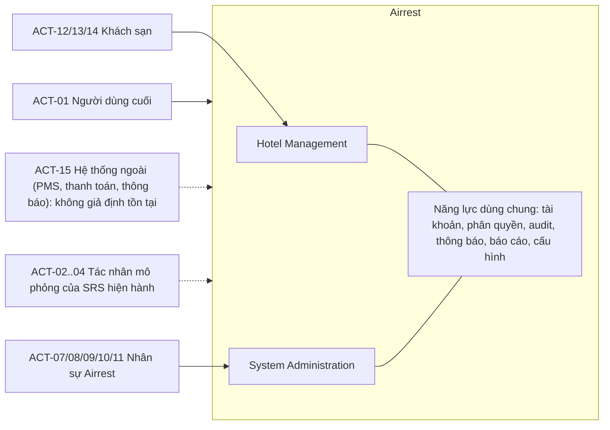

# 01. Actor, ma trận quyền và capability map

Phiên bản v0.1 Draft · 2026-10-26 · Trạng thái **DRAFT, chưa được phê duyệt**. Tài liệu bổ sung độc lập, không thay thế SRS hiện hành.

## 1. Actor catalog

Actor và quyền ở đây là đề xuất chưa được PO xác nhận. Danh sách vai trò chưa phải cuối cùng (OQ-55).

| ID | Actor | Mục tiêu | Phạm vi dữ liệu | Căn cứ / trạng thái | Loại |
|---|---|---|---|---|---|
| ACT-01 | Người dùng cuối (hành khách) | Tra cứu, đặt phòng, gửi đề nghị hỗ trợ; không đăng nhập (MB-07). | Dữ liệu của chính mình trong phiên | Đã có trong SRS hiện hành | Existing |
| ACT-07 | Quản trị hệ thống (System Administrator) | Quản lý tài khoản, vai trò, cấu hình, đối tác, tích hợp; cấp quyền. | Toàn hệ thống | Proposed; tương ứng ACT-06 của SRS v0.6 | Proposed |
| ACT-08 | Nhân viên vận hành Airrest (Operations) | Duyệt hồ sơ đối tác, giám sát yêu cầu, xử lý sự cố, theo dõi chất lượng đối tác. | Toàn bộ đối tác theo phân quyền | Proposed | Proposed |
| ACT-09 | Nhân viên hỗ trợ (Customer Support) | Tiếp nhận và xử lý yêu cầu hỗ trợ, khiếu nại; xem thông tin liên quan theo quyền. | Ca được giao; thông tin khách che theo quyền | Proposed | Proposed |
| ACT-10 | Nhân viên tài chính/đối soát (Finance) | Đối soát, báo cáo tài chính. Chỉ có vai trò khi mô hình thương mại được xác nhận. | Dữ liệu tài chính | Proposed; Blocked bởi OQ-43 | Proposed |
| ACT-11 | Kiểm toán / chỉ đọc (Auditor) | Xem audit log, báo cáo, cấu hình; không sửa. | Chỉ đọc toàn hệ thống | Proposed | Proposed |
| ACT-12 | Chủ/quản lý khách sạn (Hotel Owner/Manager) | Quản lý hồ sơ, phòng, giá, tồn, đặt phòng và nhân sự của khách sạn mình. | Tenant của mình | Proposed; thuộc ACT-05 của SRS v0.6 | Proposed |
| ACT-13 | Nhân viên khách sạn (Hotel Staff) | Cập nhật tồn, xử lý đặt phòng, nhận/trả phòng theo ủy quyền. | Tenant của mình, quyền hẹp hơn ACT-12 | Proposed; thuộc ACT-05 của SRS v0.6 | Proposed |
| ACT-14 | Lái xe của khách sạn (Hotel Driver) | Nhận và cập nhật chuyến đón sân bay. Chỉ có vai trò nếu D-26 được duyệt. | Yêu cầu đón của khách sạn mình | Proposed; Blocked bởi D-26 và MB-15 | Proposed |
| ACT-15 | Hệ thống bên ngoài (PMS/channel manager, thanh toán, thông báo) | Không giả định tồn tại; chỉ là điểm mở rộng. | Theo hợp đồng dữ liệu | Proposed; Blocked bởi OQ-44, OQ-43, OQ-52 | Proposed |
| ACT-02..04 | Hãng, cơ sở lưu trú (phản hồi tự động), nguồn dữ liệu chuyến bay (mô phỏng) | Tác nhân mô phỏng của SRS hiện hành; giữ nguyên. | — | Đã có trong SRS hiện hành | Existing |

Quan hệ với SRS v0.6: ACT-05 (khách sạn gồm lái xe) được tinh chỉnh thành ACT-12, ACT-13, ACT-14; ACT-06 (quản trị) thành ACT-07, ACT-08 và các vai trò hỗ trợ, tài chính, kiểm toán (ACT-09 đến ACT-11).

## 2. Ranh giới hệ thống

Ngoài ranh giới: PMS/channel manager, cổng thanh toán, nhà cung cấp thông báo (chỉ là điểm mở rộng, chưa thực hiện); hệ thống thật của hãng hàng không.

## 3. Ma trận quyền đề xuất (tài nguyên × vai trò)

Hành động: R đọc/liệt kê, C tạo, U sửa, S gửi duyệt, A duyệt/từ chối, X hủy/vô hiệu, E xuất, M quản lý người dùng và quyền, V xem trường nhạy cảm. **Deny by default; least privilege.** Quyền phải được thực thi ở backend/API (SA-FR-008), ẩn nút trên giao diện không phải bảo mật.

| Tài nguyên | ACT-07 | ACT-08 | ACT-09 | ACT-10 | ACT-11 | ACT-12 | ACT-13 | ACT-14 | ACT-01 |
|---|---|---|---|---|---|---|---|---|---|
| Hồ sơ đối tác | R U A X | R A X | R | R | R | C R U S | R U* | — | R** |
| Tài liệu xác minh | R A | R A | — | — | R | C R | — | — | — |
| Loại phòng và sức chứa | R | R | R | R | R | C R U X | R | — | R** |
| Giá và chính sách | R U† | R | R | R | R | C R U | R | — | R** |
| Tồn phòng | R | R U‡ | R | — | R | R U | R U (đóng/mở) | — | — |
| Đặt phòng (yêu cầu/đặt) | R | R | R V† | R | R | R A | R A§ | R (tối thiểu) | C R (của mình) |
| Nhận/trả phòng, vận hành | — | R | — | — | R | R U | R U | — | — |
| Đối soát, thanh toán, doanh thu | R | — | — | R U E V | R | R (khoản của mình) | — | — | — |
| Chất lượng đối tác, sự cố | R | C R U | C R | — | R | R C (phản hồi) | — | — | — |
| Tài khoản người dùng | C R U X M | R | R (giới hạn) | — | R | C R U X M (tenant) | — | — | — |
| Vai trò và quyền | R U M | — | — | — | R | — | — | — | — |
| Cấu hình hệ thống và danh mục | R U S | R U S¶ | R | — | R | — | — | — | — |
| Phê duyệt thay đổi | A | A | — | — | R | — | — | — | — |
| Audit log | R | R (phạm vi) | — | — | R | R (tenant, hạn chế) | — | — | — |
| Ca hỗ trợ/khiếu nại | R | R U | C R U | — | R | C R (của mình) | — | — | C |
| Báo cáo | R E | R E | R | R E | R | R E (của mình) | — | — | — |
| Cấu hình tích hợp và credentials | R U M | R | — | — | R | — | — | — | — |
| Yêu cầu đón khách | R | R | R | — | R | R | — | R U (của cơ sở mình) | C R |
| Trường nhạy cảm (V) | V (lý do) | V (lý do) | V (lý do) | V (tài chính) | — | V (khách của mình) | — | — | — |

- * ACT-13 chỉ sửa trường vận hành (HM-BR-003). ** ACT-01 chỉ xem tập con công khai. † ACT-07 chỉ sửa có lý do và audit. ‡ ACT-08 chỉ giải phóng giữ chỗ có lý do. § ACT-13 duyệt đặt phòng chỉ khi được ủy quyền. ¶ ACT-08 không sửa cấu hình ảnh hưởng quyền lợi khách.
- Quy tắc nền: deny by default; ô “—” là không có quyền; quyền xem trường nhạy cảm (V) và quyền xuất (E) là quyền riêng, luôn kèm lý do và audit; không vai trò nào có quyền sửa hoặc xóa audit log.
- Toàn bộ ma trận ở trạng thái Proposed, chờ PO và Security phê duyệt (OQ-55, D-42). Danh sách vai trò chưa phải cuối cùng.

## 4. Capability map

Cấu trúc: Domain → Module → Capability → Feature → Requirement. Mỗi tính năng thuộc đúng một module chính.

### Domain: Hotel Management (HM)

| Module | Capability | Feature | Requirement | Trạng thái |
|---|---|---|---|---|
| HM-C01 Hồ sơ đối tác | Quản lý hồ sơ | Tạo hồ sơ đối tác (bản nháp) | HM-FR-001 | Proposed |
| HM-C01 Hồ sơ đối tác | Quản lý hồ sơ | Cập nhật hồ sơ đối tác | HM-FR-002 | Proposed |
| HM-C01 Hồ sơ đối tác | Quản lý hồ sơ | Lịch sử thay đổi hồ sơ | HM-FR-005 | Proposed |
| HM-C01 Hồ sơ đối tác | Gửi duyệt và xác minh | Gửi duyệt, theo dõi kết quả và bổ sung thông tin | HM-FR-003 | Proposed |
| HM-C01 Hồ sơ đối tác | Gửi duyệt và xác minh | Hồ sơ pháp lý và tài liệu xác minh | HM-FR-004 | Blocked |
| HM-C02 Phòng và sức chứa | Loại phòng và số lượng | Quản lý loại phòng | HM-FR-006 | Proposed |
| HM-C02 Phòng và sức chứa | Loại phòng và số lượng | Số lượng phòng vật lý theo loại | HM-FR-007 | Proposed |
| HM-C02 Phòng và sức chứa | Loại phòng và số lượng | Trạng thái kinh doanh của loại phòng | HM-FR-008 | Proposed |
| HM-C03 Giá và chính sách | Giá | Giá theo loại phòng, ngày và số khách | HM-FR-009 | Proposed |
| HM-C03 Giá và chính sách | Giá | Gói giá, mùa và ngày đặc biệt | HM-FR-010 | Deferred |
| HM-C03 Giá và chính sách | Giá | Hiệu lực và lịch sử giá | HM-FR-014 | Proposed |
| HM-C03 Giá và chính sách | Thuế phí và chính sách | Thuế, phí và phụ thu | HM-FR-011 | Blocked |
| HM-C03 Giá và chính sách | Thuế phí và chính sách | Điều kiện nhận/trả phòng, trẻ em, giường phụ và số khách tối đa | HM-FR-012 | Proposed |
| HM-C03 Giá và chính sách | Thuế phí và chính sách | Chính sách hủy, hoàn tiền và thay đổi đặt phòng | HM-FR-013 | Blocked |
| HM-C04 Tồn phòng và tình trạng sẵn có | Mô hình và cập nhật tồn | Mô hình tồn phòng theo ngày | HM-FR-015 | Proposed |
| HM-C04 Tồn phòng và tình trạng sẵn có | Mô hình và cập nhật tồn | Cập nhật tồn phòng và đóng/mở bán | HM-FR-016 | Proposed |
| HM-C04 Tồn phòng và tình trạng sẵn có | Mô hình và cập nhật tồn | Ngày không nhận khách và thời gian bảo trì | HM-FR-017 | Proposed |
| HM-C04 Tồn phòng và tình trạng sẵn có | Giữ chỗ và chống đặt vượt | Giữ chỗ tạm thời | HM-FR-018 | Blocked |
| HM-C04 Tồn phòng và tình trạng sẵn có | Giữ chỗ và chống đặt vượt | Chống đặt vượt và xử lý đồng thời | HM-FR-019 | Proposed |
| HM-C04 Tồn phòng và tình trạng sẵn có | Đồng bộ ngoài | Đồng bộ tồn phòng với hệ thống ngoài (PMS/channel manager) | HM-FR-020 | Blocked |
| HM-C05 Đặt phòng | Tra cứu | Danh sách và tìm kiếm đặt phòng | HM-FR-021 | Proposed |
| HM-C05 Đặt phòng | Tra cứu | Chi tiết đặt phòng | HM-FR-022 | Proposed |
| HM-C05 Đặt phòng | Xử lý yêu cầu | Xác nhận yêu cầu đặt phòng | HM-FR-023 | Proposed |
| HM-C05 Đặt phòng | Xử lý yêu cầu | Từ chối yêu cầu đặt phòng | HM-FR-024 | Proposed |
| HM-C05 Đặt phòng | Xử lý yêu cầu | Hết hạn yêu cầu chờ xác nhận | HM-FR-025 | Blocked |
| HM-C05 Đặt phòng | Xử lý yêu cầu | Hết phòng hoặc thay đổi điều kiện sau khi khách gửi yêu cầu | HM-FR-026 | Proposed |
| HM-C05 Đặt phòng | Hủy, đổi và lịch sử | Hủy, đổi lịch và khách không đến | HM-FR-027 | Blocked |
| HM-C05 Đặt phòng | Hủy, đổi và lịch sử | Lịch sử trạng thái đặt phòng | HM-FR-028 | Proposed |
| HM-C06 Vận hành lưu trú | Đến/đi và nhận/trả phòng | Danh sách khách dự kiến đến và rời đi | HM-FR-029 | Proposed |
| HM-C06 Vận hành lưu trú | Đến/đi và nhận/trả phòng | Xác nhận nhận phòng và trả phòng | HM-FR-030 | Deferred |
| HM-C06 Vận hành lưu trú | Đến/đi và nhận/trả phòng | Khách đến muộn, không đến hoặc cần hỗ trợ | HM-FR-031 | Blocked |
| HM-C06 Vận hành lưu trú | Vận hành phòng và sự cố | Trạng thái phòng vận hành (dọn, bảo trì, sẵn sàng) | HM-FR-032 | Deferred |
| HM-C06 Vận hành lưu trú | Vận hành phòng và sự cố | Ghi chú vận hành và bàn giao ca | HM-FR-033 | Deferred |
| HM-C06 Vận hành lưu trú | Vận hành phòng và sự cố | Xử lý sự cố trong thời gian lưu trú | HM-FR-034 | Proposed |
| HM-C06 Vận hành lưu trú | Đón khách | Đón khách bằng xe của khách sạn (lái xe) | HM-FR-035 | Blocked |
| HM-C07 Đối soát, thanh toán và doanh thu | Mô hình thu tiền và đối soát | Ghi nhận mô hình thu tiền của đặt phòng | HM-FR-036 | Blocked |
| HM-C07 Đối soát, thanh toán và doanh thu | Mô hình thu tiền và đối soát | Đối soát đặt phòng, lưu trú và giao dịch | HM-FR-037 | Blocked |
| HM-C07 Đối soát, thanh toán và doanh thu | Mô hình thu tiền và đối soát | Lịch sử thanh toán, hoàn tiền và công nợ | HM-FR-038 | Blocked |
| HM-C08 Chất lượng đối tác | Sự cố và chỉ số | Ghi nhận sự cố chất lượng đối tác | HM-FR-039 | Proposed |
| HM-C08 Chất lượng đối tác | Sự cố và chỉ số | Chỉ số chất lượng khách quan | HM-FR-040 | Blocked |
| HM-C08 Chất lượng đối tác | Sự cố và chỉ số | Phản hồi và khiếu nại của khách sạn | HM-FR-041 | Proposed |
| HM-C09 Thông báo và giao tiếp | Thông báo đặt phòng (hiện thực năng lực dùng chung SH-C04) | Thông báo yêu cầu mới và kết quả | HM-FR-042 | Blocked |
| HM-C09 Thông báo và giao tiếp | Thông báo đặt phòng (hiện thực năng lực dùng chung SH-C04) | Nhắc yêu cầu sắp hết hạn | HM-FR-043 | Blocked |
| HM-C09 Thông báo và giao tiếp | Thông báo đặt phòng (hiện thực năng lực dùng chung SH-C04) | Lịch sử thông báo, lỗi gửi, retry và chống gửi trùng | HM-FR-044 | Blocked |
| HM-C10 Báo cáo và phân tích | Báo cáo khách sạn | Báo cáo yêu cầu và đặt phòng | HM-FR-045 | Proposed |
| HM-C10 Báo cáo và phân tích | Báo cáo khách sạn | Báo cáo tồn phòng và tỷ lệ sử dụng | HM-FR-046 | Proposed |
| HM-C10 Báo cáo và phân tích | Báo cáo khách sạn | Báo cáo hiệu suất phản hồi | HM-FR-047 | Proposed |
| HM-C10 Báo cáo và phân tích | Báo cáo khách sạn | Báo cáo tài chính | HM-FR-048 | Blocked |
| HM-C10 Báo cáo và phân tích | Báo cáo khách sạn | Bộ lọc và xuất dữ liệu báo cáo | HM-FR-049 | Proposed |

### Domain: System Administration (SA)

| Module | Capability | Feature | Requirement | Trạng thái |
|---|---|---|---|---|
| SA-C01 Quản lý tài khoản | Vòng đời tài khoản | Tạo và mời tài khoản | SA-FR-001 | Proposed |
| SA-C01 Quản lý tài khoản | Vòng đời tài khoản | Xem, cập nhật và vô hiệu hóa tài khoản | SA-FR-002 | Proposed |
| SA-C01 Quản lý tài khoản | Vòng đời tài khoản | Khóa và mở khóa tài khoản | SA-FR-003 | Proposed |
| SA-C01 Quản lý tài khoản | Truy cập và phiên | Đặt lại mật khẩu và khôi phục truy cập | SA-FR-004 | Blocked |
| SA-C01 Quản lý tài khoản | Truy cập và phiên | Quản lý phiên đăng nhập | SA-FR-005 | Proposed |
| SA-C02 Vai trò và phân quyền (RBAC) | Vai trò | Danh mục vai trò và quyền | SA-FR-006 | Proposed |
| SA-C02 Vai trò và phân quyền (RBAC) | Vai trò | Gán, đổi và thu hồi vai trò | SA-FR-007 | Proposed |
| SA-C02 Vai trò và phân quyền (RBAC) | Thực thi quyền và tenant | Kiểm tra quyền deny-by-default ở backend/API | SA-FR-008 | Proposed |
| SA-C02 Vai trò và phân quyền (RBAC) | Thực thi quyền và tenant | Cách ly dữ liệu theo tenant | SA-FR-009 | Proposed |
| SA-C02 Vai trò và phân quyền (RBAC) | Thực thi quyền và tenant | Quyền xem trường nhạy cảm và masking | SA-FR-010 | Proposed |
| SA-C03 Quản lý đối tác | Duyệt và vận hành đối tác | Danh sách và tìm kiếm đối tác | SA-FR-011 | Proposed |
| SA-C03 Quản lý đối tác | Duyệt và vận hành đối tác | Duyệt, từ chối và yêu cầu bổ sung hồ sơ đối tác | SA-FR-012 | Proposed |
| SA-C03 Quản lý đối tác | Duyệt và vận hành đối tác | Tạm ngưng, khôi phục và ngừng hợp tác đối tác | SA-FR-013 | Proposed |
| SA-C03 Quản lý đối tác | Duyệt và vận hành đối tác | Phân tách người lập và người duyệt (maker-checker) | SA-FR-014 | Blocked |
| SA-C04 Danh mục và cấu hình hệ thống | Danh mục và tham số | Quản lý danh mục | SA-FR-015 | Proposed |
| SA-C04 Danh mục và cấu hình hệ thống | Danh mục và tham số | Tham số nghiệp vụ (thời hạn giữ chỗ, timeout) | SA-FR-016 | Blocked |
| SA-C04 Danh mục và cấu hình hệ thống | Nội dung, thông báo, cờ tính năng | Nội dung FAQ và hướng dẫn | SA-FR-017 | Blocked |
| SA-C04 Danh mục và cấu hình hệ thống | Nội dung, thông báo, cờ tính năng | Cấu hình thông báo | SA-FR-018 | Blocked |
| SA-C04 Danh mục và cấu hình hệ thống | Nội dung, thông báo, cờ tính năng | Bật/tắt tính năng (feature flag) | SA-FR-019 | Proposed |
| SA-C04 Danh mục và cấu hình hệ thống | Kiểm soát thay đổi | Kiểm soát thay đổi cấu hình: phê duyệt, phiên bản, rollback | SA-FR-020 | Proposed |
| SA-C05 Giám sát và xử lý sự cố | Giám sát | Dashboard tình trạng vận hành | SA-FR-021 | Blocked |
| SA-C05 Giám sát và xử lý sự cố | Giám sát | Theo dõi yêu cầu đặt phòng lỗi hoặc chờ quá lâu | SA-FR-022 | Proposed |
| SA-C05 Giám sát và xử lý sự cố | Giám sát | Tra cứu theo correlation/request ID | SA-FR-023 | Proposed |
| SA-C05 Giám sát và xử lý sự cố | Sự cố hệ thống | Phân loại và xử lý sự cố hệ thống | SA-FR-024 | Proposed |
| SA-C06 Audit log | Ghi và truy vấn | Ghi audit log cho sự kiện quan trọng | SA-FR-025 | Proposed |
| SA-C06 Audit log | Ghi và truy vấn | Truy vấn và xem audit log | SA-FR-026 | Proposed |
| SA-C06 Audit log | Ghi và truy vấn | Ghi nhận truy cập và xuất dữ liệu nhạy cảm | SA-FR-028 | Proposed |
| SA-C06 Audit log | Bảo vệ | Bảo vệ audit log: bất biến, quyền và lưu giữ | SA-FR-027 | Blocked |
| SA-C07 Bảo mật và dữ liệu cá nhân | Phân loại và che dữ liệu | Phân loại dữ liệu | SA-FR-029 | Blocked |
| SA-C07 Bảo mật và dữ liệu cá nhân | Phân loại và che dữ liệu | Che dữ liệu (masking) trên giao diện và log | SA-FR-030 | Proposed |
| SA-C07 Bảo mật và dữ liệu cá nhân | Quyền của chủ thể dữ liệu | Yêu cầu sửa, xuất, xóa dữ liệu cá nhân | SA-FR-031 | Blocked |
| SA-C07 Bảo mật và dữ liệu cá nhân | Quyền của chủ thể dữ liệu | Quản lý căn cứ xử lý dữ liệu và sự đồng ý | SA-FR-032 | Blocked |
| SA-C08 Hỗ trợ và khiếu nại | Ca hỗ trợ | Tiếp nhận và phân loại yêu cầu hỗ trợ/khiếu nại | SA-FR-033 | Proposed |
| SA-C08 Hỗ trợ và khiếu nại | Ca hỗ trợ | Gán, chuyển cấp, xử lý và đóng ca | SA-FR-034 | Proposed |
| SA-C08 Hỗ trợ và khiếu nại | Ca hỗ trợ | Liên kết ca với đặt phòng/khách sạn và hạn chế can thiệp giao dịch | SA-FR-035 | Proposed |
| SA-C09 Tích hợp và tác vụ nền | Tích hợp, tác vụ, credentials | Trạng thái kết nối và lịch sử request/response | SA-FR-036 | Blocked |
| SA-C09 Tích hợp và tác vụ nền | Tích hợp, tác vụ, credentials | Hàng đợi tác vụ nền, retry và chạy lại có kiểm soát | SA-FR-037 | Proposed |
| SA-C09 Tích hợp và tác vụ nền | Tích hợp, tác vụ, credentials | Quản lý credentials và khóa API | SA-FR-038 | Blocked |
| SA-C10 Báo cáo quản trị | Báo cáo | Báo cáo tài khoản và hoạt động người dùng | SA-FR-039 | Proposed |
| SA-C10 Báo cáo quản trị | Báo cáo | Báo cáo đối tác, đặt phòng, sự cố và khiếu nại | SA-FR-040 | Proposed |
| SA-C10 Báo cáo quản trị | Báo cáo | Xuất báo cáo theo quyền | SA-FR-041 | Proposed |

## 5. Năng lực dùng chung (shared capabilities)

Để tránh trùng lặp, mỗi năng lực dùng chung có một chủ sở hữu; các module khác tham chiếu, không nhân bản.

| Năng lực | Yêu cầu | Chủ sở hữu và cách dùng |
|---|---|---|
| SH-C01 Danh tính và tài khoản | SA-FR-001…005; SM-05 | SA (chủ sở hữu); HM dùng cho nhân sự khách sạn qua SA-FR-001, 007 |
| SH-C02 Phân quyền và cách ly tenant | SA-FR-006…010; SH-NFR-001…003 | SA (chủ sở hữu); mọi chức năng HM và SA phải tuân theo |
| SH-C03 Audit log | SA-FR-025…028; SH-NFR-007 | SA (chủ sở hữu); HM chỉ khai báo sự kiện audit ở trường “Audit” của từng yêu cầu |
| SH-C04 Thông báo | HM-FR-042…044; SA-FR-018 | HM-C09 mô tả sự kiện đặt phòng; SA-C04 cấu hình mẫu; cơ chế gửi dùng chung |
| SH-C05 Báo cáo và xuất dữ liệu | HM-FR-045…049; SA-FR-039…041; SH-NFR-008 | Mỗi phân hệ có báo cáo của mình; cơ chế quyền E, masking, audit dùng chung |
| SH-C06 Cấu hình và kiểm soát thay đổi | SA-FR-015…020; SM-06 | SA (chủ sở hữu); HM dùng danh mục và tham số |

## 6. Phụ thuộc với các module Airrest hiện tại

| Module hiện tại | Quan hệ với gói này |
|---|---|
| Người dùng cuối tra cứu, đặt phòng (MB-05…MB-07, FR-008…FR-013) | Nhận dữ liệu cơ sở, giá, tồn từ HM-C01…C04; tạo yêu cầu cho HM-C05 |
| Luồng đề nghị hãng hỗ trợ L2 (MB-11…MB-14, FR-019…FR-023, SRS 4.3) | SM-03 tương thích gần đúng; khác biệt cần PO xác nhận (OQ-59) |
| Tiện ích nhà ga, hỗ trợ (MB-09, MB-10) | SA-FR-017 quản lý nội dung FAQ; MB-09/10 giữ Conditional |
| Nội dung quyền lợi (MB-03, MB-20, NFR-008, NFR-009) | SA-FR-016/017/020 chỉ được thay đổi nội dung này sau D-13 |
| Tham số mô phỏng (D-02, D-04, D-06, D-08, D-21) | Là cấu hình qua SA-FR-016; không đổi giá trị nếu chưa được PO duyệt |
