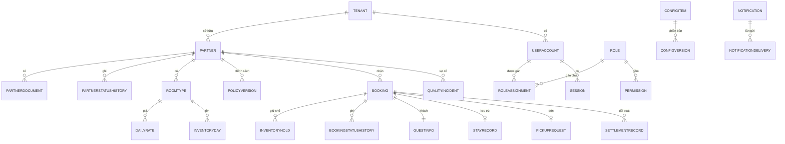
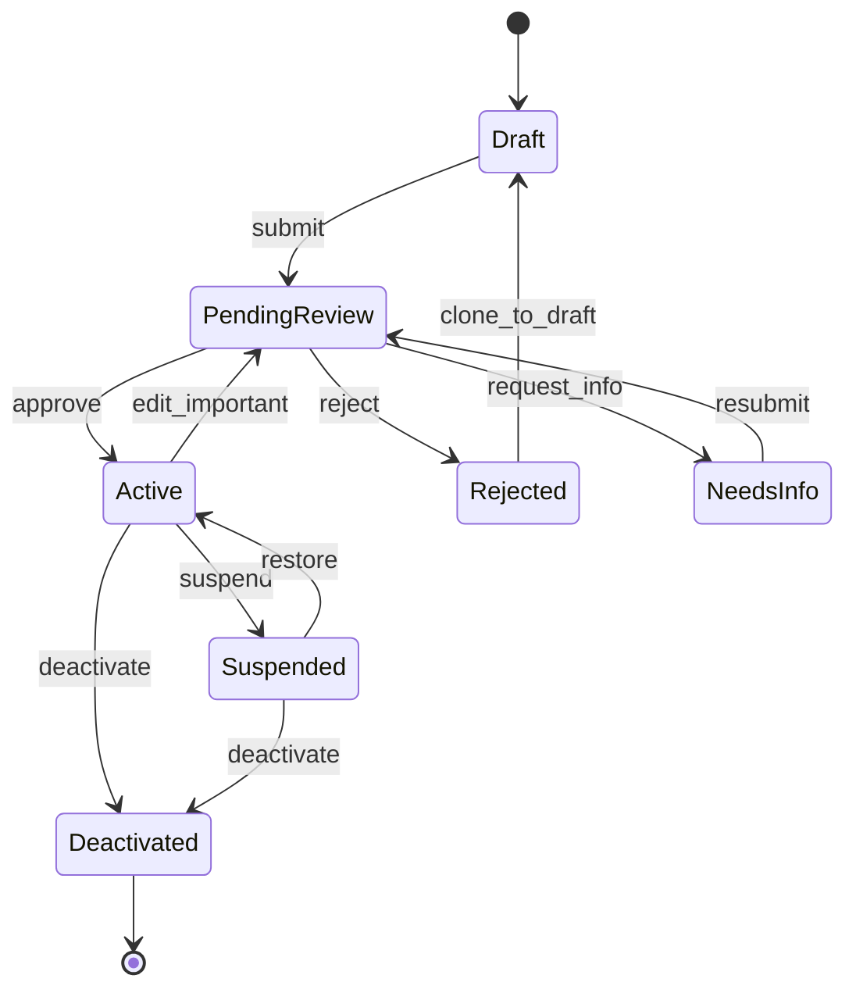
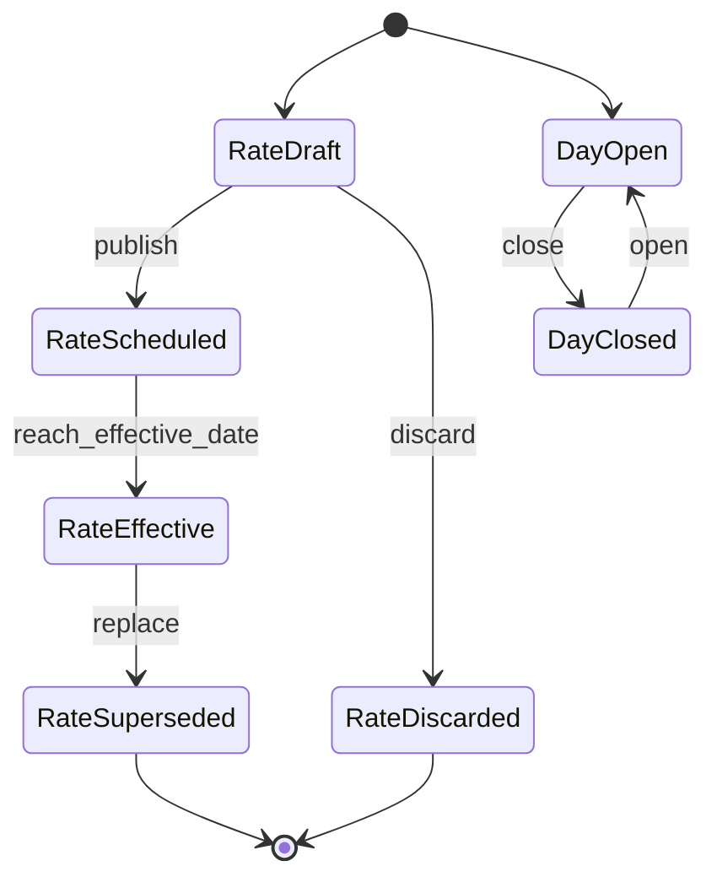
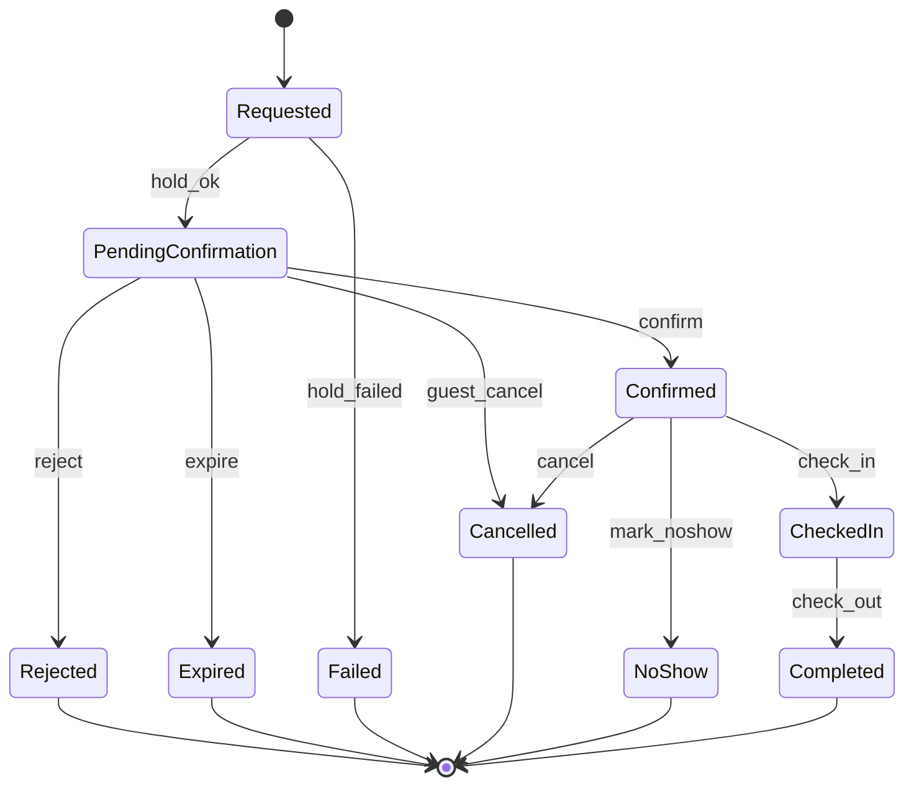
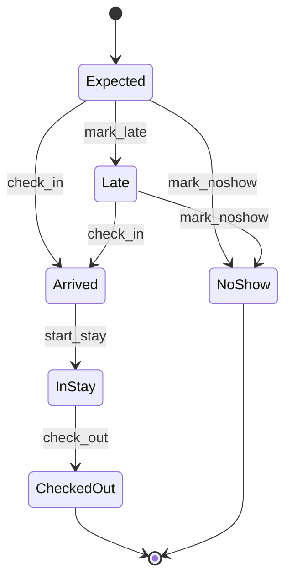
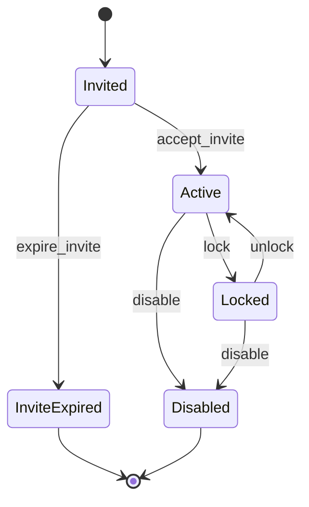
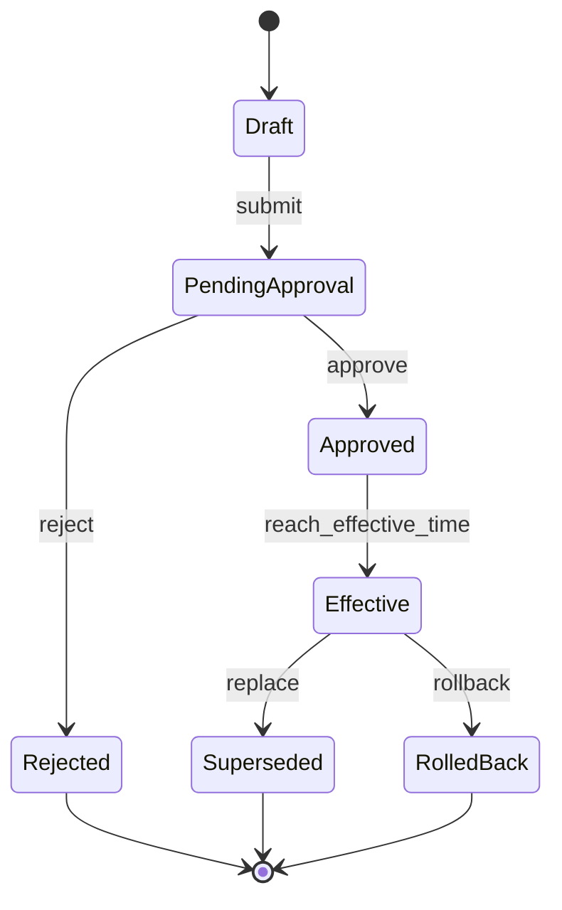
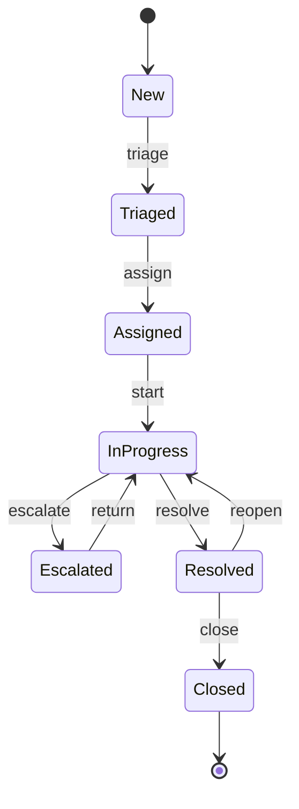

# 05. Mô hình dữ liệu logic và máy trạng thái

Phiên bản v0.1 Draft · 2026-10-26 · Trạng thái **DRAFT, chưa được phê duyệt**. Tài liệu bổ sung độc lập, không thay thế SRS hiện hành.

Mức logic, **không cam kết schema vật lý, kiểu dữ liệu hay cơ sở dữ liệu** khi chưa có kiến trúc được duyệt. Tên trường chỉ để gọi tên.

## 1. Danh mục thực thể: Hotel Management

| ID | Thực thể | Mô tả | Trường quan trọng | Quy tắc toàn vẹn | Quan hệ |
|---|---|---|---|---|---|
| HM-DATA-001 | Partner (Hồ sơ đối tác) | Hồ sơ khách sạn/đối tác. | ma_doi_tac, tenant_id, ten, dia_chi, toa_do, lien_he, loai_hinh, tien_ich, trang_thai (SM-01), phien_ban | ma_doi_tac duy nhất; thuộc đúng 1 tenant; chỉ đổi trạng thái theo SM-01 | 1 Partner – n RoomType; 1 Partner – n PartnerDocument |
| HM-DATA-002 | PartnerDocument | Tài liệu xác minh. | ma_tai_lieu, ma_doi_tac, loai, tep, trang_thai_xac_minh, nguoi_xac_minh | Loại thuộc danh mục; truy cập bị hạn chế (HM-BR-005) | n–1 Partner |
| HM-DATA-003 | PartnerStatusHistory | Lịch sử trạng thái và thay đổi hồ sơ. | ma_doi_tac, thoi_gian, nguoi, truoc, sau, ly_do | Chỉ thêm (HM-BR-006) | n–1 Partner |
| HM-DATA-004 | RoomType | Loại phòng. | ma_loai_phong, ma_doi_tac, ten, so_khach_toi_da, so_giuong, dien_tich, tien_nghi, so_phong_vat_ly, trang_thai_kinh_doanh | Mã duy nhất trong khách sạn; số phòng vật lý ≥ cam kết tương lai (HM-BR-008) | 1 RoomType – n DailyRate/InventoryDay |
| HM-DATA-005 | RatePlan | Gói giá/mùa. | ma_goi_gia, ma_loai_phong, ten, quy_tac, thu_tu_uu_tien | Thứ tự ưu tiên xác định (HM-BR-011) | n–1 RoomType |
| HM-DATA-006 | DailyRate | Giá hiệu lực theo ngày, số khách. | ma_loai_phong, ngay, so_khach, gia, tien_te, hieu_luc_tu, hieu_luc_den | Một giá hiệu lực cho mỗi (loại phòng, ngày, số khách); giá > 0 (HM-BR-010) | n–1 RoomType; lưu lịch sử |
| HM-DATA-007 | ChargeRule | Thuế, phí, phụ thuộc. | ma_khoan_thu, ten, loai, muc_hoac_ty_le, bao_gom_trong_gia | Thuộc danh mục (SA-FR-015) | n–1 Partner |
| HM-DATA-008 | PolicyVersion | Chính sách nhận/trả, trẻ em, hủy; có phiên bản. | ma_chinh_sach, ma_doi_tac, loai, noi_dung, hieu_luc_tu, phien_ban | Chính sách hủy lấy từ mẫu duyệt (HM-BR-014); số khách ≤ sức chứa | n–1 Partner |
| HM-DATA-009 | InventoryDay | Tồn phòng theo (loại phòng, ngày). | ma_loai_phong, ngay, phong_vat_ly, da_giu, da_dat, khong_kha_dung, co_the_ban (tính), dong_ban | co_the_ban = vat_ly − giu − dat − khong_kha_dung ≥ 0 (HM-BR-015); cập nhật nguyên tử (HM-BR-018) | n–1 RoomType |
| HM-DATA-010 | InventoryHold | Giữ chỗ tạm. | ma_giu_cho, ma_yeu_cau, ma_loai_phong, ngay, so_phong, het_han, trang_thai | Mỗi giữ chỗ gắn 1 yêu cầu; có hạn (HM-BR-017) | 1 Booking – 1..n Hold |
| HM-DATA-011 | Booking (yêu cầu/đặt phòng) | Yêu cầu và đặt phòng. | ma_dat_phong, ma_doi_tac, ma_loai_phong, ngay_nhan, ngay_tra, so_khach, ten_goi, trang_thai (SM-03), gia_tai_thoi_diem_dat, chinh_sach_tai_thoi_diem_dat, tao_luc | Điều kiện bất biến sau khi gửi (HM-BR-025); chỉ đổi trạng thái theo SM-03 | n–1 Partner; 1 Booking – n BookingStatusHistory |
| HM-DATA-012 | BookingStatusHistory | Lịch sử trạng thái đặt phòng. | ma_dat_phong, thoi_gian, tu, den, tac_nhan, ly_do | Chỉ thêm | n–1 Booking |
| HM-DATA-013 | GuestInfo | Thông tin khách tối thiểu. | ten_goi, (trường khác theo D-37) | Không số điện thoại/email khi chưa được phép (BR-002); phân loại nhạy cảm | 1–1 Booking |
| HM-DATA-014 | StayRecord | Nhận/trả phòng, đến muộn, không đến. | ma_dat_phong, nhan_luc, tra_luc, tinh_trang | Trả phòng sau nhận phòng (HM-BR-026) | 1–1 Booking |
| HM-DATA-015 | SettlementRecord (có điều kiện) | Đối soát, giao dịch, công nợ. | ma_ban_ghi, ma_dat_phong, mo_hinh_thu, so_tien, trang_thai | Chỉ tồn tại khi OQ-43 được quyết định (HM-BR-029) | n–1 Booking |
| HM-DATA-016 | QualityIncident | Sự cố/khiếu nại chất lượng đối tác. | ma_su_co, ma_doi_tac, ma_dat_phong, phan_loai, mo_ta, trang_thai, phan_hoi | Phân loại thuộc danh mục (HM-BR-030) | n–1 Partner |
| HM-DATA-017 | OpsNote | Ghi chú vận hành nội bộ. | ma_ghi_chu, ma_dat_phong, noi_dung, nguoi, thoi_gian | Không hiển thị cho khách | n–1 Booking |
| HM-DATA-018 | PickupRequest (có điều kiện) | Yêu cầu đón khách bằng xe khách sạn. | ma_yeu_cau_don, ma_dat_phong, san_bay, gio_don, trang_thai, ma_lai_xe, ly_do | Thuộc 1 đặt phòng Đã xác nhận; không có định vị (HM-BR-028) | n–1 Booking; phụ thuộc D-26 |

## 2. Danh mục thực thể: System Administration và dùng chung

| ID | Thực thể | Mô tả | Trường quan trọng | Quy tắc toàn vẹn | Quan hệ |
|---|---|---|---|---|---|
| SA-DATA-001 | UserAccount | Tài khoản. | ma_tai_khoan, dinh_danh, tenant_id, trang_thai (SM-05), tao_boi, tao_luc | Định danh duy nhất (SA-BR-001); không lưu thông tin xác thực dạng rõ | 1 Account – n RoleAssignment; n–1 Tenant |
| SA-DATA-002 | Role | Vai trò. | ma_vai_tro, ten, phien_ban | Không xóa khi đang gán (SA-BR-005) | 1 Role – n Permission |
| SA-DATA-003 | Permission | Quyền theo (tài nguyên, hành động). | tai_nguyen, hanh_dong, vai_tro | Cặp duy nhất trong vai trò; mặc định không có quyền | n–1 Role |
| SA-DATA-004 | RoleAssignment | Gán vai trò cho tài khoản trong phạm vi. | ma_tai_khoan, ma_vai_tro, pham_vi (tenant), hieu_luc_tu, thu_hoi_luc | Không vượt quyền người gán (SA-BR-002) | n–1 Account; n–1 Role |
| SA-DATA-005 | Session | Phiên đăng nhập. | ma_phien, ma_tai_khoan, bat_dau, het_han, thu_hoi | Hết hạn theo cấu hình; thu hồi có hiệu lực ngay | n–1 Account |
| SA-DATA-006 | ConfigItem | Mục cấu hình/danh mục/nội dung. | khoa, gia_tri, loai, phien_ban_hien_hanh | Thay đổi qua SM-06 nếu ảnh hưởng nghiệp vụ | 1 ConfigItem – n ConfigVersion |
| SA-DATA-007 | ConfigVersion | Phiên bản cấu hình. | khoa, phien_ban, gia_tri, nguoi_soan, nguoi_duyet, hieu_luc_tu, ly_do | Chỉ thêm; rollback tạo phiên bản mới | n–1 ConfigItem |
| SA-DATA-008 | ChangeRequest | Yêu cầu thay đổi cần phê duyệt (tổng quát). | ma_yeu_cau, doi_tuong, de_xuat, nguoi_lap, nguoi_duyet, trang_thai (SM-06) | nguoi_lap ≠ nguoi_duyet nếu D-34 duyệt (SA-BR-011) | n–1 đối tượng |
| SA-DATA-009 | AuditLogEntry | Nhật ký kiểm toán. | ma_log, thoi_gian, actor, hanh_dong, doi_tuong, ket_qua, ly_do, correlation_id, truoc_sau | Chỉ thêm; không có mật khẩu/token/secret (SA-BR-017) | — |
| SA-DATA-010 | SupportCase | Ca hỗ trợ/khiếu nại. | ma_ca, phan_loai, trang_thai (SM-07), nguoi_xu_ly, lien_ket (đặt phòng/đối tác), ghi_chu_noi_bo | Phân loại bắt buộc; ghi chú nội bộ không hiển thị khách | — |
| SA-DATA-011 | Notification | Thông báo. | ma_thong_bao, su_kien, nguoi_nhan, kenh, noi_dung_toi_thieu | Mỗi sự kiện một thông báo cho mỗi người nhận (HM-BR-032) | 1 Notification – n NotificationDelivery |
| SA-DATA-012 | NotificationDelivery | Lần gửi thông báo. | ma_thong_bao, lan_thu, trang_thai, loi, khoa_idempotency | Số lần thử có giới hạn (HM-BR-033) | n–1 Notification |
| SA-DATA-013 | IntegrationConnection | Kết nối ngoài (có điều kiện). | ma_ket_noi, loai, trang_thai, kiem_tra_luc, tham_chieu_secret | Secret chỉ là tham chiếu, không lưu rõ (SA-BR-021) | — |
| SA-DATA-014 | JobRun | Lần chạy tác vụ nền. | ma_tac_vu, khoa_idempotency, trang_thai, so_lan_thu, loi | Chạy lại phải idempotent (SA-BR-022) | — |
| SA-DATA-015 | DataSubjectRequest (có điều kiện) | Yêu cầu của chủ thể dữ liệu. | ma_yeu_cau, loai, trang_thai, han_xu_ly, ket_qua | Theo chính sách đã xác minh (SA-BR-018) | — |
| SA-DATA-016 | SystemIncident | Sự cố hệ thống. | ma_su_co, muc_do, trang_thai, ket_luan | Đóng khi có kết luận (SA-BR-016) | — |
| SA-DATA-017 | Tenant | Tổ chức/khách sạn làm phạm vi cách ly dữ liệu. | tenant_id, ten, loai | Mọi dữ liệu nghiệp vụ mang tenant_id (SA-BR-007); mô hình chuỗi khách sạn chưa chốt (OQ-55) | 1 Tenant – n Partner/Account |

## 3. Quan hệ ở mức logic

## 4. Quy tắc toàn vẹn xuyên thực thể

| Quy tắc | Ghi chú |
|---|---|
| Mọi thực thể nghiệp vụ mang tenant_id | Không có truy vấn hoặc ghi chéo tenant (SA-BR-007) |
| Tồn có thể bán = vật lý − giữ − đặt − không khả dụng ≥ 0 | Cập nhật nguyên tử (HM-BR-015, HM-BR-018) |
| Booking giữ giá và chính sách tại thời điểm đặt | Thay đổi giá sau đó không đổi Booking (HM-BR-025) |
| Mọi thực thể có vòng đời có bảng lịch sử chỉ thêm | Partner, Booking, ConfigVersion, AuditLogEntry (HM-BR-006) |
| Không xóa vật lý thực thể đang được tham chiếu | RoomType, ConfigItem, Role chỉ ngừng dùng (HM-BR-007, SA-BR-005, SA-BR-012) |
| Khóa idempotency cho thao tác có thể retry | Booking, NotificationDelivery, JobRun (SH-NFR-014) |
| Trường nhạy cảm được phân loại | Mặc định nhạy cảm khi chưa phân loại (SA-BR-008) |

## 5. Máy trạng thái

Mọi máy trạng thái là **đề xuất**, không phải chính sách đã duyệt. Các điều kiện còn phụ thuộc OQ ghi rõ ở cột điều kiện hoặc ghi chú.

### SM-01 — Hồ sơ đối tác

Yêu cầu liên quan: HM-FR-001…005, SA-FR-011…014. Đề xuất. Danh sách trường quan trọng và quy trình mở lại hồ sơ bị từ chối chờ OQ-51.

**Trạng thái**

| Trạng thái | Ý nghĩa |
|---|---|
| Draft | Nháp, chỉ chủ/quản lý thấy |
| PendingReview | Chờ Airrest duyệt |
| NeedsInfo | Cần bổ sung thông tin |
| Active | Đang hoạt động, hiển thị cho người dùng cuối |
| Rejected | Bị từ chối (kèm lý do) |
| Suspended | Tạm ngưng, ẩn khỏi người dùng cuối |
| Deactivated | Ngừng hợp tác (cuối) |

**Chuyển trạng thái**

| Từ | Sự kiện | Đến | Actor | Điều kiện trước | Điều kiện sau / hiệu ứng phụ | Lỗi, idempotency, đồng thời |
|---|---|---|---|---|---|---|
| Draft | submit | PendingReview | ACT-12 | Đủ trường bắt buộc (HM-BR-002); chưa có yêu cầu duyệt mở | Tạo 1 yêu cầu duyệt; thông báo ACT-08 | Gửi lặp không tạo yêu cầu thứ hai (idempotent) |
| PendingReview | approve | Active | ACT-07/08 | Người duyệt có quyền A; khác người lập nếu D-34 | Hiển thị cho người dùng cuối; thông báo khách sạn | Hai người duyệt cùng lúc: chỉ một thắng, người kia nhận xung đột |
| PendingReview | reject | Rejected | ACT-07/08 | Có lý do | Thông báo kèm lý do | Thiếu lý do bị chặn |
| PendingReview | request_info | NeedsInfo | ACT-07/08 | Có lý do/mục cần bổ sung | Thông báo kèm yêu cầu | — |
| NeedsInfo | resubmit | PendingReview | ACT-12 | Đã bổ sung | Mở lại yêu cầu duyệt | Giữ lịch sử các vòng duyệt |
| Rejected | clone_to_draft | Draft | ACT-12 | Chính sách mở lại được duyệt (OQ-51) | Tạo bản nháp mới, giữ tham chiếu bản cũ | Chưa có chính sách: chuyển bị chặn |
| Active | edit_important | PendingReview | ACT-12 | Trường quan trọng bị sửa (D-38) | Vẫn hiển thị bản đã duyệt cho đến khi duyệt lại (đề xuất) | Cảnh báo trước khi lưu |
| Active | suspend | Suspended | ACT-07/08 | Có lý do | Ẩn khỏi người dùng cuối; đặt phòng đã xác nhận giữ nguyên | Không tự hủy đặt phòng (SA-BR-010) |
| Suspended | restore | Active | ACT-07/08 | Có lý do | Hiển thị lại | — |
| Active | deactivate | Deactivated | ACT-07 | Không còn đặt phòng tương lai chưa hoàn tất | Đóng hồ sơ; giữ dữ liệu theo chính sách lưu giữ | Còn đặt phòng: chặn và liệt kê |
| Suspended | deactivate | Deactivated | ACT-07 | Như trên | Như trên | — |

### SM-02 — Giá, chính sách và tồn phòng theo ngày

Yêu cầu liên quan: HM-FR-009…020. Gồm hai máy nhỏ: phiên bản giá/chính sách (SM-02a) và ngày bán (SM-02b).

**Trạng thái**

| Trạng thái | Ý nghĩa |
|---|---|
| RateDraft | Bản nháp giá/chính sách |
| RateScheduled | Đã gửi, chờ hiệu lực |
| RateEffective | Đang hiệu lực |
| RateSuperseded | Bị thay bởi phiên bản mới (cuối) |
| RateDiscarded | Bỏ bản nháp (cuối) |
| DayOpen | Ngày đang mở bán |
| DayClosed | Ngày đóng bán/không nhận khách |

**Chuyển trạng thái**

| Từ | Sự kiện | Đến | Actor | Điều kiện trước | Điều kiện sau / hiệu ứng phụ | Lỗi, idempotency, đồng thời |
|---|---|---|---|---|---|---|
| RateDraft | publish | RateScheduled | ACT-12 | Giá > 0; không chồng lấn chưa xác nhận | Ghi lịch sử giá | Chồng lấn: yêu cầu xác nhận ghi đè |
| RateScheduled | reach_effective_date | RateEffective | Hệ thống | Đến thời điểm hiệu lực | Giá áp dụng cho yêu cầu mới | Đặt phòng đã tạo giữ giá cũ (HM-BR-010) |
| RateEffective | replace | RateSuperseded | Hệ thống | Có phiên bản mới hiệu lực | Giữ lịch sử | — |
| RateDraft | discard | RateDiscarded | ACT-12 | — | — | — |
| DayOpen | close | DayClosed | ACT-12/13 | Không vi phạm số đã cam kết | Tồn có thể bán giảm; đặt phòng đã xác nhận giữ nguyên | Phạm vi lớn: xác nhận; idempotent theo (loại phòng, ngày) |
| DayClosed | open | DayOpen | ACT-12/13 | Không có ràng buộc bảo trì | Tồn có thể bán tăng | — |

### SM-03 — Yêu cầu và đặt phòng (giữ chỗ, xác nhận, từ chối, hết hạn, hủy)

Yêu cầu liên quan: HM-FR-018…028. Đề xuất. Không đồng nhất “gửi yêu cầu” với “đặt phòng thành công”: chỉ Confirmed là cam kết của khách sạn. Quan hệ với SRS 4.3 (luồng L2): approved_waiting_property ≈ PendingConfirmation; property_rejected ≈ Rejected; confirmed ≈ Confirmed; chỗ khác biệt cần PO xác nhận (OQ-59).

**Trạng thái**

| Trạng thái | Ý nghĩa |
|---|---|
| Requested | Khách đã gửi yêu cầu, hệ thống đang giữ chỗ |
| PendingConfirmation | Đã giữ chỗ, chờ khách sạn xác nhận |
| Confirmed | Khách sạn đã cam kết |
| Rejected | Khách sạn từ chối (cuối) |
| Expired | Hết hạn chờ (cuối) |
| Failed | Không giữ được chỗ do hết tồn (cuối) |
| Cancelled | Đã hủy theo chính sách (cuối) |
| CheckedIn | Đã nhận phòng |
| Completed | Đã trả phòng, hoàn tất (cuối) |
| NoShow | Khách không đến (cuối) |

**Chuyển trạng thái**

| Từ | Sự kiện | Đến | Actor | Điều kiện trước | Điều kiện sau / hiệu ứng phụ | Lỗi, idempotency, đồng thời |
|---|---|---|---|---|---|---|
| Requested | hold_ok | PendingConfirmation | Hệ thống | Tồn có thể bán ≥ yêu cầu | Tạo giữ chỗ có hạn; thông báo khách sạn (HM-FR-042) | Nguyên tử trên tồn (HM-BR-018) |
| Requested | hold_failed | Failed | Hệ thống | Hết tồn khi giữ | Không tạo giữ chỗ; thông báo khách hết phòng | Yêu cầu thua trong cạnh tranh không để lại giữ chỗ |
| PendingConfirmation | confirm | Confirmed | ACT-12/13 | Còn hạn; giữ chỗ còn hiệu lực | Giữ chỗ thành đã đặt; thông báo khách | Xác nhận lặp chỉ có hiệu lực một lần |
| PendingConfirmation | reject | Rejected | ACT-12/13 | Có lý do từ danh mục | Giải phóng giữ chỗ; thông báo khách kèm lý do và phương án thay thế | Đã xử lý bởi người khác: xung đột |
| PendingConfirmation | expire | Expired | Hệ thống | Đến hạn (OQ-45) | Giải phóng giữ chỗ; thông báo hai bên | Trùng thời điểm với xác nhận: một kết quả theo giờ máy chủ |
| PendingConfirmation | guest_cancel | Cancelled | ACT-01 | Cho phép theo chính sách (OQ-46) | Giải phóng giữ chỗ | Chưa có chính sách: bị chặn |
| Confirmed | cancel | Cancelled | ACT-01/12 | Theo chính sách tại thời điểm đặt (OQ-46) | Hoàn tồn đúng một lần; ghi khoản phải hoàn nếu có (OQ-43) | Chính sách chưa có: bị chặn |
| Confirmed | check_in | CheckedIn | ACT-12/13 | Đến ngày nhận phòng | Ghi thời điểm nhận phòng | Có điều kiện: OQ-54 |
| Confirmed | mark_noshow | NoShow | ACT-12/13 | Qua giờ cho phép; chính sách được duyệt | Tồn không hoàn tự động | Không tự tính phí khi chưa có chính sách |
| CheckedIn | check_out | Completed | ACT-12/13 | Đã nhận phòng | Đóng vòng đời | Đảo ngược cần lý do |

### SM-04 — Lưu trú: nhận phòng, ở, trả phòng

Yêu cầu liên quan: HM-FR-029…035. Tinh chỉnh của Confirmed → CheckedIn → Completed trong SM-03; có điều kiện, chờ OQ-54 (ranh giới với PMS).

**Trạng thái**

| Trạng thái | Ý nghĩa |
|---|---|
| Expected | Dự kiến đến |
| Late | Đến muộn |
| Arrived | Đã nhận phòng |
| InStay | Đang lưu trú |
| CheckedOut | Đã trả phòng (cuối) |
| NoShow | Không đến (cuối) |

**Chuyển trạng thái**

| Từ | Sự kiện | Đến | Actor | Điều kiện trước | Điều kiện sau / hiệu ứng phụ | Lỗi, idempotency, đồng thời |
|---|---|---|---|---|---|---|
| Expected | mark_late | Late | ACT-12/13 | Qua giờ dự kiến | Ghi chú, thông báo nếu cần | — |
| Expected | check_in | Arrived | ACT-12/13 | Đặt phòng Confirmed | Ghi thời điểm | Idempotent |
| Late | check_in | Arrived | ACT-12/13 | — | Ghi thời điểm | — |
| Arrived | start_stay | InStay | Hệ thống | — | — | — |
| InStay | check_out | CheckedOut | ACT-12/13 | Đã nhận phòng | Hoàn tất đặt phòng | Đảo ngược cần lý do |
| Expected | mark_noshow | NoShow | ACT-12/13 | Qua giờ; chính sách duyệt | — | Không tự tính phí |
| Late | mark_noshow | NoShow | ACT-12/13 | Như trên | — | — |

### SM-05 — Tài khoản, vai trò và đặt lại truy cập

Yêu cầu liên quan: SA-FR-001…007. Đề xuất; cơ chế xác thực chưa chọn (OQ-48).

**Trạng thái**

| Trạng thái | Ý nghĩa |
|---|---|
| Invited | Đã mời, chưa kích hoạt |
| InviteExpired | Lời mời hết hạn (cuối, có thể mời lại) |
| Active | Hoạt động |
| Locked | Khóa tạm |
| Disabled | Vô hiệu hóa (cuối) |

**Chuyển trạng thái**

| Từ | Sự kiện | Đến | Actor | Điều kiện trước | Điều kiện sau / hiệu ứng phụ | Lỗi, idempotency, đồng thời |
|---|---|---|---|---|---|---|
| Invited | accept_invite | Active | Người dùng | Lời mời còn hạn | Gán vai trò đã mời | Lời mời dùng một lần |
| Invited | expire_invite | InviteExpired | Hệ thống | Quá hạn | — | Tạo lời mời mới thay thế |
| Active | lock | Locked | ACT-07/12; hệ thống | Có lý do | Thu hồi mọi phiên | — |
| Locked | unlock | Active | ACT-07/12 | Có lý do | Cho đăng nhập lại | — |
| Active | disable | Disabled | ACT-07/12 | Không phải quản trị viên cuối của tenant | Thu hồi phiên; giữ dữ liệu theo chính sách | Chặn khi là quản trị viên cuối |
| Locked | disable | Disabled | ACT-07/12 | Như trên | Như trên | — |
| Active | assign_role / revoke_role | Active | ACT-07/12 | Không vượt quyền người gán | Quyền có hiệu lực ở yêu cầu kế tiếp; thu hồi phiên nếu giảm quyền | Không tự nâng quyền |
| Active | reset_request → reset_done | Active | Người dùng | Liên kết một lần còn hạn | Thu hồi phiên cũ | Phản hồi như nhau cho tài khoản có/không tồn tại |

### SM-06 — Thay đổi cấu hình quan trọng (phê duyệt, hiệu lực, rollback)

Yêu cầu liên quan: SA-FR-006, SA-FR-014…020. Đề xuất; quy tắc maker-checker chờ OQ-47.

**Trạng thái**

| Trạng thái | Ý nghĩa |
|---|---|
| Draft | Bản nháp |
| PendingApproval | Chờ phê duyệt |
| Approved | Đã duyệt, chờ hiệu lực |
| Effective | Đang hiệu lực |
| Rejected | Bị từ chối (cuối) |
| Superseded | Bị thay thế (cuối) |
| RolledBack | Đã rollback (cuối) |

**Chuyển trạng thái**

| Từ | Sự kiện | Đến | Actor | Điều kiện trước | Điều kiện sau / hiệu ứng phụ | Lỗi, idempotency, đồng thời |
|---|---|---|---|---|---|---|
| Draft | submit | PendingApproval | ACT-07/08 | Giá trị hợp lệ | Tạo ChangeRequest | — |
| PendingApproval | approve | Approved | ACT-07/08 | Khác người lập nếu D-34 | Ghi người duyệt | Đồng thời: một kết quả |
| PendingApproval | reject | Rejected | ACT-07/08 | Có lý do | Giữ cấu hình cũ | — |
| Approved | reach_effective_time | Effective | Hệ thống | Đến thời điểm | Áp dụng cho yêu cầu tạo sau thời điểm | Yêu cầu đang chờ giữ điều kiện cũ |
| Effective | replace | Superseded | Hệ thống | Có phiên bản mới hiệu lực | — | — |
| Effective | rollback | RolledBack | ACT-07 | Có phiên bản trước; có lý do | Tạo phiên bản mới mang giá trị cũ | Rollback xung đột: nêu rõ |

### SM-07 — Ca hỗ trợ, khiếu nại và sự cố

Yêu cầu liên quan: SA-FR-024, SA-FR-033…035, HM-FR-034, HM-FR-039…041. Đề xuất; SLA và kênh tiếp nhận chờ OQ-57.

**Trạng thái**

| Trạng thái | Ý nghĩa |
|---|---|
| New | Mới tạo |
| Triaged | Đã phân loại |
| Assigned | Đã gán người xử lý |
| InProgress | Đang xử lý |
| Escalated | Đã chuyển cấp |
| Resolved | Đã giải quyết, chờ xác nhận |
| Closed | Đã đóng (cuối) |

**Chuyển trạng thái**

| Từ | Sự kiện | Đến | Actor | Điều kiện trước | Điều kiện sau / hiệu ứng phụ | Lỗi, idempotency, đồng thời |
|---|---|---|---|---|---|---|
| New | triage | Triaged | ACT-09/08 | Có phân loại | — | Thiếu phân loại: chặn |
| Triaged | assign | Assigned | ACT-09/08 | Người nhận có quyền | Thông báo người nhận | — |
| Assigned | start | InProgress | Người xử lý | — | — | — |
| InProgress | escalate | Escalated | ACT-09 | Có lý do | Gán cấp cao hơn | — |
| Escalated | return | InProgress | ACT-08 | — | — | — |
| InProgress | resolve | Resolved | Người xử lý | Có kết luận | Thông báo bên liên quan | Thiếu kết luận: chặn |
| Resolved | close | Closed | ACT-09/08 | Đã xác nhận hoặc quá hạn xác nhận | Đóng ca | — |
| Resolved | reopen | InProgress | ACT-09/08; người tạo | Có lý do | Ghi lịch sử mở lại | — |
