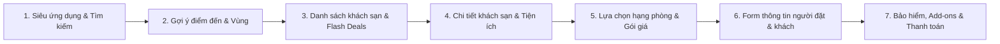
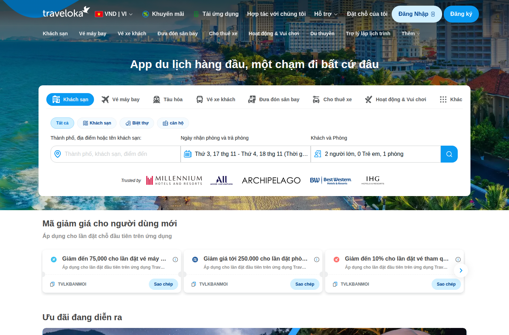
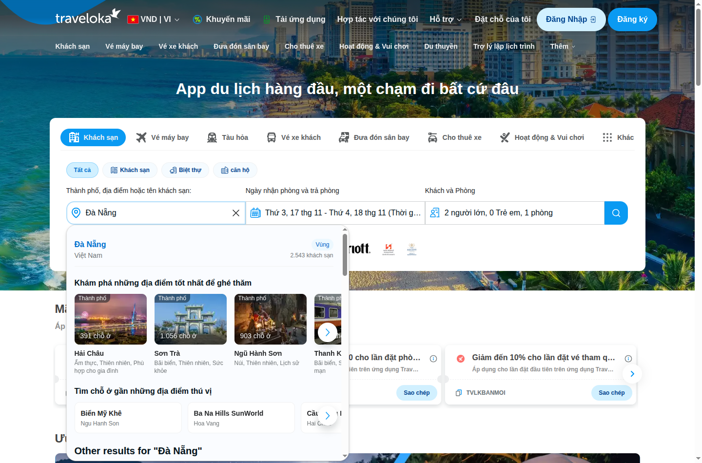
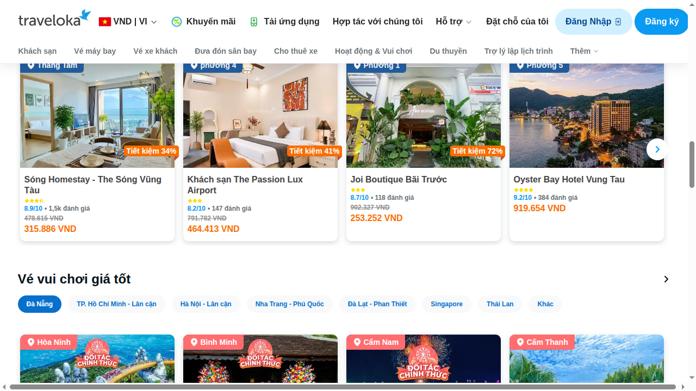
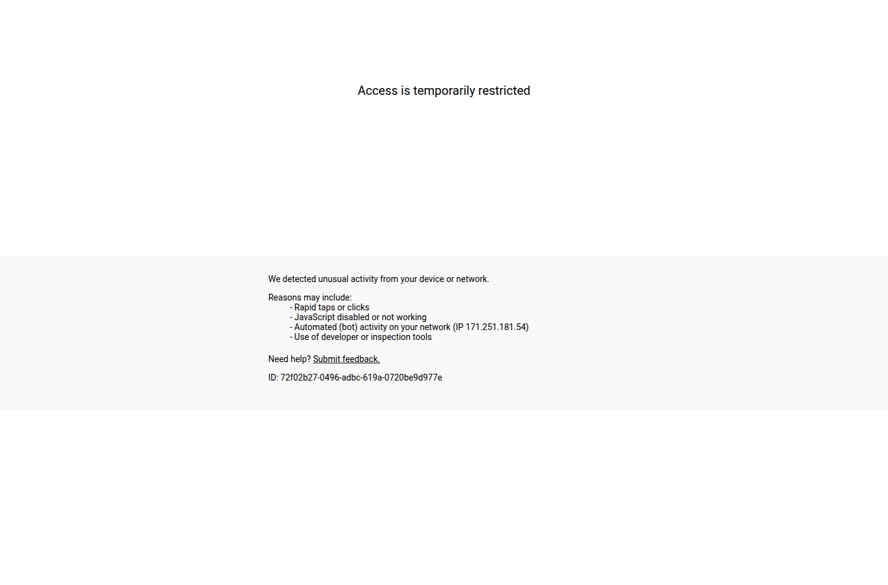

# Phân Tích Chi Tiết Luồng Đặt Phòng (Booking Flow) Trên Traveloka
> **Dự án đối chuẩn:** Hệ thống đặt phòng khách sạn Airrest  
> **Nguồn phân tích:** [Traveloka Việt Nam](https://www.traveloka.com/vi-vn)  
> **Phương pháp thực hiện:** Reverse Engineering Anything (REA) & Web Runtime Observation  
> **Ngày thực hiện:** 17/11/2026  

---

## 1. Tổng Quan Kiến Trúc & Triết Lý Sản Phẩm Của Traveloka

Traveloka được định vị là một **Siêu ứng dụng du lịch và tiện ích sống (Travel & Lifestyle Super-App)** hàng đầu Đông Nam Á. Khác với Agoda vốn tập trung thuần túy vào khách sạn và lưu trú, luồng đặt phòng của Traveloka được thiết kế theo hướng hệ sinh thái tích hợp đa dịch vụ (Khách sạn, Vé máy bay, Vé xe khách, Đưa đón sân bay, Tour & Vui chơi giải trí Xperience).

---

## 2. Phân Tích Từng Bước Kèm Hình Ảnh Thực Tế

### Bước 1: Cổng Siêu Ứng Dụng & Bộ Công Cụ Tìm Kiếm (Homepage & Super-App Search)

#### Mô tả & Phân tích Giao diện:
- **Thanh menu đa dịch vụ biểu tượng (Iconic Service Navigation):**
  - Khách sạn (màu xanh dương nổi bật làm dịch vụ cốt lõi).
  - Vé máy bay, Tàu hỏa, Vé xe khách, Đưa đón sân bay, Cho thuê xe, Hoạt động & Vui chơi, Du thuyền, Trợ lý lập lịch trình.
- **Tab phân loại loại hình cư trú:**
  - `Tất cả` | `Khách sạn` | `Biệt thự` | `Căn hộ`.
- **Hộp tìm kiếm tối giản (Consolidated Search Bar):**
  - Ô 1: `"Thành phố, địa điểm hoặc tên khách sạn"`
  - Ô 2: `"Ngày nhận phòng và trả phòng"` (Hiển thị thời gian cụ thể: Thứ, Ngày tháng)
  - Ô 3: `"Khách và Phòng"` (Mặc định: `2 người lớn, 0 Trẻ em, 1 phòng`)
  - Nút CTA tìm kiếm: Nút tròn màu xanh tích hợp biểu tượng kính lúp hiện đại.
- **Bảo chứng thương hiệu (Trust Badges):** Hiển thị logo các tập đoàn khách sạn đối tác lớn: *Millennium, ALL (Accor Live Limitless), Archipelago, Best Western, IHG*.
- **Chương trình khuyến mãi nổi bật:** Banner Black Friday / Ưu đãi thành viên mới tặng đến `500.000 VND` kèm mã QR tải App.

---

### Bước 2: Gợi Ý Điểm Đến Phân Tầng Độc Đáo (Search Suggestion & Curated Regions)

#### Mô tả & Phân tích UX Đột phá:
- Khi người dùng gõ từ khóa (ví dụ `"Đà Nẵng"`), dropdown mở rộng của Traveloka cung cấp trải nghiệm khám phá vượt trội so với các đối thủ:
  1. **Kết quả cấp vùng (Region Level):** `"Đà Nẵng, Việt Nam - Vùng - 2.543 khách sạn"`.
  2. **Khám phá địa điểm tốt nhất để ghé thăm (Curated Districts with Photos):**
     - Hải Châu (391 chỗ ở)
     - Sơn Trà (1.056 chỗ ở)
     - Ngũ Hành Sơn (903 chỗ ở)
     - Thanh Khê
     *Mỗi quận đều có ảnh đại diện thực tế (ảnh Cầu Rồng, Chùa Linh Ứng, Ngũ Hành Sơn) kèm thẻ phân loại gu du lịch (ví dụ: "Bãi biển, Thiên nhiên, Sức khỏe" hoặc "Ẩm thực, Phù hợp cho gia đình").*
  3. **Tìm chỗ ở gần địa điểm du lịch nổi tiếng:**
     - Biển Mỹ Khê (Ngũ Hành Sơn)
     - Bà Nà Hills SunWorld (Hòa Vang)
     - Cầu Rồng / Cầu sông Hàn
- **Giá trị UX:** Giúp người dùng chưa thông thuộc địa phương dễ dàng định hình khu vực lưu trú phù hợp với mục đích chuyến đi.

---

### Bước 3: Danh Sách Khách Sạn & Khuyến Mãi Flash Deals (Hotel Listing & Merchandising)

#### Mô tả & Phân tích Trưng bày Sản phẩm:
- **Thẻ phân loại khu vực theo tab:** Cho phép người dùng chuyển nhanh giữa các thị trường: `Nội địa`, `Thái Lan`, `Singapore`, `Malaysia`, `Indonesia`, `Nhật Bản`, `Hàn Quốc`...
- **Cấu trúc thẻ khách sạn (Merchandising Cards):**
  - **Ảnh đại diện lớn kèm nhãn vị trí ghim:** Ví dụ `Thắng Tam`, `Phường 4`, `Phường 1`, `Phường 5`.
  - **Huy hiệu giảm giá chớp nhoáng (Flash Discount Ribbon):** Màu cam nổi bật ở góc ảnh: `Tiết kiệm 34%`, `Tiết kiệm 41%`, `Tiết kiệm 72%`.
  - **Tên khách sạn & Hạng sao:** Ví dụ *Sóng Homestay - The Sóng Vũng Tàu*, *Khách sạn The Passion Lux Airport*, *Joi Boutique Bãi Trước*.
  - **Điểm đánh giá & Số lượng review:** Hiển thị rõ ràng: `8.9/10 - 1,5k đánh giá`, `8.7/10 - 118 đánh giá`.
  - **Mức giá ưu đãi theo đêm:** Giá gạch ngang đối chiếu với giá ưu đãi thực thanh toán (ví dụ: `478.615 VND` giảm còn `315.886 VND`).
- **Liên kết chéo hệ sinh thái (Cross-selling):** Khối `"Vé vui chơi giá tốt"` nằm ngay bên dưới danh sách khách sạn (Tour Bà Nà Hills, Vé Cẩm Nam, Vé Bình Minh...) để gợi ý khách đặt trọn gói chuyến đi.

---

### Bước 4: Trang Chi Tiết Khách Sạn & Khối Tiện Ích (Hotel Detail Overview)

#### Mô tả & Phân tích Cấu trúc:
- **Bộ lọc danh mục địa lý:** Phân vùng địa điểm nghỉ dưỡng theo quốc gia và khu vực lân cận.
- **Thư viện ảnh chất lượng cao:** Hiển thị ảnh phòng ốc, hồ bơi, nhà hàng và không gian chung với màu sắc ấm áp, tạo cảm giác thân thiện và dễ chịu.
- **Khối thông tin tiện ích cốt lõi:**
  - WiFi miễn phí tốc độ cao
  - Hồ bơi ngoài trời / Hồ bơi vô cực
  - Bàn tiếp tân 24h
  - Chỗ đỗ xe miễn phí
  - Máy lạnh và trang thiết bị hiện đại

---

### Bước 5: Bảng Lựa Chọn Hạng Phòng & Chính Sách Giá (Room Selection & Rate Plans)

#### Mô tả & Phân tích Gói Giá:
- **Phân loại phòng chi tiết:** Mỗi loại phòng (Standard, Superior, Deluxe, Suite, Villa) có mô tả diện tích, số giường, hướng nhìn (view biển / view thành phố).
- **Cấu trúc các tùy chọn chính sách giá:**
  - **Gói cơ bản:** Giá thấp nhất, không gồm ăn sáng, không hoàn tiền nếu hủy.
  - **Gói kèm bữa sáng:** Bao gồm bữa sáng buffet miễn phí mỗi ngày.
  - **Gói hoàn hủy linh hoạt (Free Cancellation / Refundable):** Cho phép hủy phòng miễn phí trước giờ nhận phòng 24h - 48h.
- **Nút CTA đặt chỗ:** Nút `"Chọn phòng"` hoặc `"Đặt ngay"` màu xanh dương dẫn trực tiếp sang biểu mẫu điền thông tin người đặt.

---

### Bước 6: Biểu Mẫu Nhập Thông Tin Khách & Liên Hệ (Guest & Contact Information)

#### Mô tả & Phân tích Biểu mẫu:
- **Khối Thông tin người liên hệ (Contact Details):**
  - Họ và tên (như trên CCCD/Hộ chiếu)
  - Số điện thoại di động (nhận tin nhắn mã đặt chỗ qua SMS/Zalo)
  - Địa chỉ Email (nhận vé điện tử / E-voucher PDF)
- **Tùy chọn đối tượng lưu trú:**
  - Radio button: `"Tôi là khách lưu trú"` hoặc `"Tôi đang đặt cho người khác"` (rất tiện lợi cho thư ký đặt phòng cho sếp hoặc đặt cho người thân).
- **Khối Yêu cầu đặc biệt (Special Requests):**
  - Phòng không hút thuốc / Phòng hút thuốc
  - Giường lớn (Double) / 2 Giường đơn (Twin)
  - Giờ nhận phòng sớm / Giờ trả phòng muộn (phù hợp tuyệt đối với mô hình Airrest).

---

### Bước 7: Dịch Vụ Gia Tăng & Phương Thức Thanh Toán (Add-ons, Insurance & Payment)

#### Mô tả & Phân tích Cổng Thanh Toán:
- **Dịch vụ gia tăng (Cross-sell Add-ons):**
  - **Bảo hiểm du lịch / Bảo hiểm hủy phòng Traveloka Protect:** Bồi thường 100% nếu có sự cố khẩn cấp.
  - **Đưa đón sân bay:** Đặt trước xe đưa đón với tài xế đón tận sảnh sân bay.
- **Cơ chế Bóc tách giá & Giảm giá:**
  - Tiền phòng gốc (Room rate)
  - Thuế GTGT (VAT) & Phí phục vụ (Service charge)
  - Ô nhập mã giảm giá Traveloka (`TVLKBANMOI`, mã ngân hàng liên kết)
- **Các phương thức thanh toán toàn diện tại thị trường Việt Nam:**
  - **VietQR / Chuyển khoản ngân hàng 24/7:** Quét mã QR chuyển khoản tự động khớp lệnh trong 3 giây.
  - **Thẻ tín dụng / Ghi nợ quốc tế:** Visa, MasterCard, JCB với công nghệ bảo mật 3D Secure OTP.
  - **Ví điện tử nội địa:** MoMo, ZaloPay, ShopeePay.
  - **Thẻ ATM nội địa:** Kết nối qua cổng thanh toán OnePay / Napas.
  - **Traveloka PayLater:** Mua trước trả sau chia kỳ hạn 1 - 12 tháng.

---

## 3. Phân Tích Kỹ Thuật Chuyên Sâu Bằng REA (Reverse Engineering Findings)

Sử dụng bộ công cụ REA (`list_browser_targets`, `inspect_web_page`, `capture_web_screenshot`, phân tích HTTP headers và LocalStorage):

1. **Hệ thống phòng vệ chống thu thập dữ liệu 3 lớp (3-Tier Bot Mitigation):**
   - **Lớp 1 - CloudFront Edge + DataDome:** Header `x-datadome: protected` chặn các công cụ cURL hoặc HTTP client không có TLS fingerprint của trình duyệt tiêu chuẩn (Mã HTTP 403).
   - **Lớp 2 - AWS WAF:** Qua REA `inspect_web_page`, phát hiện khóa lưu trữ cục bộ `awswaf_token_refresh_timestamp` và cookie `aws-waf-token`. Mỗi phiên đặt phòng phải có token WAF hợp lệ thì mới được tải dữ liệu chi tiết phòng.
   - **Lớp 3 - PerimeterX / HUMAN Security:** Kiểm soát hành vi người dùng thời gian thực (tốc độ click chuột, di chuyển con trỏ, chuyển tab). Khi phát hiện dấu hiệu bất thường, hệ thống hiển thị màn hình cảnh báo `"Truy cập tạm thời bị hạn chế - Bạn đang duyệt và nhấp chuột nhanh hơn nhiều so với dự kiến của một con người"`.
2. **Cơ chế xác thực giỏ hàng bằng chữ ký mật mã (Cryptographic Rate Keys):**
   - Mỗi gói phòng trên Traveloka không truyền ID đơn thuần mà kèm theo tham số `inventoryRateKey` mã hóa AES/HMAC chứa thông tin giá, ngày, và điều kiện phòng đã được ký từ server. Điều này ngăn chặn triệt để hành vi can thiệp sửa giá từ phía client.
3. **Kiến trúc Giao diện Frontend:**
   - Xây dựng bằng **React Native for Web** (thể hiện qua các class tiện ích đặc trưng `css-1dbjc4n`, `r-13awgt0`, `r-1loqt21`).
   - Kết hợp **Next.js** Server-Side Rendering (SSR) giúp tối ưu SEO vượt trội trên Google cho các trang thành phố và khách sạn.
   - Ứng dụng **PWA (Progressive Web App)** với Service Worker đăng ký tại `https://www.traveloka.com/desktop-sw.js` giúp cache tài nguyên tĩnh cực kỳ nhanh.

---

## 4. So Sánh Đối Chiếu Giữa Traveloka Và Agoda

| Tiêu chí | Traveloka | Agoda |
| :--- | :--- | :--- |
| **Định vị sản phẩm** | Siêu ứng dụng du lịch đa dịch vụ (Super-App) | Chuyên sâu tối đa vào Khách sạn & Lưu trú |
| **Trải nghiệm tìm kiếm** | Gợi ý theo vùng, quận huyện và điểm vui chơi nổi tiếng kèm ảnh | Gợi ý phân cấp địa lý hành chính thuần túy |
| **Chiến thuật tâm lý** | Tặng voucher ưu đãi, mã giảm giá trực tiếp | Tạo FOMO cực mạnh (Đếm ngược giữ phòng, cảnh báo 67% kín phòng) |
| **Công nghệ Frontend** | React Native for Web + Next.js SSR + PWA | React.js SPA + Server-Side Hydration |
| **Bảo mật & Anti-bot** | DataDome + AWS WAF + PerimeterX + RateKey | Akamai Bot Manager |
| **Phương thức thanh toán** | Rất mạnh về VietQR, Ví điện tử và PayLater nội địa | Rất mạnh về Thẻ quốc tế, Đặt ngay - Trả sau |

---

## 5. Đề Xuất Chiến Lược Áp Dụng Trực Tiếp Cho Dự Án Airrest

1. **Học tập cơ chế Auto-suggest theo điểm tham quan của Traveloka:**
   - Khách đặt phòng nghỉ ngắn giờ tại Airrest thường gắn liền với sự kiện hoặc vị trí gần các địa điểm như: sân bay, bệnh viện, trường đại học, khu công nghệ, trung tâm hội nghị. Airrest nên phân nhóm gợi ý: *Gần Sân bay Nội Bài/Tân Sơn Nhất*, *Gần Bệnh viện Bạch Mai*, *Gần Trung tâm Hội nghị Quốc gia*.
2. **Tích hợp thanh toán mã QR động (VietQR):**
   - Hơn 85% người dùng trẻ tại Việt Nam thanh toán qua App ngân hàng. Airrest cần trang bị tính năng sinh mã VietQR tự động kèm số tiền và nội dung đơn hàng, xác nhận tự động qua Webhook ngân hàng như Traveloka.
3. **Tách biệt rõ "Người đặt" và "Khách lưu trú":**
   - Cho phép người dùng đặt phòng hộ bạn bè, người thân hoặc đối tác mà không bị sai lệch tên trên giấy tờ nhận phòng tại quầy lễ tân.
4. **Bảo mật giá và phòng với mã hóa Rate Key:**
   - Áp dụng cơ chế mã hóa tham số gói đặt phòng của Traveloka để bảo vệ hệ thống API của Airrest, tránh trường hợp client gửi request giả mạo giá phòng vào backend.
