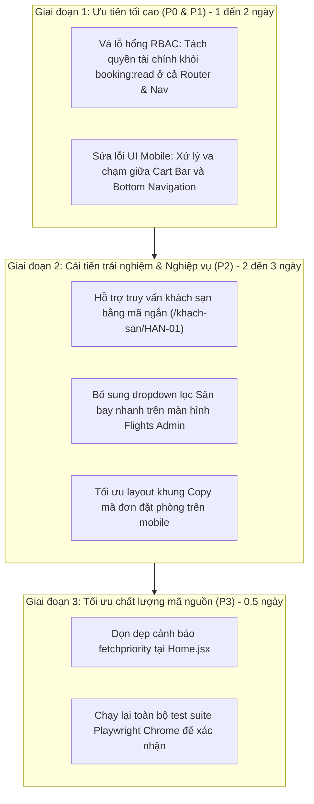

# BÁO CÁO TỔNG HỢP CÁC VẤN ĐỀ LỖI, ĐIỂM BẤT HỢP LÝ VÀ ĐỀ XUẤT CẢI TIẾN
**Dự án**: Airrest — Nền tảng hỗ trợ lưu trú & đưa đón sự cố hàng không  
**Phương pháp kiểm thử**: Playwright thuần điều khiển Google Chrome thực tế (`/usr/bin/google-chrome`), tương tác 2 chiều đa vai trò (8 Actors + Mobile Viewport).  
**Ngày lập báo cáo**: 18/11/2026  
**Thư mục bằng chứng ảnh**: [`reports/playwright_audit_screenshots/`](./playwright_audit_screenshots)  
**Kịch bản kiểm thử tự động**: [`scripts/deep-audit-all-roles.mjs`](../scripts/deep-audit-all-roles.mjs)

---

## MỤC LỤC
1. [Bảng ma trận phân loại mức độ ưu tiên (Priority & Risk Matrix)](#1-bảng-ma-trận-phân-loại-mức-độ-ưu-tiên)
2. [Chi tiết các vấn đề lỗi & Điểm bất hợp lý](#2-chi-tiết-các-vấn-đề-lỗi--điểm-bất-hợp-lý)
   - [P0 - CRITICAL: Rò rỉ thông tin Tài chính & Doanh thu cho Lễ tân](#p0---critical-rò-rỉ-thông-tin-tài-chính--doanh-thu-cho-lễ-tân)
   - [P1 - HIGH: Va chạm & Chèn đè giữa Cart Bar và Bottom Navigation trên Mobile](#p1---high-va-chạm--chèn-đè-giữa-cart-bar-và-bottom-navigation-trên-mobile)
   - [P2 - MEDIUM: Đường dẫn chi tiết khách sạn chưa hỗ trợ mã ngắn (HAN-01)](#p2---medium-đường-dẫn-chi-tiết-khách-sạn-chưa-hỗ-trợ-mã-ngắn-han-01)
   - [P2 - MEDIUM: Thiếu bộ lọc sân bay nhanh trên màn hình Chuyến bay Quản trị](#p2---medium-thiếu-bộ-lọc-sân-bay-nhanh-trên-màn-hình-chuyến-bay-quản-trị)
   - [P2 - MEDIUM: Khung hiển thị & nút Sao chép mã Booking bị vỡ layout trên màn hình hẹp](#p2---medium-khung-hiển-thị--nút-sao-chép-mã-booking-bị-vỡ-layout-trên-màn-hình-hẹp)
   - [P3 - LOW: Cảnh báo React 18 Console về thuộc tính DOM `fetchPriority`](#p3---low-cảnh-báo-react-18-console-về-thuộc-tính-dom-fetchpriority)
3. [Làm rõ các điểm nghiệp vụ chuẩn (Tránh sửa nhầm)](#3-làm-rõ-các-điểm-nghiệp-vụ-chuẩn-tránh-sửa-nhầm)
4. [Lộ trình hành động & Kế hoạch xử lý (Action Plan)](#4-lộ-trình-hành-động--kế-hoạch-xử-lý-action-plan)

---

## 1. BẢNG MA TRẬN PHÂN LOẠI MỨC ĐỘ ƯU TIÊN

| Mã | Phân loại | Vấn đề | Phạm vi ảnh hưởng | Mức độ | Trạng thái |
|:---:|---|---|---|:---:|:---:|
| **SEC-01** | **Bảo mật & RBAC** | Lễ tân khách sạn xem được số dư ngân hàng, lịch sử chi trả và báo cáo doanh thu | Backend Router & Frontend Nav | **P0 (Critical)** | Cần vá ngay |
| **UI-01** | **Giao diện & UX** | Thanh Cart Bar đè lên thanh Bottom Navigation trên điện thoại di động | Giao diện di động (Mobile) | **P1 (High)** | Cần khắc phục |
| **API-01** | **Routing & API** | Link `/khach-san/HAN-01` bị lỗi 422 do backend chỉ nhận định dạng UUID | Trải nghiệm duyệt web & SEO | **P2 (Medium)** | Đề xuất tối ưu |
| **UX-01** | **Trải nghiệm Quản trị**| Màn hình Chuyến bay Admin thiếu dropdown chọn nhanh theo sân bay (HAN, SGN...) | Cổng Quản trị viên | **P2 (Medium)** | Đề xuất bổ sung |
| **UI-02** | **Bố cục Giao diện** | Khung sao chép mã booking sau khi đặt phòng bị rớt dòng trên màn hình hẹp | Modal đặt phòng (Mobile) | **P2 (Medium)** | Đề xuất điều chỉnh |
| **CODE-01**| **Chất lượng Mã** | Cảnh báo React 18 DOM prop `fetchPriority` trên trang chủ | Console trình duyệt | **P3 (Low)** | Dọn dẹp code |

---

## 2. CHI TIẾT CÁC VẤN ĐỀ LỖI & ĐIỂM BẤT HỢP LÝ

### P0 - CRITICAL: Rò rỉ thông tin Tài chính & Doanh thu cho Lễ tân
* **Mã lỗi**: `SEC-01`
* **Vị trí phát hiện**:
  * Frontend: [`apps/web/src/lib/hotelNav.js`](Airrest_website/apps/web/src/lib/hotelNav.js#L16-L17) (dòng 16–17)
  * Backend Router 1: [`backend/api/modules/hotelPayouts/hotelPayouts.router.ts`](Airrest_website/backend/api/modules/hotelPayouts/hotelPayouts.router.ts#L13) (dòng 13)
  * Backend Router 2: [`backend/api/modules/hotelStats/hotelStats.router.ts`](Airrest_website/backend/api/modules/hotelStats/hotelStats.router.ts#L13) (dòng 13)
* **Hiện tượng & Bằng chứng**:
  * Khi đăng nhập bằng tài khoản Lễ tân (`letan@demo.airrest.vn`), menu bên trái vẫn hiển thị 2 tab: **"Chi trả"** (`payouts`) và **"Báo cáo doanh thu"** (`revenue`).
  * Kiểm tra tầng Backend: Hai router `/v1/hotel/payouts` và `/v1/hotel/stats` chỉ kiểm tra quyền `PERM.BOOKING_READ`:
    ```typescript
    // backend/api/modules/hotelPayouts/hotelPayouts.router.ts
    const read = [authenticate, requirePermission(PERM.BOOKING_READ)];
    ```
  * Lễ tân có quyền `booking:read` để check-in/check-out cho khách, vô tình được backend cấp quyền đọc toàn bộ dữ liệu tài chính nhạy cảm: thông tin tài khoản ngân hàng, lịch sử yêu cầu rút tiền, các khoản khấu trừ và doanh thu phòng.
* **Hậu quả**: Vi phạm nghiêm trọng nguyên tắc phân quyền đặc quyền tối thiểu (Least Privilege). Nhân viên cấp tác vụ (lễ tân) nắm được bí mật kinh doanh và số liệu tài chính của chủ khách sạn.
* **Đề xuất khắc phục mong muốn**:
  1. **Ở Backend**: Tạo quyền hạn mới hoặc sử dụng đúng quyền quản trị doanh nghiệp:
     * Dùng `PERM.BUSINESS_REPORT_READ` hoặc bổ sung `PERM.HOTEL_PAYOUT_MANAGE` vào middleware bảo vệ endpoint `/v1/hotel/payouts` và `/v1/hotel/stats`.
     * Tuyệt đối không dùng chung `PERM.BOOKING_READ` cho các nghiệp vụ tài chính.
  2. **Ở Frontend**: Cập nhật lại điều kiện hiển thị menu tại `hotelNav.js`:
     ```javascript
     // Sửa từ:
     { id: 'payouts', label: 'Chi trả', need: [PERM.BOOKING_READ] },
     { id: 'revenue', label: 'Báo cáo doanh thu', need: [PERM.BOOKING_READ] }
     
     // Thành:
     { id: 'payouts', label: 'Chi trả', need: [PERM.BUSINESS_HOTEL_MANAGE] },
     { id: 'revenue', label: 'Báo cáo doanh thu', need: [PERM.BUSINESS_REPORT_READ] }
     ```

---

### P1 - HIGH: Va chạm & Chèn đè giữa Cart Bar và Bottom Navigation trên Mobile
* **Mã lỗi**: `UI-01`
* **Vị trí phát hiện**:
  * [`apps/web/src/screens/user/UserSite.jsx`](Airrest_website/apps/web/src/screens/user/UserSite.jsx#L85) (Thanh Bottom Nav)
  * [`apps/web/src/screens/user/Stays.jsx`](Airrest_website/apps/web/src/screens/user/Stays.jsx#L202) (Thanh Cart Bar)
* **Hiện tượng & Bằng chứng**:
  * Kiểm thử trên kích thước chuẩn của điện thoại (iPhone Viewport: 390 x 844 px).
  * Khi hành khách chọn 1 phòng vào giỏ, thanh tóm tắt giỏ phòng (Cart Bar) xuất hiện ở đáy màn hình.
  * **Đo đạc tọa độ thực tế từ Playwright**:
    * Thanh Bottom Navigation: `top: 780px`, `bottom: 844px` (chiều cao 64px, `z-index: 40`).
    * Thanh Cart Bar: `top: 732px`, `bottom: 795.67px` (chiều cao ~64px, `z-index: 30`).
    * Hai thanh này **chèn đè lên nhau một khoảng 15.67px** và chiếm dụng tổng cộng **112px** ở đáy màn hình.
  * Ảnh chụp bằng chứng: [`reports/playwright_audit_screenshots/mob_01_stays_cart_collision.png`](./playwright_audit_screenshots/mob_01_stays_cart_collision.png).
* **Hậu quả**:
  * Các nút bấm ở khách sạn nằm dưới cùng danh sách bị che khuất hoàn toàn.
  * Nút gọi hỗ trợ nhanh (Chatbot FAB) bị đè một phần.
  * Người dùng rất dễ bấm nhầm giữa nút "Đặt ngay" của Cart và tab "Nơi nghỉ/Tài khoản" của Bottom Nav.
* **Đề xuất khắc phục mong muốn**:
  * **Phương án A (Khuyến nghị)**: Khi `cartRooms > 0` trên mobile, tự động thêm class ẩn thanh Bottom Navigation (`tw:translate-y-full tw:transition-transform`) hoặc đẩy Cart Bar lên phía trên Bottom Nav bằng thuộc tính `bottom: calc(4rem + env(safe-area-inset-bottom))`.
  * **Phương án B**: Tích hợp trực tiếp badge số lượng phòng và nút "Đặt ngay" thành một phần nằm bên trong thanh Bottom Navigation khi đang ở trang danh sách nơi nghỉ.

---

### P2 - MEDIUM: Đường dẫn chi tiết khách sạn chưa hỗ trợ mã ngắn (HAN-01)
* **Mã lỗi**: `API-01`
* **Vị trí phát hiện**:
  * Backend Schema: [`backend/api/modules/hotels/hotels.router.ts`](Airrest_website/backend/api/modules/hotels/hotels.router.ts#L52) (dòng 52)
  * Frontend Route: [`apps/web/src/lib/routes.js`](Airrest_website/apps/web/src/lib/routes.js#L6) (dòng 6)
* **Hiện tượng & Bằng chứng**:
  * Đường dẫn nội bộ của web điều hướng theo UUID: `/khach-san/e39ea0c3-1670-41d3-a2fd-eee989421879` (hoạt động tốt).
  * Tuy nhiên, trong giao tiếp thực tế và tài liệu đối tác, khách sạn thường được định danh bằng mã code ngắn (ví dụ `HAN-01`, `SGN-01`).
  * Khi người dùng truy cập trực tiếp bằng URL ngắn `/khach-san/HAN-01`, backend kiểm tra bằng schema `z.string().uuid()` và lập tức trả về lỗi HTTP 422:
    ```json
    { "error": { "code": "VALIDATION_ERROR", "message": "Dữ liệu không hợp lệ", "details": [{ "path": ["id"], "message": "Mã không hợp lệ" }] } }
    ```
* **Hậu quả**: Trải nghiệm người dùng kém khi chia sẻ liên kết; không thân thiện với SEO và truyền thông; gây khó hiểu khi khách hàng gõ mã khách sạn ghi trên vé hỗ trợ bay.
* **Đề xuất khắc phục mong muốn**:
  * Nâng cấp endpoint `GET /v1/hotels/:idOrCode` tại backend:
    ```typescript
    // Kiểm tra nếu chuỗi khớp định dạng UUID thì query theo ID, ngược lại query theo CODE:
    const isUuid = /^[0-9a-f]{8}-[0-9a-f]{4}-[0-9a-f]{4}-[0-9a-f]{4}-[0-9a-f]{12}$/i.test(param);
    const query = isUuid 
      ? 'SELECT * FROM hotels WHERE id = $1' 
      : 'SELECT * FROM hotels WHERE UPPER(code) = UPPER($1)';
    ```

---

### P2 - MEDIUM: Thiếu bộ lọc sân bay nhanh trên màn hình Chuyến bay Quản trị
* **Mã lỗi**: `UX-01`
* **Vị trí phát hiện**: [`apps/web/src/components/admin/Flights.jsx`](Airrest_website/apps/web/src/components/admin/Flights.jsx)
* **Hiện tượng & Bằng chứng**:
  * Màn hình quản lý chuyến bay của Quản trị viên chỉ có 1 ô tìm kiếm văn bản tự do theo mã chuyến bay (ví dụ nhập `VN218`).
  * Quản trị viên không thể chọn nhanh để lọc toàn bộ các chuyến bay delay tại sân bay Nội Bài (HAN) hay Tân Sơn Nhất (SGN).
* **Hậu quả**: Khi xảy ra sự cố thời tiết xấu diện rộng tại 1 sân bay (hàng chục chuyến bay delay cùng lúc), người điều phối hệ thống rất khó khăn trong việc lọc và nắm bắt toàn cảnh sự cố tại từng điểm nóng hàng không.
* **Đề xuất khắc phục mong muốn**:
  * Bổ sung Dropdown chọn nhanh sân bay đi (`Origin`) và sân bay đến (`Destination`) với danh sách các sân bay có sẵn: `HAN`, `SGN`, `DAD`, `CXR`, `PQC` bên cạnh ô tìm kiếm hiện tại.

---

### P2 - MEDIUM: Khung hiển thị & nút Sao chép mã Booking bị vỡ layout trên màn hình hẹp
* **Mã lỗi**: `UI-02`
* **Vị trí phát hiện**: [`apps/web/src/screens/user/BookingModal.jsx`](Airrest_website/apps/web/src/screens/user/BookingModal.jsx#L251-L254) (dòng 251–254)
* **Hiện tượng & Bằng chứng**:
  * Khi đặt phòng thành công trên điện thoại có màn hình hẹp (chiều rộng < 360px), khối thông báo mã booking hiển thị mã đơn (ví dụ `AR-XXXXXXXX`) và nút icon Sao chép (`data-testid="copy-code"`).
  * Do không đủ khoảng trống ngang, nút sao chép bị đẩy xuống hàng dưới, làm biến dạng khung viền cảnh báo nổi bật.
* **Đề xuất khắc phục mong muốn**:
  * Áp dụng `flex-wrap: nowrap`, đặt mã booking với `font-family: monospace` và nút sao chép dạng icon nhỏ gọn gắn cố định bên cạnh mã số.

---

### P3 - LOW: Cảnh báo React 18 Console về thuộc tính DOM `fetchPriority`
* **Mã lỗi**: `CODE-01`
* **Vị trí phát hiện**: [`apps/web/src/screens/user/Home.jsx`](Airrest_website/apps/web/src/screens/user/Home.jsx#L154) (dòng 154)
* **Hiện tượng & Bằng chứng**:
  * Console trình duyệt Google Chrome xuất hiện cảnh báo React:
    ```
    Warning: React does not recognize the `fetchPriority` prop on a DOM element. If you intentionally want it to appear in the DOM as a custom attribute, spell it as lowercase `fetchpriority` instead.
    ```
* **Nguyên nhân**: React 18 yêu cầu các thuộc tính HTML DOM chuẩn chưa có trong SyntheticEvent/Props camelCase phải được viết bằng chữ thường toàn bộ.
* **Đề xuất khắc phục mong muốn**:
  * Đổi thuộc tính thẻ ảnh từ `fetchPriority="high"` thành `fetchpriority="high"`.

---

## 3. LÀM RÕ CÁC ĐIỂM NGHIỆP VỤ CHUẨN (TRÁNH SỬA NHẦM)

Trong quá trình phân tích đối chiếu, có một số đặc điểm kiến trúc được thiết kế chuẩn xác nhưng dễ bị hiểu lầm là lỗi. Cần ghi nhận rõ để đội ngũ phát triển không can thiệp sai:

1. **Ranh giới tài khoản Đơn vị chi trả (Hãng bay - Payer) vs Quản trị nền tảng (Sysadmin)**:
   * Tab "Chuyến bay delay" và "Bảng kê tháng" đòi hỏi ngữ cảnh tài khoản phải có `payerId` (ví dụ Vietnam Airlines, Vietjet).
   * Tài khoản Sysadmin thuộc về nền tảng Airrest (không thuộc hãng bay nào), do đó việc Sysadmin không vào 2 tab này là **đúng thiết kế ranh giới bảo mật đa người thuê (Multi-tenant)**. Quản trị viên sử dụng tab "Đơn vị chi trả" (`adminPayers`) và "Quyết toán" (`adminSettle`) để quản lý toàn hệ thống.
2. **Phân quyền cấu hình chi tiết của Điều phối viên (Admin OPS)**:
   * Tài khoản `vanhanh@airrest.mo` vào được tab Cấu hình là đúng theo phân quyền `admin:config:shuttle` (để điều chỉnh bảng giá cước xe đưa đón).
   * Hệ thống đã tự động khóa nút sửa đối với các tham số tài chính chung (`pricing.serviceFee`). Đây là cơ chế bảo mật phân quyền chi tiết (Fine-grained authorization) đạt chuẩn.
3. **Cơ chế bảo vệ quyền riêng tư tra cứu (`PhoneGate`)**:
   * Khi khách chỉ nhập mã đơn `AR-4NS9GDBP` tại trang `/tra-cuu`, hệ thống chỉ hiển thị thông tin tóm tắt. Khách bắt buộc phải nhập đúng Số điện thoại đã đặt phòng thì hệ thống mới mở các nút hành động nhạy cảm (Hủy phòng, Đổi ngày, Gọi xe, Xem chi tiết xe). Đây là cơ chế bảo mật chống rò rỉ dữ liệu cá nhân rất tốt.

---

## 4. LỘ TRÌNH HÀNH ĐỘNG & KẾ HOẠCH XỬ LÝ (ACTION PLAN)



### Checklist thực hiện:
- [ ] **SEC-01**: Cập nhật [`hotelPayouts.router.ts`](Airrest_website/backend/api/modules/hotelPayouts/hotelPayouts.router.ts) & [`hotelStats.router.ts`](Airrest_website/backend/api/modules/hotelStats/hotelStats.router.ts) sang quyền `PERM.BUSINESS_REPORT_READ`.
- [ ] **SEC-01**: Cập nhật [`hotelNav.js`](Airrest_website/apps/web/src/lib/hotelNav.js) để ẩn tab Chi trả và Doanh thu với tài khoản Lễ tân.
- [ ] **UI-01**: Thêm offset hoặc cơ chế ẩn Bottom Nav khi giỏ phòng có dữ liệu tại [`UserSite.jsx`](Airrest_website/apps/web/src/screens/user/UserSite.jsx).
- [ ] **API-01**: Cập nhật [`hotels.router.ts`](Airrest_website/backend/api/modules/hotels/hotels.router.ts) cho phép nhận tham số là UUID hoặc Code khách sạn.
- [ ] **UX-01**: Thêm bộ lọc Dropdown sân bay tại [`Flights.jsx`](Airrest_website/apps/web/src/components/admin/Flights.jsx).
- [ ] **CODE-01**: Sửa prop `fetchPriority` thành `fetchpriority` tại [`Home.jsx`](Airrest_website/apps/web/src/screens/user/Home.jsx).
- [ ] **VERIFY**: Chạy lại lệnh `node scripts/deep-audit-all-roles.mjs` trên Google Chrome để đảm bảo 100% kịch bản đạt chuẩn.
